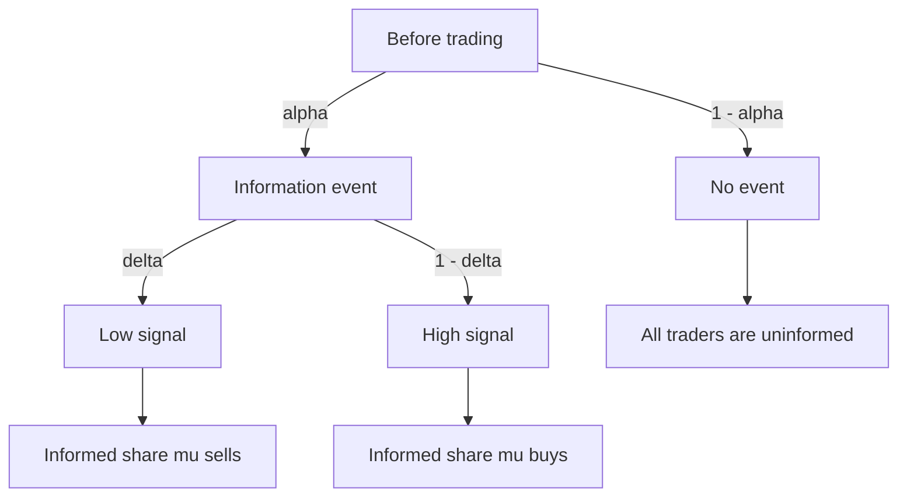

# Topic 1: Information-Based Models

These notes follow the deck "3. Information based Models", slides 1 to 47, in the slide order.

Everything in this file is exam material. A ⭐ marks what to know without notes. Worked examples use made-up numbers to practise the slide formulas.

| Model | What it adds | What the dealer does | Main result |
|---|---|---|---|
| Bagehot (1971) | Some traders know more | Recovers losses from the uninformed | The spread exists because of information |
| Copeland and Galai (1983) | A profit function for the dealer | Balances expected gains and losses | The spread is the price of a free option |
| Glosten and Milgrom (1985) | Learning from each trade | Quotes the expected value given the trade | The spread exists with zero cost and zero profit |
| Kyle (1985) | A strategic insider who chooses size | Prices the total order flow | Price impact is $\lambda = \sigma_0 / 2\sigma_y$ |
| Easley and O'Hara (1987) | Trade size and event uncertainty | Quotes a price for each size | Size and sequence of trades move prices |

## 0. Words to know first

- **Fundamental value:** It is what the asset is truly worth. It is written $V$, $v$ or $P$.
- **Bid and ask:** The dealer buys at the bid. The dealer sells at the ask.
- **Spread:** It is the ask minus the bid.
- **Informed trader:** This trader knows something about the value that the price does not show yet.
- **Uninformed trader:** This trader trades for cash needs or portfolio needs. They are also called liquidity traders or noise traders.
- **Adverse selection:** The dealer loses because the better informed trader picks the profitable side.
- **Risk neutral:** The person cares only about expected profit. Risk does not matter to them.
- **Prior and posterior:** The prior is the belief before seeing a trade. The posterior is the belief after seeing it.

## 1. Role of information (slide 2)

1. **Transaction cost is not enough:** The market price of an asset did not always depend on transaction cost.
2. **Information flow matters:** New information also moves prices.
3. **Some traders are superior:** Market participants do not have equal information.
4. **The dealer faces a new risk:** Adverse selection is a risk to the wealth of the market maker.

| Point | Inventory models | Information models |
|---|---|---|
| Dealer's problem | The dealer holds an unwanted position | The trader may know more |
| Reason for the spread | Holding cost, order cost and ruin risk | Adverse selection |
| What a trade changes | The inventory | The belief about value |
| Price effect | Mostly temporary | Permanent, as far as the trade has information |

## 2. The five theories (slide 3)

1. Bagehot (1971)
2. Copeland and Galai (1983)
3. Glosten and Milgrom (1985)
4. Kyle (1985)
5. Easley and O'Hara (1987)

Each theory fixes a weakness of the theory before it.

## 3. Bagehot (1971): "The only game in town" (slide 4)

a. **There are two gains.**
   - **Market gain:** It comes when the whole market rises. Everyone can earn it.
   - **Trading gain:** It comes from trading better than others. Everyone cannot earn it.

b. **The average investor loses over time.** The cost of information causes this loss.

c. **The market maker stands in the middle.**
   - The market maker supplies liquidity to everyone.
   - The market maker loses to informed traders.
   - The market maker must recover that loss from uninformed traders.

d. **The spread balances the two.** A wider spread reduces the loss to the informed. It also raises the gain from the uninformed.

```text
Informed traders  <--- dealer loses ---  DEALER  <--- dealer gains ---  Uninformed traders
```

> **Exam:** Bagehot has no equations. Write three things: the two gains, the two kinds of traders, and the spread as the balance.

## 4. Copeland and Galai (1983): "Information effects on the bid-ask spread" (slides 5 to 11)

**Why this model is needed:** Bagehot gave only words. Copeland and Galai turn the idea into a profit function.

### 4.1 The idea

a. The model has one period. Some fraction of the traders has superior information.

b. The model can be read in two ways.
   - **Profit view:** A risk-neutral dealer sets the bid and ask to maximize expected profit.
   - **Option view:** The ask is a free call option. The bid is a free put option. The dealer gives both options to traders.

c. The option view works like this.
   - A trader may buy at $P_A$ when the true value is higher. This is a call with strike $P_A$.
   - A trader may sell at $P_B$ when the true value is lower. This is a put with strike $P_B$.

### 4.2 Assumptions

- **A1:** There is a single risk-neutral dealer.
- **A2:** Informed traders know the actual price $P$.
- **A3:** Uninformed traders know only the general price. Call it $P_0$.
- **A4:** Traders arrive with given probabilities, as in inventory models.
- **A5:** All trades have the same fixed size.
- **A6:** Quotes are instantaneous. No time passes between setting the quote and trading.

### 4.3 Notation

| Symbol | Meaning |
|---|---|
| $\pi_I$ | Probability that the trader is informed |
| $1-\pi_I$ | Probability that the trader is uninformed |
| $\pi_{BL}$ | Probability that an uninformed trader buys |
| $\pi_{SL}$ | Probability that an uninformed trader sells |
| $\pi_{NL}$ | Probability that an uninformed trader does not trade |
| $f(P)$ | Density of the true price |
| $P_A$ and $P_B$ | Ask and bid |

### 4.4 ⭐ Solution step by step

**Step 1: Find the loss to an informed trader.**

- The informed trader buys only if $P \gt P_A$. The dealer then loses $P-P_A$.
- The informed trader sells only if $P \lt P_B$. The dealer then loses $P_B-P$.
- Average these losses over all possible prices. This is equation 3.1.

$$L_I=\int_{P_A}^{\infty}(P-P_A)f(P) dP+\int_{0}^{P_B}(P_B-P)f(P) dP$$

**Step 2: Find the gain from an uninformed trader.**

- A purchase gives the dealer $P_A-P_0$.
- A sale gives the dealer $P_0-P_B$.
- No trade gives zero. This is equation 3.2. The slide writes $P$ in place of $P_0$.

$$G_U=\pi_{BL}(P_A-P_0)+\pi_{SL}(P_0-P_B)+\pi_{NL}(0)$$

**Step 3: Weight the gain and the loss.**

- The gain comes with probability $1-\pi_I$.
- The loss comes with probability $\pi_I$.

$$\max_{P_A, P_B}\left[(1-\pi_I)G_U-\pi_I L_I\right]$$

**Step 4: Add the participation condition.**

- The dealer stays only if expected profit is not negative.
- With competition, expected profit becomes zero.

$$(1-\pi_I)G_U-\pi_I L_I\ge 0$$

**Step 5: Read the trade-off.**

- A wider spread makes $L_I$ smaller.
- A wider spread earns more per uninformed trade.
- A wider spread also drives uninformed traders away. This stops the spread from growing without limit.

### 4.5 Worked example

The true price is 110 or 90 with equal chance. So $P_0=100$. Also $\pi_I=0.2$ and $\pi_{BL}=\pi_{SL}=0.5$. The quotes are $100+h$ and $100-h$. Competition makes profit zero.

1. The gain is $G_U=0.5h+0.5h=h$.
2. The loss is $L_I=0.5(10-h)+0.5(10-h)=10-h$.
3. Zero profit gives $0.8h=0.2(10-h)$.
4. Expand the right side. It gives $0.8h=2-0.2h$.
5. Add $0.2h$ to both sides. It gives $h=2$.

**Answer:** The ask is 102, the bid is 98 and the spread is 4.

### 4.6 ⭐ Findings and limitations

- **Information asymmetry:** It explains the dealer's spread.
- **Higher spread:** The spread rises with the price level and with the variance of return.
- **Lower spread:** The spread falls with market activity, depth and continuity.
- **First limitation:** The model has only one period.
- **Second limitation:** New information is revealed instantly through the trade.

> **Exam:** Do not stop at the objective function. Explain the sign of each term and the option view.

## 5. Glosten and Milgrom (1985): "Bid, ask and transaction prices in a specialist market with heterogeneously informed traders" (slides 12 to 24)

**Why this model is needed:** Copeland and Galai have one period. Their dealer does not learn. Here the dealer learns from every trade.

### 5.1 The idea

- **Competitive market:** The dealer earns zero expected profit.
- **Trades carry information:** Informed traders sell on bad news. They buy on good news.
- **Types are hidden:** The dealer serves informed traders and liquidity traders. The dealer cannot tell who is who.
- **The trade is a signal:** The dealer updates the belief about value using the type of trade, which is a buy or a sale.

### 5.2 Assumptions

- **A1:** The value is $V_L$ with probability $\theta$. It is $V_H$ with probability $1-\theta$.
- **A2:** A fraction $\mu$ of traders are insiders. The rest, $1-\mu$, are liquidity traders.
- **A3:** Insiders buy on good news and sell on bad news.
- **A4:** A liquidity trader buys or sells with probability 0.5 each.
- **A5:** Trading is sequential. One trader arrives at a time and trades one unit or none.
- **A6:** The dealer is risk neutral and competitive.
- **A7:** Transaction cost is zero.

The profit of insiders equals the loss of liquidity traders.

> **Slide error:** The slides change the meaning of $\theta$. Slides 14, 16 and 17 use it for good news. Slides 18 and 20 and equation 4.27 use it for bad news. These notes always use $\theta=\Pr(V_L)$, because the final formulas need it. Define $\theta$ in your first line in the exam.

### 5.3 The event tree (slides 16 to 18)

The tree has three stages. Nature chooses the news. A trader learns it or does not. The trader then buys or sells.

```text
                                           buy        sell
                     informed   (mu)        1          0
good news (1-theta)
                     uninformed (1-mu)     0.5        0.5

                     informed   (mu)        0          1
bad news  (theta)
                     uninformed (1-mu)     0.5        0.5
```

| Branch | Probability with a buy | Probability with a sale |
|---|---|---|
| Good news, informed | $(1-\theta)\mu$ | 0 |
| Good news, uninformed | $0.5(1-\theta)(1-\mu)$ | $0.5(1-\theta)(1-\mu)$ |
| Bad news, informed | 0 | $\theta\mu$ |
| Bad news, uninformed | $0.5\theta(1-\mu)$ | $0.5\theta(1-\mu)$ |

A sale at time 1 can come from three branches. An informed sale on good news is impossible.

Slide 16 is more general. It lets uninformed traders buy with probability $\gamma^B$ and sell with probability $\gamma^S$. In our notation it gives these totals.

$$\Pr(B)=(1-\mu)\gamma^B+(1-\theta)\mu$$

$$\Pr(S)=(1-\mu)\gamma^S+\theta\mu$$

### 5.4 Bayes rule (slides 21 to 23)

1. The data can happen with the event or without it. This is equation 3.10.

$$\Pr(D)=\Pr(D\mid E)\Pr(E)+\Pr(D\mid E^c)\Pr(E^c)$$

2. The joint probability can be written in two ways. This is equation 3.11.

$$\Pr(D,E)=\Pr(E\mid D)\Pr(D)=\Pr(D\mid E)\Pr(E)$$

3. Divide by $\Pr(D)$. This is equation 3.12.

$$\Pr(E\mid D)=\frac{\Pr(D\mid E)\Pr(E)}{\Pr(D)}$$

4. Put step 1 into the denominator. This is equation 3.13.

$$\Pr(E\mid D)=\frac{\Pr(D\mid E)\Pr(E)}{\Pr(D\mid E)\Pr(E)+\Pr(D\mid E^c)\Pr(E^c)}$$

5. Read the result in words. The posterior equals the prior times the likelihood, divided by the marginal likelihood. This is equation 3.14.

### 5.5 Regret-free quotes (slide 15)

- A quote is regret free if it is still fair after the trade happens.
- The ask is the expected value given a buy. This is equation 4.23.
- The bid is the expected value given a sale. This is equation 4.24.

$$a=E[V\mid B]=V_L\Pr(V_L\mid B)+V_H\Pr(V_H\mid B)$$

$$b=E[V\mid S]=V_L\Pr(V_L\mid S)+V_H\Pr(V_H\mid S)$$

### 5.6 ⭐ Solution step by step

**Step 1: Find the probability of a buy.** Add the buy column of the table.

$$\Pr(B)=0.5\theta(1-\mu)+(1-\theta)\mu+0.5(1-\theta)(1-\mu)$$

Join the two uninformed terms. Their total is $0.5(1-\mu)$.

$$\Pr(B)=0.5(1-\mu)+\mu-\theta\mu$$

Take 0.5 outside. This is equation 4.27.

$$\Pr(B)=0.5[1+\mu(1-2\theta)]$$

**Step 2: Find the probability of a sale.** Every trade is a buy or a sale, so subtract from 1.

$$\Pr(S)=1-\Pr(B)=0.5[1-\mu(1-2\theta)]$$

**Step 3: Update after a buy.** Use Bayes rule, which is equation 4.26. Only an uninformed trader buys on bad news.

$$\Pr(V_L\mid B)=\frac{0.5\theta(1-\mu)}{\Pr(B)}=\frac{\theta(1-\mu)}{1+\mu(1-2\theta)}$$

$$\Pr(V_H\mid B)=\frac{(1-\theta)(1+\mu)}{1+\mu(1-2\theta)}$$

**Step 4: Update after a sale.** Use the sale column and Bayes rule.

$$\Pr(V_L\mid S)=\frac{\theta(1+\mu)}{1-\mu(1-2\theta)}$$

$$\Pr(V_H\mid S)=\frac{(1-\theta)(1-\mu)}{1-\mu(1-2\theta)}$$

> **Slide error:** Equation 4.28 prints $\Pr(V_L\mid B)$ as $(1-\theta)(1-\mu)/[1-\mu(1-2\theta)]$. That is true only when $\theta$ means good news. It does not agree with equations 4.27 and 4.29. Use Step 3.

**Step 5: Write the ask.** Put Step 3 into equation 4.23. This is equation 4.29.

$$a=\frac{\theta(1-\mu)V_L+(1-\theta)(1+\mu)V_H}{1+\mu(1-2\theta)}$$

**Step 6: Write the bid.** Put Step 4 into equation 4.24. This is equation 4.30.

$$b=\frac{\theta(1+\mu)V_L+(1-\theta)(1-\mu)V_H}{1-\mu(1-2\theta)}$$

**Step 7: Write both quotes as a distance from the low value.** The two posteriors add to 1, so this is allowed. Let $k=1-2\theta$.

$$a=V_L+(V_H-V_L)\frac{(1-\theta)(1+\mu)}{1+\mu k}$$

$$b=V_L+(V_H-V_L)\frac{(1-\theta)(1-\mu)}{1-\mu k}$$

**Step 8: Subtract.** The two $V_L$ terms cancel. Use a common denominator.

$$s=(V_H-V_L)(1-\theta)\frac{(1+\mu)(1-\mu k)-(1-\mu)(1+\mu k)}{1-\mu^2k^2}$$

Expand the numerator. It is $1-\mu k+\mu-\mu^2k-1-\mu k+\mu+\mu^2k$. This equals $2\mu(1-k)$. Since $1-k=2\theta$, it equals $4\theta\mu$. This gives equation 4.31.

$$s=a-b=\frac{4\theta(1-\theta)\mu(V_H-V_L)}{1-(1-2\theta)^2\mu^2}$$

**Step 9: Take the special case.** Put $\theta=0.5$. Then $1-2\theta=0$.

$$s=\mu(V_H-V_L)$$

**Conclusion:** The spread is positive with zero cost and zero profit. It rises with $\mu$. This spread is pure adverse selection.

### 5.7 ⭐ Worked example

Take $V_H=110$, $V_L=90$, $\theta=0.3$ and $\mu=0.4$.

1. The prior value is $0.3(90)+0.7(110)=104$.
2. The term $\mu(1-2\theta)$ is $0.4(0.4)=0.16$.
3. The probability of a buy is $0.5(1.16)=0.58$. The probability of a sale is 0.42.
4. The ask is $[0.18(90)+0.98(110)]/1.16=106.897$.
5. The bid is $[0.42(90)+0.42(110)]/0.84=100$.
6. The spread is 6.897.
7. The average transaction price is $0.58(106.897)+0.42(100)=104$. It equals the prior value.

Now suppose a buy happens. The dealer learns from it.

1. The new $\theta$ is $\Pr(V_L\mid B)=0.18/1.16=0.1552$.
2. The new ask is 108.541. The new bid is 104.
3. Both quotes move up after a buy.

### 5.8 ⭐ Findings

- **Simple description:** The model explains the adverse selection cost. The dealer puts it in the spread to avoid losses.
- **Beliefs change:** Information affects the beliefs of the dealer.
- **Quotes change:** The dealer updates quotes by learning from the arrival of trades.
- **Difference from Copeland and Galai:** Their spread is a function of expected gains and losses. This spread comes from beliefs given each trade.
- **Martingale:** The price is a martingale with respect to the dealer's information. The best forecast of the next price is the present price.
- **Efficiency:** The market is semi-strong efficient. Public information cannot predict the future price better.

> **Exam:** This is the most likely numerical. Draw the tree first. Then write the buy probability, the posterior, the ask, the bid and the spread. Finish with one line of meaning.

## 6. Kyle (1985): "Continuous auctions and insider trading" (slides 25 to 32)

**Why this model is needed:** The insider in Glosten and Milgrom trades one unit and does not think about price impact. Kyle's insider chooses the size strategically.

### 6.1 The idea and the players

- **Strategic insider:** One risk-neutral informed trader knows how their order moves the price.
- **Noise traders:** They trade a random amount.
- **Market makers:** They are competitive and risk neutral.
- **Batch auction:** All orders clear at one price. So the bid-ask spread is not relevant.
- **Simple setting:** There is one period and one risky security.

### 6.2 Questions the model answers (slide 26)

1. How quickly does private information enter the price?
2. How valuable is private information to an insider?
3. How does noise trading affect price volatility?
4. What decides the liquidity of a market?

### 6.3 Assumptions

- **A1:** The final value is $v\sim N(p_0,\sigma_0^2)$. Only the insider knows it.
- **A2:** Noise demand is $y\sim N(0,\sigma_y^2)$. It is independent of $v$.
- **A3:** The insider knows $v$ but not $y$. The insider submits $x(v)$.
- **A4:** The dealer sees only the total $z=x+y$. The dealer sets $p(z)$.
- **A5:** Competition gives zero expected profit. So $p=E[v\mid z]$.
- **A6:** The price rule is linear. It is $p(z)=\lambda z+\mu$, as in equation 4.4.

Here $\lambda$ is inverse liquidity. A lower $\lambda$ means lower price impact. The symbol $\mu$ is an intercept here. It is not the share of insiders.

> **Slide gap:** Slide 28 says that the dealer sets the price to optimize profit. In Kyle, competition forces zero expected profit. Use A5.

### 6.4 ⭐ Solution step by step

**Step 1: Write the insider's profit.** This is equation 4.3.

$$\pi_I=x(v-p)$$

**Step 2: Take the expectation.** Put in the price rule and use $E[y]=0$. This is equation 4.5.

$$E[\pi_I]=x(v-\lambda x-\mu)$$

**Step 3: Maximize.** Set the derivative to zero. The second derivative is $-2\lambda$, so it is a maximum.

$$v-2\lambda x-\mu=0$$

$$x=\frac{v-\mu}{2\lambda}$$

This is equation 4.6. The insider trades less when $\lambda$ is higher.

**Step 4: Write the order as a line.** This is equation 4.7.

$$x=a+\beta v$$

$$a=-\frac{\mu}{2\lambda},\qquad \beta=\frac{1}{2\lambda}$$

**Step 5: Let the dealer learn.** The order flow is $z=a+\beta v+y$. So its mean is $a+\beta p_0$. Its variance is $\beta^2\sigma_0^2+\sigma_y^2$. Its covariance with $v$ is $\beta\sigma_0^2$. The rule for normal variables gives equation 4.8.

$$E[v\mid z]=p_0+\frac{\beta\sigma_0^2}{\sigma_y^2+\beta^2\sigma_0^2}(z-a-\beta p_0)$$

**Step 6: Match the slope.** A5 says this must equal $\lambda z+\mu$.

$$\lambda=\frac{\beta\sigma_0^2}{\sigma_y^2+\beta^2\sigma_0^2}$$

Put $\beta=1/2\lambda$ and multiply by the denominator.

$$\lambda\sigma_y^2+\frac{\sigma_0^2}{4\lambda}=\frac{\sigma_0^2}{2\lambda}$$

Subtract the second term from both sides. Then multiply by $\lambda$.

$$\lambda^2\sigma_y^2=\frac{\sigma_0^2}{4}$$

Take the positive root. This is equation 4.11.

$$\lambda^{\ast}=\frac{\sigma_0}{2\sigma_y}$$

**Step 7: Match the intercept.** It is $\mu=p_0-\lambda(a+\beta p_0)$. Put in $a$ and $\beta$.

$$\mu=p_0+\frac{\mu}{2}-\frac{p_0}{2}$$

Subtract $\mu/2$ from both sides. Multiply by 2. This is equation 4.10.

$$\mu^{\ast}=p_0$$

**Step 8: Find the insider's rule.** Put $\lambda^{\ast}$ and $\mu^{\ast}$ into Step 4.

$$\beta^{\ast}=\frac{\sigma_y}{\sigma_0},\qquad a^{\ast}=-\frac{p_0\sigma_y}{\sigma_0}$$

$$x=\frac{\sigma_y}{\sigma_0}(v-p_0)$$

> **Slide error:** Equation 4.9 has no minus sign on $a^{\ast}$. The minus sign is needed, because $a=-\mu/2\lambda$.

**Step 9: Find how much is revealed.** The remaining variance is the prior variance minus covariance squared over the variance of $z$. Here $\beta^2\sigma_0^2=\sigma_y^2$.

$$\mathrm{Var}(v\mid z)=\sigma_0^2-\frac{\beta^2\sigma_0^4}{2\sigma_y^2}=\frac{\sigma_0^2}{2}$$

Half of the private information enters the price in one period.

**Step 10: Find the insider's expected profit.** Put Step 3 into Step 2. It gives $(v-p_0)^2/4\lambda$. The average of $(v-p_0)^2$ is $\sigma_0^2$. This is equation 4.13.

$$E[\pi_I]=\frac{\sigma_0^2}{4\lambda}=\frac{\sigma_y\sigma_0}{2}$$

**Step 11: Find the loss of noise traders.** Only the $\lambda y$ part of the price is related to $y$. This is equation 4.14.

$$E[\pi_L]=E[y(p-v)]=\lambda\sigma_y^2=\frac{\sigma_y\sigma_0}{2}$$

**Conclusion:** The trading cost of noise traders equals the insider's profit. The dealer's expected net profit is zero.

### 6.5 ⭐ What changes what

| Change | Price impact | Insider's profit | Meaning |
|---|---|---|---|
| Higher $\sigma_0$ | Rises | Rises | More private information makes the market less liquid |
| Higher $\sigma_y$ | Falls | Rises | More noise hides the insider and makes the market deeper |

### 6.6 Worked example

Take $p_0=100$, $\sigma_0=10$, $\sigma_y=1000$, $v=110$ and $y=-400$.

1. The price impact is $\lambda=10/2000=0.005$.
2. The slope is $\beta=1000/10=100$.
3. The insider buys $x=100(110-100)=1000$.
4. The dealer sees $z=1000-400=600$.
5. The price is $p=100+0.005(600)=103$.
6. The realized insider profit is $1000(110-103)=7000$.
7. The expected profit before $v$ is known is $0.5(1000)(10)=5000$.
8. The remaining variance is $100/2=50$.

### 6.7 ⭐ Findings (slide 32)

- **Noise distorts information:** Order flow from liquidity traders hides the insider's information. A large random buy makes the dealer raise the price.
- **Who pays:** Liquidity traders fund the insider's profit. The dealer's net loss is zero.
- **Many periods:** The insider splits the order into small pieces. The size of the pieces changes over time.

> **Slide gap:** Slide 32 says that noise distorts the information "available to informed traders". The insider already knows $v$. The noise hides the information from the dealer.

## 7. Easley and O'Hara (1987): "Price, trade size, and information in securities markets" (slides 33 to 47)

**Why this model is needed:** Earlier sequential models used one fixed trade size. They also assumed that information exists.

### 7.1 What is new and what is examined (slides 33 and 34)

- **Extension:** The model extends the sequential trade model of Glosten and Milgrom.
- **Same dealers:** Market makers are competitive and risk neutral. Their quotes change with trades.
- **Different sizes:** Traders can trade different quantities.
- **Dual uncertainty:** The dealer does not know whether information exists. The dealer also does not know its direction.
- **Object of study:** The paper studies price movements, trade size and the spread of information.
- **Main message:** The size and the sequence of trades both move prices and pass information.

### 7.2 Assumptions (slides 35 to 37)

- **A1:** The value $V$ is random. An information event is a signal $s$. It is low or high.
- **A2:** The signal is low with probability $\delta$ and high with probability $1-\delta$. Here $0\lt\delta\lt 1$.
- **A3:** Write $\underline{V}=E[V\mid s=L]$ and $\bar{V}=E[V\mid s=H]$. Here $\bar{V}\gt\underline{V}$.
- **A4:** An event happens before the trading day with probability $\alpha$. Here $0\lt\alpha\le 1$. An event will happen at some time. It happens only between trading days.
- **A5:** After an event, some traders see the signal. The expected share of trades by them is $\mu$.
- **A6:** Informed traders are risk neutral. They are many, so they act competitively.
- **A7:** The dealer and the uninformed know neither the event nor the signal.
- **A8:** There is no transaction cost and no risk aversion. Costs are ignored because the period is short.
- **A9:** Uninformed demand is given from outside. It comes from the timing of income and consumption, or from portfolio needs. These needs differ across people.

The value without news is the prior mean.

$$V^{\ast}=\delta\underline{V}+(1-\delta)\bar{V}$$

### 7.3 Market structure (slides 37 to 40)

a. **There are two sizes on each side.**
   - Buyers want $B^1$ or $B^2$ units, with $0\lt B^1\lt B^2$.
   - Sellers offer $S^1$ or $S^2$ units, with $0\lt S^1\lt S^2$.
   - $X_B^i$ and $X_S^i$ are the positive shares of uninformed traders who want each size.

b. **Trading is sequential.**
   1. A trader arrives according to these probabilities.
   2. The trader asks competing dealers for prices at each quantity.
   3. The trader may choose not to trade.
   4. An uninformed trader takes the best quote for the desired quantity.
   5. An informed trader takes the quote with the highest profit.
   6. A trader who is indifferent picks a dealer at random.

c. **Dealers set schedules.**
   - Each dealer picks a profit-maximizing schedule, given the schedules of the others.
   - At the start of the day, the dealer sets a price for each quantity.
   - Each trade has zero expected profit.
   - Prices are needed only for the four quantities.



### 7.4 ⭐ Two equilibria (slides 41 and 43)

| Point | Separating equilibrium | Pooling equilibrium |
|---|---|---|
| Size chosen by the informed | Mainly large | Both small and large |
| Number of informed traders | Relatively few | Many |
| Can the dealer separate types? | Yes, partly by size | No, the types are hard to tell apart |
| Where is the spread? | Only on large trades | On both sizes |
| Effect on price | Large trades get worse prices | Prices are averaged and may hide the true price |

In pooling, both types choose the same action at the same price with positive probability.

### 7.5 ⭐ Separating prices step by step (slide 42)

**Step 1: List the ways a large sale can happen.**

| State | Joint probability with a large sale |
|---|---|
| Event and low signal | $\alpha\delta[\mu+(1-\mu)X_S^2]$ |
| Event and high signal | $\alpha(1-\delta)(1-\mu)X_S^2$ |
| No event | $(1-\alpha)X_S^2$ |

**Step 2: Add them.**

$$\Pr(S^2)=X_S^2(1-\alpha\mu)+\alpha\delta\mu$$

**Step 3: Find the expected value.** Uninformed sales are worth $V^{\ast}$ on average. Informed sales are worth $\underline{V}$.

$$b_2=\frac{X_S^2(1-\alpha\mu)V^{\ast}+\alpha\delta\mu\underline{V}}{X_S^2(1-\alpha\mu)+\alpha\delta\mu}$$

**Step 4: Take $V^{\ast}$ outside.** Add and subtract $\alpha\delta\mu V^{\ast}$ in the numerator.

$$b_2=V^{\ast}-\frac{\alpha\mu\delta(V^{\ast}-\underline{V})}{X_S^2(1-\alpha\mu)+\alpha\delta\mu}$$

**Step 5: Use the variance.** The definition gives $V^{\ast}-\underline{V}=(1-\delta)(\bar{V}-\underline{V})$. The variance of a two-point value is $\sigma_v^2=\delta(1-\delta)(\bar{V}-\underline{V})^2$.

$$b_2^{\ast}=V^{\ast}-\frac{\sigma_v^2}{\bar{V}-\underline{V}}\cdot\frac{\alpha\mu}{X_S^2(1-\alpha\mu)+\delta\alpha\mu}$$

**Step 6: Repeat the steps for a large buy.** The informed buy with a high signal, so $1-\delta$ replaces $\delta$ in the denominator.

$$a_2^{\ast}=V^{\ast}+\frac{\sigma_v^2}{\bar{V}-\underline{V}}\cdot\frac{\alpha\mu}{X_B^2(1-\alpha\mu)+(1-\delta)\alpha\mu}$$

**Step 7: Price small trades.** The informed never trade small here. So a first small trade has no adverse selection.

$$a_1=b_1=V^{\ast}$$

**Step 8: Check that the informed prefer the large size.** A buyer needs $B^2(\bar{V}-a_2)\ge B^1(\bar{V}-V^{\ast})$. Put in $a_2$ and divide.

$$\frac{B^2}{B^1}\ge 1+\frac{\alpha\mu(1-\delta)}{X_B^2(1-\alpha\mu)}$$

Separation holds when the large size is large enough, or when $\alpha\mu$ is small enough. Otherwise the informed also trade small, and pooling results.

**Conclusion:** The large-trade discount rises with $\alpha$, $\mu$ and the variance of value.

### 7.6 Pooling prices (slide 43)

Let a share $\phi_i$ of informed sellers choose size $i$. Use the same steps.

$$b_i=V^{\ast}-\frac{\sigma_v^2}{\bar{V}-\underline{V}}\cdot\frac{\alpha\mu\phi_i}{X_S^i(1-\alpha\mu)+\delta\alpha\mu\phi_i}$$

Both bids are now below $V^{\ast}$, so both sizes carry a spread. Informed sellers must earn the same profit at both sizes.

### 7.7 Spread calculation (slide 44)

The slide writes $H$ for an informed trader, $L$ for an uninformed trader and $C$ for costs and risk premium. It prints $B=E[V\mid H]-C$, $A=E[V\mid L]+C$ and $S=E[V\mid L]-E[V\mid H]+2C$.

> **Slide error:** The dealer cannot see the type of trader, so a quote cannot depend on it. The dealer sees only the side and the size. These are the correct forms for size $i$.

$$A_i=E[V\mid B^i]+C$$

$$B_i=E[V\mid S^i]-C$$

$$S_i=E[V\mid B^i]-E[V\mid S^i]+2C$$

The model itself assumes $C=0$.

### 7.8 ⭐ Price path after a block sale (slides 45 and 46)

```text
Figure 1: only the trader type is uncertain (an event is known)

V*    o
       \
b2      o---------o
        t+1      t+2

Figure 2: the trader type and the event are both uncertain

V*    o
       \
        \         o     partial recovery, still below V*
         \       /
b2        o-----
        t+1      t+2
```

- **At time t:** A small trade happens at $V^{\ast}$.
- **At time t+1:** A block sale pushes the price down to $b_2$.
- **At time t+2 in Figure 1:** A small trade says nothing new. The price stays at the low level.
- **At time t+2 in Figure 2:** A small trade comes only from an uninformed trader. It makes "no event" more likely. The price recovers partly.

### 7.9 Worked example

Take $\bar{V}=110$, $\underline{V}=90$, $\delta=0.5$, $\alpha=0.5$, $\mu=0.4$ and $X_S^2=X_B^2=0.25$.

1. The prior value is $V^{\ast}=100$. The variance is 100.
2. The product $\alpha\mu$ is 0.2.
3. The denominator is $0.25(0.8)+0.5(0.2)=0.3$.
4. The adjustment is $(100/20)(0.2/0.3)=3.333$.
5. The large bid is 96.667. The large ask is 103.333. Both small prices are 100.
6. Separation needs $B^2/B^1\ge 1.5$.
7. A small trade after a block sale happens at 97.391. This shows the partial recovery.

### 7.10 ⭐ Findings (slide 47)

- **Block trades:** Their price effects come from informed trading.
- **Quantity matters:** Trade size is correlated with private information.
- **Informed preference:** At any given price, informed traders prefer larger amounts.
- **Optimal pricing:** The price depends on quantity. Large-trade prices show a higher probability of informed trading.

## 8. ⭐ Compare the five theories

| Point | Bagehot | Copeland and Galai | Glosten and Milgrom | Kyle | Easley and O'Hara |
|---|---|---|---|---|---|
| Time | No formal model | One period | Sequential | One batch, later many | Sequential |
| Dealer | Loses and recovers | Maximizes profit | Earns zero profit | Earns zero profit | Earns zero profit |
| Informed trader | Not modelled | Takes a free option | Trades one unit | Chooses size strategically | Chooses one of two sizes |
| Does the dealer learn? | No | No | From direction | From net order flow | From direction, size and sequence |
| Liquidity measure | Spread | Spread | Spread | $1/\lambda$ | Spread at each size |
| Is the event certain? | Not modelled | Yes | Yes | Yes | No |

> **Exam:** The word "option" points to Copeland and Galai. "Regret free", "Bayes" and "sequential" point to Glosten and Milgrom. "Batch", "strategic" and "order flow" point to Kyle. "Size", "block" and "event uncertainty" point to Easley and O'Hara.
