# Topic 1: Information-Based Models

These notes follow the deck "3. Information based Models", slides 1 to 47, in the slide order.

Everything in this file is exam material. A ⭐ marks what to know without notes. Worked examples use made-up numbers to practise the slide formulas.

The table below is a map of the whole topic. Each row is one of the five models. The second column says what new feature the model brings. The third column says how the dealer behaves in that model. The last column gives the one result to remember.

| Model | What it adds | What the dealer does | Main result |
|---|---|---|---|
| Bagehot (1971) | Some traders know more | Recovers losses from the uninformed | The spread exists because of information |
| Copeland and Galai (1983) | A profit function for the dealer | Balances expected gains and losses | The spread is the price of a free option |
| Glosten and Milgrom (1985) | Learning from each trade | Quotes the expected value given the trade | The spread exists with zero cost and zero profit |
| Kyle (1985) | A strategic insider who chooses size | Prices the total order flow | Price impact is $\lambda = \sigma_0 / 2\sigma_y$ |
| Easley and O'Hara (1987) | Trade size and event uncertainty | Quotes a price for each size | Size and sequence of trades move prices |

Read the table from top to bottom. Bagehot only states the idea in words. Copeland and Galai write the dealer's profit as a formula. Glosten and Milgrom let the dealer learn from each trade. Kyle lets the informed trader choose how much to trade. Easley and O'Hara let trades have different sizes, and they let the dealer be unsure whether any news exists at all. Every symbol in the table, such as $\lambda$, is defined later in the section on that model.

## 0. Words to know first

These words appear in every model below. Each one is defined here once, so later sections can use it without stopping.

- **Fundamental value:** It is what the asset is truly worth. Nobody may know it exactly when trading happens. The notes write it as $V$, $v$ or $P$, because different papers use different letters.
- **Dealer:** The dealer is the person who stands ready to buy from anyone who wants to sell and to sell to anyone who wants to buy. The papers also call the dealer the market maker or the specialist.
- **Bid and ask:** These are the two prices the dealer posts. The dealer buys at the bid. The dealer sells at the ask. So a trader who wants to sell receives the bid, and a trader who wants to buy pays the ask.
- **Spread:** It is the ask minus the bid. It is what a trader loses by buying and then selling straight away.
- **Informed trader:** This trader knows something about the value that the price does not show yet. The notes also call this trader an insider.
- **Uninformed trader:** This trader trades for cash needs or portfolio needs, not because of news. They are also called liquidity traders or noise traders.
- **Adverse selection:** The dealer must trade with anyone who arrives. The better informed trader picks the side that is profitable for them. So the dealer tends to sell just before the value rises and to buy just before the value falls. The dealer's loss from this is called adverse selection.
- **Probability:** It is a number between 0 and 1 that says how likely something is. The notes write $\Pr(A)$ for "the probability that $A$ happens".
- **Conditional probability:** $\Pr(A\mid B)$ means "the probability of $A$, counting only the cases in which $B$ happens". The bar is read as "given".
- **Expected value:** It is the average outcome, where each possible outcome is weighted by its probability. The notes write $E[X]$ for the expected value of $X$. For example, if $X$ is 10 or 20 with equal chance, then $E[X]=0.5(10)+0.5(20)=15$. $E[X\mid B]$ is the same average, counting only the cases in which $B$ happens.
- **Risk neutral:** The person cares only about expected profit. Risk does not matter to them. So a risk-neutral dealer accepts any trade whose expected profit is not negative.
- **Prior and posterior:** The prior is the belief before seeing a trade. The posterior is the belief after seeing it. A belief here means a set of probabilities, for example "the value is high with probability 0.7".

## 1. Role of information (slide 2)

This slide answers one question: why do we need new models after the inventory models? The inventory models explained the spread through the dealer's costs. Slide 2 makes four points that show what those models leave out.

1. **Transaction cost is not enough:** The market price of an asset did not always depend on transaction cost. So costs alone cannot explain how prices behave.
2. **Information flow matters:** New information also moves prices. When news arrives, the value of the asset changes, and the price must follow it.
3. **Some traders are superior:** Market participants do not have equal information. Some traders learn the news before others do.
4. **The dealer faces a new risk:** Adverse selection (defined in section 0) is a risk to the wealth of the market maker. When a better informed trader arrives, the dealer is likely to be on the losing side of the trade.

The table below compares the two families of models point by point.

| Point | Inventory models | Information models |
|---|---|---|
| Dealer's problem | The dealer holds an unwanted position | The trader may know more |
| Reason for the spread | Holding cost, order cost and ruin risk | Adverse selection |
| What a trade changes | The inventory | The belief about value |
| Price effect | Mostly temporary | Permanent, as far as the trade has information |

Walk through the rows. In inventory models, the dealer's worry is holding too much or too little of the asset. In information models, the worry is that the trader on the other side knows more. So the reason for the spread changes. Inventory models say the spread pays for holding cost, order cost and the risk of ruin. Information models say the spread pays for losses to informed traders.

A trade also changes something different in each family. In inventory models, a trade changes only how many units the dealer holds. In information models, a trade changes what the dealer believes the asset is worth. This leads to the last row. An inventory effect fades once the dealer gets back to the preferred position, so it is mostly temporary. An information effect does not fade, because the news is real. So it is permanent, to the extent that the trade carried information.

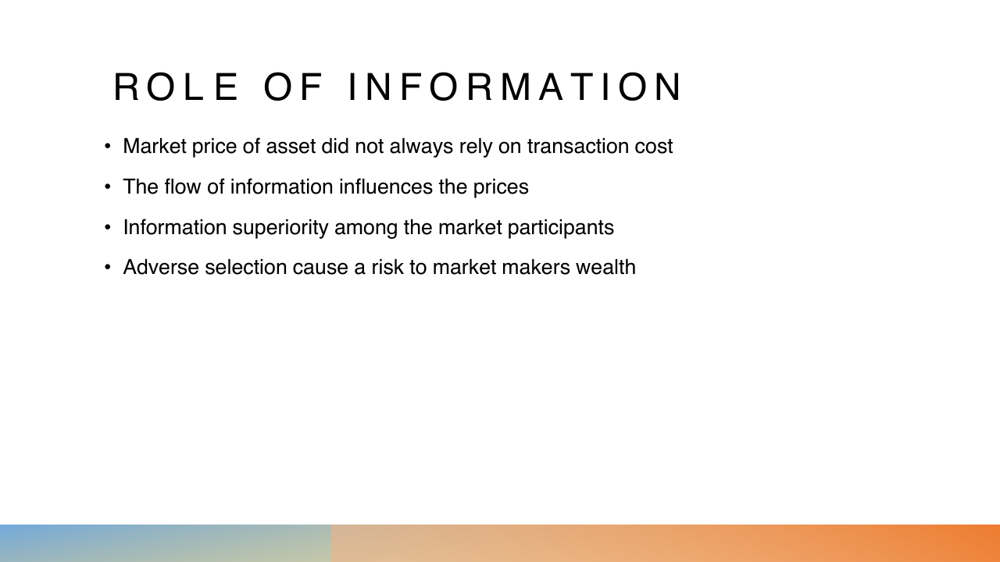

## 2. The five theories (slide 3)

Slide 3 lists the five information-based models in the order the course covers them.

1. Bagehot (1971)
2. Copeland and Galai (1983)
3. Glosten and Milgrom (1985)
4. Kyle (1985)
5. Easley and O'Hara (1987)

Each theory fixes a weakness of the theory before it. So each later section starts with a line called "Why this model is needed". That line names the weakness of the earlier model that the new model fixes. Reading these lines in order tells the story of the whole topic.


## 3. Bagehot (1971): "The only game in town" (slide 4)

Bagehot asks a simple question: if the dealer loses to traders who know more, how can the dealer stay in business? The answer comes in four parts.

a. **There are two gains.** An investor can make money in two different ways.
   - **Market gain:** It comes when the whole market rises. Everyone who holds the asset earns it at the same time. So everyone can earn it.
   - **Trading gain:** It comes from trading better than others. One trader gains only when the trader on the other side loses. So everyone cannot earn it at the same time.

b. **The average investor loses over time.** To trade better than others, a trader needs information. Getting information costs money. The average trader cannot beat the average trader, so on average nobody earns a trading gain. But everyone still pays the cost of information. So the cost of information causes the average investor to lose over time.

c. **The market maker stands in the middle.** The market maker meets both kinds of traders.
   - The market maker supplies liquidity to everyone. Liquidity here means the ability to buy or sell at once. The market maker trades with anyone who arrives.
   - The market maker loses to informed traders. They buy when they know the value is higher than the price, and they sell when they know it is lower.
   - The market maker must recover that loss from uninformed traders. Uninformed traders do not trade on news, so on average the dealer does not lose to them. The dealer earns the spread on each of their trades.

d. **The spread balances the two.** The spread is the tool the dealer uses to balance the loss and the gain. A wider spread reduces the loss to the informed, because each informed trade now gives them a smaller profit. It also raises the gain from the uninformed, because each uninformed trade now pays the dealer more. So the dealer sets the spread wide enough that the gain from the uninformed covers the loss to the informed.

The picture below shows the flow of money. The dealer sits in the middle. Money flows from the dealer to the informed traders on the left. Money flows from the uninformed traders on the right to the dealer.

```text
Informed traders  <--- dealer loses ---  DEALER  <--- dealer gains ---  Uninformed traders
```

> **Exam:** Bagehot has no equations. So a question on Bagehot is answered in words. Write three things. First, the two gains: market gain and trading gain. Second, the two kinds of traders: informed traders, to whom the dealer loses, and uninformed traders, from whom the dealer gains. Third, the spread as the balance between that loss and that gain.

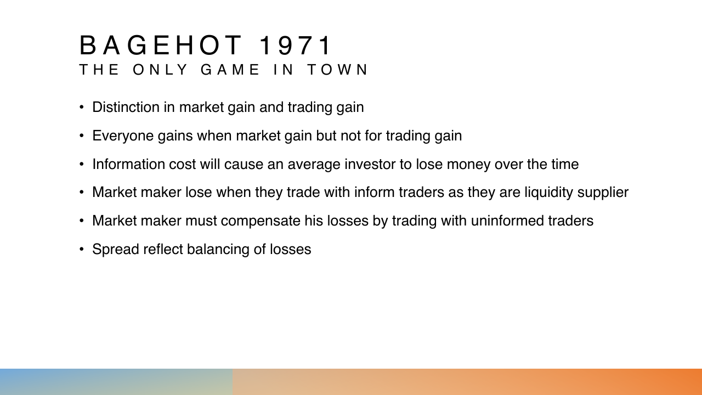

## 4. Copeland and Galai (1983): "Information effects on the bid-ask spread" (slides 5 to 11)

**Why this model is needed:** Bagehot gave only words. A verbal idea cannot tell us how wide the spread should be. Copeland and Galai turn the idea into a profit function. A profit function is a formula for the dealer's expected profit in terms of the bid and the ask. With it, the dealer can choose the quotes by maximizing the formula.

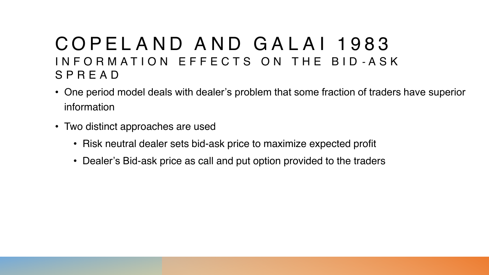

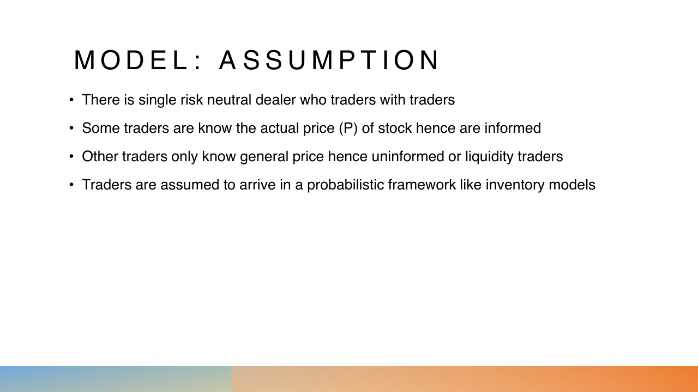

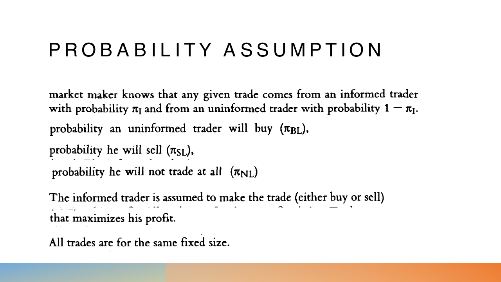

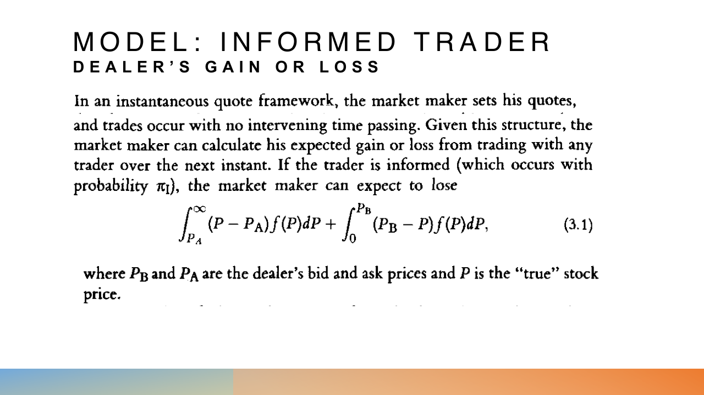

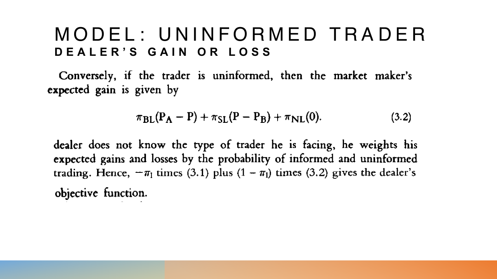

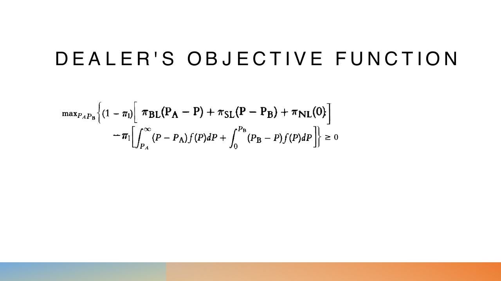

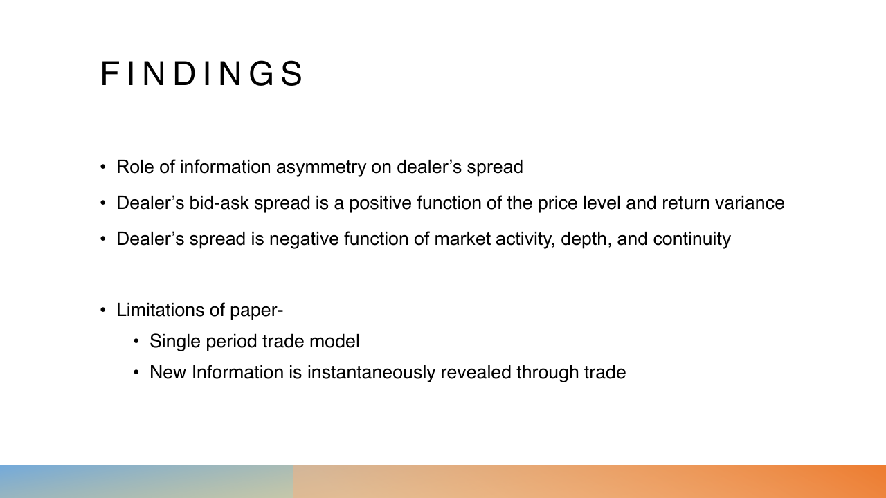

### 4.1 The idea

a. The model has one period. This means the dealer sets the quotes once, one trader arrives, and the game ends. Some fraction of the traders has superior information. The dealer does not know whether the trader in front of them is one of these.

b. The model can be read in two ways. Both readings describe the same model.
   - **Profit view:** A risk-neutral dealer (defined in section 0) sets the bid and ask to maximize expected profit.
   - **Option view:** The ask is a free call option. The bid is a free put option. The dealer gives both options to traders without charging for them.

c. The option view needs two definitions. A call option is the right, but not the duty, to buy an asset at a fixed price. A put option is the right, but not the duty, to sell an asset at a fixed price. The fixed price is called the strike. Now the option view works like this.
   - A trader may buy at $P_A$ when the true value is higher. The dealer has promised to sell at $P_A$, and the trader uses that promise only when it pays. This is exactly a call with strike $P_A$.
   - A trader may sell at $P_B$ when the true value is lower. The dealer has promised to buy at $P_B$, and the trader uses that promise only when it pays. This is exactly a put with strike $P_B$.

   An informed trader knows the true value, so they use these options only when the options are worth something. That is where the dealer's loss comes from.

### 4.2 Assumptions

The model rests on six assumptions. Each one is numbered so that the steps below can cite it.

- **A1:** There is a single risk-neutral dealer. So the dealer cares only about expected profit.
- **A2:** Informed traders know the actual price $P$. Here $P$ is the true value of the asset.
- **A3:** Uninformed traders know only the general price. Call it $P_0$. It is the average value that everyone expects.
- **A4:** Traders arrive with given probabilities, as in inventory models. So the chance that the next trader is informed is a known number.
- **A5:** All trades have the same fixed size. So each trade is one unit, and the dealer only needs one bid and one ask.
- **A6:** Quotes are instantaneous. No time passes between setting the quote and trading.

### 4.3 Notation

The table lists every symbol the solution uses.

| Symbol | Meaning |
|---|---|
| $\pi_I$ | Probability that the trader is informed |
| $1-\pi_I$ | Probability that the trader is uninformed |
| $\pi_{BL}$ | Probability that an uninformed trader buys |
| $\pi_{SL}$ | Probability that an uninformed trader sells |
| $\pi_{NL}$ | Probability that an uninformed trader does not trade |
| $f(P)$ | Density of the true price |
| $P_A$ and $P_B$ | Ask and bid |

Two rows need a word more. An uninformed trader does exactly one of three things: buys, sells or does not trade. So the three probabilities $\pi_{BL}$, $\pi_{SL}$ and $\pi_{NL}$ add up to 1. The density $f(P)$ describes how likely each true price is. Where $f(P)$ is large, true prices near $P$ are likely. Where it is small, they are unlikely.

### 4.4 ⭐ Solution step by step

The dealer meets two kinds of traders and does not know which kind has arrived. So the plan is this. First find the dealer's expected loss if the trader is informed. Then find the expected gain if the trader is uninformed. Then weight each by its probability and add.

**Step 1: Find the loss to an informed trader.**

The informed trader knows the true price $P$ (A2). So they buy only when buying gives them a profit.

- The informed trader buys only if $P \gt P_A$. The trader then pays $P_A$ for an asset worth $P$. The dealer receives $P_A$ and gives up an asset worth $P$. So the dealer then loses $P-P_A$.
- The informed trader sells only if $P \lt P_B$. The trader then receives $P_B$ for an asset worth $P$. The dealer pays $P_B$ for an asset worth only $P$. So the dealer then loses $P_B-P$.
- If $P$ is between $P_B$ and $P_A$, the informed trader does not trade, and the dealer loses nothing.
- The dealer does not know $P$. So the dealer averages these losses over all possible prices, using the density $f(P)$ as the weight. This is equation 3.1.

The first integral adds up the loss $P-P_A$ over every price above the ask. The second integral adds up the loss $P_B-P$ over every price from 0 up to the bid. The lower limit is 0 because a price cannot be negative.

$$L_I=\int_{P_A}^{\infty}(P-P_A)f(P) dP+\int_{0}^{P_B}(P_B-P)f(P) dP$$

So $L_I$ is the expected loss to one informed trader. It is exactly the value of the free call plus the value of the free put from section 4.1.

**Step 2: Find the gain from an uninformed trader.**

The uninformed trader knows only the general price $P_0$ (A3). So, from the dealer's point of view, the asset is worth $P_0$ on average when an uninformed trader arrives.

- A purchase gives the dealer $P_A-P_0$. The dealer receives $P_A$ and gives up an asset worth $P_0$ on average.
- A sale gives the dealer $P_0-P_B$. The dealer pays $P_B$ and receives an asset worth $P_0$ on average.
- No trade gives zero. Each of these outcomes is multiplied by its probability from the notation table. This is equation 3.2. The slide writes $P$ in place of $P_0$.

$$G_U=\pi_{BL}(P_A-P_0)+\pi_{SL}(P_0-P_B)+\pi_{NL}(0)$$

So $G_U$ is the expected gain from one uninformed trader. The last term is zero, so it drops out, but the slide writes it to show all three outcomes.

**Step 3: Weight the gain and the loss.**

The dealer does not know which kind of trader will arrive. So the dealer's expected profit is a weighted average of the two cases.

- The gain comes with probability $1-\pi_I$, because that is the chance that the trader is uninformed.
- The loss comes with probability $\pi_I$, because that is the chance that the trader is informed.

So the expected profit is $(1-\pi_I)G_U$ minus $\pi_I L_I$. The loss has a minus sign because it reduces profit. The dealer chooses the ask $P_A$ and the bid $P_B$ to make this as large as possible. The symbol $\max_{P_A, P_B}$ means "choose $P_A$ and $P_B$ to maximize what follows".

$$\max_{P_A, P_B}\left[(1-\pi_I)G_U-\pi_I L_I\right]$$

**Step 4: Add the participation condition.**

The dealer is free to leave the market. This gives a second condition.

- The dealer stays only if expected profit is not negative. A risk-neutral dealer (A1) would not stay to lose money on average.
- With competition, expected profit becomes zero. If the profit were positive, another dealer would offer slightly better quotes and take the business. This continues until the profit is zero.

$$(1-\pi_I)G_U-\pi_I L_I\ge 0$$

**Step 5: Read the trade-off.**

Now look at what happens when the dealer widens the spread, by raising $P_A$ and lowering $P_B$.

- A wider spread makes $L_I$ smaller. A higher $P_A$ means fewer true prices lie above the ask, and the gap $P-P_A$ is smaller. The same holds for the bid. So the free options are worth less.
- A wider spread earns more per uninformed trade. The gains $P_A-P_0$ and $P_0-P_B$ both grow.
- A wider spread also drives uninformed traders away. The chances $\pi_{BL}$ and $\pi_{SL}$ fall, because fewer uninformed traders want to pay a high price. This stops the spread from growing without limit.

So the best spread is where these forces balance. Making it wider would lose more uninformed business than it saves on informed losses.

### 4.5 Worked example

This example puts numbers into Steps 1 to 4. All numbers are made up for practice.

The true price is 110 or 90 with equal chance. So $P_0=100$, because the general price is the average, $0.5(110)+0.5(90)=100$. Also $\pi_I=0.2$, so one trader in five is informed. And $\pi_{BL}=\pi_{SL}=0.5$, so an uninformed trader buys or sells with equal chance and never stays out. The quotes are $100+h$ and $100-h$. Here $h$ is the half-spread, the distance from the middle price to each quote, and it lies between 0 and 10. Competition makes profit zero, as in Step 4.

1. The gain is $G_U=0.5h+0.5h=h$. A buy gives the dealer $(100+h)-100=h$, and a sale gives $100-(100-h)=h$. Each happens with probability 0.5, as in equation 3.2.
2. The loss is $L_I=0.5(10-h)+0.5(10-h)=10-h$. With probability 0.5 the true price is 110, which is above the ask $100+h$. The informed trader buys, and the dealer loses $110-(100+h)=10-h$. With probability 0.5 the true price is 90, which is below the bid $100-h$. The informed trader sells, and the dealer loses $(100-h)-90=10-h$. There are only two possible prices, so the integrals in equation 3.1 become this sum of two terms.
3. Zero profit gives $0.8h=0.2(10-h)$. This comes from $(1-0.2)h-0.2(10-h)=0$. Move the loss to the right side. Note that $1-0.2=0.8$.
4. Expand the right side. It gives $0.8h=2-0.2h$, because $0.2\times 10=2$.
5. Add $0.2h$ to both sides. It gives $h=2$, because $0.8h+0.2h=h$.

To check, put $h=2$ back in. The left side is $0.8(2)=1.6$. The right side is $0.2(10-2)=0.2(8)=1.6$. Both sides agree.

**Answer:** The ask is 102, the bid is 98 and the spread is 4. The ask is $100+2$, the bid is $100-2$, and the spread is $102-98$. So the dealer charges a spread of 4 even though there is no cost of any kind. The spread exists only because one trader in five is informed.

### 4.6 ⭐ Findings and limitations

The paper reports three findings and has two limitations.

- **Information asymmetry:** It explains the dealer's spread. Information asymmetry means that some traders know more than others. The worked example shows a spread with no costs at all.
- **Higher spread:** The spread rises with the price level and with the variance of return. Variance measures how widely the value can move. A wider range of possible values makes the free options in Step 1 worth more, so the dealer must charge more.
- **Lower spread:** The spread falls with market activity, depth and continuity. Depth means how much can be traded near the current price. Continuity means that trading goes on without gaps.
- **First limitation:** The model has only one period. So it cannot say what happens to the quotes after the first trade.
- **Second limitation:** New information is revealed instantly through the trade. The model does not show how the dealer slowly learns the information over many trades.

> **Exam:** Do not stop at the objective function. Explain the sign of each term and the option view. The gain term $(1-\pi_I)G_U$ is positive because the dealer earns the spread from uninformed traders. The loss term $\pi_I L_I$ has a minus sign because informed traders use the free call and the free put against the dealer.

## 5. Glosten and Milgrom (1985): "Bid, ask and transaction prices in a specialist market with heterogeneously informed traders" (slides 12 to 24)

**Why this model is needed:** Copeland and Galai have one period. Their dealer does not learn. A real dealer sees many trades and learns from each one. Here the dealer learns from every trade. So this model can say how the quotes change from one trade to the next.

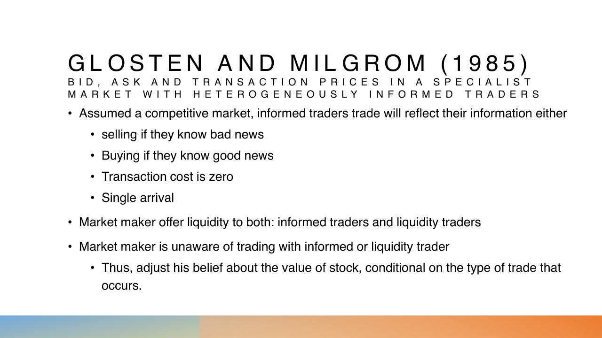

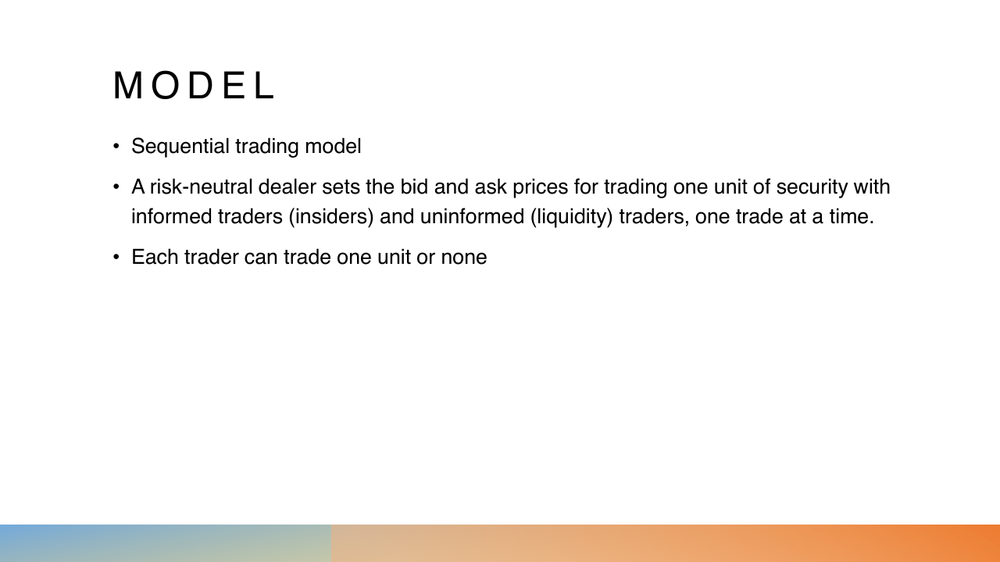

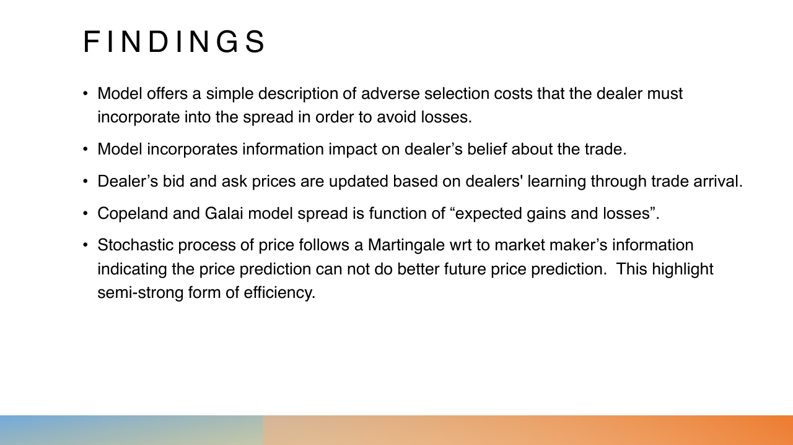

### 5.1 The idea

The model rests on four ideas.

- **Competitive market:** Many dealers compete. So, as in Step 4 of section 4.4, the dealer earns zero expected profit.
- **Trades carry information:** Informed traders sell on bad news. They buy on good news. So a buy is a hint of good news, and a sale is a hint of bad news.
- **Types are hidden:** The dealer serves informed traders and liquidity traders. The dealer cannot tell who is who. Both kinds of trader send the same kind of order.
- **The trade is a signal:** Because a trade is a hint, the dealer updates the belief about value using the type of trade, which is a buy or a sale. The tool for this update is Bayes rule, which section 5.4 explains.

### 5.2 Assumptions

The model needs seven assumptions. The steps in section 5.6 cite them by number.

- **A1:** The value is $V_L$ with probability $\theta$. It is $V_H$ with probability $1-\theta$. Here $V_L$ is the low value and $V_H$ is the high value. So $\theta$ is the prior probability of bad news.
- **A2:** A fraction $\mu$ of traders are insiders. The rest, $1-\mu$, are liquidity traders. So when a trader arrives, the chance that the trader is informed is $\mu$.
- **A3:** Insiders buy on good news and sell on bad news. They know the value, so they always pick the side that profits.
- **A4:** A liquidity trader buys or sells with probability 0.5 each. This does not depend on the news, because liquidity traders do not know the news.
- **A5:** Trading is sequential. One trader arrives at a time and trades one unit or none. The dealer sees each trade before the next trader arrives.
- **A6:** The dealer is risk neutral and competitive. So the dealer's expected profit is zero.
- **A7:** Transaction cost is zero. So the spread cannot come from costs.

These assumptions have one consequence. The dealer earns zero (A6) and there are no costs (A7). So the money that insiders make must come from someone else. The only other people are the liquidity traders. So the profit of insiders equals the loss of liquidity traders.

> **Slide error:** The slides change the meaning of $\theta$. Slides 14, 16 and 17 use it for good news. Slides 18 and 20 and equation 4.27 use it for bad news. These notes always use $\theta=\Pr(V_L)$, because the final formulas need it. In other words, $\theta$ is always the chance of the low value, which is bad news. If you mix the two meanings, you get the wrong formulas. Define $\theta$ in your first line in the exam.

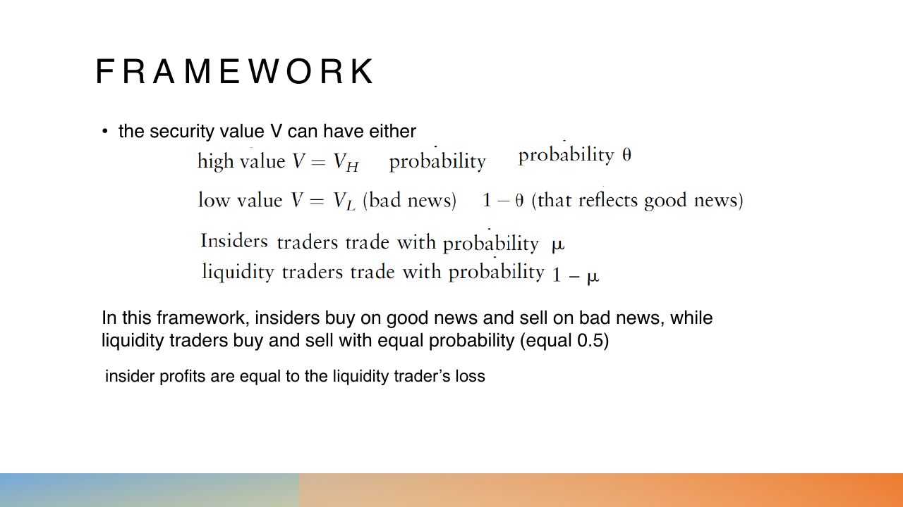

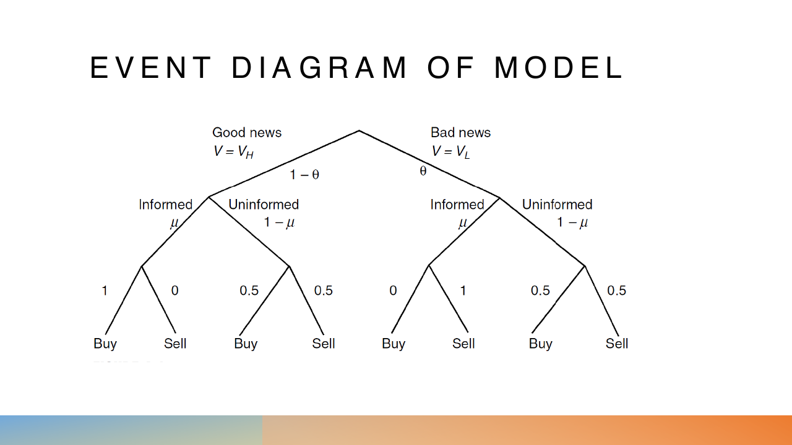

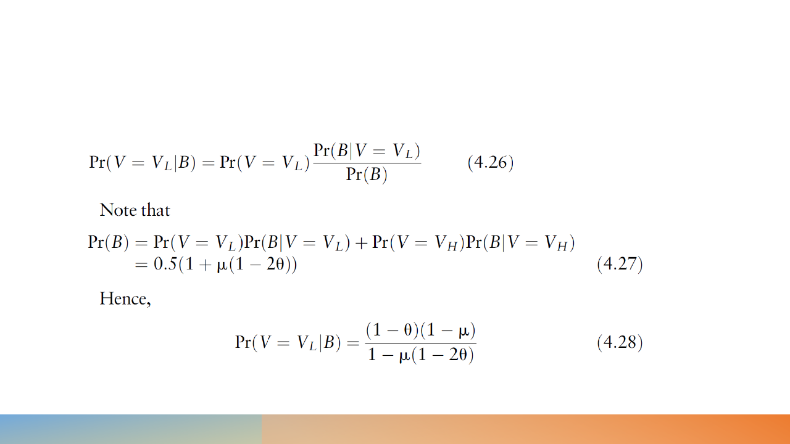

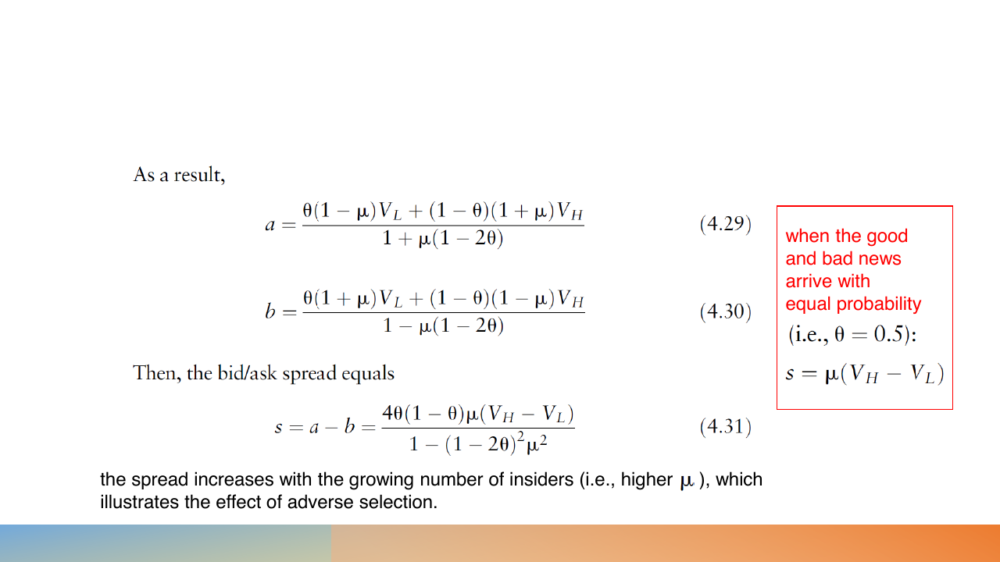

### 5.3 The event tree (slides 16 to 18)

An event tree lists every way the next trade can happen, with the probability of each. The tree has three stages. Nature chooses the news. A trader learns it or does not. The trader then buys or sells.

Read the picture from left to right. The first split is the news: good news with probability $1-\theta$, bad news with probability $\theta$ (A1). The second split is the trader: informed with probability $\mu$, uninformed with probability $1-\mu$ (A2). The two columns on the right give the chance that this trader buys or sells. An informed trader buys for sure on good news and sells for sure on bad news (A3). An uninformed trader buys or sells with probability 0.5 each, whatever the news (A4).

```text
                                           buy        sell
                     informed   (mu)        1          0
good news (1-theta)
                     uninformed (1-mu)     0.5        0.5

                     informed   (mu)        0          1
bad news  (theta)
                     uninformed (1-mu)     0.5        0.5
```

To find the probability of a whole path through the tree, multiply the probabilities along the path. For example, take the path "good news, informed, buy". Its probability is $(1-\theta)$ times $\mu$ times 1, which is $(1-\theta)\mu$. The table below does this for every path.

| Branch | Probability with a buy | Probability with a sale |
|---|---|---|
| Good news, informed | $(1-\theta)\mu$ | 0 |
| Good news, uninformed | $0.5(1-\theta)(1-\mu)$ | $0.5(1-\theta)(1-\mu)$ |
| Bad news, informed | 0 | $\theta\mu$ |
| Bad news, uninformed | $0.5\theta(1-\mu)$ | $0.5\theta(1-\mu)$ |

Each entry is a joint probability. For example, $0.5\theta(1-\mu)$ in the last row is the chance that the news is bad, the trader is uninformed, and the trader buys, all at once.

The sale column shows something useful. A sale at time 1 can come from three branches: good news with an uninformed trader, bad news with an informed trader, and bad news with an uninformed trader. An informed sale on good news is impossible, because an informed trader never sells when the value is high. The same reasoning applies to buys: an informed buy on bad news is impossible.

Slide 16 is more general. It lets uninformed traders buy with probability $\gamma^B$ and sell with probability $\gamma^S$, in place of 0.5 each. To get the total chance of a buy, add every way a buy can happen. Uninformed traders buy with chance $\gamma^B$ whatever the news, so they give $(1-\mu)\gamma^B$. Informed traders buy only on good news, so they give $(1-\theta)\mu$. In our notation it gives these totals.

$$\Pr(B)=(1-\mu)\gamma^B+(1-\theta)\mu$$

The sale total works the same way. Uninformed traders sell with chance $\gamma^S$ whatever the news. Informed traders sell only on bad news, which gives $\theta\mu$.

$$\Pr(S)=(1-\mu)\gamma^S+\theta\mu$$

With $\gamma^B=\gamma^S=0.5$ these become the totals of the two columns of the table above.

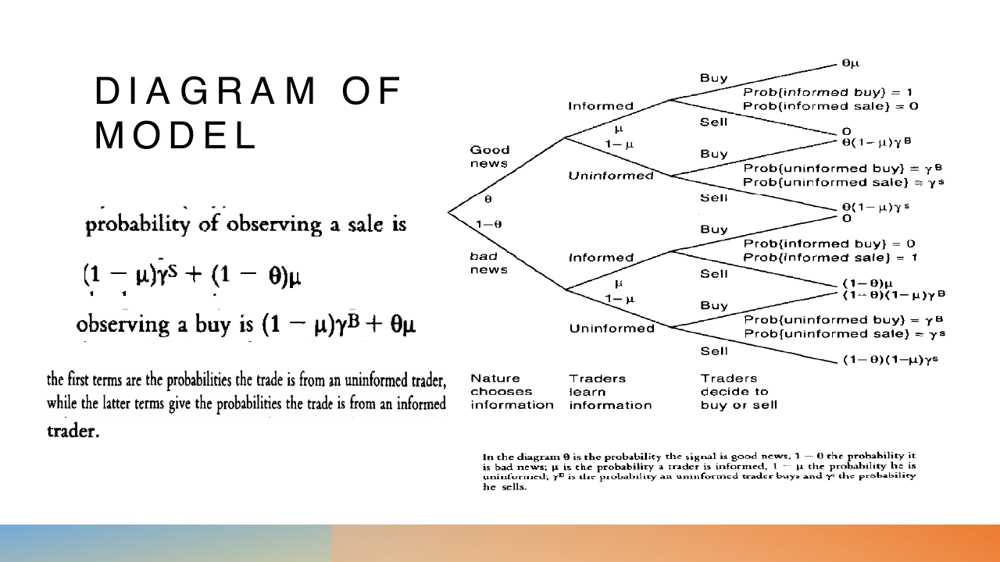

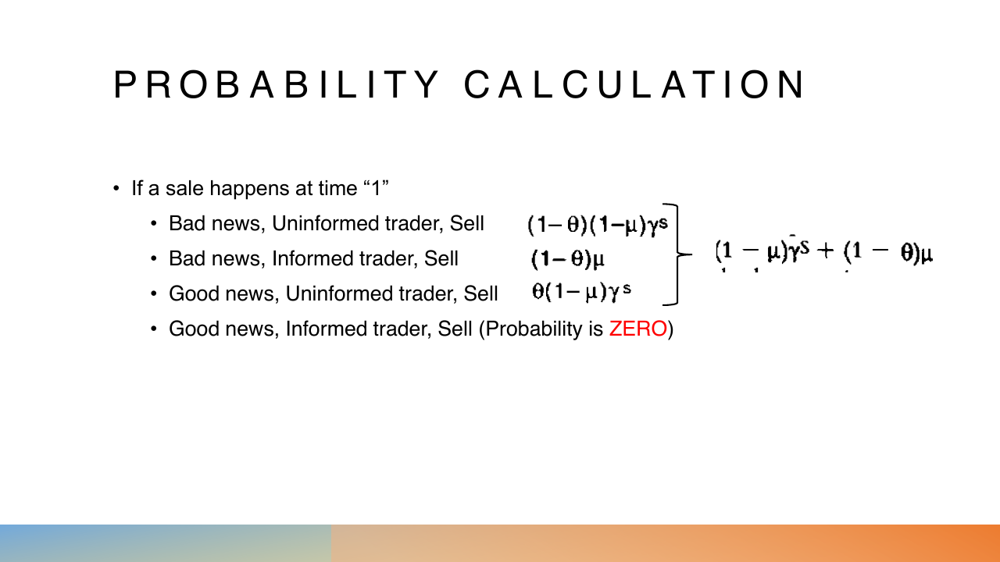

### 5.4 Bayes rule (slides 21 to 23)

The dealer needs to turn "the chance of a buy, given the value" into "the chance of the value, given a buy". Bayes rule is the tool that does this. The slides build it in five steps. Here $E$ is an event, such as "the value is low". $D$ is the data we observe, such as "a buy arrived". $E^c$ means "$E$ does not happen", and it is called the complement of $E$.

1. The data can happen with the event or without it. So the total chance of the data is the chance of the data when $E$ happens, times the chance of $E$, plus the chance of the data when $E$ does not happen, times the chance of that. This is equation 3.10.

$$\Pr(D)=\Pr(D\mid E)\Pr(E)+\Pr(D\mid E^c)\Pr(E^c)$$

2. The joint probability $\Pr(D,E)$ is the chance that $D$ and $E$ both happen. It can be written in two ways. One way is to take the chance of $D$, then the chance of $E$ given $D$. The other way is to take the chance of $E$, then the chance of $D$ given $E$. Both describe the same joint event, so they are equal. This is equation 3.11.

$$\Pr(D,E)=\Pr(E\mid D)\Pr(D)=\Pr(D\mid E)\Pr(E)$$

3. We want $\Pr(E\mid D)$ alone on the left. So divide both sides of the second equality by $\Pr(D)$. This is equation 3.12.

$$\Pr(E\mid D)=\frac{\Pr(D\mid E)\Pr(E)}{\Pr(D)}$$

4. The denominator $\Pr(D)$ is often not known directly. But step 1 gives a formula for it. Put step 1 into the denominator. This is equation 3.13.

$$\Pr(E\mid D)=\frac{\Pr(D\mid E)\Pr(E)}{\Pr(D\mid E)\Pr(E)+\Pr(D\mid E^c)\Pr(E^c)}$$

5. Read the result in words. The posterior equals the prior times the likelihood, divided by the marginal likelihood. This is equation 3.14. Here the posterior is $\Pr(E\mid D)$, the belief after seeing the data. The prior is $\Pr(E)$, the belief before. The likelihood is $\Pr(D\mid E)$, the chance of seeing this data if $E$ is true. The marginal likelihood is $\Pr(D)$, the total chance of seeing this data at all.

In this model, $E$ will be "the value is $V_L$" and $D$ will be "a buy arrived" or "a sale arrived".

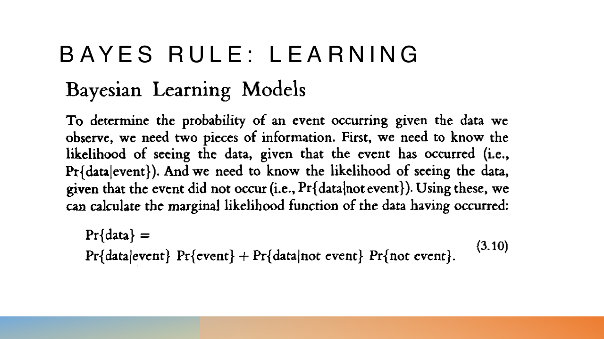

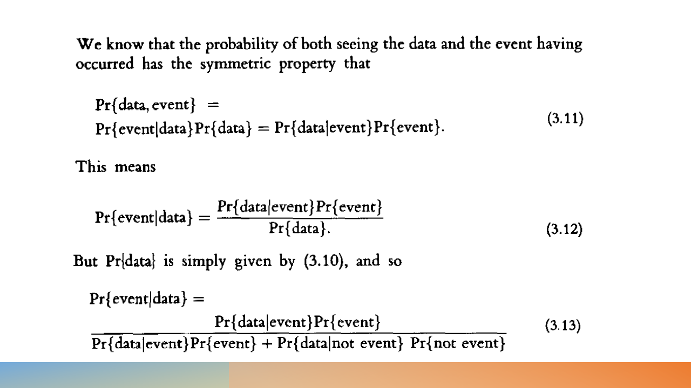

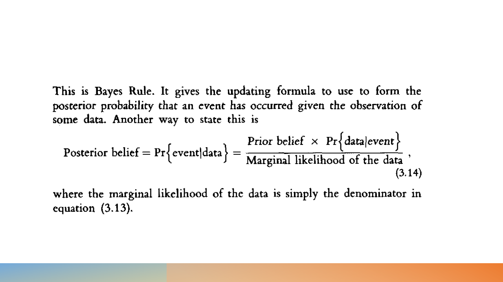

### 5.5 Regret-free quotes (slide 15)

The dealer posts two prices before any trade happens. The ask is the price at which the dealer sells. The bid is the price at which the dealer buys.

A trade tells the dealer something. Informed traders buy when they know the value is high. So when a buy order arrives, the chance that the value is high goes up. The dealer has just sold at the ask, so this is bad news for the dealer.

A quote is called "regret free" if the dealer would not want to change it after seeing the trade. This means the quote already includes the information that the trade reveals.

So the dealer sets the ask equal to the expected value of the asset, given that the next trade is a buy. The slide calls this equation 4.23. The symbol $E[V\mid B]$ means "the average value of the asset, counting only the cases in which a buy arrives". The value can only be $V_L$ or $V_H$. So the average is $V_L$ times the chance of $V_L$ after a buy, plus $V_H$ times the chance of $V_H$ after a buy.

$$a=E[V\mid B]=V_L\Pr(V_L\mid B)+V_H\Pr(V_H\mid B)$$

The bid works the same way, with a sale in place of a buy. This is equation 4.24.

$$b=E[V\mid S]=V_L\Pr(V_L\mid S)+V_H\Pr(V_H\mid S)$$

Why does this give the dealer zero expected profit? If the ask were below $E[V\mid B]$, the dealer would sell below the average value and lose money on each buy. The dealer earns zero expected profit (assumption in 5.2), so the ask cannot be higher either.

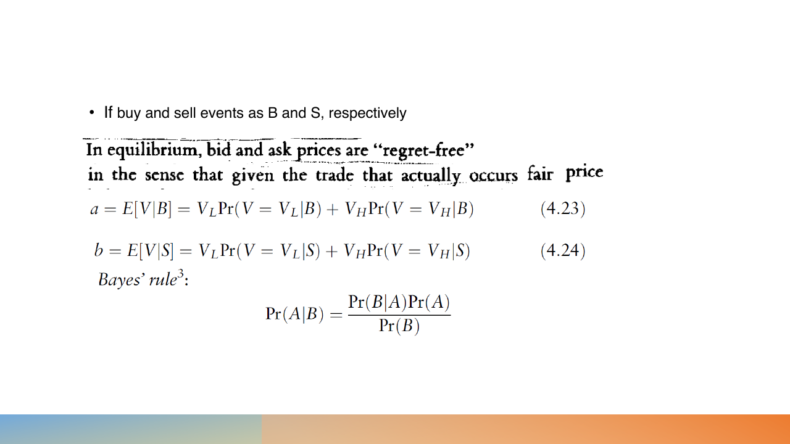

### 5.6 ⭐ Solution step by step

The goal is a formula for the ask, the bid and the spread. Equations 4.23 and 4.24 need four posterior probabilities: the chance of each value after a buy, and after a sale. Bayes rule needs the total chance of a buy and of a sale first. So the steps go in this order: total chances, then posteriors, then quotes, then the spread.

**Step 1: Find the probability of a buy.** A buy can happen in three ways, as the buy column of the table in section 5.3 shows. These ways cannot happen together, so add the buy column of the table.

$$\Pr(B)=0.5\theta(1-\mu)+(1-\theta)\mu+0.5(1-\theta)(1-\mu)$$

Join the two uninformed terms. They are the first and the last term. Both contain $0.5(1-\mu)$, so take it out.

$$0.5\theta(1-\mu)+0.5(1-\theta)(1-\mu)=0.5(1-\mu)[\theta+(1-\theta)]=0.5(1-\mu)$$

Their total is $0.5(1-\mu)$, because $\theta+(1-\theta)=1$. This makes sense: an uninformed trader buys with chance 0.5 whatever the news. Also expand the informed term: $(1-\theta)\mu=\mu-\theta\mu$.

$$\Pr(B)=0.5(1-\mu)+\mu-\theta\mu$$

Take 0.5 outside. To do this, write each term as 0.5 times something. The first term is already $0.5(1-\mu)$. The other two are $\mu=0.5(2\mu)$ and $\theta\mu=0.5(2\theta\mu)$.

$$\Pr(B)=0.5[1-\mu+2\mu-2\theta\mu]=0.5[1+\mu-2\theta\mu]$$

The last two terms inside the bracket share the factor $\mu$, so $\mu-2\theta\mu=\mu(1-2\theta)$. This is equation 4.27.

$$\Pr(B)=0.5[1+\mu(1-2\theta)]$$

**Step 2: Find the probability of a sale.** Every trade is a buy or a sale, because a liquidity trader always does one of the two (A4) and an insider always does one of the two (A3). So the two chances add to 1, and we subtract from 1.

$$\Pr(S)=1-\Pr(B)=0.5[1-\mu(1-2\theta)]$$

To see the last equality, write 1 as $0.5(2)$. Then $1-0.5[1+\mu(1-2\theta)]=0.5[2-1-\mu(1-2\theta)]=0.5[1-\mu(1-2\theta)]$.

**Step 3: Update after a buy.** Use Bayes rule, which is equation 4.26. It says the posterior equals the joint probability of the value and the buy, divided by the total chance of a buy (equation 3.12 from section 5.4, with $E$ as $V_L$ and $D$ as a buy).

$$\Pr(V_L\mid B)=\frac{\Pr(B\mid V_L)\Pr(V_L)}{\Pr(B)}$$

The top is the joint chance of bad news and a buy. Only an uninformed trader buys on bad news. So the top is the "bad news, uninformed" entry of the buy column, which is $0.5\theta(1-\mu)$. The bottom is Step 1.

$$\Pr(V_L\mid B)=\frac{0.5\theta(1-\mu)}{0.5[1+\mu(1-2\theta)]}$$

The 0.5 on top and the 0.5 on the bottom cancel.

$$\Pr(V_L\mid B)=\frac{0.5\theta(1-\mu)}{\Pr(B)}=\frac{\theta(1-\mu)}{1+\mu(1-2\theta)}$$

Now do the same for the high value. On good news, a buy can come from an informed trader or an uninformed trader. So the top is the sum of the two good-news entries of the buy column.

$$(1-\theta)\mu+0.5(1-\theta)(1-\mu)=(1-\theta)[\mu+0.5-0.5\mu]=0.5(1-\theta)(1+\mu)$$

Divide this by Step 1. The 0.5 cancels again.

$$\Pr(V_H\mid B)=\frac{(1-\theta)(1+\mu)}{1+\mu(1-2\theta)}$$

**Step 4: Update after a sale.** Use the sale column and Bayes rule, in the same way as Step 3. On bad news, a sale can come from an informed trader or an uninformed trader. So the joint chance of bad news and a sale is the sum of the two bad-news entries.

$$\theta\mu+0.5\theta(1-\mu)=\theta[\mu+0.5-0.5\mu]=0.5\theta(1+\mu)$$

On good news, only an uninformed trader sells. So the joint chance of good news and a sale is $0.5(1-\theta)(1-\mu)$. Divide each joint chance by $\Pr(S)$ from Step 2. The 0.5 cancels in each.

$$\Pr(V_L\mid S)=\frac{\theta(1+\mu)}{1-\mu(1-2\theta)}$$

$$\Pr(V_H\mid S)=\frac{(1-\theta)(1-\mu)}{1-\mu(1-2\theta)}$$

> **Slide error:** Equation 4.28 prints $\Pr(V_L\mid B)$ as $(1-\theta)(1-\mu)/[1-\mu(1-2\theta)]$. That is true only when $\theta$ means good news. It does not agree with equations 4.27 and 4.29, which use $\theta$ for bad news. So the slide mixes the two meanings of $\theta$ from the slide error in section 5.2. Use Step 3.

**Step 5: Write the ask.** Put Step 3 into equation 4.23. Both posteriors have the same denominator, $1+\mu(1-2\theta)$. So the two terms can be written over that one denominator. This is equation 4.29.

$$a=\frac{\theta(1-\mu)V_L+(1-\theta)(1+\mu)V_H}{1+\mu(1-2\theta)}$$

**Step 6: Write the bid.** Put Step 4 into equation 4.24. Again both posteriors share the denominator, here $1-\mu(1-2\theta)$. This is equation 4.30.

$$b=\frac{\theta(1+\mu)V_L+(1-\theta)(1-\mu)V_H}{1-\mu(1-2\theta)}$$

**Step 7: Write both quotes as a distance from the low value.** This form makes the subtraction in Step 8 easier. The two posteriors after a buy add to 1, because after a buy the value is either low or high. So $\Pr(V_L\mid B)=1-\Pr(V_H\mid B)$, and this is allowed. Put it into equation 4.23.

$$a=V_L[1-\Pr(V_H\mid B)]+V_H\Pr(V_H\mid B)=V_L+(V_H-V_L)\Pr(V_H\mid B)$$

The bid works the same way with the sale posteriors. To keep the lines short, let $k=1-2\theta$. Then put in $\Pr(V_H\mid B)$ from Step 3 and $\Pr(V_H\mid S)$ from Step 4.

$$a=V_L+(V_H-V_L)\frac{(1-\theta)(1+\mu)}{1+\mu k}$$

$$b=V_L+(V_H-V_L)\frac{(1-\theta)(1-\mu)}{1-\mu k}$$

**Step 8: Subtract.** The spread is $s=a-b$. The two $V_L$ terms cancel. Both remaining terms contain $(V_H-V_L)(1-\theta)$, so take it out.

$$s=(V_H-V_L)(1-\theta)\left[\frac{1+\mu}{1+\mu k}-\frac{1-\mu}{1-\mu k}\right]$$

Use a common denominator. Multiply the first fraction above and below by $1-\mu k$, and the second by $1+\mu k$. The common denominator is $(1+\mu k)(1-\mu k)=1-\mu^2k^2$.

$$s=(V_H-V_L)(1-\theta)\frac{(1+\mu)(1-\mu k)-(1-\mu)(1+\mu k)}{1-\mu^2k^2}$$

Expand the numerator. The first product is $(1+\mu)(1-\mu k)=1-\mu k+\mu-\mu^2k$. The second product is $(1-\mu)(1+\mu k)=1+\mu k-\mu-\mu^2k$. Subtracting the second from the first gives $1-\mu k+\mu-\mu^2k-1-\mu k+\mu+\mu^2k$. The 1 and $-1$ cancel. The $-\mu^2k$ and $+\mu^2k$ cancel. What is left is $2\mu-2\mu k$. This equals $2\mu(1-k)$. Since $1-k=1-(1-2\theta)=2\theta$, it equals $4\theta\mu$.

$$s=(V_H-V_L)(1-\theta)\frac{4\theta\mu}{1-\mu^2k^2}$$

Finally, put $k=1-2\theta$ back, so $\mu^2k^2=(1-2\theta)^2\mu^2$. This gives equation 4.31.

$$s=a-b=\frac{4\theta(1-\theta)\mu(V_H-V_L)}{1-(1-2\theta)^2\mu^2}$$

**Step 9: Take the special case.** Put $\theta=0.5$, so good news and bad news are equally likely. Then $1-2\theta=0$, and the denominator becomes $1-0=1$. The numerator becomes $4(0.5)(0.5)\mu(V_H-V_L)=\mu(V_H-V_L)$.

$$s=\mu(V_H-V_L)$$

**Conclusion:** The spread is positive with zero cost and zero profit. The model has no costs (A7) and the dealer earns zero (A6), yet $s$ is above zero whenever $\mu$ is above zero. It rises with $\mu$: more insiders means each trade says more about the value, so the quotes move further apart. This spread is pure adverse selection.

### 5.7 ⭐ Worked example

This example puts numbers into Steps 1 to 8. Take $V_H=110$, $V_L=90$, $\theta=0.3$ and $\mu=0.4$. So bad news has a 30 percent chance, and 40 percent of traders are insiders.

1. The prior value is $0.3(90)+0.7(110)=104$. This is the expected value before any trade, with weights $\theta=0.3$ and $1-\theta=0.7$. The two parts are $0.3(90)=27$ and $0.7(110)=77$, which add to 104.
2. The term $\mu(1-2\theta)$ is $0.4(0.4)=0.16$, because $1-2(0.3)=0.4$.
3. The probability of a buy is $0.5(1.16)=0.58$, from Step 1 with $1+0.16=1.16$. The probability of a sale is 0.42, from Step 2: $1-0.58=0.42$.
4. The ask is $[0.18(90)+0.98(110)]/1.16=106.897$. This is equation 4.29. The weight on $V_L$ is $\theta(1-\mu)=0.3(0.6)=0.18$. The weight on $V_H$ is $(1-\theta)(1+\mu)=0.7(1.4)=0.98$. The top is $16.2+107.8=124$, and $124/1.16=106.897$.
5. The bid is $[0.42(90)+0.42(110)]/0.84=100$. This is equation 4.30. The weight on $V_L$ is $\theta(1+\mu)=0.3(1.4)=0.42$. The weight on $V_H$ is $(1-\theta)(1-\mu)=0.7(0.6)=0.42$. The bottom is $1-0.16=0.84$. The top is $37.8+46.2=84$, and $84/0.84=100$.
6. The spread is 6.897. It is $106.897-100$. Equation 4.31 gives the same number: $4(0.3)(0.7)(0.4)(20)/(1-0.16^2)=6.72/0.9744=6.897$.
7. The average transaction price is $0.58(106.897)+0.42(100)=104$. A buy happens at the ask with chance 0.58, and a sale happens at the bid with chance 0.42. It equals the prior value. This is what zero expected profit means: on average the dealer trades at what the asset is worth.

Now suppose a buy happens. The dealer learns from it. The posterior after the buy becomes the new prior for the next trade.

1. The new $\theta$ is $\Pr(V_L\mid B)=0.18/1.16=0.1552$. This is Step 3 with the numbers above. The chance of bad news falls from 0.3 to about 0.1552, because a buy is a hint of good news.
2. The new ask is 108.541. The new bid is 104. These come from equations 4.29 and 4.30 with $\theta=0.1552$ and the same $\mu=0.4$. The new $1-2\theta$ is about 0.6897, so $1+\mu(1-2\theta)$ is about 1.2759 and $1-\mu(1-2\theta)$ is about 0.7241. For the ask, the top is about $0.0931(90)+1.1828(110)=138.483$, and $138.483/1.2759=108.541$. For the bid, the top is about $0.2172(90)+0.5069(110)=75.31$, and $75.31/0.7241=104$.
3. Both quotes move up after a buy. The ask goes from 106.897 to 108.541. The bid goes from 100 to 104. The dealer now believes the value is more likely to be high, so both prices rise.

### 5.8 ⭐ Findings

The paper reports six findings.

- **Simple description:** The model explains the adverse selection cost. The dealer puts it in the spread to avoid losses. Without the spread, the dealer would lose to insiders on every trade with them.
- **Beliefs change:** Information affects the beliefs of the dealer. Each trade carries a hint about the value, so the dealer's probabilities change after every trade.
- **Quotes change:** The dealer updates quotes by learning from the arrival of trades. The worked example shows this: after a buy, both quotes moved up.
- **Difference from Copeland and Galai:** Their spread is a function of expected gains and losses. This spread comes from beliefs given each trade. So Copeland and Galai balance a gain against a loss, while Glosten and Milgrom set each quote equal to an expected value.
- **Martingale:** The price is a martingale with respect to the dealer's information. A martingale is a series whose expected next value equals its present value. So the best forecast of the next price is the present price. The worked example shows a case of this: the average transaction price, 104, equals the prior value.
- **Efficiency:** The market is semi-strong efficient. Semi-strong efficient means that prices already reflect all public information. So public information cannot predict the future price better than the present price does.

> **Exam:** This is the most likely numerical. Draw the tree first, as in section 5.3. Then write the buy probability (Step 1), the posterior (Step 3), the ask (Step 5), the bid (Step 6) and the spread (Step 8). Finish with one line of meaning, for example "the spread is positive with zero cost, so it is pure adverse selection".

## 6. Kyle (1985): "Continuous auctions and insider trading" (slides 25 to 32)

**Why this model is needed:** The insider in Glosten and Milgrom trades one unit and does not think about price impact. Price impact is how much the insider's own order moves the price. A real insider knows that a large order pushes the price against them. Kyle's insider chooses the size strategically, which means the insider takes this effect into account.

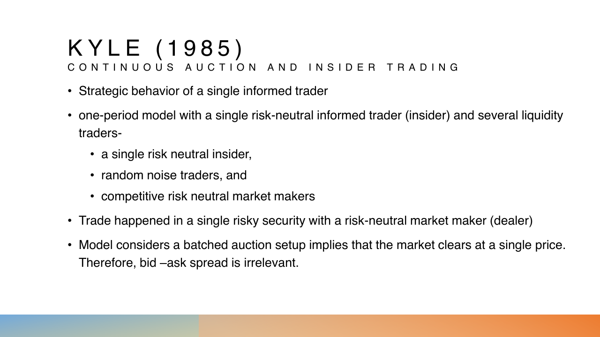

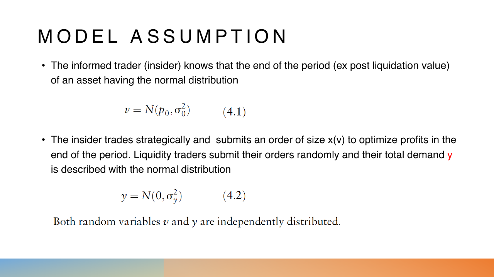

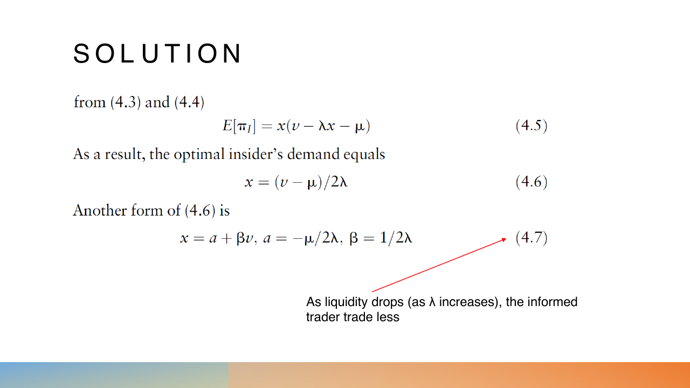

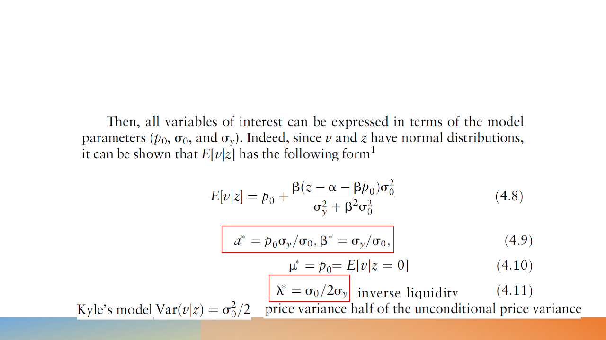

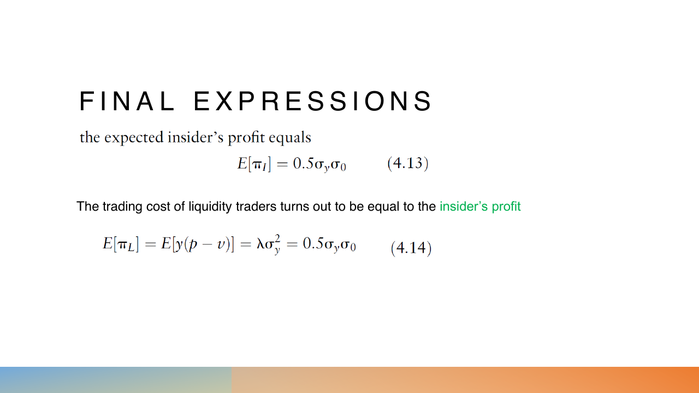

### 6.1 The idea and the players

The model has three kinds of players and a simple setting.

- **Strategic insider:** One risk-neutral informed trader knows how their order moves the price. So the insider chooses the order size to get the most expected profit.
- **Noise traders:** They trade a random amount. The amount has nothing to do with the value. Noise traders are the same as the uninformed traders of section 0.
- **Market makers:** They are competitive and risk neutral. So, as in Glosten and Milgrom, they earn zero expected profit.
- **Batch auction:** All orders are collected together and then clear at one price. Every buyer and every seller in the batch gets the same price. So there is no separate bid and ask, and the bid-ask spread is not relevant. The measure of trading cost here is price impact instead.
- **Simple setting:** There is one period and one risky security.

### 6.2 Questions the model answers (slide 26)

Slide 26 lists four questions. The steps in section 6.4 answer each one.

1. How quickly does private information enter the price? Step 9 answers this.
2. How valuable is private information to an insider? Step 10 answers this.
3. How does noise trading affect price volatility? The table in section 6.5 answers this.
4. What decides the liquidity of a market? Step 6 answers this, through $\lambda$.

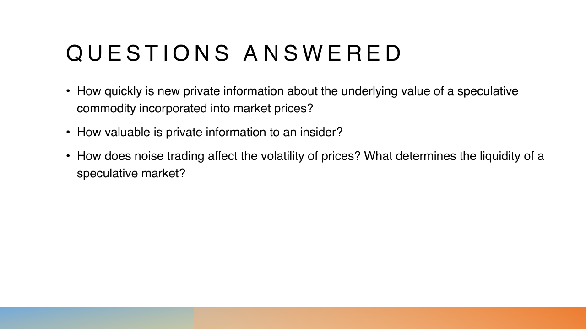

### 6.3 Assumptions

The model uses the normal distribution. A normal distribution is the bell-shaped distribution. $N(m,s^2)$ means a normal variable with mean $m$ and variance $s^2$. The mean is the expected value. The variance is the expected squared distance from the mean, so it measures spread. The square root of the variance is the standard deviation, written $\sigma$. Two variables are independent if knowing one tells you nothing about the other.

- **A1:** The final value is $v\sim N(p_0,\sigma_0^2)$. Only the insider knows it. So everyone else expects the value to be $p_0$, with variance $\sigma_0^2$. The symbol $\sim$ is read "is distributed as".
- **A2:** Noise demand is $y\sim N(0,\sigma_y^2)$. It is independent of $v$. Its mean is 0, so on average noise traders neither buy nor sell. A positive $y$ is a buy and a negative $y$ is a sale.
- **A3:** The insider knows $v$ but not $y$. The insider submits $x(v)$. So the insider's order is a rule that depends only on the value.
- **A4:** The dealer sees only the total $z=x+y$. The dealer sets $p(z)$. The dealer cannot split $z$ into the insider's part and the noise part. The total $z$ is called the order flow.
- **A5:** Competition gives zero expected profit. So $p=E[v\mid z]$. The price equals the expected value, given the order flow the dealer saw. This is the same reasoning as the regret-free quotes in section 5.5.
- **A6:** The price rule is linear. It is $p(z)=\lambda z+\mu$, as in equation 4.4. Linear means the price is a straight line in $z$.

Here $\lambda$ is inverse liquidity. It is the slope of the price rule: one more unit of order flow moves the price by $\lambda$. A lower $\lambda$ means lower price impact, so the market is more liquid. The symbol $\mu$ is an intercept here. It is the price when the order flow is zero. It is not the share of insiders, which $\mu$ meant in section 5.

> **Slide gap:** Slide 28 says that the dealer sets the price to optimize profit. In Kyle, competition forces zero expected profit. If one dealer made a profit, another would offer a better price. So the dealer does not choose a price to make profit. Use A5.

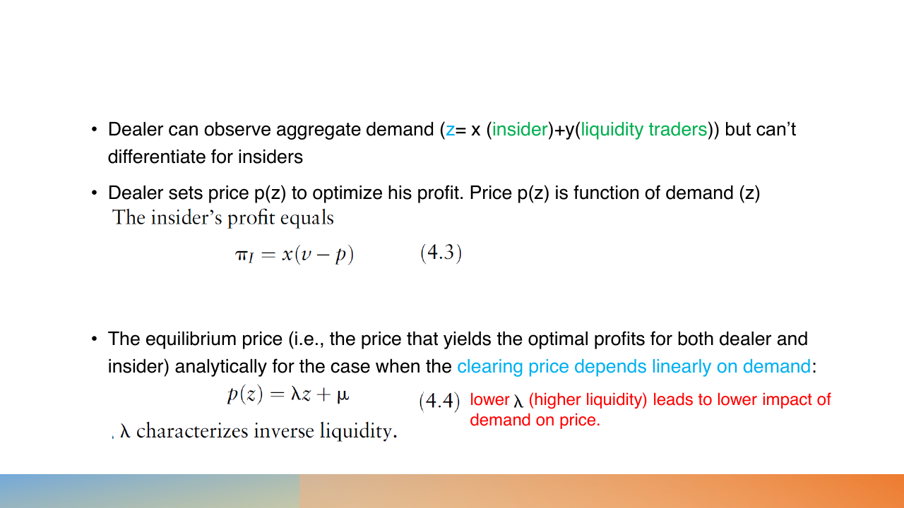

### 6.4 ⭐ Solution step by step

The solution has two sides. First, the insider chooses an order, taking the price rule as given (Steps 1 to 4). Second, the dealer sets the price rule, knowing how the insider behaves (Steps 5 to 7). An equilibrium is where both choices are consistent with each other. Then Steps 8 to 11 read off the results.

**Step 1: Write the insider's profit.** The insider buys $x$ units at price $p$. Each unit is worth $v$. So each unit earns $v-p$, and the total profit is $x$ times that. This is equation 4.3.

$$\pi_I=x(v-p)$$

**Step 2: Take the expectation.** The insider does not know $y$ (A3), so the price is uncertain for the insider. Put in the price rule from A6, with $z=x+y$.

$$\pi_I=x(v-\lambda x-\lambda y-\mu)$$

Now take the expected value over $y$. The insider knows $x$ and $v$, so they stay fixed. The only random part is $y$, and $E[y]=0$ by A2. So the term $\lambda y$ averages to zero. This is equation 4.5.

$$E[\pi_I]=x(v-\lambda x-\mu)$$

**Step 3: Maximize.** The insider picks $x$ to make this as large as possible. First multiply out: $E[\pi_I]=xv-\lambda x^2-\mu x$. At the best $x$, the derivative with respect to $x$ is zero. The derivative of $xv$ is $v$, of $-\lambda x^2$ is $-2\lambda x$, and of $-\mu x$ is $-\mu$. Set the derivative to zero. The second derivative is $-2\lambda$, which is negative because $\lambda$ is positive, so it is a maximum.

$$v-2\lambda x-\mu=0$$

Add $2\lambda x$ to both sides, then divide both sides by $2\lambda$.

$$x=\frac{v-\mu}{2\lambda}$$

This is equation 4.6. The insider buys when the value $v$ is above the intercept $\mu$, and sells when it is below. The insider trades less when $\lambda$ is higher, because each unit then moves the price more against the insider.

**Step 4: Write the order as a line.** Split the fraction in Step 3 into two parts: $x=-\mu/2\lambda+v/2\lambda$. So the order is a constant plus a slope times $v$. This is equation 4.7.

$$x=a+\beta v$$

$$a=-\frac{\mu}{2\lambda},\qquad \beta=\frac{1}{2\lambda}$$

Here $a$ is the constant and $\beta$ is how strongly the insider's order responds to the value.

**Step 5: Let the dealer learn.** Now switch to the dealer. The dealer knows the insider's rule from Step 4, but not $v$. The dealer sees the order flow $z=a+\beta v+y$. The dealer needs three facts about $z$.

- **Mean:** $E[z]=a+\beta E[v]+E[y]=a+\beta p_0$, because $E[v]=p_0$ (A1) and $E[y]=0$ (A2).
- **Variance:** Its variance is $\beta^2\sigma_0^2+\sigma_y^2$. The constant $a$ does not change the variance. Multiplying $v$ by $\beta$ multiplies its variance by $\beta^2$. And $v$ and $y$ are independent (A2), so their variances add.
- **Covariance with $v$:** Covariance measures how two variables move together. Its covariance with $v$ is $\beta\sigma_0^2$. Only the $\beta v$ part of $z$ moves with $v$, and the covariance of $v$ with itself is its variance $\sigma_0^2$. The part $y$ is independent of $v$, so it adds nothing.

Now the rule for normal variables applies. When two variables are jointly normal, the expected value of one given the other is its mean, plus the covariance over the variance, times the surprise in the other.

$$E[v\mid z]=E[v]+\frac{\mathrm{Cov}(v,z)}{\mathrm{Var}(z)}(z-E[z])$$

Put in the three facts. This gives equation 4.8.

$$E[v\mid z]=p_0+\frac{\beta\sigma_0^2}{\sigma_y^2+\beta^2\sigma_0^2}(z-a-\beta p_0)$$

**Step 6: Match the slope.** A5 says this must equal $\lambda z+\mu$. Two straight lines in $z$ are equal only if their slopes are equal and their intercepts are equal. The slope of equation 4.8 is the fraction in front of $z$. So the slope must equal $\lambda$.

$$\lambda=\frac{\beta\sigma_0^2}{\sigma_y^2+\beta^2\sigma_0^2}$$

Multiply both sides by the denominator, then expand the left side.

$$\lambda\sigma_y^2+\lambda\beta^2\sigma_0^2=\beta\sigma_0^2$$

Now put $\beta=1/2\lambda$ from Step 4. Then $\beta^2=1/4\lambda^2$, so $\lambda\beta^2\sigma_0^2=\sigma_0^2/4\lambda$. And $\beta\sigma_0^2=\sigma_0^2/2\lambda$.

$$\lambda\sigma_y^2+\frac{\sigma_0^2}{4\lambda}=\frac{\sigma_0^2}{2\lambda}$$

Subtract the second term from both sides. The right side becomes $\sigma_0^2/2\lambda-\sigma_0^2/4\lambda=\sigma_0^2/4\lambda$, because one half minus one quarter is one quarter.

$$\lambda\sigma_y^2=\frac{\sigma_0^2}{4\lambda}$$

Then multiply both sides by $\lambda$.

$$\lambda^2\sigma_y^2=\frac{\sigma_0^2}{4}$$

Divide both sides by $\sigma_y^2$. This gives $\lambda^2=\sigma_0^2/4\sigma_y^2$. Take the positive root. The root must be positive, because a buy order must raise the price. This is equation 4.11.

$$\lambda^{\ast}=\frac{\sigma_0}{2\sigma_y}$$

The star marks the equilibrium value. So price impact is half the ratio of the value's standard deviation to the noise standard deviation.

**Step 7: Match the intercept.** Expand equation 4.8 so the part without $z$ is separate. The fraction in front of $z$ is now $\lambda$, from Step 6.

$$E[v\mid z]=\lambda z+p_0-\lambda(a+\beta p_0)$$

So the intercept is $\mu=p_0-\lambda(a+\beta p_0)$. Put in $a$ and $\beta$ from Step 4. Then $\lambda a=-\mu/2$ and $\lambda\beta=1/2$.

$$\mu=p_0+\frac{\mu}{2}-\frac{p_0}{2}$$

Subtract $\mu/2$ from both sides. This gives $\mu/2=p_0/2$. Multiply by 2. This is equation 4.10.

$$\mu^{\ast}=p_0$$

So when the order flow is zero, the price is the prior mean $p_0$. Zero order flow tells the dealer nothing new.

**Step 8: Find the insider's rule.** Put $\lambda^{\ast}$ and $\mu^{\ast}$ into Step 4. For the slope, $\beta=1/2\lambda^{\ast}=1/(\sigma_0/\sigma_y)=\sigma_y/\sigma_0$. For the constant, $a=-\mu^{\ast}\beta=-p_0\sigma_y/\sigma_0$.

$$\beta^{\ast}=\frac{\sigma_y}{\sigma_0},\qquad a^{\ast}=-\frac{p_0\sigma_y}{\sigma_0}$$

Put these into $x=a+\beta v$. Both terms contain $\sigma_y/\sigma_0$, so take it out.

$$x=\frac{\sigma_y}{\sigma_0}(v-p_0)$$

So the insider buys in proportion to how far the true value is above the prior mean. More noise ($\sigma_y$ higher) lets the insider trade more, because the order is better hidden.

> **Slide error:** Equation 4.9 has no minus sign on $a^{\ast}$. The minus sign is needed, because $a=-\mu/2\lambda$. Without it, the rule would be $x=(\sigma_y/\sigma_0)(v+p_0)$, and the insider would buy even when $v$ equals $p_0$, which makes no profit.

**Step 9: Find how much is revealed.** This answers question 1 of section 6.2. For normal variables, the variance left after seeing $z$ is the prior variance minus covariance squared over the variance of $z$.

$$\mathrm{Var}(v\mid z)=\sigma_0^2-\frac{\mathrm{Cov}(v,z)^2}{\mathrm{Var}(z)}=\sigma_0^2-\frac{\beta^2\sigma_0^4}{\sigma_y^2+\beta^2\sigma_0^2}$$

Here $\beta^2\sigma_0^2=\sigma_y^2$, because $\beta^{\ast}=\sigma_y/\sigma_0$ from Step 8 gives $\beta^2\sigma_0^2=(\sigma_y^2/\sigma_0^2)\sigma_0^2=\sigma_y^2$. So the denominator becomes $2\sigma_y^2$.

$$\mathrm{Var}(v\mid z)=\sigma_0^2-\frac{\beta^2\sigma_0^4}{2\sigma_y^2}=\frac{\sigma_0^2}{2}$$

The last equality uses $\beta^2\sigma_0^4=(\beta^2\sigma_0^2)\sigma_0^2=\sigma_y^2\sigma_0^2$.

$$\sigma_0^2-\frac{\sigma_y^2\sigma_0^2}{2\sigma_y^2}=\sigma_0^2-\frac{\sigma_0^2}{2}=\frac{\sigma_0^2}{2}$$

The dealer's uncertainty about $v$ falls from $\sigma_0^2$ to $\sigma_0^2/2$. So half of the private information enters the price in one period.

**Step 10: Find the insider's expected profit.** This answers question 2 of section 6.2. Put Step 3 into Step 2. At the best order, $\lambda x=(v-\mu)/2$, so $v-\lambda x-\mu=(v-\mu)/2$. Then the profit is $x$ times that.

$$E[\pi_I]=\frac{v-\mu}{2\lambda}\cdot\frac{v-\mu}{2}=\frac{(v-\mu)^2}{4\lambda}$$

With $\mu^{\ast}=p_0$, it gives $(v-p_0)^2/4\lambda$. This is the profit once the insider knows $v$. Before $v$ is known, we average over $v$. The average of $(v-p_0)^2$ is $\sigma_0^2$, by the definition of variance. Then put in $\lambda^{\ast}=\sigma_0/2\sigma_y$: dividing by $4\lambda^{\ast}=2\sigma_0/\sigma_y$ is the same as multiplying by $\sigma_y/2\sigma_0$. This is equation 4.13.

$$E[\pi_I]=\frac{\sigma_0^2}{4\lambda}=\frac{\sigma_y\sigma_0}{2}$$

**Step 11: Find the loss of noise traders.** Noise traders buy $y$ units at price $p$, and each unit is worth $v$. So they lose $y(p-v)$. The price is $p=\lambda x+\lambda y+\mu$. Only the $\lambda y$ part of the price is related to $y$. The other parts, $\lambda x+\mu-v$, depend only on $v$, which is independent of $y$. So multiplying them by $y$ and averaging gives zero, because $E[y]=0$. What remains is $E[\lambda y^2]=\lambda\sigma_y^2$, since the average of $y^2$ is the variance $\sigma_y^2$. Then put in $\lambda^{\ast}$: $(\sigma_0/2\sigma_y)\sigma_y^2=\sigma_y\sigma_0/2$. This is equation 4.14.

$$E[\pi_L]=E[y(p-v)]=\lambda\sigma_y^2=\frac{\sigma_y\sigma_0}{2}$$

**Conclusion:** The trading cost of noise traders equals the insider's profit. Both are $\sigma_y\sigma_0/2$. So the money flows from noise traders to the insider, and the dealer only passes it along. The dealer's expected net profit is zero, as A5 requires.

### 6.5 ⭐ What changes what

This table answers question 3 of section 6.2. It reads off the two formulas $\lambda^{\ast}=\sigma_0/2\sigma_y$ (Step 6) and $E[\pi_I]=\sigma_y\sigma_0/2$ (Step 10).

| Change | Price impact | Insider's profit | Meaning |
|---|---|---|---|
| Higher $\sigma_0$ | Rises | Rises | More private information makes the market less liquid |
| Higher $\sigma_y$ | Falls | Rises | More noise hides the insider and makes the market deeper |

Walk through the first row. A higher $\sigma_0$ means the insider's information is worth more, because the value can be further from $p_0$. $\sigma_0$ is on top in $\lambda^{\ast}$, so price impact rises. The dealer protects against the insider by moving the price more for each unit. $\sigma_0$ is also on top in the profit, so the profit rises.

Now the second row. A higher $\sigma_y$ means more noise trading. $\sigma_y$ is on the bottom in $\lambda^{\ast}$, so price impact falls. The order flow is now mostly noise, so the dealer reads less into it. A market where orders move the price less is called deeper. But $\sigma_y$ is on top in the profit, so the insider's profit rises. The insider hides behind the extra noise and trades more (Step 8).

### 6.6 Worked example

This example puts numbers into Steps 6 to 10. Take $p_0=100$, $\sigma_0=10$, $\sigma_y=1000$, $v=110$ and $y=-400$. So the true value is 10 above the prior mean, and noise traders happen to sell 400 units.

1. The price impact is $\lambda=10/2000=0.005$. This is $\sigma_0/2\sigma_y$ from Step 6, with $2\sigma_y=2000$.
2. The slope is $\beta=1000/10=100$. This is $\sigma_y/\sigma_0$ from Step 8.
3. The insider buys $x=100(110-100)=1000$. This is $x=\beta(v-p_0)$ from Step 8.
4. The dealer sees $z=1000-400=600$. This is $z=x+y$ from A4. The dealer cannot tell that 1000 of it came from the insider.
5. The price is $p=100+0.005(600)=103$. This is $p=\mu^{\ast}+\lambda^{\ast}z$, with $\mu^{\ast}=p_0=100$ and $0.005(600)=3$.
6. The realized insider profit is $1000(110-103)=7000$. This is $\pi_I=x(v-p)$ from Step 1. Each unit earns $110-103=7$.
7. The expected profit before $v$ is known is $0.5(1000)(10)=5000$. This is $\sigma_y\sigma_0/2$ from Step 10. The realized profit here is higher than 5000 because the noise traders sold 400 units, which kept the price lower.
8. The remaining variance is $100/2=50$. This is $\sigma_0^2/2$ from Step 9, with $\sigma_0^2=10^2=100$.

### 6.7 ⭐ Findings (slide 32)

Slide 32 states three findings.

- **Noise distorts information:** Order flow from liquidity traders hides the insider's information. The dealer sees only the total order flow. A large random buy makes the dealer raise the price, even though it carries no information. So the price does not reveal everything the insider knows.
- **Who pays:** Liquidity traders fund the insider's profit. Step 11 shows that their loss equals the insider's profit. The dealer's net loss is zero.
- **Many periods:** When the model has many periods, the insider splits the order into small pieces. A single large order would move the price a lot against the insider. The size of the pieces changes over time.

> **Slide gap:** Slide 32 says that noise distorts the information "available to informed traders". The insider already knows $v$, so nothing is hidden from the insider. The noise hides the information from the dealer, who sees only the total order flow.

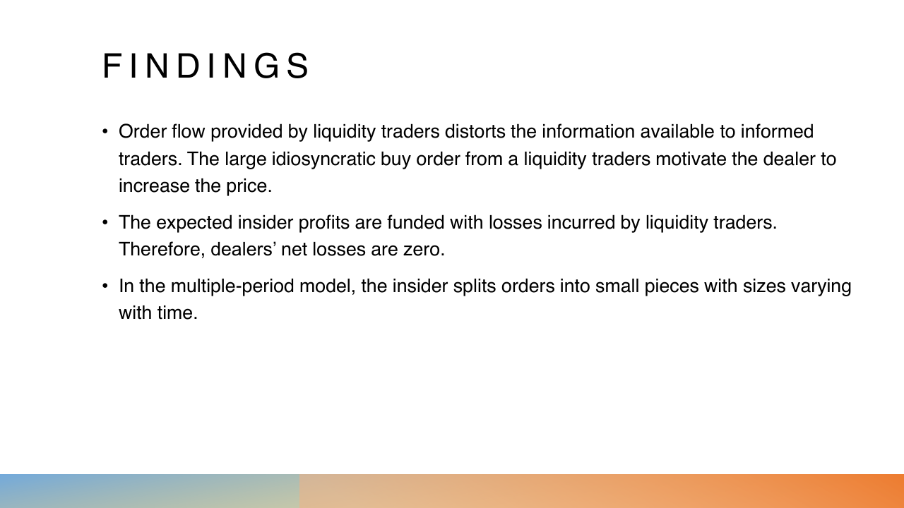

## 7. Easley and O'Hara (1987): "Price, trade size, and information in securities markets" (slides 33 to 47)

**Why this model is needed:** Earlier sequential models used one fixed trade size. So they could not ask whether a large trade says more than a small one. They also assumed that information exists. The dealer knew there was news, and only did not know which way it went. This model drops both restrictions.

### 7.1 What is new and what is examined (slides 33 and 34)

Slides 33 and 34 say what this model keeps from Glosten and Milgrom, what it changes, and what it studies.

- **Extension:** The model extends the sequential trade model of Glosten and Milgrom. Traders still arrive one at a time.
- **Same dealers:** Market makers are competitive and risk neutral. Their quotes change with trades, as in Glosten and Milgrom.
- **Different sizes:** Traders can trade different quantities. This is the first change.
- **Dual uncertainty:** The dealer does not know whether information exists. The dealer also does not know its direction. This is the second change. "Dual" means there are two unknowns.
- **Object of study:** The paper studies price movements, trade size and the spread of information. Here "spread of information" means how information passes into prices over time.
- **Main message:** The size and the sequence of trades both move prices and pass information.

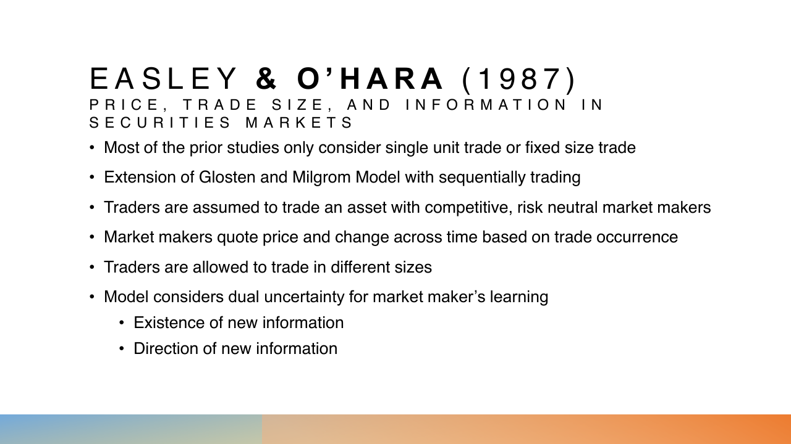

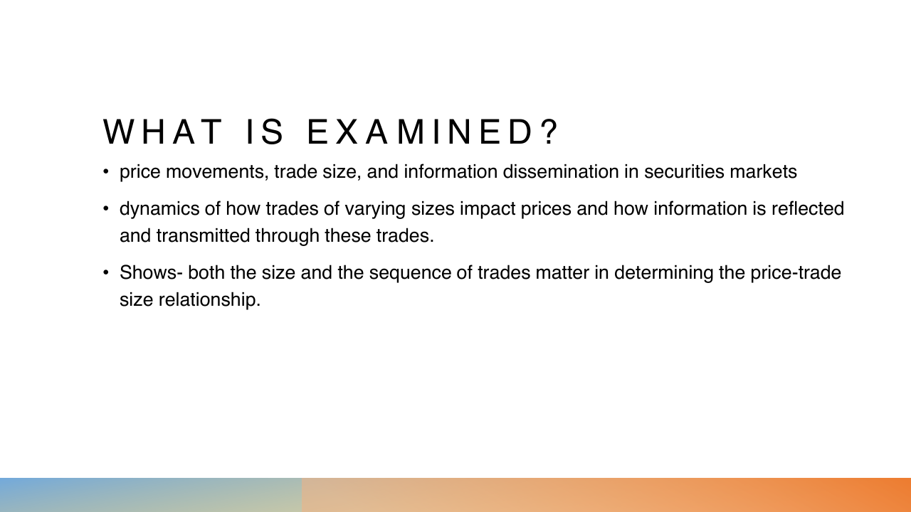

### 7.2 Assumptions (slides 35 to 37)

The model rests on nine assumptions.

- **A1:** The value $V$ is random. An information event is a signal $s$. It is low or high. A low signal is bad news and a high signal is good news.
- **A2:** The signal is low with probability $\delta$ and high with probability $1-\delta$. Here $0\lt\delta\lt 1$, so both signals are possible.
- **A3:** Write $\underline{V}=E[V\mid s=L]$ and $\bar{V}=E[V\mid s=H]$. Here $\bar{V}\gt\underline{V}$. So $\underline{V}$ is the expected value after a low signal, and $\bar{V}$ is the expected value after a high signal. The high signal gives the higher value.
- **A4:** An event happens before the trading day with probability $\alpha$. Here $0\lt\alpha\le 1$. With probability $1-\alpha$ there is no news that day. An event will happen at some time. It happens only between trading days, never during one.
- **A5:** After an event, some traders see the signal. The expected share of trades by them is $\mu$. So when news exists, a fraction $\mu$ of trades come from informed traders.
- **A6:** Informed traders are risk neutral. They are many, so they act competitively. No single informed trader can hold back to get a better price.
- **A7:** The dealer and the uninformed know neither the event nor the signal. They do not know whether news exists, nor which way it goes.
- **A8:** There is no transaction cost and no risk aversion. Costs are ignored because the period is short.
- **A9:** Uninformed demand is given from outside. It comes from the timing of income and consumption, or from portfolio needs. These needs differ across people. So different uninformed traders want different sizes.

The value without news is the prior mean. If no signal is known, the expected value averages the two signal values. The low signal value gets weight $\delta$ and the high signal value gets weight $1-\delta$ (A2).

$$V^{\ast}=\delta\underline{V}+(1-\delta)\bar{V}$$

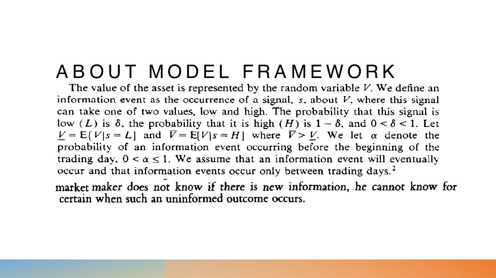

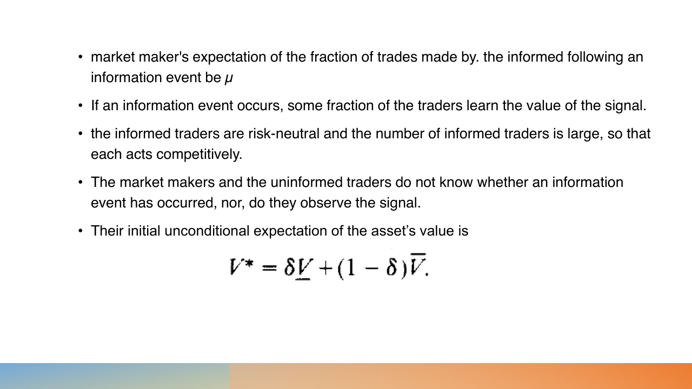

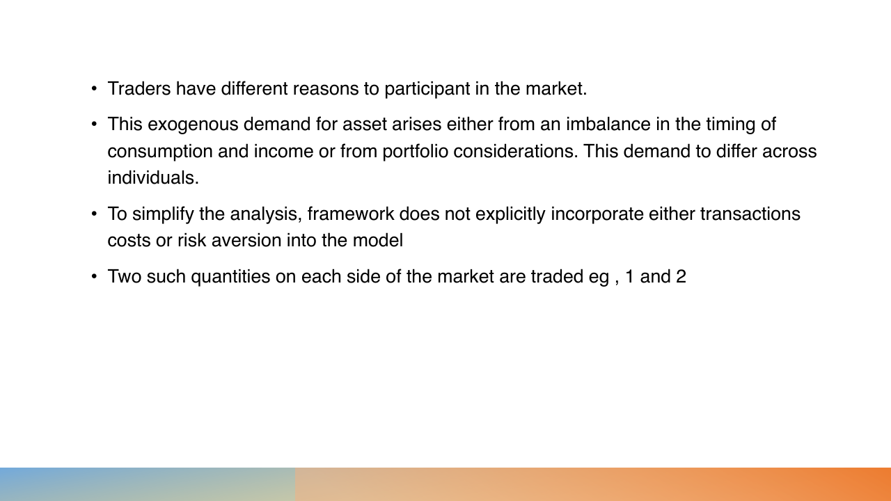

### 7.3 Market structure (slides 37 to 40)

This section says who trades what size, in what order, and how dealers set prices.

a. **There are two sizes on each side.**
   - Buyers want $B^1$ or $B^2$ units, with $0\lt B^1\lt B^2$. So $B^1$ is a small buy and $B^2$ is a large buy.
   - Sellers offer $S^1$ or $S^2$ units, with $0\lt S^1\lt S^2$. So $S^1$ is a small sale and $S^2$ is a large sale.
   - $X_B^i$ and $X_S^i$ are the positive shares of uninformed traders who want each size. For example, $X_S^2$ is the share of uninformed traders who want to make a large sale. The letter $i$ stands for the size, 1 or 2.

b. **Trading is sequential.** Each trade happens in six steps.
   1. A trader arrives according to these probabilities.
   2. The trader asks competing dealers for prices at each quantity.
   3. The trader may choose not to trade.
   4. An uninformed trader takes the best quote for the desired quantity. The quantity comes from the trader's own needs (A9).
   5. An informed trader takes the quote with the highest profit. So the informed trader compares the profit at each size and picks the best.
   6. A trader who is indifferent picks a dealer at random. Indifferent means the trader gets the same profit either way.

c. **Dealers set schedules.** A schedule is a list of prices, one for each quantity.
   - Each dealer picks a profit-maximizing schedule, given the schedules of the others.
   - At the start of the day, the dealer sets a price for each quantity.
   - Each trade has zero expected profit, because the dealers compete.
   - Prices are needed only for the four quantities: small buy, large buy, small sale and large sale.

The flowchart below shows how the day is set up before trading. Read it from the top. With probability $\alpha$ an information event happens, and with probability $1-\alpha$ it does not. If an event happens, the signal is low with probability $\delta$ and high with probability $1-\delta$. After a low signal, the informed share $\mu$ of trades are sales. After a high signal, the informed share $\mu$ of trades are buys. If no event happens, every trader is uninformed.

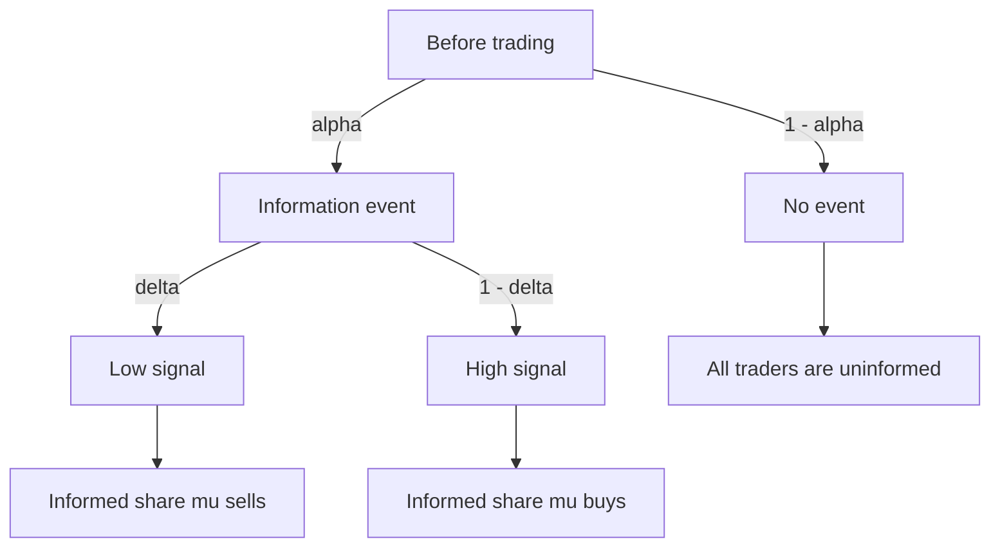

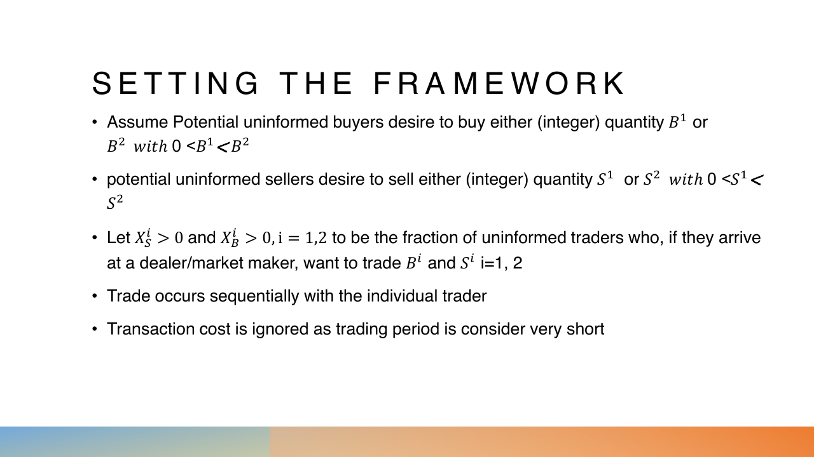

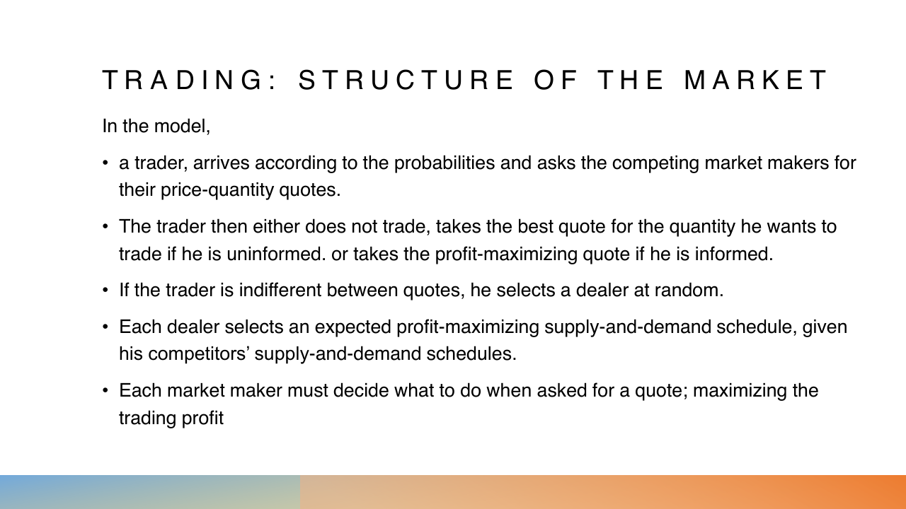

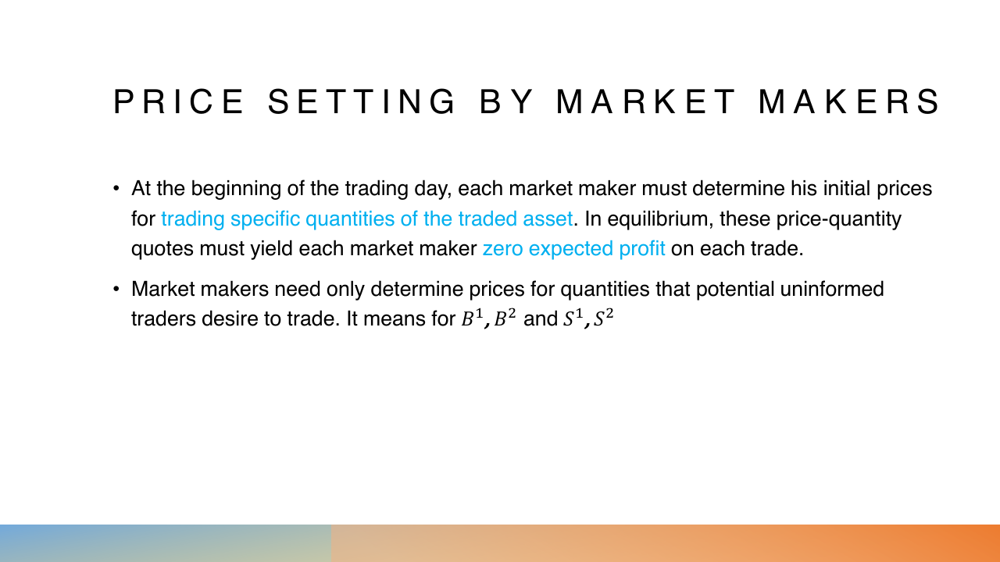

### 7.4 ⭐ Two equilibria (slides 41 and 43)

An equilibrium is a set of prices and trading choices where nobody wants to change what they do. This model has two kinds of equilibrium. The difference is which sizes the informed traders use.

| Point | Separating equilibrium | Pooling equilibrium |
|---|---|---|
| Size chosen by the informed | Mainly large | Both small and large |
| Number of informed traders | Relatively few | Many |
| Can the dealer separate types? | Yes, partly by size | No, the types are hard to tell apart |
| Where is the spread? | Only on large trades | On both sizes |
| Effect on price | Large trades get worse prices | Prices are averaged and may hide the true price |

Walk through the two columns. In a separating equilibrium, the informed trade only large sizes. This happens when informed traders are relatively few. Then a small trade must come from an uninformed trader, and only a large trade might be informed. So the size partly separates the two types. The dealer puts a spread only on large trades, and large trades get worse prices.

In a pooling equilibrium, the informed use both sizes. This happens when informed traders are many. Then a trade of either size might be informed, and the dealer cannot tell the types apart by size. So both sizes carry a spread. The price mixes the two types, so it may hide the true price.

In pooling, both types choose the same action at the same price with positive probability. "With positive probability" means it happens some of the time, not never.

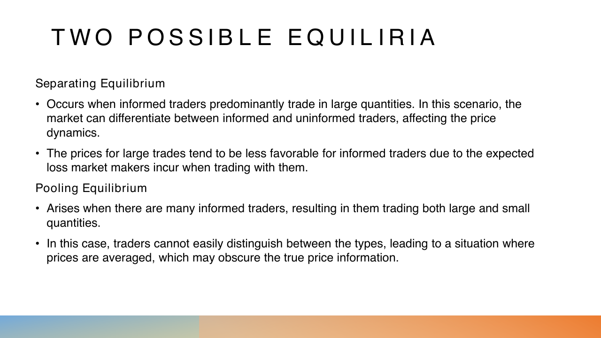

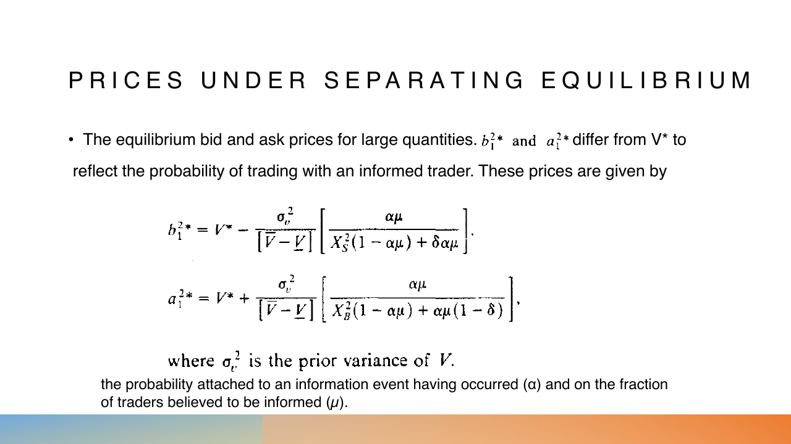

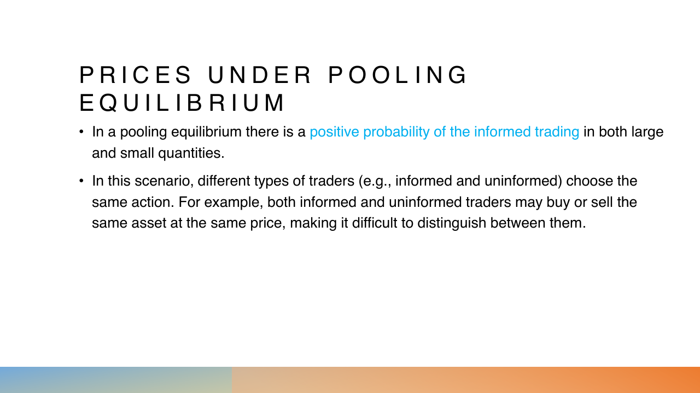

### 7.5 ⭐ Separating prices step by step (slide 42)

The goal is the large bid $b_2$, the price at which the dealer buys a large sale. The method is the regret-free rule of section 5.5: the bid equals the expected value given that a large sale arrives. So we need the chance of each state together with a large sale, and then Bayes rule. In a separating equilibrium, informed traders trade only large sizes.

**Step 1: List the ways a large sale can happen.** There are three states of the world: an event with a low signal, an event with a high signal, and no event. For each state, multiply the chance of the state by the chance of a large sale in that state.

- **Event and low signal:** The state has chance $\alpha\delta$. A fraction $\mu$ of trades are informed, and they all sell large. A fraction $1-\mu$ are uninformed, and a share $X_S^2$ of them sell large. So a large sale has chance $\mu+(1-\mu)X_S^2$.
- **Event and high signal:** The state has chance $\alpha(1-\delta)$. The informed now buy, so they never sell. Only uninformed traders sell large, with chance $(1-\mu)X_S^2$.
- **No event:** The state has chance $1-\alpha$. Every trader is uninformed, so a large sale has chance $X_S^2$.

| State | Joint probability with a large sale |
|---|---|
| Event and low signal | $\alpha\delta[\mu+(1-\mu)X_S^2]$ |
| Event and high signal | $\alpha(1-\delta)(1-\mu)X_S^2$ |
| No event | $(1-\alpha)X_S^2$ |

**Step 2: Add them.** The three states cannot happen together, so the total chance of a large sale is the sum of the three rows. First separate the informed part, $\alpha\delta\mu$, from the uninformed parts, which all contain $X_S^2$.

$$\Pr(S^2)=\alpha\delta\mu+X_S^2[\alpha\delta(1-\mu)+\alpha(1-\delta)(1-\mu)+(1-\alpha)]$$

The first two terms in the bracket share $\alpha(1-\mu)$, and $\delta+(1-\delta)=1$. So they add to $\alpha(1-\mu)=\alpha-\alpha\mu$. Adding $1-\alpha$ gives $1-\alpha\mu$.

$$\Pr(S^2)=X_S^2(1-\alpha\mu)+\alpha\delta\mu$$

**Step 3: Find the expected value.** The bid $b_2$ is the expected value given a large sale. By Bayes rule, it is the sum over states of the joint probability times the value in that state, divided by $\Pr(S^2)$. The value is $\underline{V}$ after a low signal, $\bar{V}$ after a high signal, and $V^{\ast}$ with no event.

Group the top into an uninformed part and an informed part. Uninformed sales are worth $V^{\ast}$ on average. To see this, collect the uninformed terms: in the event states they give $\alpha(1-\mu)X_S^2[\delta\underline{V}+(1-\delta)\bar{V}]=\alpha(1-\mu)X_S^2V^{\ast}$, and with no event they give $(1-\alpha)X_S^2V^{\ast}$. Together that is $X_S^2(1-\alpha\mu)V^{\ast}$, using the same sum as in Step 2. Informed sales happen only after a low signal, so they are worth $\underline{V}$.

$$b_2=\frac{X_S^2(1-\alpha\mu)V^{\ast}+\alpha\delta\mu\underline{V}}{X_S^2(1-\alpha\mu)+\alpha\delta\mu}$$

So $b_2$ is a weighted average of $V^{\ast}$ and $\underline{V}$. The weight on $\underline{V}$ is the share of large sales that come from informed traders.

**Step 4: Take $V^{\ast}$ outside.** We want to see how far $b_2$ lies below $V^{\ast}$. Add and subtract $\alpha\delta\mu V^{\ast}$ in the numerator. This changes nothing, because the two terms cancel.

$$b_2=\frac{X_S^2(1-\alpha\mu)V^{\ast}+\alpha\delta\mu V^{\ast}-\alpha\delta\mu V^{\ast}+\alpha\delta\mu\underline{V}}{X_S^2(1-\alpha\mu)+\alpha\delta\mu}$$

The first two terms of the numerator are $V^{\ast}$ times the denominator. So they divide to give $V^{\ast}$. The last two terms are $-\alpha\delta\mu(V^{\ast}-\underline{V})$.

$$b_2=V^{\ast}-\frac{\alpha\mu\delta(V^{\ast}-\underline{V})}{X_S^2(1-\alpha\mu)+\alpha\delta\mu}$$

The fraction is positive, because $V^{\ast}$ is above $\underline{V}$. So the large bid is below $V^{\ast}$.

**Step 5: Use the variance.** The slide writes the answer with the prior variance of $V$. Two facts connect the two forms. First, the definition of $V^{\ast}$ gives $V^{\ast}-\underline{V}=(1-\delta)(\bar{V}-\underline{V})$.

$$V^{\ast}-\underline{V}=\delta\underline{V}+(1-\delta)\bar{V}-\underline{V}=(1-\delta)\bar{V}-(1-\delta)\underline{V}=(1-\delta)(\bar{V}-\underline{V})$$

Second, the variance of a two-point value is $\sigma_v^2=\delta(1-\delta)(\bar{V}-\underline{V})^2$. This is the variance of a value that is $\underline{V}$ with chance $\delta$ and $\bar{V}$ with chance $1-\delta$. Dividing it by $\bar{V}-\underline{V}$ gives $\delta(1-\delta)(\bar{V}-\underline{V})$. So the numerator of Step 4 can be rewritten.

$$\alpha\mu\delta(V^{\ast}-\underline{V})=\alpha\mu\delta(1-\delta)(\bar{V}-\underline{V})=\frac{\sigma_v^2}{\bar{V}-\underline{V}}\cdot\alpha\mu$$

Put this into Step 4. The star on $b_2$ marks the equilibrium value.

$$b_2^{\ast}=V^{\ast}-\frac{\sigma_v^2}{\bar{V}-\underline{V}}\cdot\frac{\alpha\mu}{X_S^2(1-\alpha\mu)+\delta\alpha\mu}$$

**Step 6: Repeat the steps for a large buy.** The large ask $a_2$ is the expected value given a large buy. The informed buy with a high signal, so $1-\delta$ replaces $\delta$ in the denominator, and $X_B^2$ replaces $X_S^2$. Informed buys are worth $\bar{V}$, which is above $V^{\ast}$, so the ask is above $V^{\ast}$ and the sign is plus. The numerator becomes $\alpha\mu(1-\delta)(\bar{V}-V^{\ast})$. Since $\bar{V}-V^{\ast}=\delta(\bar{V}-\underline{V})$, this is again $\alpha\mu\delta(1-\delta)(\bar{V}-\underline{V})$, the same as in Step 5.

$$a_2^{\ast}=V^{\ast}+\frac{\sigma_v^2}{\bar{V}-\underline{V}}\cdot\frac{\alpha\mu}{X_B^2(1-\alpha\mu)+(1-\delta)\alpha\mu}$$

**Step 7: Price small trades.** The informed never trade small here, because this is the separating equilibrium. So a first small trade comes only from an uninformed trader. It carries no information about the value, so it has no adverse selection. The expected value given a small trade is the prior value.

$$a_1=b_1=V^{\ast}$$

**Step 8: Check that the informed prefer the large size.** The separating equilibrium exists only if informed traders really do choose the large size. Take an informed buyer, who knows the value is $\bar{V}$. A large buy earns $B^2(\bar{V}-a_2)$: the number of units times the profit per unit. A small buy earns $B^1(\bar{V}-V^{\ast})$, because the small ask is $V^{\ast}$ (Step 7). The large size must pay at least as much. A buyer needs $B^2(\bar{V}-a_2)\ge B^1(\bar{V}-V^{\ast})$.

Put in $a_2$ from Step 6. To keep lines short, write $D_B=X_B^2(1-\alpha\mu)+(1-\delta)\alpha\mu$ for its denominator. Then $a_2-V^{\ast}=\alpha\mu\delta(1-\delta)(\bar{V}-\underline{V})/D_B$, and $\bar{V}-V^{\ast}=\delta(\bar{V}-\underline{V})$ from Step 6.

$$\bar{V}-a_2=(\bar{V}-V^{\ast})-(a_2-V^{\ast})=\delta(\bar{V}-\underline{V})\left[1-\frac{\alpha\mu(1-\delta)}{D_B}\right]=\delta(\bar{V}-\underline{V})\frac{X_B^2(1-\alpha\mu)}{D_B}$$

The last equality uses $D_B-\alpha\mu(1-\delta)=X_B^2(1-\alpha\mu)$. Now divide both sides of the condition by $B^1(\bar{V}-a_2)$. Both are positive, so the inequality keeps its direction.

$$\frac{B^2}{B^1}\ge\frac{\bar{V}-V^{\ast}}{\bar{V}-a_2}=\frac{D_B}{X_B^2(1-\alpha\mu)}$$

Split the fraction, writing $D_B$ as its two parts. The first part over the denominator is 1.

$$\frac{B^2}{B^1}\ge 1+\frac{\alpha\mu(1-\delta)}{X_B^2(1-\alpha\mu)}$$

Separation holds when the large size is large enough, or when $\alpha\mu$ is small enough. A large $B^2/B^1$ makes the left side big. A small $\alpha\mu$ makes the right side close to 1. Otherwise the informed also trade small, and pooling results.

**Conclusion:** The large-trade discount rises with $\alpha$, $\mu$ and the variance of value. The discount is the gap $V^{\ast}-b_2^{\ast}$. A higher $\alpha$ or $\mu$ means a large sale is more likely to be informed. A higher variance means an informed trade costs the dealer more.

### 7.6 Pooling prices (slide 43)

In a pooling equilibrium, informed traders use both sizes. Let a share $\phi_i$ of informed sellers choose size $i$. So $\phi_1+\phi_2=1$. Use the same steps as section 7.5. The only change is in Step 1: the informed part of a size-$i$ sale is now $\mu\phi_i$ in place of $\mu$. So $\alpha\delta\mu$ becomes $\alpha\delta\mu\phi_i$ everywhere, and $\alpha\mu$ in the numerator becomes $\alpha\mu\phi_i$.

$$b_i=V^{\ast}-\frac{\sigma_v^2}{\bar{V}-\underline{V}}\cdot\frac{\alpha\mu\phi_i}{X_S^i(1-\alpha\mu)+\delta\alpha\mu\phi_i}$$

Both bids are now below $V^{\ast}$, because each $\phi_i$ is above zero. So both sizes carry a spread. Informed sellers must earn the same profit at both sizes. If one size paid more, every informed seller would choose it, and they would no longer use both sizes.

### 7.7 Spread calculation (slide 44)

Slide 44 writes the quotes with costs added. The slide writes $H$ for an informed trader, $L$ for an uninformed trader and $C$ for costs and risk premium. A risk premium is extra pay for bearing risk. It prints $B=E[V\mid H]-C$, $A=E[V\mid L]+C$ and $S=E[V\mid L]-E[V\mid H]+2C$.

> **Slide error:** The dealer cannot see the type of trader, so a quote cannot depend on it. The dealer sees only the side and the size. The side is whether the trade is a buy or a sale. These are the correct forms for size $i$.

The ask for size $i$ is the expected value given a buy of size $i$, plus the cost $C$. The dealer adds $C$ because the dealer must cover the cost when selling.

$$A_i=E[V\mid B^i]+C$$

The bid for size $i$ is the expected value given a sale of size $i$, minus $C$. The dealer subtracts $C$ because the dealer must cover the cost when buying.

$$B_i=E[V\mid S^i]-C$$

The spread is the ask minus the bid. The two costs add, so the spread contains $2C$.

$$S_i=E[V\mid B^i]-E[V\mid S^i]+2C$$

The model itself assumes $C=0$ (A8). So in the model the spread is only the information part, $E[V\mid B^i]-E[V\mid S^i]$.

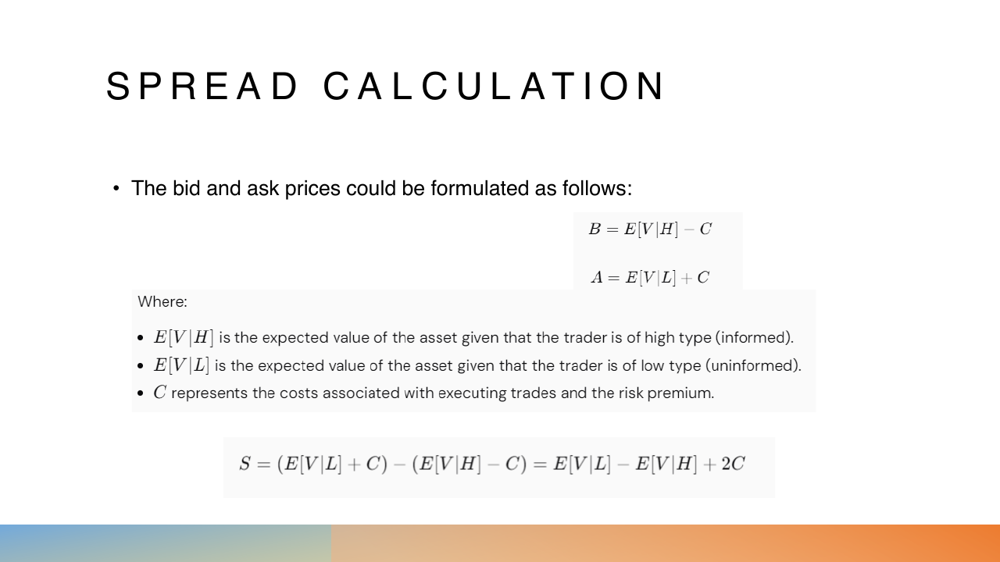

### 7.8 ⭐ Price path after a block sale (slides 45 and 46)

A block sale is a large sale. Slides 45 and 46 show how prices move after one, in a separating equilibrium. The two figures differ in what the dealer knows. In Figure 1, the dealer knows that an event has happened, but not its direction or who is informed. In Figure 2, the dealer does not even know whether an event has happened.

```text
Figure 1: only the trader type is uncertain (an event is known)

V*    o
       \
b2      o---------o
        t+1      t+2

Figure 2: the trader type and the event are both uncertain

V*    o
       \
        \         o     partial recovery, still below V*
         \       /
b2        o-----
        t+1      t+2
```

- **At time t:** A small trade happens at $V^{\ast}$. Small trades carry no information in the separating equilibrium (Step 7 of section 7.5).
- **At time t+1:** A block sale pushes the price down to $b_2$. A large sale might be informed, so the dealer now gives more weight to a low signal.
- **At time t+2 in Figure 1:** A small trade says nothing new. An event is known to have happened, so a small trade comes from an uninformed trader with the same chance after a low signal as after a high signal. So it does not change the belief, and the price stays at the low level.
- **At time t+2 in Figure 2:** A small trade comes only from an uninformed trader. If there is no event, every trader is uninformed. If there is an event, only the share $1-\mu$ is uninformed. So a small trade is more likely when there is no event. It makes "no event" more likely. The price recovers partly, toward $V^{\ast}$, but stays below it.

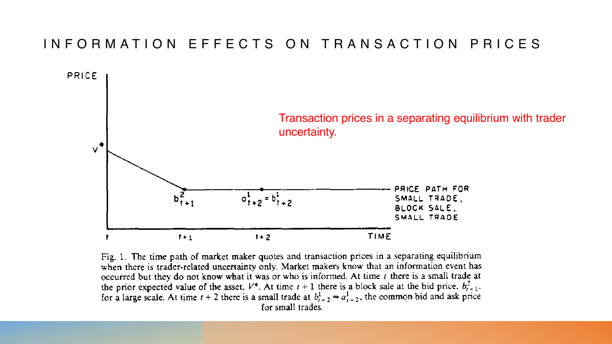

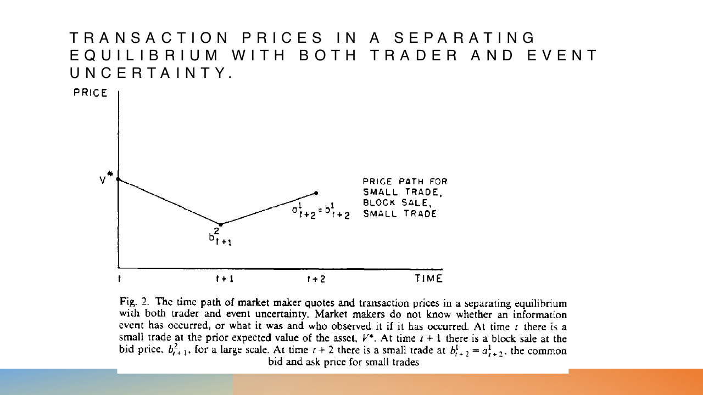

### 7.9 Worked example

This example puts numbers into sections 7.5 and 7.8. Take $\bar{V}=110$, $\underline{V}=90$, $\delta=0.5$, $\alpha=0.5$, $\mu=0.4$ and $X_S^2=X_B^2=0.25$. So the signal is equally likely to be low or high, news exists on half of the days, and a quarter of uninformed traders want the large size.

1. The prior value is $V^{\ast}=100$. It is $0.5(90)+0.5(110)$. The variance is 100. It is $\delta(1-\delta)(\bar{V}-\underline{V})^2=0.5(0.5)(20)^2=0.25(400)$.
2. The product $\alpha\mu$ is 0.2. It is $0.5(0.4)$. So $1-\alpha\mu=0.8$.
3. The denominator is $0.25(0.8)+0.5(0.2)=0.3$. This is $X_S^2(1-\alpha\mu)+\delta\alpha\mu$ from Step 5, with $0.2+0.1=0.3$.
4. The adjustment is $(100/20)(0.2/0.3)=3.333$. The first factor is $\sigma_v^2/(\bar{V}-\underline{V})=100/20=5$. The second factor is $\alpha\mu$ over the denominator. So the adjustment is $5(0.2/0.3)$.
5. The large bid is 96.667. The large ask is 103.333. Both small prices are 100. The bid is $100-3.333$ and the ask is $100+3.333$. The ask uses the same denominator, because $1-\delta=\delta=0.5$ and $X_B^2=X_S^2$. The small prices equal $V^{\ast}$ by Step 7.
6. Separation needs $B^2/B^1\ge 1.5$. This is Step 8: $1+0.2(0.5)/[0.25(0.8)]=1+0.1/0.2=1.5$. So the large size must be at least one and a half times the small size.
7. A small trade after a block sale happens at 97.391. This shows the partial recovery. The calculation follows.

First, find the belief after the block sale. Use the table in Step 1 of section 7.5. The joint chance of "event and low signal" with a large sale is $0.5(0.5)[0.4+0.6(0.25)]=0.25(0.55)=0.1375$. For "event and high signal" it is $0.5(0.5)(0.6)(0.25)=0.0375$. For "no event" it is $0.5(0.25)=0.125$. These add to 0.3. The values in the three states are 90, 110 and 100. So the expected value is $(0.1375(90)+0.0375(110)+0.125(100))/0.3=(12.375+4.125+12.5)/0.3=29/0.3=96.667$. This matches the large bid.

Next, a small trade arrives. In the separating equilibrium only uninformed traders trade small. In each event state, the chance of a small trade is $1-\mu=0.6$ times the uninformed share for that size. With no event, it is 1 times that share. The uninformed share is the same in every state, so it cancels in Bayes rule. So multiply the two event states by 0.6 and leave the no-event state alone. This gives $0.1375(0.6)=0.0825$, $0.0375(0.6)=0.0225$ and 0.125. These add to 0.23. The expected value is $(0.0825(90)+0.0225(110)+0.125(100))/0.23=(7.425+2.475+12.5)/0.23=22.4/0.23=97.391$.

So the price rises from 96.667 to 97.391, but stays below 100. The weight on "no event" rose from $0.125/0.3$, about 0.42, to $0.125/0.23$, about 0.54. This is the partial recovery of Figure 2.

### 7.10 ⭐ Findings (slide 47)

Slide 47 states four findings.

- **Block trades:** Their price effects come from informed trading. A block sale lowers the price because it might come from an informed trader, as section 7.8 shows.
- **Quantity matters:** Trade size is correlated with private information. Correlated means the two tend to move together: larger trades are more likely to be informed.
- **Informed preference:** At any given price, informed traders prefer larger amounts. Each unit earns them a profit, so more units earn more.
- **Optimal pricing:** The price depends on quantity. Large-trade prices show a higher probability of informed trading. This is why the large bid in section 7.5 is below the small bid.

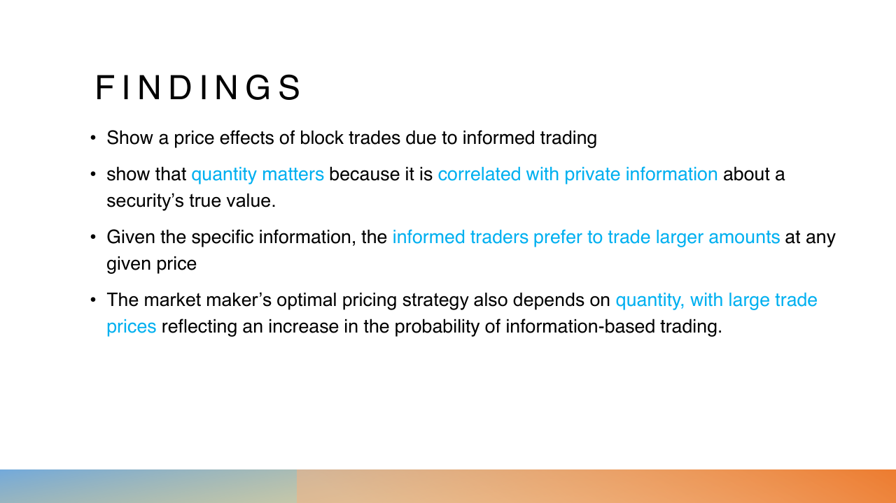

## 8. ⭐ Compare the five theories

The table puts the five models side by side on six points. Each column is one model, in the order of section 2.

| Point | Bagehot | Copeland and Galai | Glosten and Milgrom | Kyle | Easley and O'Hara |
|---|---|---|---|---|---|
| Time | No formal model | One period | Sequential | One batch, later many | Sequential |
| Dealer | Loses and recovers | Maximizes profit | Earns zero profit | Earns zero profit | Earns zero profit |
| Informed trader | Not modelled | Takes a free option | Trades one unit | Chooses size strategically | Chooses one of two sizes |
| Does the dealer learn? | No | No | From direction | From net order flow | From direction, size and sequence |
| Liquidity measure | Spread | Spread | Spread | $1/\lambda$ | Spread at each size |
| Is the event certain? | Not modelled | Yes | Yes | Yes | No |

Walk through the rows. The time row shows how the models grew. Bagehot has no formal model. Copeland and Galai have one period. Glosten and Milgrom, and Easley and O'Hara, have traders arriving one at a time. Kyle has one batch auction, and later many.

The dealer row shows the dealer's goal. In Bagehot the dealer loses to the informed and recovers from the uninformed. In Copeland and Galai the dealer maximizes profit. In the last three models competition drives the dealer's expected profit to zero.

The informed trader row shows how the insider acts. In Copeland and Galai the informed trader uses a free option. In Glosten and Milgrom the informed trader trades one unit. In Kyle the insider chooses the size to limit price impact. In Easley and O'Hara the informed trader chooses between two sizes.

The learning row shows what the dealer learns from. In Glosten and Milgrom it is the direction of the trade, buy or sale. In Kyle it is the net order flow $z$. In Easley and O'Hara it is the direction, the size and the order of trades.

The liquidity row shows how each model measures trading cost. Most models use the spread. Kyle has no spread, so liquidity is $1/\lambda$, the inverse of price impact. Easley and O'Hara have a different spread at each size.

The last row asks whether news is known to exist. Only Easley and O'Hara allow the dealer to be unsure whether an event has happened.

> **Exam:** Key words tell you which model a question is about. The word "option" points to Copeland and Galai, because of the free call and put. "Regret free", "Bayes" and "sequential" point to Glosten and Milgrom. "Batch", "strategic" and "order flow" point to Kyle. "Size", "block" and "event uncertainty" point to Easley and O'Hara.
