# Topic 2: Liquidity Measures and Applications

These notes follow the deck "1.5 Empirical Liquidity and it characteristics", slides 1 to 34. Section 5 covers Lesmond (2005), which is not in the slides.

Everything in this file is exam material. A ⭐ marks what to know without notes. Worked examples use made-up numbers to practise the slide formulas.

| Paper | Question | Measure | Answer |
|---|---|---|---|
| Chordia, Roll and Subrahmanyam (2000) | Does liquidity move together across stocks? | Spreads and depth | Yes, there is commonality |
| Amihud (2002) | Does illiquidity affect returns? | Absolute return per dollar traded | Less liquid stocks must pay higher returns |
| Lesmond (2005) | Which measure works in emerging markets? | LOT, Roll, Amihud and others | LOT and Roll work best across countries |
| Ince (2022) | Which part of illiquidity is priced? | Three parts of illiquidity | The idiosyncratic part predicts returns |
| Stoll (2000) | What causes friction? | Seven friction measures | Friction has real and informational parts |

## 0. Words to know first

| Term | Meaning |
|---|---|
| Liquidity | The ability to trade a large size, quickly, at low cost, when you want to |
| Immediacy | Trading now without waiting |
| Mid price | $P_M=(P_A+P_B)/2$ |
| Price impact | How much a trade moves the price |
| Commonality | The liquidity of many stocks moves together |
| Premium | The extra return that investors demand |
| Coefficient | The size and direction of an effect |
| t value | Tells whether the coefficient differs from zero. An absolute value above about 2 is significant |

## 1. Background (slides 2 and 3)

The deck has three main papers. They are Chordia and others (2000), Amihud (2002) and Ince (2022).

| No. | Paper | Contribution |
|---|---|---|
| 1 | Amihud and Mendelson (1986) | Introduced the spread as a proxy for illiquidity |
| 2 | Chordia and others (2000) | Documented commonality in liquidity |
| 3 | Chordia and others (2001) | Studied the cross-sectional relation with the level of illiquidity |
| 4 | Huberman and Halka (2001) | Found a systematic part of liquidity that changes over time |

## 2. Chordia, Roll and Subrahmanyam (2000): "Commonality in liquidity" (slides 4 to 18)

### 2.1 The gap (slide 4)

| Point | What it says |
|---|---|
| Earlier studies looked at one stock at a time | They gave little attention to common causes of liquidity |
| Liquidity moves together | Changes in liquidity are correlated across stocks |
| Two causes of change | Inventory risk and asymmetric information both change liquidity over time |
| Common causes | Trading cost and other microstructure effects have common determinants |

### 2.2 ⭐ Seven reasons for commonality (slide 5)

| No. | Reason | How it makes liquidity move together | Type |
|---|---|---|---|
| 1 | Price swings | Trading activity across the market responds to market-wide price swings | Inventory |
| 2 | Volume | Volume drives dealer inventory. So the desired inventory levels of dealers move together | Inventory |
| 3 | Interest rates | The cost of carrying inventory depends on market interest rates | Inventory |
| 4 | Volatility | Inventory risk depends on volatility. Volatility has a market component | Inventory |
| 5 | Program trading | It puts common pressure on many inventories at once | Inventory |
| 6 | Institutional funds | Funds with similar styles trade in a similar way | Correlated trading |
| 7 | Asymmetric information | A small group of large traders may know more about many stocks | Information |

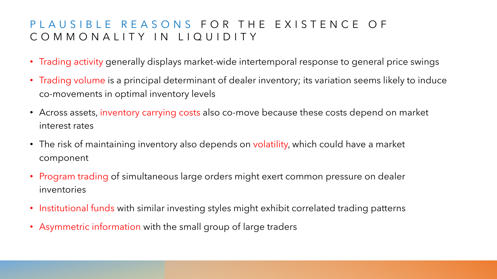

### 2.3 Implications (slide 6)

| Implication | What it says |
|---|---|
| Covariation | Liquidity moves together |
| Trading cost | The costs of trading also move together |
| Crises | Liquidity crises can be episodic. They can also be global |
| A liquidity factor | Trading cost has a common factor. See Amihud and Mendelson (1986) and Brennan and Subrahmanyam (1996) |
| Asset prices | Liquidity affects prices through two channels, in the next table |

| Channel | What matters | Effect |
|---|---|---|
| Static | The average cost of trading | A costly stock must pay a higher return |
| Dynamic | The risk that liquidity changes | Traders avoid trading, so a risky-liquidity stock must pay more |

### 2.4 Data (slides 7 and 8)

| Item | Detail |
|---|---|
| Source | NYSE transaction data from the Institute for the Study of Security Markets |
| Period | The year 1992. It has 254 trading days |
| Sample | 1,169 stocks. Each traded at least once on 10 or more days |
| Excluded stocks | Stocks with splits or stock dividends, certificates, ADRs, non-US firms, Americus Trust, closed-end funds and REITs |
| Price filter | A stock-day is deleted if the average price is below 2 dollars |
| Trade filter | The opening batch and special-settlement trades are removed |
| NYSE feature | The specialist announces the spread and depth some seconds before a trade |
| Daily value | Each measure is averaged over all trades of that stock on that day |

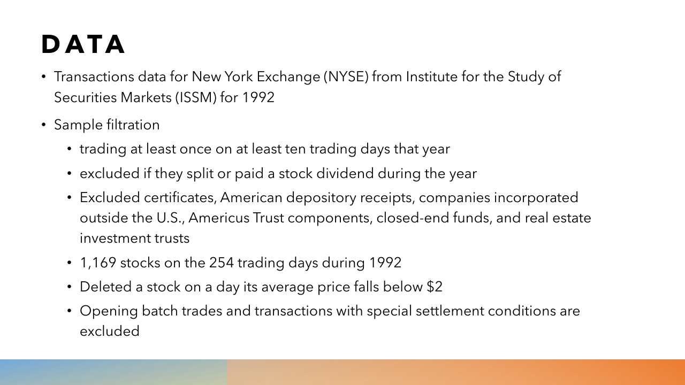

### 2.5 ⭐ The five measures (slide 9)

| Symbol | Name | Formula | Unit | Higher value means |
|---|---|---|---|---|
| QSPR | Quoted spread | $P_A-P_B$ | Dollars | Less liquidity |
| PQSPR | Proportional quoted spread | $(P_A-P_B)/P_M$ | Pure number | Less liquidity |
| DEP | Depth | $(Q_A+Q_B)/2$ | Shares | More liquidity |
| ESPR | Effective spread | $2\lvert P_t-P_M\rvert$ | Dollars | Less liquidity |
| PESPR | Proportional effective spread | $2\lvert P_t-P_M\rvert/P_t$ | Pure number | Less liquidity |

| Symbol | Meaning |
|---|---|
| $P_t$ | The trade price |
| $Q_A$ and $Q_B$ | The shares offered at the ask and the bid |

**Worked example:** The bid is 99.80 and the ask is 100.20. A buy happens at 100.10. The depths are 600 at the bid and 400 at the ask.

| Step | Measure | Working | Result |
|---|---|---|---|
| 1 | Quoted spread | $100.20-99.80$ | 0.40 |
| 2 | Mid price | $(100.20+99.80)/2$ | 100 |
| 3 | Proportional quoted spread | $0.40/100$ | 0.004 |
| 4 | Depth | $(600+400)/2$ | 500 shares |
| 5 | Effective spread | $2\lvert 100.10-100\rvert=2(0.10)$ | 0.20 |
| 6 | Proportional effective spread | $0.20/100.10$ | 0.002 |
| 7 | Compare | 0.20 against 0.40 | The effective spread is smaller because the trade is inside the quotes |

> **Exam:** The effective spread has a 2 in it. The proportional quoted spread divides by the mid price. The proportional effective spread divides by the trade price.

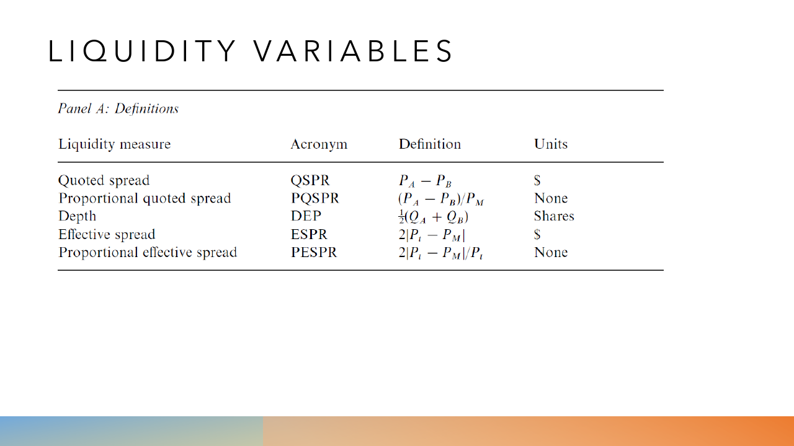

### 2.6 Cross-sectional statistics (slide 10)

| Measure | Mean | Median | Standard deviation |
|---|---|---|---|
| QSPR | 0.3162 | 0.2691 | 1.3570 |
| PQSPR | 0.0160 | 0.0115 | 0.0136 |
| DEP | 3776 | 2661 | 3790 |
| ESPR | 0.2245 | 0.1791 | 1.3051 |
| PESPR | 0.0111 | 0.0077 | 0.0132 |

| Correlation | PQSPR | DEP | ESPR | PESPR |
|---|---|---|---|---|
| QSPR | 0.844 | -0.396 | 0.665 | 0.555 |
| PQSPR | | -0.303 | 0.549 | 0.699 |
| DEP | | | -0.228 | -0.156 |
| ESPR | | | | 0.871 |

| What we see | Why |
|---|---|
| Effective below quoted | Many trades happen inside the quotes |
| Mean above median | A few illiquid stocks pull the mean up |
| Spreads agree | All spread measures have positive correlation with each other |
| Depth is opposite | A wide spread comes with low depth |

### 2.7 Daily changes (slide 11)

The letter D means the proportional change from the previous day.

$$DL_t=\frac{L_t-L_{t-1}}{L_{t-1}}$$

| Absolute change | Mean | Median | Standard deviation |
|---|---|---|---|
| DQSPR | 0.2396 | 0.2373 | 0.0741 |
| DPQSPR | 0.2408 | 0.2386 | 0.0742 |
| DDEP | 0.7828 | 0.6543 | 0.4533 |
| DESPR | 0.3148 | 0.2976 | 0.1367 |
| DPESPR | 0.3196 | 0.2977 | 0.1811 |

Liquidity changes a lot from day to day. Depth changes the most.

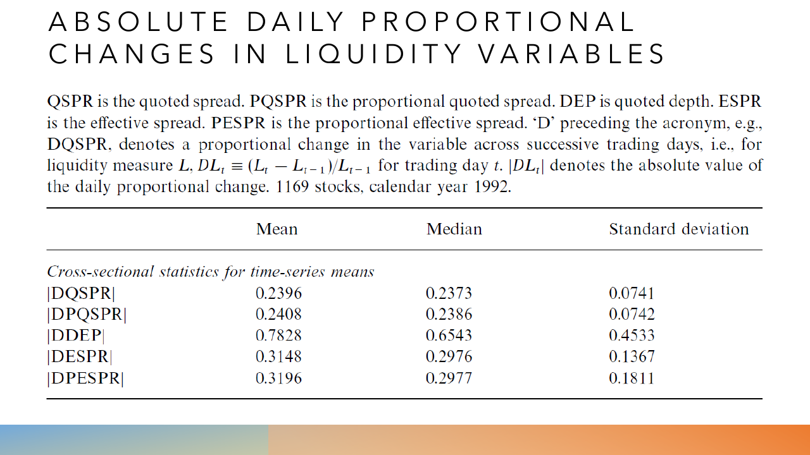

### 2.8 ⭐ Test 1: market commonality (slides 12 and 13)

$$DL_{j,t}=\alpha_j+\beta_jDL_{M,t}+\varepsilon_{j,t}$$

| Part | Meaning |
|---|---|
| $DL_{j,t}$ | The change in liquidity of stock $j$ |
| $DL_{M,t}$ | The change in average market liquidity on the same day |
| $\beta_j\gt 0$ | The stock moves with the market. This is commonality |
| Extra terms | The regression also has a lag and a lead of the market change |
| Table notation | t values are in brackets. "Significant" means positive with t above 1.645 |

| Item | DQSPR | DPQSPR | DDEP | DESPR | DPESPR |
|---|---|---|---|---|---|
| Same day | 0.690 (28.29) | 0.791 (30.09) | 1.373 (15.50) | 0.280 (10.64) | 0.778 (2.06) |
| Percent positive | 84.86 | 84.26 | 81.61 | 68.61 | 71.00 |
| Percent significant | 34.65 | 33.27 | 31.05 | 14.88 | 14.29 |
| Lag | 0.123 (4.72) | 0.169 (6.46) | -0.047 (-0.72) | 0.058 (2.63) | 0.179 (1.80) |
| Percent positive | 58.60 | 59.80 | 47.65 | 53.04 | 55.95 |
| Percent significant | 8.81 | 9.50 | 4.62 | 6.93 | 7.96 |
| Lead | 0.053 (2.33) | 0.050 (1.87) | 0.336 (5.55) | 0.042 (1.99) | -0.156 (-0.65) |
| Percent positive | 55.35 | 56.29 | 56.54 | 53.21 | 55.00 |
| Percent significant | 6.84 | 7.01 | 7.19 | 5.73 | 6.76 |

| Result | What it says |
|---|---|
| Main result | The same-day coefficient is positive for all five measures |
| Breadth | About 69 to 85 percent of stocks have a positive coefficient |
| Timing | The same day matters much more than the lag or the lead |
| Reading a number | A value of 0.69 means that a 1 percent change in the market spread goes with a 0.69 percent change in the stock spread |

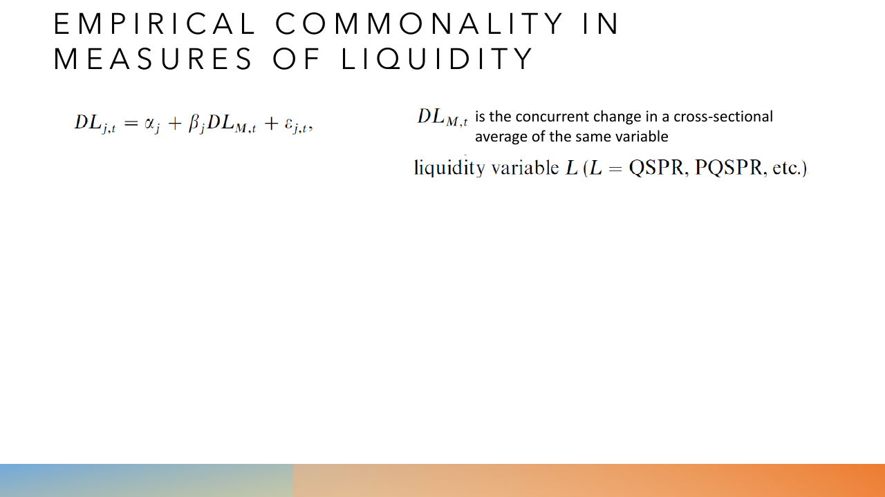

### 2.9 Test 2: market and industry (slide 14)

$$DL_{j,t}=\alpha_j+\beta_{j,M}DL_{M,t}+\beta_{j,I}DL_{I,t}+\varepsilon_{j,t}$$

Here $DL_{I,t}$ is the change in average industry liquidity.

| Measure | Market, same day | Industry, same day | Market, sum | Industry, sum | Mean R-squared |
|---|---|---|---|---|---|
| DQSPR | 0.264 (9.86) | 0.467 (16.65) | 0.409 | 0.530 | 0.024 |
| DPQSPR | 0.505 (14.06) | 0.287 (11.08) | 0.642 | 0.386 | 0.022 |
| DDEP | 0.721 (6.17) | 0.614 (7.28) | 1.030 | 0.596 | 0.014 |
| DESPR | 0.164 (5.26) | 0.414 (7.51) | 0.260 | 0.429 | 0.020 |
| DPESPR | -0.172 (-0.60) | 0.970 (1.81) | -0.468 | 1.285 | 0.018 |

| Result | What it says |
|---|---|
| Two sources | Both the market and the industry matter |
| Sum | It adds the same day, the lag and the lead |
| Small power | The regression explains only about 2 percent of daily changes. Most changes are specific to the firm |

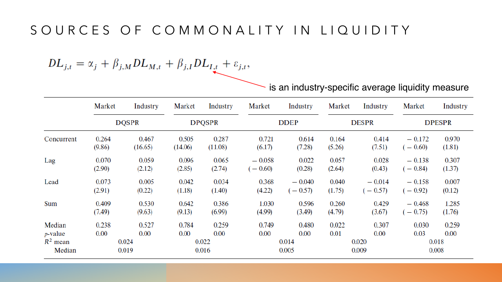

### 2.10 Test 3: inventory risk or information (slides 15 and 16)

| Idea used | Source |
|---|---|
| The number of trades indicates asymmetric information | Jones and others, 1994 |
| Stealth trading: informed traders break up orders. They are most active in medium sizes | Barclay and Warner, 1993 |
| The trading frequency of a stock is strongly influenced by the market and the industry | Slide 15 |

$$DL_{j,t}=\alpha_j+\beta_SDS_{j,t}+\beta_TDT_{j,t}+\beta_MDV_{M,t}+\beta_IDV_{I,t}+\varepsilon_{j,t}$$

| Variable | Meaning | What it stands for |
|---|---|---|
| $S$ | Average dollar size of a trade in the stock | Block pressure or information |
| $T$ | Number of trades in the stock | Asymmetric information |
| $V_M$ | Market dollar volume without stock $j$ | Balanced, uninformed trading |
| $V_I$ | Industry dollar volume without stock $j$ | Trading in the industry |

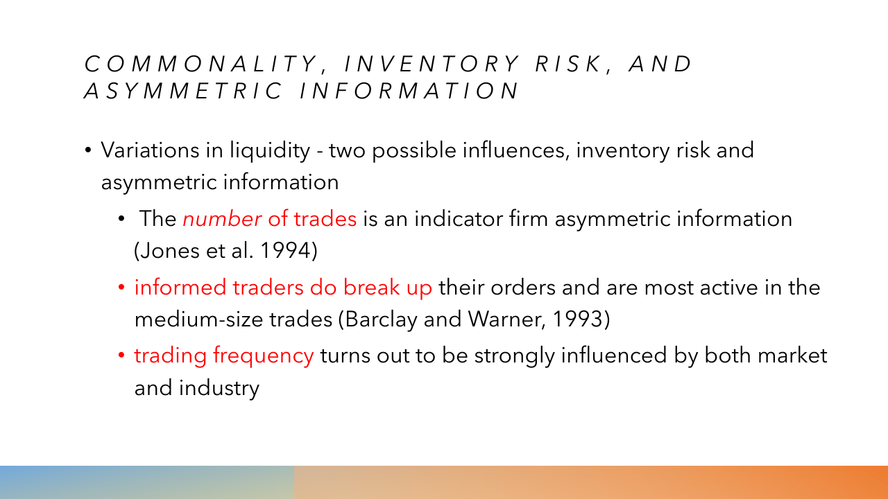

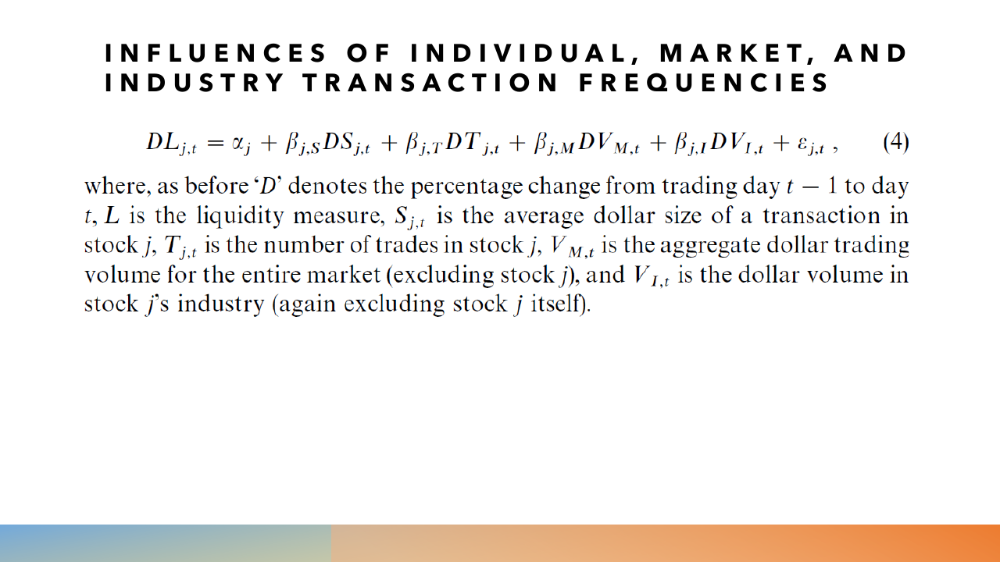

### 2.11 Observations (slide 17)

| Variable | Effect | Explanation |
|---|---|---|
| Trading in general | The usual view: more trading should reduce spreads | Inventory view |
| Number of transactions | Spreads rise with it. It has a strong positive effect on spreads | Informed traders |
| Market volume | Negative and marginal effect on the quoted spread | Balanced, uninformed trading |
| Trade size | Strong positive effect on the quoted spread and on depth | Block pressure or information |
| Industry volume | Its effect on depth is negative and not significant | No clear effect |

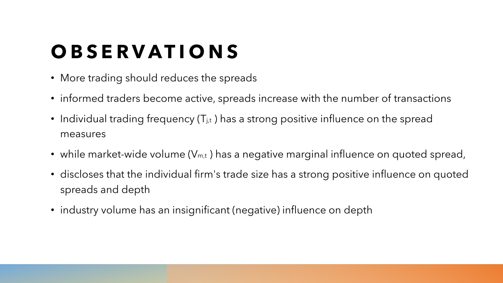

### 2.12 ⭐ Conclusion (slide 18)

| No. | Conclusion | Which theory |
|---|---|---|
| 1 | Liquidity measures of individual stocks move together | Commonality |
| 2 | The spread of a stock rises with its own number of transactions | Asymmetric information |
| 3 | The spread falls with market-wide trading, because such trading is mostly uninformed and balances inventory | Inventory risk |

> **Exam:** Write in this order: meaning, reasons, data, five measures, regression, sign and conclusion. One number is enough: the quoted spread coefficient is 0.69.

## 3. Amihud (2002): "Illiquidity and stock returns: cross-section and time-series effects" (slides 19 to 25)

### 3.1 The idea

| Point | What it says |
|---|---|
| Illiquidity | A stock is illiquid if a small traded value moves the price a lot |
| Advantage | The measure needs only daily returns and daily volume. It needs no quote data |
| Claim | Investors demand a higher expected return for an illiquid stock |

### 3.2 ⭐ The measure (slide 21)

$$ILLIQ_{iy}=\frac{1}{D_{iy}}\sum_{d=1}^{D_{iy}}\frac{\lvert R_{iyd}\rvert}{VOLD_{iyd}}$$

| Symbol | Meaning |
|---|---|
| $R_{iyd}$ | Return of stock $i$ on day $d$ of year $y$ |
| $VOLD_{iyd}$ | Dollar volume on that day |
| $D_{iy}$ | Number of days with data in that year |

| Point | What it says |
|---|---|
| Meaning | The average absolute return per dollar traded. It is a price impact measure |
| Direction | A higher value means less liquidity |
| Related measure | The Amivest ratio is total volume divided by total absolute return. See Cooper and others (1985) and Khan and Baker (1993). A higher Amivest ratio means more liquidity |

**Worked example:**

| Day | Return | Volume in million dollars | Absolute return per million dollars |
|---|---|---|---|
| 1 | 0.02 | 10 | 0.002 |
| 2 | -0.01 | 5 | 0.002 |
| 3 | 0.03 | 10 | 0.003 |

| Step | Working | Result |
|---|---|---|
| 1. Ratio for each day | $0.02/10$, $0.01/5$, $0.03/10$ | 0.002, 0.002, 0.003 |
| 2. Add the last column | $0.002+0.002+0.003$ | 0.007 |
| 3. Divide by three days | $0.007/3$ | ILLIQ is 0.002333 per million dollars |
| 4. Total volume | $10+5+10$ | 25 |
| 5. Total absolute return | $0.02+0.01+0.03$ | 0.06 |
| 6. Amivest ratio | $25/0.06=416.67$ | 416.67 million dollars per unit return |

> **Exam:** Take the ratio for each day first. Then take the average. Do not divide the average return by the average volume. Always state the unit.

### 3.3 Is it a good measure? (slide 22)

The test compares it with two measures from detailed trade data.

$$ILLIQ_i=-292+247.9\lambda_i+49.2\psi_i$$

| Term | Meaning | t value |
|---|---|---|
| Intercept | $-292$ | 12.25 |
| $\lambda_i$ | Kyle's price impact | 13.78 |
| $\psi_i$ | The fixed-cost part of the spread | 17.33 |
| R-squared | 0.30 | |

Both slopes are positive. So the simple measure agrees with the detailed measures.

### 3.4 ⭐ Effect on returns: data and method (slides 23 and 24)

| Item | Detail |
|---|---|
| Market | NYSE stocks from 1963 to 1997 |
| Source | CRSP daily and monthly |
| Method | Fama and MacBeth (1973) |
| Tests | One cross-section in each month from 1964 to 1997. That is 408 months |
| Delisting | Returns are adjusted for delisting (Shumway, 1997). This avoids survivorship bias |
| Timing | Each stock characteristic comes from year $y-1$. So it is known at the start of year $y$ |

$$R_{imy}=k_{0my}+\sum_{j=1}^{J}k_{jmy}X_{ji,y-1}+U_{imy}$$

| Symbol | Meaning |
|---|---|
| $R_{imy}$ | Return of stock $i$ in month $m$ of year $y$ |
| $X_{ji,y-1}$ | Characteristic $j$ from the previous year, such as illiquidity |
| $k_{jmy}$ | Price of that characteristic in that month |
| $U_{imy}$ | Error term |

The method has three steps.

| Step | What we do |
|---|---|
| 1 | Run one regression across stocks in each month |
| 2 | Save the coefficients of each month |
| 3 | Average them over 408 months and test whether the average is zero |

### 3.5 Findings

The findings slide (slide 25) is blank in our deck. The [midsem liquidity notes](../pre-midsem/2_liquidity/liquidity_measures.html), section 3, list them.

## 4. Ince (2022): liquidity components (slides 26 to 28 and slide 34)

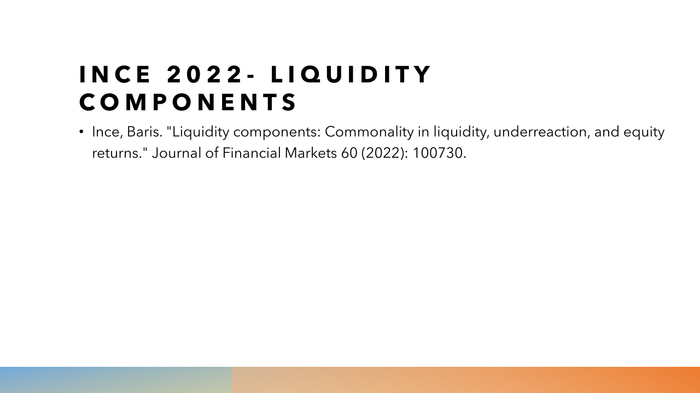

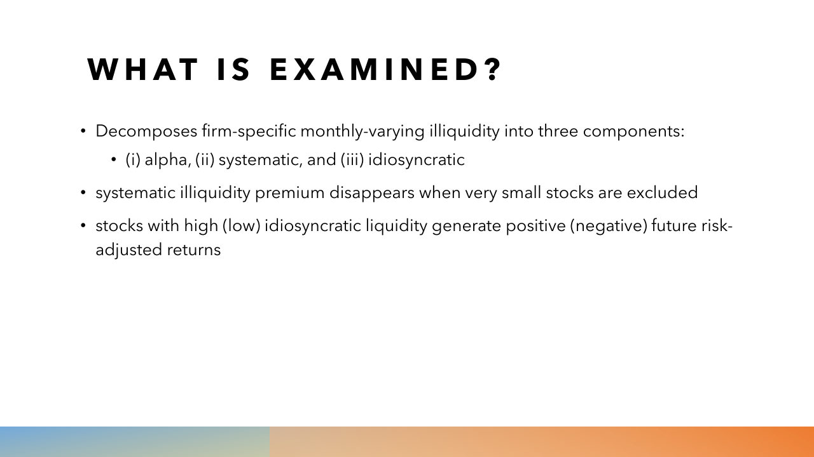

### 4.1 What the paper does

The paper splits the monthly illiquidity of a firm into three parts.

| No. | Part | What it is |
|---|---|---|
| 1 | Alpha | The constant part for that firm |
| 2 | Systematic | It moves with the market |
| 3 | Idiosyncratic | It is specific to the firm |

### 4.2 Findings

| Part | Finding |
|---|---|
| Systematic premium | It disappears when very small stocks are removed |
| Idiosyncratic part | High idiosyncratic liquidity gives positive future risk-adjusted returns. Low idiosyncratic liquidity gives negative ones |

### 4.3 Data (slide 34)

This slide sits after Stoll in the deck, but it belongs to Ince.

| Item | Detail |
|---|---|
| Stocks | Common stocks on NYSE, Amex and Nasdaq |
| Period | January 1964 to December 2018 |
| Source | CRSP |

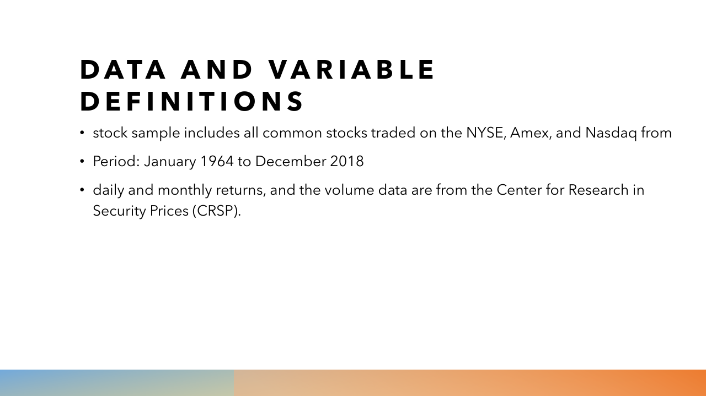

### 4.4 Other articles on commonality (slide 28)

| Article | Cause or finding |
|---|---|
| Kamara and others (2008), Koch and others (2009) | Correlated trading by institutions |
| Morck and others (2000) | Weak incentive to trade individual securities |
| Huberman and Halka (2001) | Investor sentiment |
| Coughenour and Saad (2004), Hameed and others (2010) | Funding limits of intermediaries |
| Karolyi and others (2012) | Evidence from 40 markets |

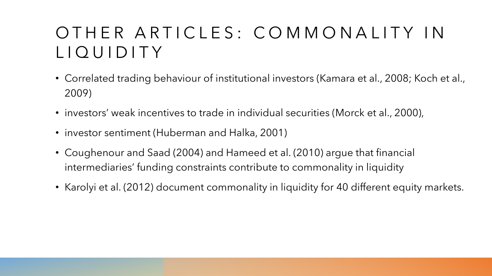

## 5. Lesmond (2005): "Liquidity of emerging markets"

The paper is in the Journal of Financial Economics, volume 77, pages 411 to 452.

> **Source:** The full paper is behind a paywall, and I did not read it. The main findings below come from parts of the abstract and from summaries, both shown by web search. The LOT model in 5.4 comes from the original 1999 paper. The last column of the table in 5.3 is explanation. It is not a claim of the paper.

### 5.1 The problem

| Point | What it says |
|---|---|
| Data is missing | Many emerging markets lack long records of bids and asks |
| Cost still matters | Trading can be very costly in these markets |
| Solution | Estimate liquidity from daily prices and volume |
| Question | Which low-frequency measure works across countries and within a country? |

### 5.2 Setting

| Item | Detail |
|---|---|
| Markets | Summaries say that it covers 31 emerging markets. One citing paper says 23 |
| Period | A summary of the paper reports 1987 to 2000 |
| Test | It compares five liquidity measures with quoted spreads, where spreads are available |
| Named measures | Search summaries name LOT, Roll, Amihud and turnover. I remember the fifth as Amivest, but I did not verify this |

### 5.3 The measures

| Measure | Formula | Type | Data needed | Main weakness |
|---|---|---|---|---|
| LOT | $\alpha_2-\alpha_1$ | Price based | Daily returns of stock and market | It needs an estimation model |
| Roll | $2\sqrt{-\mathrm{Cov}(\Delta P_t,\Delta P_{t-1})}$ | Price based | Daily prices | It fails when covariance is positive |
| Amihud | Average of absolute return over traded value | Price impact | Returns and volume | It fails with zero volume |
| Turnover | Shares traded over shares outstanding | Volume based | Volume and share count | Volume can rise in a crisis while cost also rises |

### 5.4 ⭐ The LOT model (Lesmond, Ogden and Trzcinka, 1999)

**Idea:** An investor trades only if the value of information exceeds the cost of trading. Otherwise the price does not move. So many zero-return days indicate high trading cost.

**Assumptions:**

| No. | Assumption |
|---|---|
| A1 | The true return $R^{\ast}$ follows the market model |
| A2 | Selling needs a true return below $\alpha_1$, where $\alpha_1\lt 0$ |
| A3 | Buying needs a true return above $\alpha_2$, where $\alpha_2\gt 0$ |
| A4 | The marginal informed investor trades only beyond these limits |
| A5 | The error is normal |

| Step | What we do |
|---|---|
| 1 | Write the true return |
| 2 | Write what we observe in each of the three regions |
| 3 | Estimate by maximum likelihood |
| 4 | Take the difference of the two limits |

**Step 1: Write the true return.**

$$R^{\ast}_{jt}=\beta_jR_{mt}+\varepsilon_{jt}$$

**Step 2: Write what we observe in each of the three regions.**

| True return | Observed return | Meaning |
|---|---|---|
| $R^{\ast}\lt\alpha_1$ | $R=R^{\ast}-\alpha_1$ | Bad news is larger than the selling cost |
| $\alpha_1\le R^{\ast}\le\alpha_2$ | $R=0$ | News is too small, so the return is zero |
| $R^{\ast}\gt\alpha_2$ | $R=R^{\ast}-\alpha_2$ | Good news is larger than the buying cost |

**Step 3: Estimate by maximum likelihood.**

| Part of the likelihood | Days it covers |
|---|---|
| Falls | Days with $R\lt 0$ |
| Zeros | Days with $R=0$ |
| Rises | Days with $R\gt 0$ |

It chooses $\alpha_1$, $\alpha_2$, $\beta$ and the error variance to make the observed returns most likely.

**Step 4: Take the difference.**

| Cost | Value |
|---|---|
| Selling cost | $-\alpha_1$ |
| Buying cost | $\alpha_2$ |
| Round-trip cost | Their sum |

$$LOT=\alpha_2-\alpha_1$$

**Worked example:** Take $\alpha_1=-0.010$ and $\alpha_2=0.015$.

| Step | Case | Working | Result |
|---|---|---|---|
| 1 | Round-trip cost | $0.015+0.010=0.025$ | 2.5 percent |
| 2 | True return 0.025, above $\alpha_2$ | $0.025-0.015=0.010$ | Observed 0.010 |
| 3 | True return 0.007, between the limits | No trade | Observed zero |
| 4 | True return -0.018, below $\alpha_1$ | $-0.018+0.010=-0.008$ | Observed -0.008 |

The 1999 paper estimated round-trip costs of 1.2 percent for the largest US firms and 10.3 percent for the smallest, for 1963 to 1990.

**Simpler cousin:** The share of zero-return days also measures illiquidity. Bekaert, Harvey and Lundblad report that Lesmond (2005) found it highly correlated with hand-collected spreads in emerging markets.

### 5.5 ⭐ Findings

| No. | Topic | Finding |
|---|---|---|
| 1 | Across countries | The price-based measures, LOT and Roll, work better than volume-based measures |
| 2 | Within a country | LOT works best. Amihud works to a lesser extent |
| 3 | Institutions | Countries with weak political and legal institutions have significantly higher liquidity cost. The abstract says that this holds "even to the exclusion of legal origin or insider trading enforcement" |
| 4 | Political risk | More political risk goes with 10 basis points higher cost by LOT. It goes with 1.9 percent higher price impact by Amihud |
| 5 | Which risk is stronger | Political risk appears stronger than information risk created by legal institutions |

> **Exam:** Remember the pair. LOT and Roll are for comparisons across countries. LOT and then Amihud are for comparisons within a country. Then add institutions and political risk.

## 6. Stoll (2000): "Friction" (slides 29 to 33)

### 6.1 What friction means (slide 30)

| View | Friction is | Source |
|---|---|---|
| Time | The time needed to trade a given amount optimally | Lippman and McCall (1986) |
| Price | The price concession paid for immediacy | Demsetz (1968) |

Stoll uses the price view.

### 6.2 What the paper does (slide 29)

| Item | Detail |
|---|---|
| Focus | It studies the sources of trading friction |
| Measures | It builds seven robust measures from transaction data |
| Sample | 1,706 NYSE and AMSE stocks and 2,184 Nasdaq stocks |
| Insights | The size of cost, real against informational friction, and the effect of market structure |
| Relations | How the measures relate to each other and to trading characteristics |

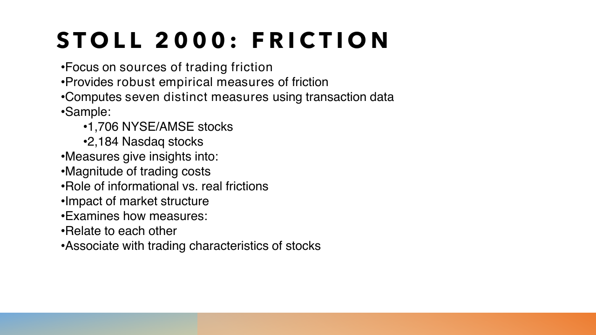

### 6.3 Price of immediacy (slides 31 and 32)

$$s=a_0+a_1\log V+a_2\sigma^2+a_3\log MV+a_4\log P+a_5\log N+e$$

| Symbol | Meaning |
|---|---|
| $s=(A-B)/2P$ | The proportional quoted half-spread |
| $V$ | Daily dollar volume |
| $\sigma^2$ | Return variance |
| $MV$ | Market value |
| $P$ | Price |
| $N$ | Trades per day |

Results for December 1997 have t values in brackets.

| Variable | NYSE and AMSE | Nasdaq | Why |
|---|---|---|---|
| Intercept | 0.0207 | 0.0384 | It is the base level |
| Log volume | -0.0010 (-9.35) | -0.0012 (-5.95) | Inventory is easier to unload |
| Variance | 1.5467 (16.74) | 0.4908 (7.56) | Inventory risk is higher |
| Log market value | 0.0003 (3.56) | -0.0003 (-2.18) | The sign differs by market |
| Log price | -0.0024 (-21.15) | -0.0020 (-9.51) | Fixed cost is spread over a higher price |
| Log trades | 0.0003 (2.63) | -0.0011 (-5.60) | The sign differs by market |
| Adjusted R-squared | 0.7731 | 0.6467 | The fit is strong |

January and February 1998 give similar results.

| Month | NYSE and AMSE adjusted R-squared | Nasdaq adjusted R-squared |
|---|---|---|
| January 1998 | 0.7763 | 0.6588 |
| February 1998 | 0.7914 | 0.6688 |

### 6.4 Real and informational friction (slide 33)

| Friction | What it is |
|---|---|
| Real friction | Trading uses real resources, such as labour, systems and capital to bear inventory risk |
| Informational friction | Wealth moves from less informed traders to better informed traders |

| Measure | Formula | What it contains |
|---|---|---|
| Quoted half-spread | $S=(A-B)/2$ | Total friction |
| Effective half-spread | $ES=\lvert P-M\rvert$ | Total friction on actual trades |
| Traded spread | Not given. The slide says "refer to article". | Not given |

> **Exam:** Stoll uses half-spreads. Chordia uses full spreads. So Chordia's effective spread is twice Stoll's.

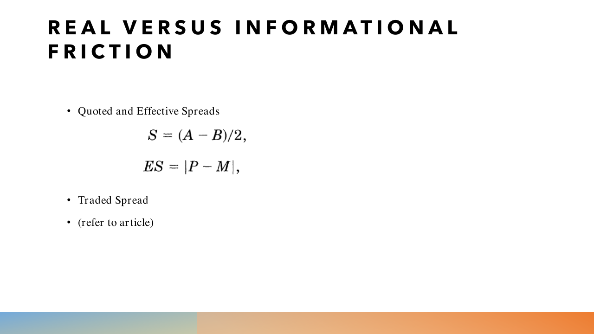
