# Topic 2: Liquidity Measures and Applications

These notes follow the deck "1.5 Empirical Liquidity and it characteristics", slides 1 to 34. Section 5 covers Lesmond (2005), which is not in the slides.

Everything in this file is exam material. A ⭐ marks what to know without notes. Worked examples use made-up numbers to practise the slide formulas.

The topic has five papers. The table below gives one paper per row, so you can see the whole topic at once. The "Question" column says what the paper asks. The "Measure" column says what the paper uses to measure liquidity or trading cost. The "Answer" column gives the main result in a few words. Each paper has its own section below, and every word in the table is explained there.

| Paper | Question | Measure | Answer |
|---|---|---|---|
| Chordia, Roll and Subrahmanyam (2000) | Does liquidity move together across stocks? | Spreads and depth | Yes, there is commonality |
| Amihud (2002) | Does illiquidity affect returns? | Absolute return per dollar traded | Less liquid stocks must pay higher returns |
| Lesmond (2005) | Which measure works in emerging markets? | LOT, Roll, Amihud and others | LOT and Roll work best across countries |
| Ince (2022) | Which part of illiquidity is priced? | Three parts of illiquidity | The idiosyncratic part predicts returns |
| Stoll (2000) | What causes friction? | Seven friction measures | Friction has real and informational parts |

## 0. Words to know first

The papers in this topic use the same few words again and again. This section defines each word before any paper needs it. Later sections refer back here.

- **Liquidity:** Liquidity is the ability to trade a large size, quickly, at low cost, when you want to. So it has four parts: size, speed, cost and timing. A stock is liquid when all four are easy. A stock is illiquid when trading it is slow or costly, or when a trade moves its price a lot.
- **Bid and ask:** The ask, written $P_A$, is the price at which you can buy right now. The bid, written $P_B$, is the price at which you can sell right now. The ask is always above the bid. Together, the bid and the ask are called the quotes.
- **Spread:** The spread is the ask minus the bid. Suppose you buy at the ask and then sell at once at the bid. You lose the spread. So the spread is a cost of trading. A wide spread means a costly, less liquid stock.
- **Depth:** Depth is the number of shares offered at the quotes. $Q_A$ is the number of shares offered for sale at the ask. $Q_B$ is the number of shares wanted at the bid. More depth means a larger trade can happen at the quoted price. So more depth means more liquidity.
- **Immediacy:** Immediacy means trading now, without waiting. A trader who wants immediacy accepts the quoted price instead of waiting for a better one.
- **Mid price:** The mid price is the point halfway between the bid and the ask. It is $P_M=(P_A+P_B)/2$. We add the two quotes and divide by two, which gives their average. The notes use the mid price as the reference point when they measure how far a trade price is from the middle of the quotes.
- **Price impact:** Price impact is how much a trade moves the price. A large price impact means the stock is illiquid, because even a modest trade pushes the price.
- **Commonality:** Commonality means that the liquidity of many stocks moves together. On a day when one stock becomes less liquid, many other stocks also become less liquid.
- **Premium:** A premium is the extra return that investors demand. For example, investors may demand an extra return for holding a stock that is costly to trade.
- **Regression:** A regression is a statistical method. It fits a straight-line relation between one variable and one or more other variables. The variable we want to explain sits on the left of the equals sign. The variables that explain it sit on the right. The fitted equation looks like $y=a+bx+e$. Here $a$ is the intercept, which is the value of $y$ when $x$ is zero. $b$ is the slope. $e$ is the error, which is the part of $y$ that the line does not explain.
- **Coefficient and t value:** A coefficient is a number that the regression estimates, such as the slope $b$. The coefficient gives the size and direction of an effect. A positive coefficient means $y$ rises when $x$ rises. A negative coefficient means $y$ falls when $x$ rises. The t value tells whether the coefficient differs from zero. It compares the coefficient with how uncertain the estimate is. An absolute value above about 2 is significant. "Significant" means the coefficient is unlikely to be zero, so the effect is unlikely to be pure chance.
- **R-squared:** R-squared is the share of the variation in $y$ that the regression explains. It lies between 0 and 1. An R-squared of 0.30 means the right-hand variables explain 30 percent of the differences in $y$. Adjusted R-squared is the same idea, corrected for the number of right-hand variables.
- **Cross-section and time series:** A cross-section compares many stocks at one point in time. A time series follows one stock over many days. "Cross-sectional" and "time-series" describe which of the two a statistic or regression uses.

## 1. Background (slides 2 and 3)

Before the main papers, slides 2 and 3 place them in a line of earlier work. This background says where each idea in the topic came from.

The deck has three main papers. They are Chordia and others (2000), Amihud (2002) and Ince (2022). "Chordia and others" is short for Chordia, Roll and Subrahmanyam. The slides list four pieces of work that build the line, in time order.

1. **Amihud and Mendelson (1986):** They introduced the spread as a proxy for illiquidity. A proxy is a quantity we can measure that stands in for one we cannot measure directly. Illiquidity cannot be seen directly. The spread can be seen in the quotes. So a wider spread is read as a sign of a less liquid stock.
2. **Chordia and others (2000):** They documented commonality in liquidity. "Documented" means they showed it with data. So this paper showed that the liquidity of many stocks moves together. Section 2 covers it.
3. **Chordia and others (2001):** They studied the cross-sectional relation with the level of illiquidity. "Cross-sectional" means comparing many stocks at the same time (section 0). So this work compares stocks whose levels of illiquidity differ.
4. **Huberman and Halka (2001):** They found a systematic part of liquidity that changes over time. "Systematic" means shared by many stocks, as opposed to specific to one stock. So this is a second piece of evidence that liquidity has a common part.

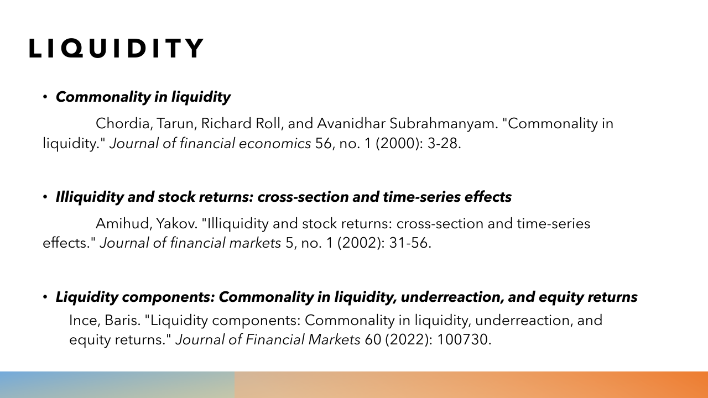

## 2. Chordia, Roll and Subrahmanyam (2000): "Commonality in liquidity" (slides 4 to 18)

This paper asks one question. Does the liquidity of different stocks move together? The answer is yes. The sections below follow the slides in order. First comes the gap in earlier work. Then come the reasons to expect commonality, the data, the measures, the three tests and the conclusion.

### 2.1 The gap (slide 4)

This slide says what earlier work missed, and so why the paper was needed.

**Earlier studies looked at one stock at a time:** Earlier research studied the liquidity of each stock on its own. Because of this, it gave little attention to causes that affect many stocks at once. Such causes are called common causes.

**Liquidity moves together:** The paper's starting point is that changes in liquidity are correlated across stocks. "Correlated" means they tend to move in the same direction at the same time. So when liquidity falls in one stock, it tends to fall in others too.

**Two causes of change:** Two forces change liquidity over time. The first is inventory risk. A dealer is a trader who stands ready to buy and sell, and posts the bid and the ask. The shares the dealer holds after trading are the dealer's inventory. Inventory risk is the risk that the price moves against the dealer while the dealer holds this inventory. The second force is asymmetric information. Asymmetric information means some traders know more about the stock's value than the dealer does. Both forces make the dealer widen the spread, so both change liquidity.

**Common causes:** Trading cost and other microstructure effects have common determinants. A determinant is a cause. So some of the things that set trading cost are the same for many stocks. That is why we should expect liquidity to move together.

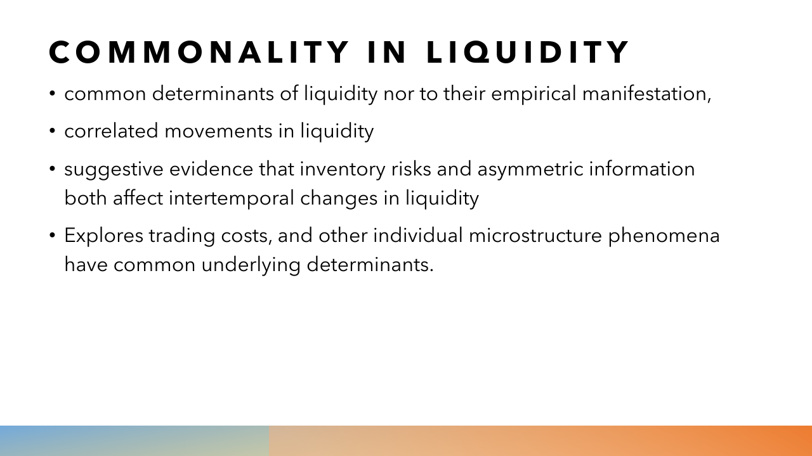

### 2.2 ⭐ Seven reasons for commonality (slide 5)

Why should liquidity move together? The slide gives seven reasons. Each reason is a force that hits many stocks at the same time. When one force hits many stocks at once, it changes their liquidity at once. That shared movement is commonality.

1. **Price swings:** Trading activity across the market responds to market-wide price swings. When the whole market moves sharply, investors trade many stocks at the same time. So trading activity rises or falls in many stocks together, and their liquidity changes together.
2. **Volume:** Volume is the amount traded. Volume drives dealer inventory, because every trade with a dealer adds to or takes from the dealer's holdings. Market-wide volume rises and falls for all stocks together. So the desired inventory levels of dealers move together. Dealers set their quotes with their inventory in mind, so their quotes move together too.
3. **Interest rates:** The cost of carrying inventory depends on market interest rates. Holding shares ties up money, and that money has a cost set by interest rates. Interest rates are the same for every dealer. So when rates change, the cost of holding inventory changes for all stocks at once.
4. **Volatility:** Volatility is how much a price swings. Inventory risk depends on volatility, because a bigger swing means a bigger possible loss on the shares the dealer holds. Volatility has a market component, which is a part shared by all stocks. So when market volatility rises, inventory risk rises in many stocks at once, and dealers widen spreads together.
5. **Program trading:** Program trading is the trading of a whole basket of stocks in one go. It puts common pressure on many inventories at once. So dealers in many stocks face the same buying or selling pressure at the same moment.
6. **Institutional funds:** An institutional fund is a large investor, such as a mutual fund. Funds with similar styles hold similar stocks. So they trade in a similar way, buying or selling the same groups of stocks at the same times.
7. **Asymmetric information:** A small group of large traders may know more about many stocks. Then dealers in all of those stocks face the same informed traders. So the information risk, and the spreads it causes, rise and fall in those stocks together.

### 2.3 Implications (slide 6)

Suppose liquidity does move together. What follows from that? The slide lists five implications.

**Covariation:** Liquidity moves together. "Covariation" is the formal word for this. It means two or more quantities vary together.

**Trading cost:** The costs of trading also move together. This follows because the spread is a trading cost, and spreads are part of liquidity.

**Crises:** Liquidity crises can be episodic. "Episodic" means they come in bursts at particular times, not all the time. They can also be global, which means they hit many markets at once. Both follow from commonality: if liquidity falls in many stocks together, a crisis is shared rather than isolated.

**A liquidity factor:** A factor is a common driver shared by many assets. Trading cost has a common factor. See Amihud and Mendelson (1986) and Brennan and Subrahmanyam (1996).

**Asset prices:** Liquidity affects prices through two channels. The table below names them. Read each row from left to right: the channel, then what matters in that channel, then the effect on returns.

| Channel | What matters | Effect |
|---|---|---|
| Static | The average cost of trading | A costly stock must pay a higher return |
| Dynamic | The risk that liquidity changes | Traders avoid trading, so a risky-liquidity stock must pay more |

The static channel looks at the average level of cost. An investor who pays a high cost to trade a stock keeps less of the return. So the investor buys the stock only if it pays a higher return to make up for the cost. The dynamic channel looks at the risk that liquidity changes in the future. When liquidity may get worse, traders avoid trading. So investors want extra return for holding a stock whose liquidity is risky. In both rows, illiquidity raises the return a stock must pay.

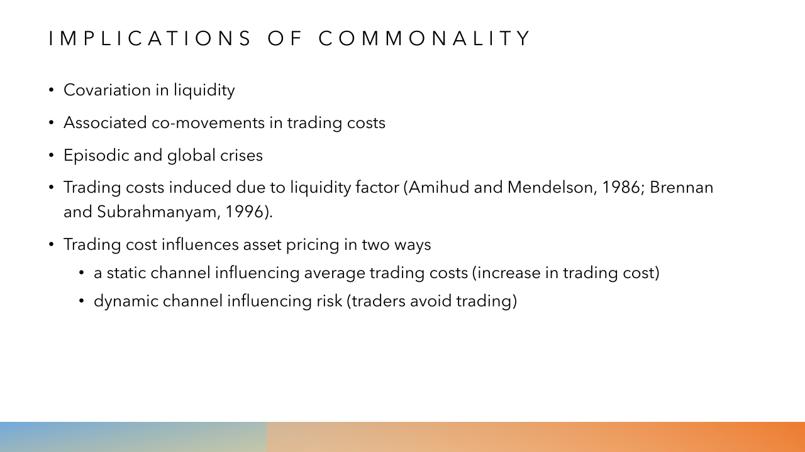

### 2.4 Data (slides 7 and 8)

To test for commonality, the paper needs the liquidity of many stocks on many days. This section says where the data comes from and how it was cleaned.

**Source:** NYSE transaction data comes from the Institute for the Study of Security Markets. NYSE is the New York Stock Exchange. Transaction data records every trade and every quote, one by one.

**Period:** The year is 1992. It has 254 trading days. A trading day is a day the exchange is open.

**Sample:** It has 1,169 stocks. Each traded at least once on 10 or more days. This rule keeps out stocks that almost never traded, because a stock with very few trades gives very few measurements.

**Excluded stocks:** Stocks with splits or stock dividends, certificates, ADRs, non-US firms, Americus Trust, closed-end funds and REITs are removed. A split or a stock dividend changes the number of shares and so changes the price per share. That would change a dollar spread for a reason that has nothing to do with liquidity. An ADR (American Depositary Receipt) is a certificate traded in the US that stands for shares of a foreign firm. A closed-end fund is a fund whose own shares trade on the exchange. A REIT is a real estate investment trust. After these removals, the sample holds only ordinary common shares of US firms.

**Price filter:** A stock-day is deleted if the average price is below 2 dollars. A stock-day is one stock on one day. So the paper drops each day on which a stock's price is very low.

**Trade filter:** The opening batch and special-settlement trades are removed. The opening batch is the set of orders matched together at a single price when the market opens. A special-settlement trade is a trade settled on terms that differ from the normal ones. Both kinds of trade do not happen in the normal way against the posted quotes. So they are removed.

**NYSE feature:** The specialist announces the spread and depth some seconds before a trade. The specialist is the NYSE dealer in charge of a stock. So other traders know the quoted spread and the depth before each trade, even if only by a few seconds. This means each trade can be matched with the quotes that were in force when it happened.

**Daily value:** Each measure is averaged over all trades of that stock on that day. So each stock gets one number per measure per day. These daily numbers are what the tests use.

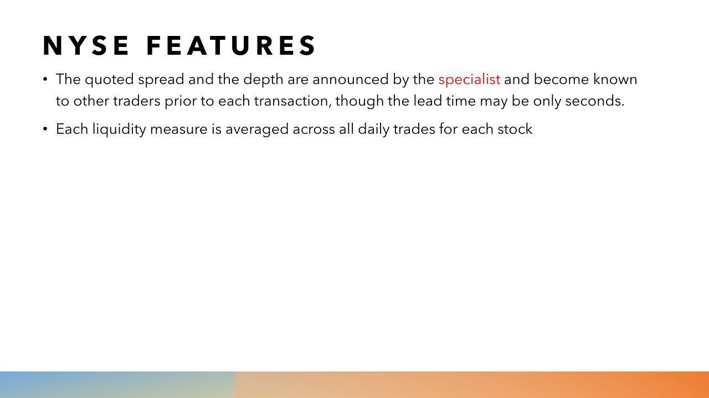

### 2.5 ⭐ The five measures (slide 9)

The paper measures liquidity in five ways. Each way catches a different side of liquidity: the cost of a round trip, the size available, or the cost on actual trades. The table gives each measure's short name, its formula, its unit, and which direction is good.

| Symbol | Name | Formula | Unit | Higher value means |
|---|---|---|---|---|
| QSPR | Quoted spread | $P_A-P_B$ | Dollars | Less liquidity |
| PQSPR | Proportional quoted spread | $(P_A-P_B)/P_M$ | Pure number | Less liquidity |
| DEP | Depth | $(Q_A+Q_B)/2$ | Shares | More liquidity |
| ESPR | Effective spread | $2\lvert P_t-P_M\rvert$ | Dollars | Less liquidity |
| PESPR | Proportional effective spread | $2\lvert P_t-P_M\rvert/P_t$ | Pure number | Less liquidity |

Here $P_t$ is the trade price. $Q_A$ and $Q_B$ are the shares offered at the ask and the bid.

Here is how to read each row. The quoted spread is the ask minus the bid, in dollars. A wider spread costs more, so a higher value means less liquidity. The proportional quoted spread divides the quoted spread by the mid price. Dividing a dollar amount by a dollar price cancels the dollars, so the result is a pure number. This lets us compare a cheap stock with an expensive one. Depth is the average of the shares offered at the ask and at the bid. More shares on offer means more liquidity, so depth is the only measure where higher is better. The effective spread looks at an actual trade. The symbol $\lvert P_t-P_M\rvert$ means the absolute value of $P_t-P_M$, which is the distance between the trade price and the mid price, always counted as positive. The distance is multiplied by 2 so that the result is on the same scale as a full spread. The proportional effective spread divides the effective spread by the trade price, so it is also a pure number.

**Worked example:** The bid is 99.80 and the ask is 100.20. A buy happens at 100.10. The depths are 600 at the bid and 400 at the ask. We now compute all five measures, one at a time.

1. The quoted spread is 0.40. We take the ask minus the bid.

$$QSPR=P_A-P_B=100.20-99.80=0.40$$

2. The mid price is 100. So the proportional quoted spread is 0.004. First we find the mid price by averaging the bid and the ask. Then we divide the quoted spread by it.

$$P_M=\frac{P_A+P_B}{2}=\frac{100.20+99.80}{2}=\frac{200}{2}=100$$

$$PQSPR=\frac{P_A-P_B}{P_M}=\frac{0.40}{100}=0.004$$

The result 0.004 is a pure number. It means the spread is 0.4 percent of the mid price.

3. The depth is 500 shares. We average the shares at the ask and at the bid.

$$DEP=\frac{Q_A+Q_B}{2}=\frac{400+600}{2}=\frac{1000}{2}=500$$

4. The effective spread is $2(0.10)=0.20$. The trade price is 100.10 and the mid price is 100. Their distance is 0.10. We double it.

$$ESPR=2\lvert P_t-P_M\rvert=2\lvert 100.10-100\rvert=2(0.10)=0.20$$

5. The proportional effective spread is $0.20/100.10=0.002$. We divide the effective spread by the trade price, not by the mid price.

$$PESPR=\frac{0.20}{100.10}=0.001998\approx 0.002$$

6. The effective spread is smaller because the trade is inside the quotes. The buy happened at 100.10, which is below the ask of 100.20. So the buyer paid less than the full quoted cost. If the buy had happened exactly at the ask, the effective spread would be $2\lvert 100.20-100\rvert=0.40$, the same as the quoted spread.

> **Exam:** The effective spread has a 2 in it. The doubling puts it on the same scale as the full quoted spread. The proportional quoted spread divides by the mid price. The proportional effective spread divides by the trade price. Mixing up these two divisors is the most common slip.

### 2.6 Cross-sectional statistics (slide 10)

Before testing for commonality, the paper describes the five measures. This slide answers two questions. How large is each measure in a typical stock? And do the measures agree with each other?

The first table works in two steps. First, for each stock, the measure is averaged over all days of 1992. This is a time-series mean, because it follows one stock over time. Second, these 1,169 stock averages are described across stocks. That is why the slide calls them cross-sectional statistics. The mean is the ordinary average. The median is the middle value when the stocks are sorted from low to high. The standard deviation measures how spread out the values are around the mean.

| Measure | Mean | Median | Standard deviation |
|---|---|---|---|
| QSPR | 0.3162 | 0.2691 | 1.3570 |
| PQSPR | 0.0160 | 0.0115 | 0.0136 |
| DEP | 3776 | 2661 | 3790 |
| ESPR | 0.2245 | 0.1791 | 1.3051 |
| PESPR | 0.0111 | 0.0077 | 0.0132 |

The second table gives correlations. A correlation measures how two quantities move together. It runs from -1 to 1. A positive correlation means they rise and fall together. A negative correlation means one rises when the other falls. For each stock, the paper finds the correlation between two measures over the days of 1992. Then it averages that correlation across stocks. Read a cell by taking its row name and its column name. For example, the cell in row QSPR and column PQSPR is 0.844. So the quoted spread and the proportional quoted spread have an average correlation of 0.844.

| Correlation | PQSPR | DEP | ESPR | PESPR |
|---|---|---|---|---|
| QSPR | 0.844 | -0.396 | 0.665 | 0.555 |
| PQSPR | | -0.303 | 0.549 | 0.699 |
| DEP | | | -0.228 | -0.156 |
| ESPR | | | | 0.871 |

The tables lead to four observations.

**Effective below quoted:** The mean effective spread is 0.2245 dollars. The mean quoted spread is 0.3162 dollars. So the effective spread is smaller. The reason is that many trades happen inside the quotes, as in the worked example in 2.5.

**Mean above median:** For every measure, the mean is larger than the median. For example, the mean quoted spread is 0.3162 but the median is 0.2691. A few illiquid stocks have very large spreads. These few large values pull the mean up, but they do not move the middle value much.

**Spreads agree:** All spread measures have positive correlation with each other. For example, ESPR and PESPR have a correlation of 0.871. So when one spread measure is high, the others tend to be high too.

**Depth is opposite:** Every correlation in the DEP row and column is negative, such as -0.396 with QSPR. So a wide spread comes with low depth. This fits section 0: a wide spread and low depth both mean low liquidity.

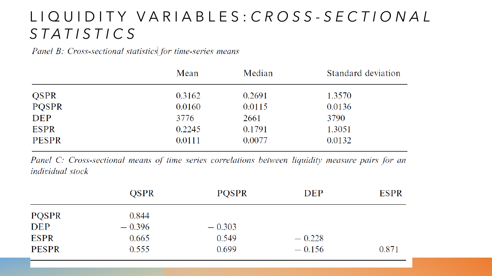

### 2.7 Daily changes (slide 11)

Commonality is about how liquidity changes from day to day. So the paper next turns each measure into a daily change.

The letter D means the proportional change from the previous day. A proportional change is the change divided by the starting value. We take today's value, subtract yesterday's value, and divide by yesterday's value.

$$DL_t=\frac{L_t-L_{t-1}}{L_{t-1}}$$

Here $L$ stands for any one of the five measures. $L_t$ is its value on day $t$, and $L_{t-1}$ is its value on the day before. So DQSPR is the daily proportional change in the quoted spread, DDEP is the daily proportional change in depth, and so on. For example, if a spread is 0.25 yesterday and 0.30 today, then $DL_t=(0.30-0.25)/0.25=0.20$, which is a rise of 20 percent.

The table below uses the absolute value of each daily change. The absolute value ignores the sign, so a rise of 20 percent and a fall of 20 percent both count as 0.20. This measures how big the daily moves are, whatever their direction. As in 2.6, each stock's values are first averaged over the year, and then described across stocks.

| Absolute change | Mean | Median | Standard deviation |
|---|---|---|---|
| DQSPR | 0.2396 | 0.2373 | 0.0741 |
| DPQSPR | 0.2408 | 0.2386 | 0.0742 |
| DDEP | 0.7828 | 0.6543 | 0.4533 |
| DESPR | 0.3148 | 0.2976 | 0.1367 |
| DPESPR | 0.3196 | 0.2977 | 0.1811 |

Liquidity changes a lot from day to day. The mean absolute change in the quoted spread is 0.2396. This means the quoted spread moves by about 24 percent from one day to the next, on average. Depth changes the most. Its mean absolute change is 0.7828, so depth moves by about 78 percent a day on average.

### 2.8 ⭐ Test 1: market commonality (slides 12 and 13)

Now the paper tests the main question. When the liquidity of the whole market changes, does the liquidity of a single stock change in the same direction on the same day? To answer this, it runs a regression (section 0) for each stock.

$$DL_{j,t}=\alpha_j+\beta_jDL_{M,t}+\varepsilon_{j,t}$$

- $DL_{j,t}$ is the change in liquidity of stock $j$. It is the proportional change from 2.7, for stock $j$ on day $t$.
- $DL_{M,t}$ is the change in average market liquidity on the same day. The slide calls it the concurrent change in a cross-sectional average of the same variable. "Concurrent" means on the same day. "Cross-sectional average" means the average across stocks.
- $\alpha_j$ is the intercept for stock $j$. $\varepsilon_{j,t}$ is the error, the part of the stock's change that the market change does not explain.
- A positive $\beta_j$ means that the stock moves with the market. When market liquidity gets worse, the stock's liquidity also gets worse. This is commonality.
- The regression also has a lag and a lead of the market change. The lag is the market change on the previous day. The lead is the market change on the next day. They check whether the link is really same-day, or spread over nearby days.

Written out with the lag and the lead, the regression for each stock looks like the line below. The names $\beta_{j,-1}$ and $\beta_{j,+1}$ for the extra slopes are our labels, not the slide's.

$$DL_{j,t}=\alpha_j+\beta_{j,-1}DL_{M,t-1}+\beta_jDL_{M,t}+\beta_{j,+1}DL_{M,t+1}+\varepsilon_{j,t}$$

This regression is run once for each of the 1,169 stocks, using that stock's daily data over the year. So each stock gets its own slopes. The table then summarises these 1,169 sets of slopes.

- In the table, t values are in brackets. "Significant" means positive with t above 1.645. The slide says 1.645 is the 5 percent critical level in a one-tailed test. A one-tailed test asks only whether the slope is positive, not whether it differs from zero in either direction.

Here is how to read the table. Each column is one of the five liquidity measures. The rows come in three blocks: same day, lag and lead. In each block, the first row is the average slope across all stocks, with its t value in brackets. "Percent positive" is the share of stocks whose own slope is positive. "Percent significant" is the share of stocks whose own slope is positive with t above 1.645.

| Item | DQSPR | DPQSPR | DDEP | DESPR | DPESPR |
|---|---|---|---|---|---|
| Same day | 0.690 (28.29) | 0.791 (30.09) | 1.373 (15.50) | 0.280 (10.64) | 0.778 (2.06) |
| Percent positive | 84.86 | 84.26 | 81.61 | 68.61 | 71.00 |
| Percent significant | 34.65 | 33.27 | 31.05 | 14.88 | 14.29 |
| Lag | 0.123 (4.72) | 0.169 (6.46) | -0.047 (-0.72) | 0.058 (2.63) | 0.179 (1.80) |
| Percent positive | 58.60 | 59.80 | 47.65 | 53.04 | 55.95 |
| Percent significant | 8.81 | 9.50 | 4.62 | 6.93 | 7.96 |
| Lead | 0.053 (2.33) | 0.050 (1.87) | 0.336 (5.55) | 0.042 (1.99) | -0.156 (-0.65) |
| Percent positive | 55.35 | 56.29 | 56.54 | 53.21 | 55.00 |
| Percent significant | 6.84 | 7.01 | 7.19 | 5.73 | 6.76 |

The table gives four results.

**Main result:** The same-day coefficient is positive for all five measures. The values run from 0.280 to 1.373. Every same-day t value is above 2, for example 28.29 for the quoted spread. So for every measure, a stock's liquidity moves with market liquidity on the same day. This is commonality.

**Breadth:** About 69 to 85 percent of stocks have a positive coefficient. The "Percent positive" row in the same-day block runs from 68.61 to 84.86. So commonality is not driven by a few stocks. Most stocks move with the market.

**Timing:** The same day matters much more than the lag or the lead. The lag and lead slopes are much smaller, for example 0.123 and 0.053 for the quoted spread against 0.690 on the same day. Their "Percent significant" values are also low, under 10 percent. So the link between a stock and the market happens mostly on the same day.

**Reading a number:** A value of 0.69 means that a 1 percent change in the market spread goes with a 0.69 percent change in the stock spread. Both sides of the regression are proportional changes, so the slope compares percent with percent. For example, if the market's quoted spread rises by 10 percent on a day, the average stock's quoted spread rises by about 6.9 percent that day.

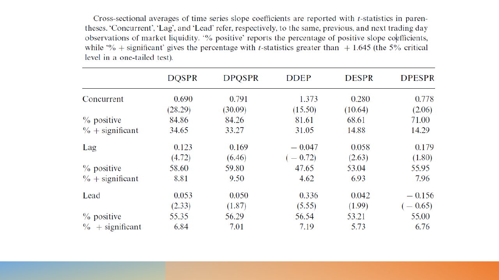

### 2.9 Test 2: market and industry (slide 14)

Test 1 showed that stocks move with the market. But stocks in the same industry may share causes too. So Test 2 asks whether the industry adds anything beyond the market. It puts both on the right-hand side of the regression.

$$DL_{j,t}=\alpha_j+\beta_{j,M}DL_{M,t}+\beta_{j,I}DL_{I,t}+\varepsilon_{j,t}$$

Here $DL_{I,t}$ is the change in average industry liquidity. It is the same kind of proportional change as before, averaged over the stocks in stock $j$'s industry. $\beta_{j,M}$ is the slope on the market change, and $\beta_{j,I}$ is the slope on the industry change. Each slope measures the link with one source while the other source is held fixed.

Here is how to read the table. Each row is one liquidity measure. The first two columns are the same-day slopes, averaged across stocks, with t values in brackets. The two "sum" columns add up the same-day, lag and lead slopes for each source. The last column is the mean R-squared across the stock regressions.

| Measure | Market, same day | Industry, same day | Market, sum | Industry, sum | Mean R-squared |
|---|---|---|---|---|---|
| DQSPR | 0.264 (9.86) | 0.467 (16.65) | 0.409 | 0.530 | 0.024 |
| DPQSPR | 0.505 (14.06) | 0.287 (11.08) | 0.642 | 0.386 | 0.022 |
| DDEP | 0.721 (6.17) | 0.614 (7.28) | 1.030 | 0.596 | 0.014 |
| DESPR | 0.164 (5.26) | 0.414 (7.51) | 0.260 | 0.429 | 0.020 |
| DPESPR | -0.172 (-0.60) | 0.970 (1.81) | -0.468 | 1.285 | 0.018 |

The table gives three results.

**Two sources:** Both the market and the industry matter. For the first four measures, both same-day slopes are positive with t values above 2. For example, the quoted spread has 0.264 (9.86) for the market and 0.467 (16.65) for the industry. So a stock's liquidity moves with its industry even after the market is taken into account. The last row is the exception. For DPESPR, the market slope is -0.172 with t of -0.60, which is not significant.

**Sum:** It adds the same day, the lag and the lead. So the sum gives the total link over the three days around each day. For the quoted spread, the market sum is 0.409, compared with 0.264 on the same day alone.

**Small power:** The regression explains only about 2 percent of daily changes. The mean R-squared values run from 0.014 to 0.024, which is 1.4 to 2.4 percent. So the market and the industry together explain only a small part of how a stock's liquidity changes each day. Most changes are specific to the firm. Commonality is real, because the slopes are significant, but it is a small part of the daily story.

### 2.10 Test 3: inventory risk or information (slides 15 and 16)

Tests 1 and 2 showed that commonality exists. Test 3 asks why. Section 2.1 named two forces that change liquidity: inventory risk and asymmetric information. This test tries to tell them apart by looking at different kinds of trading activity. Three earlier ideas guide the choice of variables.

**Number of trades:** It indicates asymmetric information (Jones and others, 1994). So when a stock has more trades, it suggests that more informed traders are active in it.

**Stealth trading:** Informed traders break up orders. They are most active in medium sizes (Barclay and Warner, 1993). An informed trader who sends one huge order would reveal the information. So the trader splits it into many medium-sized orders. This is why the count of trades, and not only their size, can carry information.

**Frequency:** The trading frequency of a stock is strongly influenced by the market and the industry. So the test must include market and industry trading. Otherwise the stock's own trade count could pick up market-wide effects.

These ideas lead to the regression below. The left side is the same daily change in liquidity as before. The right side has four daily changes, one for each kind of trading activity.

$$DL_{j,t}=\alpha_j+\beta_SDS_{j,t}+\beta_TDT_{j,t}+\beta_MDV_{M,t}+\beta_IDV_{I,t}+\varepsilon_{j,t}$$

As before, the letter D means the proportional change from day $t-1$ to day $t$. So $DS_{j,t}$ is the daily change in $S$, $DT_{j,t}$ is the daily change in $T$, and so on. Each $\beta$ is the slope on one variable. The table says what each variable is and which force it stands for.

| Variable | Meaning | What it stands for |
|---|---|---|
| $S$ | Average dollar size of a trade in the stock | Block pressure or information |
| $T$ | Number of trades in the stock | Asymmetric information |
| $V_M$ | Market dollar volume without stock $j$ | Balanced, uninformed trading |
| $V_I$ | Industry dollar volume without stock $j$ | Trading in the industry |

Read each row as a variable, then its meaning, then the force it stands for. $S$ is how large the trades in the stock are, in dollars. Large trades can push a dealer's inventory hard, which the table calls block pressure, or they can carry information. $T$ is how many trades happen in the stock, which Jones and others (1994) link to asymmetric information. $V_M$ is the dollar volume of the whole market, leaving out stock $j$ itself. Market-wide trading is mostly uninformed and balanced, which means buys and sells roughly offset each other. Balanced trading lets a dealer get rid of unwanted inventory, so it eases inventory risk. $V_I$ is the dollar volume of the industry, again leaving out stock $j$. Stock $j$ is left out of both so that its own trading does not appear on both sides of the regression.

The logic of the test follows from these meanings. If the spread rises when $T$ rises, that points to asymmetric information. If the spread falls when $V_M$ rises, that points to inventory risk.

### 2.11 Observations (slide 17)

This slide reports what the Test 3 regression found. It starts from what we would expect and then gives the signs of the slopes.

**The usual view:** More trading should reduce spreads. The reason is that more trading lets a dealer balance inventory more easily, so inventory risk falls.

**With informed traders:** Spreads rise with the number of transactions. When informed traders become active, more trades mean more risk of trading with someone who knows more. So the dealer widens the spread. This is the opposite of the usual view, and the data can tell which one holds.

**Number of trades:** It has a strong positive effect on spreads. So the slope on $DT_{j,t}$ is positive. More trades in the stock come with wider spreads. This supports the asymmetric information view.

**Market volume:** It has a negative and marginal effect on the quoted spread. "Negative" means more market-wide volume comes with a narrower quoted spread. "Marginal" means the effect is weak. This supports the inventory view, because market-wide trading is balanced and helps dealers unload inventory.

**Trade size:** It has a strong positive effect on the quoted spread and on depth. So when the average trade in the stock is larger, the quoted spread is wider and the depth is larger.

**Industry volume:** Its effect on depth is negative and not significant. "Not significant" means we cannot tell it apart from zero.

### 2.12 ⭐ Conclusion (slide 18)

The paper ends with three conclusions. Each one comes from one of the tests above.

1. Liquidity measures of individual stocks move together. This comes from Tests 1 and 2, where the same-day slopes on market and industry liquidity are positive and significant.
2. The spread of a stock rises with its own number of transactions. This is asymmetric information. It comes from Test 3, where the slope on the number of trades is positive.
3. The spread falls with market-wide trading. This is inventory risk, because such trading is mostly uninformed and balances inventory. It also comes from Test 3, where the slope on market volume is negative.

So both forces from 2.1 show up in the data. The stock's own trading shows the information force. Market-wide trading shows the inventory force.

> **Exam:** Write in this order: meaning, reasons, data, five measures, regression, sign and conclusion. "Meaning" is what commonality is (2.1). "Reasons" are the seven reasons (2.2). "Data" is the NYSE sample for 1992 (2.4). "Five measures" are QSPR, PQSPR, DEP, ESPR and PESPR (2.5). "Regression" is Test 1 (2.8). "Sign" is the positive same-day slope. "Conclusion" is the three points above. One number is enough: the quoted spread coefficient is 0.69.

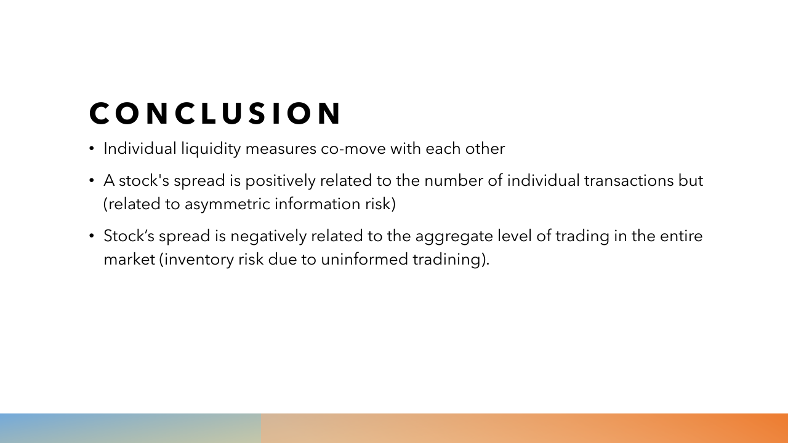

## 3. Amihud (2002): "Illiquidity and stock returns: cross-section and time-series effects" (slides 19 to 25)

This paper asks whether illiquidity affects the returns that stocks pay. To answer that, it first needs a measure of illiquidity that is easy to compute for many stocks over many years. So the paper builds a simple measure, checks that it is a good one, and then tests its effect on returns.

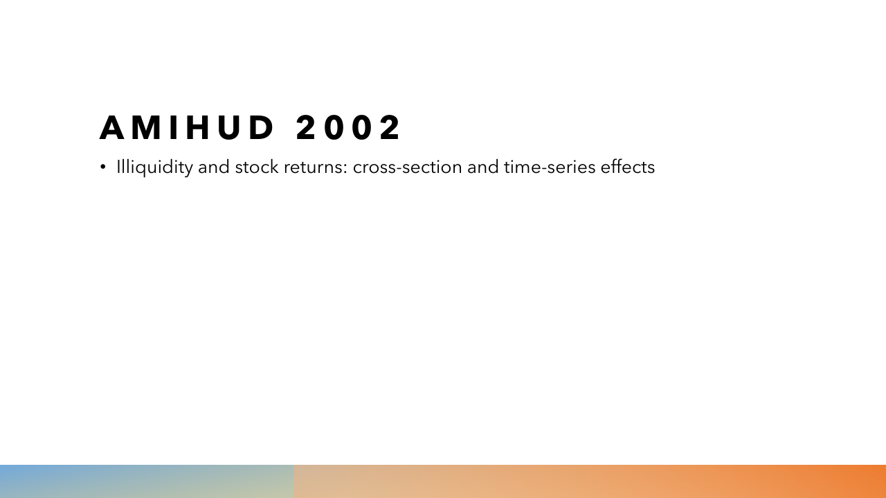

### 3.1 The idea

**Illiquidity:** A stock is illiquid if a small traded value moves the price a lot. This is the price impact idea from section 0. So the measure should compare how much the price moved with how much money was traded.

**Advantage:** The measure needs only daily returns and daily volume. It needs no quote data. A return is the percentage change in the price. Daily returns and daily volume exist for many stocks over many decades. Quote data, with every bid and ask, exists only for shorter and more recent periods. So this measure can be computed over a much longer history.

**Claim:** Investors demand a higher expected return for an illiquid stock. The expected return is the return investors anticipate on average. This is the premium from section 0, and it is the claim the paper tests.

### 3.2 ⭐ The measure (slide 21)

The measure turns the idea in 3.1 into a formula. For each day, it divides the size of the price move by the money traded that day. Then it averages these daily ratios over the year.

$$ILLIQ_{iy}=\frac{1}{D_{iy}}\sum_{d=1}^{D_{iy}}\frac{\lvert R_{iyd}\rvert}{VOLD_{iyd}}$$

The table defines each symbol.

| Symbol | Meaning |
|---|---|
| $R_{iyd}$ | Return of stock $i$ on day $d$ of year $y$ |
| $VOLD_{iyd}$ | Dollar volume on that day |
| $D_{iy}$ | Number of days with data in that year |

Read the formula from the inside out. $\lvert R_{iyd}\rvert$ is the absolute value of the day's return, so a fall of 1 percent and a rise of 1 percent count the same. We only care how far the price moved, not which way. Dividing by $VOLD_{iyd}$, the dollar volume, gives the price move per dollar traded on that day. The symbol $\sum_{d=1}^{D_{iy}}$ means "add up over every day $d$ from the first day to day $D_{iy}$". Multiplying by $1/D_{iy}$ divides that total by the number of days. So the whole formula is the average of the daily ratios over the year.

**Meaning:** It is the average absolute return per dollar traded. It is a price impact measure, because it says how much the price moves for each dollar of trading.

**Direction:** A higher value means less liquidity. A higher value says that each dollar traded moves the price more, which is the definition of an illiquid stock in 3.1.

**Related measure:** The Amivest ratio is total volume divided by total absolute return. See Cooper and others (1985) and Khan and Baker (1993). The Amivest ratio turns the Amihud ratio upside down: it puts volume on top and the price move at the bottom. So it measures how much trading the stock can absorb per unit of price move. A higher Amivest ratio means more liquidity.

**Worked example:** Take one stock over three days. The table gives each day's return and dollar volume. The last column is the daily ratio from the formula: the absolute return divided by the volume.

| Day | Return | Volume in million dollars | Absolute return per million dollars |
|---|---|---|---|
| 1 | 0.02 | 10 | 0.002 |
| 2 | -0.01 | 5 | 0.002 |
| 3 | 0.03 | 10 | 0.003 |

The last column is computed day by day. On day 2 the return is negative, so the absolute value turns -0.01 into 0.01.

$$\frac{\lvert 0.02\rvert}{10}=0.002,\quad\frac{\lvert -0.01\rvert}{5}=\frac{0.01}{5}=0.002,\quad\frac{\lvert 0.03\rvert}{10}=0.003$$

1. Add the last column. The total is 0.007.

$$0.002+0.002+0.003=0.007$$

2. Divide by three days. The answer is 0.002333 per million dollars. Here $D_{iy}=3$, because there are three days of data.

$$ILLIQ=\frac{1}{3}\times 0.007=0.002333$$

This means that, on an average day, each million dollars traded goes with a price move of about 0.002333, which is about 0.23 percent.

3. The Amivest ratio is $25/0.06=416.67$ million dollars per unit return. The total volume is the sum of the volume column. The total absolute return is the sum of the absolute returns.

$$\text{Total volume}=10+5+10=25$$

$$\text{Total absolute return}=0.02+0.01+0.03=0.06$$

$$\text{Amivest}=\frac{25}{0.06}=416.67$$

So the stock absorbs about 416.67 million dollars of trading for each full unit of absolute return.

> **Exam:** Take the ratio for each day first. Then take the average. Do not divide the average return by the average volume. The two give different answers. In the example, the average absolute return is $0.06/3=0.02$ and the average volume is $25/3=8.333$. Dividing them gives $0.02/8.333=0.0024$, which is not the correct 0.002333. Always state the unit, such as "per million dollars".

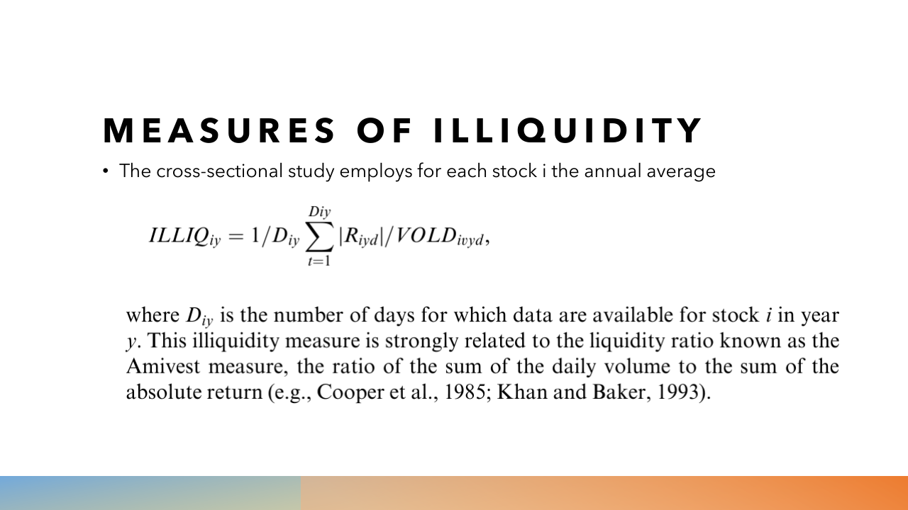

### 3.3 Is it a good measure? (slide 22)

ILLIQ is simple. So before using it, the paper checks that it agrees with more detailed measures of illiquidity. The test compares it with two measures from detailed trade data. It runs a cross-sectional regression: across stocks, ILLIQ is on the left and the two detailed measures are on the right.

$$ILLIQ_i=-292+247.9\lambda_i+49.2\psi_i$$

- $\lambda_i$ is Kyle's price impact. The slide cites Kyle (1985) and calls $\lambda$ the price impact measure. It is computed from detailed trade data for stock $i$.
- $\psi_i$ is the fixed-cost part of the spread. The slide calls it the fixed-cost component related to the bid–ask spread. It is also computed from detailed trade data.
- The t values are 12.25, 13.78 and 17.33, in the order of the terms. So 12.25 belongs to the intercept -292, 13.78 to the slope 247.9 on $\lambda_i$, and 17.33 to the slope 49.2 on $\psi_i$. All three are far above 2, so all three are significant.
- R-squared is 0.30. So the two detailed measures explain 30 percent of the differences in ILLIQ across stocks.
- Both slopes are positive. A stock with a higher detailed price impact, or a higher fixed cost, also has a higher ILLIQ. So the simple measure agrees with the detailed measures.

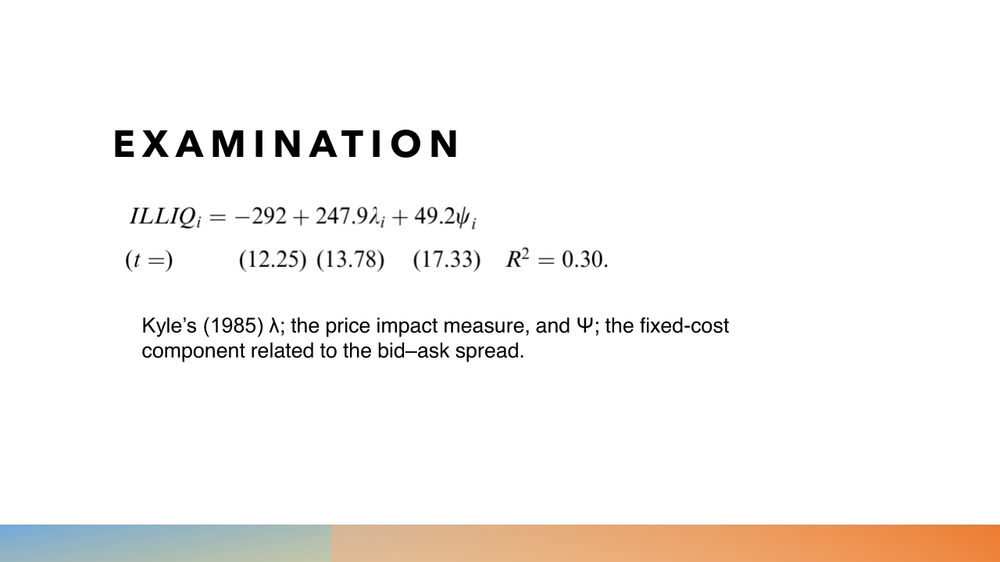

### 3.4 ⭐ Effect on returns: data and method (slides 23 and 24)

Now the paper tests its claim from 3.1: do illiquid stocks pay higher returns? This section gives the data and the method.

**Market:** The sample is NYSE stocks from 1963 to 1997.

**Source:** The data is CRSP daily and monthly. CRSP (Center for Research in Security Prices) is a standard database of US stock prices, returns and volumes.

**Method:** It uses Fama and MacBeth (1973). This is a way to test whether a stock characteristic is linked to returns. The three steps are set out below the equation.

**Tests:** It runs one cross-section in each month from 1964 to 1997. That is 408 months. The years 1964 to 1997 are 34 years, and 34 years times 12 months gives 408 months. The tests start in 1964, not 1963, because of the timing rule below: each characteristic needs one earlier year of data.

**Delisting:** Returns are adjusted for delisting (Shumway, 1997). A stock is delisted when it is removed from the exchange, for example because the firm failed. If the last, often bad, returns of such stocks were dropped, only the firms that survived would remain. That would make returns look better than they were. This error is called survivorship bias. The adjustment avoids survivorship bias.

**Timing:** Each stock characteristic comes from year $y-1$. So it is known at the start of year $y$. This matters because the test asks whether a known characteristic predicts later returns. Using a value from the same year would mix the cause with what it is meant to predict.

The regression for one month is below. On the left is each stock's return in that month. On the right are the stock's characteristics from the previous year.

$$R_{imy}=k_{0my}+\sum_{j=1}^{J}k_{jmy}X_{ji,y-1}+U_{imy}$$

| Symbol | Meaning |
|---|---|
| $R_{imy}$ | Return of stock $i$ in month $m$ of year $y$ |
| $X_{ji,y-1}$ | Characteristic $j$ from the previous year, such as illiquidity |
| $k_{jmy}$ | Price of that characteristic in that month |
| $U_{imy}$ | Error term |

$k_{0my}$ is the intercept for that month. The symbol $\sum_{j=1}^{J}$ means we add one term for each of the $J$ characteristics. Each $k_{jmy}$ is called the "price" of characteristic $j$. It is the extra return in month $m$ for each extra unit of the characteristic. If illiquidity is priced, its $k$ should be positive: more illiquid stocks should earn more.

The method has three steps.

1. Run one regression across stocks in each month. All stocks in that month are the data points. This gives one set of $k$ values for that month.
2. Save the coefficients of each month. After all months, there are 408 values of each $k$.
3. Average them over 408 months and test whether the average is zero. The test uses a t value (section 0). A positive average with a large t value means the characteristic earns a premium over the whole period.

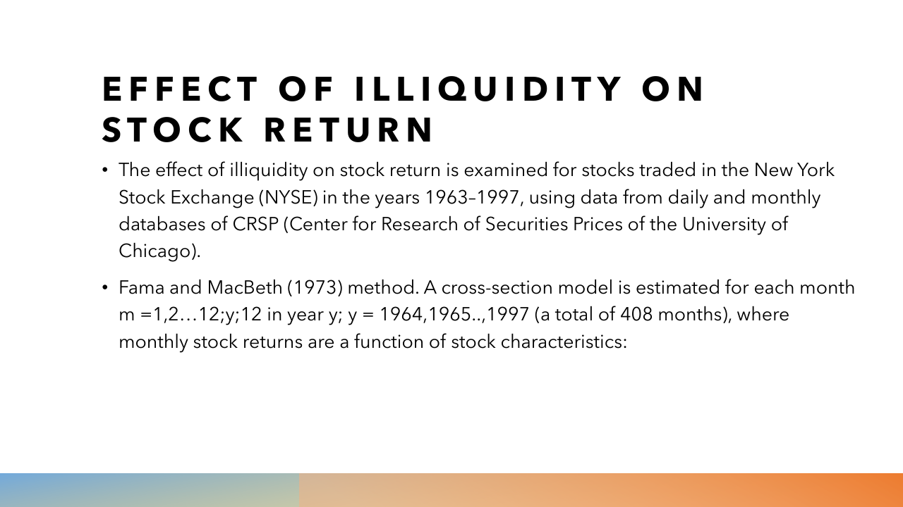

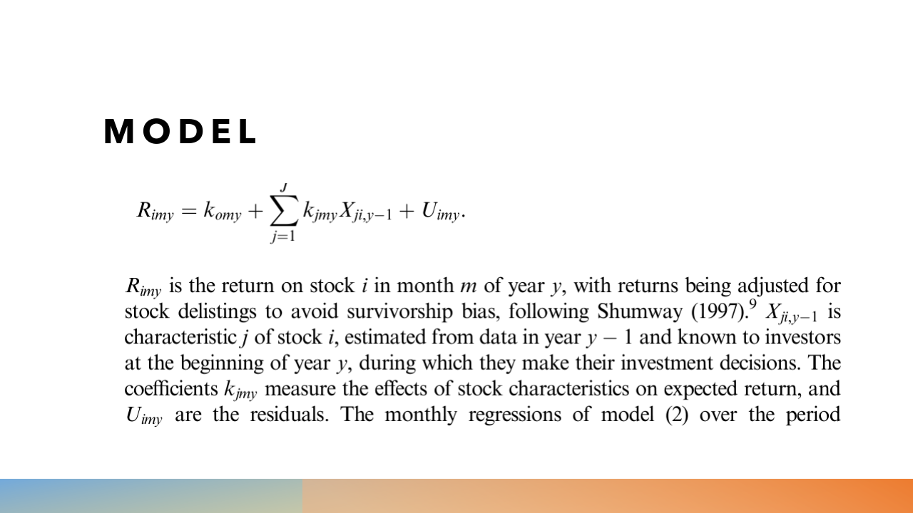

### 3.5 Findings

The findings slide (slide 25) is blank in our deck. So this file does not list the findings here, because there is no slide to explain. The [midsem liquidity notes](../pre-midsem/2_liquidity/liquidity_measures.html), section 3, list them.

## 4. Ince (2022): liquidity components (slides 26 to 28 and slide 34)

Amihud (2002) treats a stock's illiquidity as one number. This paper splits that number into parts. Then it asks which part is linked to future returns. The slides give the paper's full title as "Liquidity components: Commonality in liquidity, underreaction, and equity returns", in the Journal of Financial Markets.

### 4.1 What the paper does

The paper splits the monthly illiquidity of a firm into three parts. "Monthly" means the paper has one illiquidity value for each firm in each month. The three parts add up to that value.

1. **Alpha:** It is the constant part for that firm. It is the level of illiquidity that belongs to the firm itself and stays the same from month to month.
2. **Systematic:** It moves with the market. This is the part that rises and falls with the illiquidity of all stocks together. So it is the commonality from section 2.
3. **Idiosyncratic:** It is specific to the firm. "Idiosyncratic" means belonging to one firm only. It is what is left of the month's illiquidity after the constant part and the market part are taken out.

### 4.2 Findings

With the three parts in hand, the paper asks which part predicts returns. It reports two findings.

**Systematic premium:** It disappears when very small stocks are removed. The systematic premium is the extra return linked to the systematic part. So this premium shows up only because of very small stocks. Without them, the market part of illiquidity earns no extra return.

**Idiosyncratic part:** High idiosyncratic liquidity gives positive future risk-adjusted returns. Low idiosyncratic liquidity gives negative ones. A risk-adjusted return is the return left after removing the part that the stock's exposure to known risks would explain. So the firm-specific part of liquidity predicts future returns, even after risk is accounted for. This is why the summary table at the top says that the idiosyncratic part predicts returns.

### 4.3 Data (slide 34)

This slide sits after Stoll in the deck, but it belongs to Ince. It says what sample the findings in 4.2 come from.

- The stocks are common stocks on NYSE, Amex and Nasdaq. These are the three main US stock markets of the period. Common stocks are ordinary shares, as in 2.4.
- The period is January 1964 to December 2018. So the sample covers 55 years of monthly data.
- The source is CRSP. This is the same database that Amihud (2002) uses (3.4).

### 4.4 Other articles on commonality (slide 28)

Section 2 showed that commonality exists. Slide 28 lists later articles that look for its causes. Each row gives an article, then the cause or finding it reports.

| Article | Cause or finding |
|---|---|
| Kamara and others (2008), Koch and others (2009) | Correlated trading by institutions |
| Morck and others (2000) | Weak incentive to trade individual securities |
| Huberman and Halka (2001) | Investor sentiment |
| Coughenour and Saad (2004), Hameed and others (2010) | Funding limits of intermediaries |
| Karolyi and others (2012) | Evidence from 40 markets |

Read the rows as follows. Correlated trading by institutions means large investors buy and sell the same stocks at the same times, as in reason 6 of 2.2. A weak incentive to trade individual securities means investors gain little from trading single stocks on their own information, so trading in different stocks looks alike. Investor sentiment is the general mood of investors, which is shared across stocks. Intermediaries are the dealers and other firms that stand between buyers and sellers. Funding limits mean these intermediaries can borrow only so much, so when their funding gets tight, they supply less liquidity in many stocks at once. The last row says commonality has been studied in 40 markets, not only in the US.

## 5. Lesmond (2005): "Liquidity of emerging markets"

The paper is in the Journal of Financial Economics, volume 77, pages 411 to 452.

This paper has no slides. It asks how to measure liquidity in markets where good quote data is missing. Section 5.1 sets out the problem, 5.2 the setting, 5.3 the candidate measures, 5.4 the LOT measure in detail, and 5.5 the findings.

> **Source:** The full paper is behind a paywall, and I did not read it. The main findings below come from parts of the abstract and from summaries, both shown by web search. The LOT model in 5.4 comes from the original 1999 paper. The last column of the table in 5.3 is explanation. It is not a claim of the paper. So read each statement in this section together with the source it names.

### 5.1 The problem

An emerging market is a stock market in a developing economy. This section says why measuring liquidity there is hard, and what the paper does about it.

**Data is missing:** Many emerging markets lack long records of bids and asks. Without bids and asks, we cannot compute the spreads of section 2.5.

**Cost still matters:** Trading can be very costly in these markets. So we still need a measure of trading cost, even though the usual data is missing.

**Solution:** Estimate liquidity from daily prices and volume. Daily prices and volume are recorded in almost every market, so this data is available. A measure built from daily data is called a low-frequency measure, because it uses one observation per day instead of every trade.

**Question:** Which low-frequency measure works across countries and within a country? "Across countries" means comparing the average liquidity of one country with another. "Within a country" means comparing stocks inside the same country.

### 5.2 Setting

This section says how large the study is and how it checks the measures. Each point names where it comes from.

**Markets:** Summaries say that it covers 31 emerging markets. One citing paper says 23. A citing paper is a later paper that refers to Lesmond (2005). The two sources disagree, so the exact count is not certain.

**Period:** A summary of the paper reports 1987 to 2000.

**Test:** It compares five liquidity measures with quoted spreads, where spreads are available. The quoted spread is the benchmark here. A measure is good if it agrees with the quoted spread in the markets and periods where both can be computed.

**Named measures:** Search summaries name LOT, Roll, Amihud and turnover. I remember the fifth as Amivest, but I did not verify this. The Amivest ratio is the one defined in 3.2.

### 5.3 The measures

The table describes four of the measures. Read each row as: the measure's name, how it is computed, what kind of measure it is, what data it needs, and where it breaks down. As the source note says, the last column is explanation, not a claim of the paper.

| Measure | Formula | Type | Data needed | Main weakness |
|---|---|---|---|---|
| LOT | $\alpha_2-\alpha_1$ | Price based | Daily returns of stock and market | It needs an estimation model |
| Roll | $2\sqrt{-\mathrm{Cov}(\Delta P_t,\Delta P_{t-1})}$ | Price based | Daily prices | It fails when covariance is positive |
| Amihud | Average of absolute return over traded value | Price impact | Returns and volume | It fails with zero volume |
| Turnover | Shares traded over shares outstanding | Volume based | Volume and share count | Volume can rise in a crisis while cost also rises |

**LOT:** This measure is the gap between two thresholds, $\alpha_2$ and $\alpha_1$. Section 5.4 builds it step by step. It is price based because it uses returns. Its weakness is that the thresholds are not seen in the data. They must be estimated with a statistical model, so the answer depends on that model being right.

**Roll:** $\Delta P_t$ is the price change on day $t$, and $\Delta P_{t-1}$ is the price change on the day before. $\mathrm{Cov}$ is the covariance, which measures whether two quantities move together. A negative covariance means a rise tends to follow a fall, and a fall tends to follow a rise. The formula puts a minus sign in front of the covariance. When the covariance is negative, minus the covariance is positive, and its square root exists. When the covariance is positive, the number under the square root is negative. A negative number has no real square root. So the measure fails.

**Amihud:** This is the ILLIQ measure of 3.2. It divides each day's absolute return by that day's traded value. On a day with zero volume, we would divide by zero, which is not defined. In markets where many days have no trading, this is a real problem.

**Turnover:** Turnover is the number of shares traded divided by the shares outstanding. Shares outstanding is the total number of the firm's shares held by investors. More turnover is read as more liquidity. But in a crisis, volume can rise while the cost of trading also rises. Then turnover says liquidity improved when it actually got worse.

### 5.4 ⭐ The LOT model (Lesmond, Ogden and Trzcinka, 1999)

LOT is named after the three authors of the 1999 paper. It measures trading cost using only daily returns. Its key observation is that a costly stock has many days on which the price does not move at all.

**Idea:** An investor trades only if the value of information exceeds the cost of trading. Otherwise the price does not move. So many zero-return days indicate high trading cost. Here is the reasoning in steps. An investor with news gains from trading only if the news is worth more than the cost of the trade. If the news is small, the investor does not trade. If no one trades on the news, the price does not change, and the observed return that day is zero. The higher the cost, the more news is "too small to trade on". So a high cost gives many zero-return days.

**Assumptions:** The model rests on five assumptions, labelled A1 to A5.

- **A1:** The true return $R^{\ast}$ follows the market model. The true return is the return the stock would have if trading were free. The market model is defined in Step 1.
- **A2:** Selling needs a true return below $\alpha_1$, where $\alpha_1\lt 0$. So $\alpha_1$ is a negative threshold. The news must be worse than $\alpha_1$ before selling is worth the cost.
- **A3:** Buying needs a true return above $\alpha_2$, where $\alpha_2\gt 0$. So $\alpha_2$ is a positive threshold. The news must be better than $\alpha_2$ before buying is worth the cost.
- **A4:** The marginal informed investor trades only beyond these limits. The marginal investor is the one on the edge of deciding whether to trade. This investor's decision sets the price.
- **A5:** The error is normal. The error is defined in Step 1. "Normal" means it follows the bell-shaped normal distribution.

**Step 1: Write the true return.** By A1, the true return follows the market model. The market model says a stock's return has two parts: a part that follows the market and a part specific to the stock.

$$R^{\ast}_{jt}=\beta_jR_{mt}+\varepsilon_{jt}$$

$R^{\ast}_{jt}$ is the true return of stock $j$ on day $t$. $R_{mt}$ is the market return on day $t$. $\beta_j$ says how strongly stock $j$ reacts to the market: if $\beta_j$ is 1, the stock moves one for one with the market. $\varepsilon_{jt}$ is the error, which is the news specific to stock $j$ on day $t$. By A5, it is normal.

**Step 2: Write what we observe in each of the three regions.** We do not see the true return. We see the observed return, written $R$. By A2 to A4, what we observe depends on where the true return falls relative to the two thresholds. There are three regions, one per row of the table.

| True return | Observed return | Meaning |
|---|---|---|
| $R^{\ast}\lt\alpha_1$ | $R=R^{\ast}-\alpha_1$ | Bad news is larger than the selling cost |
| $\alpha_1\le R^{\ast}\le\alpha_2$ | $R=0$ | News is too small, so the return is zero |
| $R^{\ast}\gt\alpha_2$ | $R=R^{\ast}-\alpha_2$ | Good news is larger than the buying cost |

Here is each row in words. In the first row, the true return is below $\alpha_1$, so the news is bad enough to sell on (A2). The investor sells, and the price falls. But the investor gives up the cost, so the observed fall is the true fall minus the threshold: $R=R^{\ast}-\alpha_1$. Because $\alpha_1$ is negative, subtracting it adds a positive amount. So the observed fall is smaller than the true fall. In the middle row, the true return lies between the two thresholds. The news is not worth the cost in either direction, so no one trades and the observed return is zero. In the last row, the true return is above $\alpha_2$, so the news is good enough to buy on (A3). The observed rise is the true rise minus the buying threshold, $R=R^{\ast}-\alpha_2$. So the observed rise is smaller than the true rise.

**Step 3: Estimate by maximum likelihood.** The likelihood is the probability of seeing the returns we actually observed, given some values of the unknown numbers. Maximum likelihood picks the values that make this probability as large as possible. The likelihood has three parts. They are the falls, the zeros and the rises. These match the three rows of the Step 2 table. Each day falls into exactly one part, depending on whether its observed return is negative, zero or positive. It chooses $\alpha_1$, $\alpha_2$, $\beta$ and the error variance to make the observed returns most likely. The error variance measures how large the stock-specific news $\varepsilon_{jt}$ tends to be.

**Step 4: Take the difference.** Step 3 gives estimates of the two thresholds. Now we turn them into one cost. The selling cost is $-\alpha_1$. Since $\alpha_1$ is negative, $-\alpha_1$ is positive, as a cost should be. The buying cost is $\alpha_2$. Their sum is the round-trip cost. A round trip is one buy and one sell, so its cost is the buying cost plus the selling cost.

$$LOT=\alpha_2+(-\alpha_1)$$

Adding a negative of a number is the same as subtracting that number. So the sum becomes a difference.

$$LOT=\alpha_2-\alpha_1$$

**Worked example:** Take $\alpha_1=-0.010$ and $\alpha_2=0.015$. So the selling cost is 0.010 and the buying cost is 0.015.

1. The round-trip cost is $0.015+0.010=0.025$, which is 2.5 percent. We put the two thresholds into the formula from Step 4.

$$LOT=\alpha_2-\alpha_1=0.015-(-0.010)=0.015+0.010=0.025$$

2. A true return of 0.025 is observed as $0.025-0.015=0.010$. The true return 0.025 is above $\alpha_2=0.015$, so it is in the last row of the Step 2 table. The observed return is the true return minus $\alpha_2$.

$$R=R^{\ast}-\alpha_2=0.025-0.015=0.010$$

3. A true return of 0.007 is observed as zero. The value 0.007 lies between $\alpha_1=-0.010$ and $\alpha_2=0.015$. So it is in the middle row of the table, and no one trades.

4. A true return of -0.018 is observed as $-0.018+0.010=-0.008$. The value -0.018 is below $\alpha_1=-0.010$, so it is in the first row of the table. The observed return is the true return minus $\alpha_1$. Subtracting -0.010 is the same as adding 0.010.

$$R=R^{\ast}-\alpha_1=-0.018-(-0.010)=-0.018+0.010=-0.008$$

The example shows the pattern of the model. Large news is observed, but made smaller by the cost. Small news is not observed at all.

The 1999 paper estimated round-trip costs of 1.2 percent for the largest US firms and 10.3 percent for the smallest, for 1963 to 1990. So the smallest firms had a much higher estimated trading cost.

**Simpler cousin:** The share of zero-return days also measures illiquidity. This follows from the LOT idea: a high cost gives many zero-return days. It needs no model at all, only a count of the days on which the return is zero. Bekaert, Harvey and Lundblad report that Lesmond (2005) found it highly correlated with hand-collected spreads in emerging markets. "Hand-collected" means the spreads were gathered by hand from records, because no database held them.

### 5.5 ⭐ Findings

With the measures compared against quoted spreads, the paper reports five findings. The first two answer the question in 5.1. The last three are about what drives liquidity cost across countries.

1. **Across countries:** The price-based measures, LOT and Roll, work better than volume-based measures. So when comparing one country with another, measures built from prices agree with quoted spreads better than measures built from volume, such as turnover.
2. **Within a country:** LOT works best. Amihud works to a lesser extent. So when comparing stocks inside one country, LOT agrees best with quoted spreads, and Amihud's ILLIQ comes next.
3. **Institutions:** Countries with weak political and legal institutions have significantly higher liquidity cost. Institutions are a country's rules and the bodies that enforce them, such as courts and laws. The abstract says that this holds "even to the exclusion of legal origin or insider trading enforcement". Legal origin is the family a country's legal system comes from. Insider trading enforcement is how strictly a country punishes trading on private company information. One reading of the quoted phrase is that the link between weak institutions and high cost does not come only from these two things.
4. **Political risk:** More political risk goes with 10 basis points higher cost by LOT. A basis point is one hundredth of one percent. So 10 basis points is 0.10 percent. It goes with 1.9 percent higher price impact by Amihud. So both measures say that more political risk comes with a higher cost of trading.
5. **Which risk is stronger:** Political risk appears stronger than information risk created by legal institutions. Information risk here is the risk of trading against someone who knows more, which weak legal institutions allow. So, of the two, political risk seems to matter more for the cost of trading.

> **Exam:** Remember the pair. LOT and Roll are for comparisons across countries. LOT and then Amihud are for comparisons within a country. Then add institutions and political risk. Note that LOT appears in both pairs.

## 6. Stoll (2000): "Friction" (slides 29 to 33)

This paper asks what causes the cost of trading. It calls that cost friction. It first defines friction, then measures it, then splits it into two kinds.

### 6.1 What friction means (slide 30)

Friction is anything that makes trading costly or slow. The slide gives two ways to define it. Read each row as: the view, what friction is in that view, and the paper the view comes from.

| View | Friction is | Source |
|---|---|---|
| Time | The time needed to trade a given amount optimally | Lippman and McCall (1986) |
| Price | The price concession paid for immediacy | Demsetz (1968) |

In the time view, friction is how long a trader must wait to trade a given amount at the best price. A more liquid stock needs less time. In the price view, friction is the price concession paid for immediacy. A price concession is the amount of price a trader gives up. Immediacy is trading now (section 0). So in the price view, friction is how much worse a price the trader accepts in order to trade at once. The spread is an example: a buyer who wants to trade now pays the ask, which is above the mid price.

Stoll uses the price view. So every friction measure in this paper is a price, such as a spread.

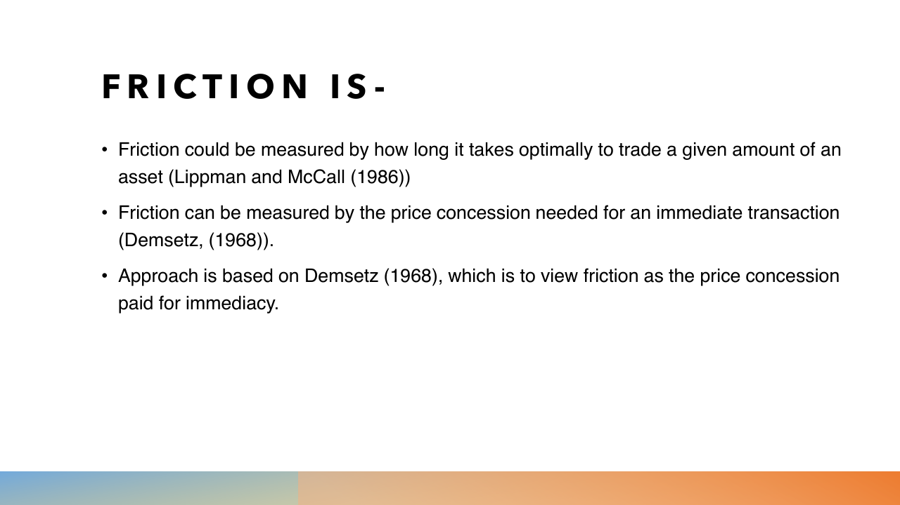

### 6.2 What the paper does (slide 29)

This slide gives the plan of the paper.

**Focus:** It studies the sources of trading friction. So the question is where the cost of trading comes from.

**Measures:** It builds seven robust measures from transaction data. Transaction data records every trade and quote (2.4). "Robust" means the measures are meant to be reliable, not dependent on one special case.

**Sample:** It has 1,706 NYSE and AMSE stocks and 2,184 Nasdaq stocks. NYSE and Nasdaq are two US stock markets with different trading systems. So the paper can compare friction in two market structures.

**Insights:** It shows the size of cost, real against informational friction, and the effect of market structure. "Size of cost" is how large friction is. "Real against informational friction" is the split in 6.4. "Market structure" is the way a market is organised, such as NYSE against Nasdaq.

**Relations:** It studies how the measures relate to each other and to trading characteristics. Trading characteristics are features such as volume, volatility, price and the number of trades. Section 6.3 shows this.

### 6.3 Price of immediacy (slides 31 and 32)

If friction is the price of immediacy, what makes that price high or low? The paper answers with a cross-sectional regression: across stocks, the spread is on the left and the stock's trading characteristics are on the right.

$$s=a_0+a_1\log V+a_2\sigma^2+a_3\log MV+a_4\log P+a_5\log N+e$$

Here $s=(A-B)/2P$ is the proportional quoted half-spread. $V$ is daily dollar volume. $\sigma^2$ is return variance. $MV$ is market value. $P$ is price. $N$ is trades per day.

Here is each symbol in words. $A$ is the ask and $B$ is the bid. $A-B$ is the spread, and dividing by 2 gives the half-spread. Dividing again by the price $P$ makes it a proportion, a pure number. The slide says $P$ is the stock's closing price, the last price of the day. Return variance $\sigma^2$ measures how much the stock's return swings. It is the square of the volatility. Market value $MV$ is the total value of the firm's shares. $\log$ is the logarithm. Taking the logarithm shrinks very large numbers, so that a few huge stocks do not dominate the regression. $a_0$ is the intercept, $a_1$ to $a_5$ are the slopes, and $e$ is the error.

Results for December 1997 have t values in brackets. Read each row as one variable. The middle two columns give its coefficient in each market. The last column gives the reason for its sign.

| Variable | NYSE and AMSE | Nasdaq | Why |
|---|---|---|---|
| Intercept | 0.0207 | 0.0384 | It is the base level |
| Log volume | -0.0010 (-9.35) | -0.0012 (-5.95) | Inventory is easier to unload |
| Variance | 1.5467 (16.74) | 0.4908 (7.56) | Inventory risk is higher |
| Log market value | 0.0003 (3.56) | -0.0003 (-2.18) | The sign differs by market |
| Log price | -0.0024 (-21.15) | -0.0020 (-9.51) | Fixed cost is spread over a higher price |
| Log trades | 0.0003 (2.63) | -0.0011 (-5.60) | The sign differs by market |
| Adjusted R-squared | 0.7731 | 0.6467 | The fit is strong |

Here is each row in words.

**Intercept:** It is the base level of the half-spread before the variables are added.

**Log volume:** The coefficient is negative in both markets, with t values of -9.35 and -5.95. So stocks with more volume have narrower spreads. The reason is that a dealer can unload inventory more easily when many people trade. For NYSE, a rise of 1 in log volume goes with a fall of 0.0010 in the half-spread, which is 0.10 percent of the price.

**Variance:** The coefficient is positive in both markets. So stocks whose returns swing more have wider spreads. The reason is inventory risk: a bigger swing means a bigger possible loss on the dealer's inventory (2.2, reason 4).

**Log market value:** The sign is positive on NYSE and AMSE but negative on Nasdaq. So the link between firm size and the spread differs by market.

**Log price:** The coefficient is negative in both markets, with the largest t value on NYSE, -21.15. So higher-priced stocks have smaller proportional spreads. The reason is that part of the cost of a trade is fixed. When the price is higher, the same fixed cost is a smaller fraction of the price.

**Log trades:** The sign is positive on NYSE and AMSE but negative on Nasdaq. So again the link differs by market.

**Adjusted R-squared:** It is 0.7731 for NYSE and AMSE and 0.6467 for Nasdaq. So these few variables explain about 77 percent and 65 percent of the differences in spreads across stocks. The fit is strong.

January and February 1998 give similar results. Adjusted R-squared is 0.7763 and 0.7914 for NYSE and AMSE. It is 0.6588 and 0.6688 for Nasdaq. So the December 1997 result is not a one-month accident.

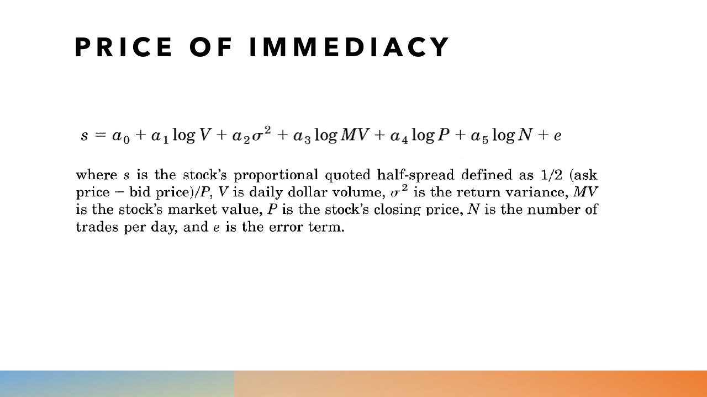

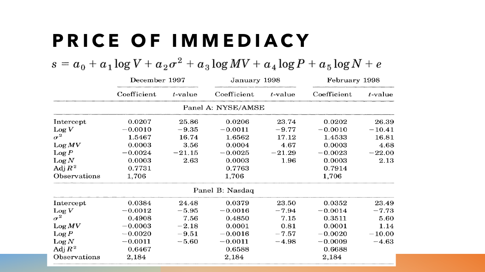

### 6.4 Real and informational friction (slide 33)

Section 6.3 measured how large friction is. This section asks what friction is made of. The paper splits it into two kinds.

**Real friction:** Trading uses real resources, such as labour, systems and capital to bear inventory risk. These resources cost money. Someone must pay for them, and the spread is how they are paid. This cost would exist even if no trader knew more than any other.

**Informational friction:** Wealth moves from less informed traders to better informed traders. This is the asymmetric information of 2.1. The informed trader gains and the uninformed trader loses. The dealer widens the spread to cover these losses.

The table gives the measures the slide shows. Read each row as: the measure, its formula, and what part of friction it contains.

| Measure | Formula | What it contains |
|---|---|---|
| Quoted half-spread | $S=(A-B)/2$ | Total friction |
| Effective half-spread | $ES=\lvert P-M\rvert$ | Total friction on actual trades |
| Traded spread | Not given. The slide says "refer to article". | Not given |

The quoted half-spread $S$ is half the distance between the ask $A$ and the bid $B$. It is the distance from the mid price to either quote. The effective half-spread $ES$ is the distance between the trade price $P$ and the mid price $M$, which is the mid price $P_M$ of section 0. Both contain total friction. "Total" means they include the real part and the informational part together, without separating them. The quoted half-spread uses the posted quotes. The effective half-spread uses the prices at which trades actually happened. The slide does not give the traded spread. It says only "refer to article".

> **Exam:** Stoll uses half-spreads. Chordia uses full spreads. So Chordia's effective spread is twice Stoll's. Compare the two formulas. Chordia's effective spread is $2\lvert P_t-P_M\rvert$ (2.5). Stoll's effective half-spread is $\lvert P-M\rvert$. Both use the distance between the trade price and the mid price, so Chordia's is two times Stoll's.

$$ESPR=2\lvert P_t-P_M\rvert=2\times ES$$

> In the worked example of 2.5, the trade is at 100.10 and the mid price is 100. Stoll's effective half-spread is 0.10, and Chordia's effective spread is 0.20. In the same way, Stoll's quoted half-spread is $0.40/2=0.20$, while Chordia's quoted spread is 0.40.

