# Topic 3: Triggers of Extreme Illiquidity

These notes follow the deck "4. Extreme illiquidity in Market", slides 1 to 13.

Everything in this file is exam material. A ⭐ marks what to know without notes. Worked examples use made-up numbers to practise the slide formulas.

The topic has four parts. The table below lists them in the order the notes cover them. Read each row as "this part of the topic comes from this source and makes this point". First comes a theory of why liquidity can collapse. Then comes evidence that lenders really do demand more money in a crisis. Then comes a way to measure spirals in real stock data. Last comes the effect of spirals on how the market values firms.

| Part | Source | Main point |
|---|---|---|
| Theory | Brunnermeier and Pedersen (2009) | Market liquidity and funding liquidity feed each other |
| Evidence | Margin history of S&P 500 futures | Margins jump in a crisis |
| Measure | Jain, Mishra and McInish (2013) | Count bad spread days and bad price days over 10 days |
| Effect | The same paper | Spirals lower firm valuation |

## 0. Words to know first

The rest of the file uses the words below again and again. So each one is defined here, before it is needed. Later sections refer back to these definitions.

- **Market liquidity:** It is how easily an asset can be traded. An asset is liquid if you can buy or sell it quickly, in a large amount, at a price close to its true value. An asset is illiquid if a sale pushes the price down a lot, or if no buyer can be found.
- **Funding liquidity:** It is how easily a trader can obtain money to trade. A trader rarely pays for a whole position with their own money. The trader borrows the rest. Funding liquidity is high when lending is easy and cheap. It is low when lenders refuse to lend or ask for more security.
- **Capital:** It is the trader's own money. It is what the trader would have left after selling every position and repaying every loan. These notes write it as $W$.
- **Position:** It is the amount of an asset the trader holds, measured in money. These notes write it as $X$.
- **Speculator:** This trader supplies liquidity by buying cheap and selling dear. Dealers and hedge funds are examples. When other people want to sell, the speculator buys from them. When other people want to buy, the speculator sells to them. So the speculator is the one who makes trading easy for everyone else.
- **Financier:** This is the bank or broker who lends to the speculator.
- **Margin:** It is the part of a position that the trader must pay with their own capital. A haircut means the same thing for a collateral loan. For example, a margin of 10 percent means the trader pays 10 out of every 100 with their own capital. The financier lends the other 90. A collateral loan is a loan in which the borrower hands over an asset as security. The haircut is the part of that asset's value that the lender will not lend against. These notes write the margin rate as $m$.
- **Leverage:** It is the size of the position divided by the trader's capital. If the position is 100 and the capital is 10, the leverage is 10. A trader who borrows more has higher leverage.
- **Deleveraging:** It means selling positions to reduce borrowing.
- **Spiral:** It is a loop in which a bad event causes more of itself.
- **Fundamental value:** It is the true value of the asset, based on what the asset will pay its owner. A price "moves away from fundamentals" when it moves away from this true value for reasons that have nothing to do with the asset itself.
- **Fundamental volatility:** It is the variation of the true value. Volatility means how much something moves up and down. So fundamental volatility is how much the true value itself moves.
- **Flight to quality:** Capital moves out of risky assets and into safe assets.

## 1. Why extreme cases are critical (slide 2)

This section answers one question. Why should we study the cases in which liquidity collapses? Slide 2 gives three principles of how a healthy market should work.

1. **Liquidity is key:** A market cannot work well without it. If traders cannot buy and sell easily, the market fails at its basic job.
2. **Trading should govern change:** Changes should come from the trading of participants. In a healthy market, prices and liquidity change because buyers and sellers trade with each other.
3. **Outside factors should not rule:** External factors should not influence the liquidity of an asset or of the market. Liquidity should not depend on things outside the trading itself.

In an extreme case, the third principle breaks. Funding is an outside factor, because it depends on lenders and not on the asset. Yet in an extreme case, funding can decide liquidity. So liquidity is no longer set by trading alone. This is why these cases need study.

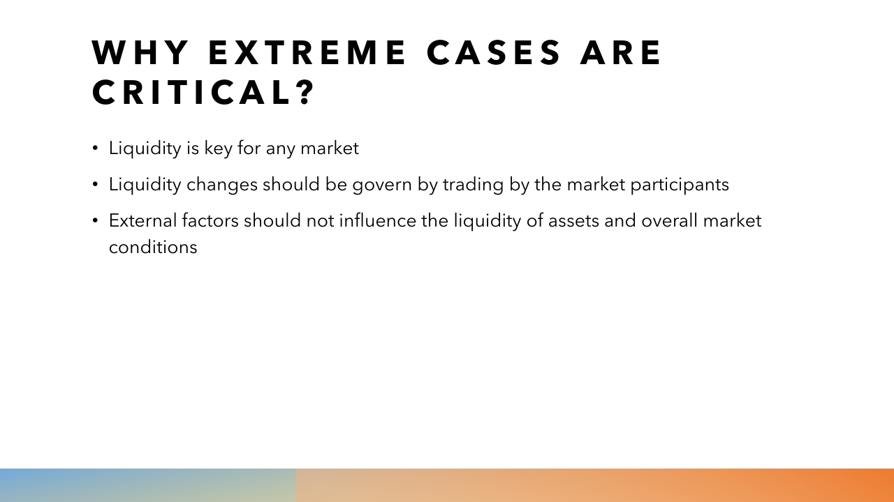

## 2. Brunnermeier and Pedersen (2009): "Market liquidity and funding liquidity" (slides 3 and 4)

This section presents the main theory of the topic. It explains how a lack of money for traders and a lack of easy trading can make each other worse.

The paper is in the Review of Financial Studies, volume 22, issue 6, pages 2201 to 2238.

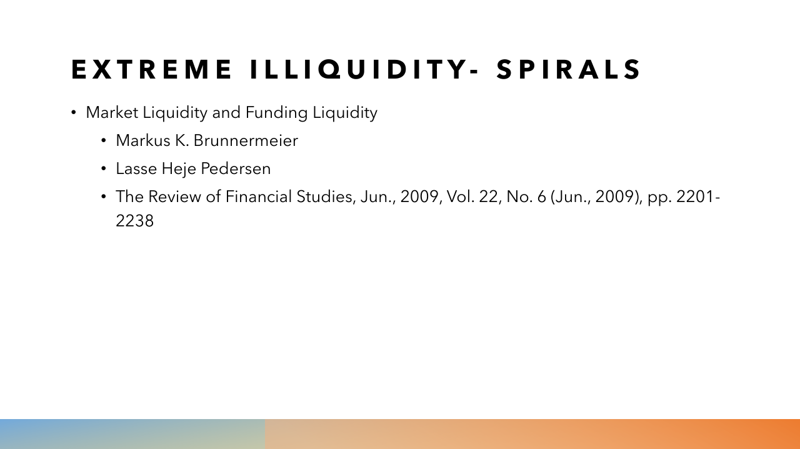

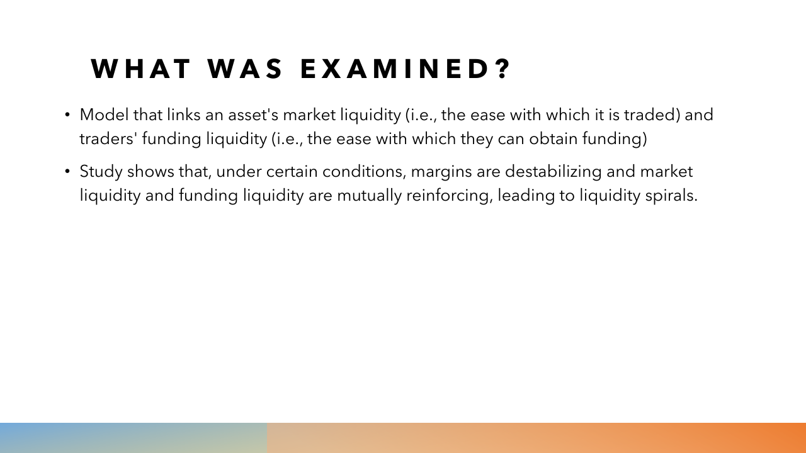

### 2.1 ⭐ The main idea

The paper connects the two kinds of liquidity defined in section 0. The connection runs in both directions. That is what makes it dangerous.

- **The link:** The model links market liquidity and funding liquidity. Slide 4 puts it this way. Market liquidity is the ease with which an asset is traded. Funding liquidity is the ease with which traders can obtain funding.
- **First direction:** Traders provide market liquidity. They can do this only when they have funding. A speculator who buys from a seller needs money to pay for the purchase. Most of that money is borrowed. So if the speculator cannot borrow, the speculator cannot buy. Then sellers find no buyer, and market liquidity falls. In short, funding liquidity drives market liquidity.
- **Second direction:** Funding means capital and margin. Both depend on how liquid the assets are. If the assets the trader holds become hard to sell, their prices fall. Then the trader's capital falls. Lenders also see more risk, so they ask for a higher margin. In short, market liquidity drives funding liquidity.
- **The danger:** Under some conditions margins are destabilizing. The two kinds of liquidity then reinforce each other. "Destabilizing" means that margins rise exactly when things are going badly. The higher margin makes things go worse. "Reinforce each other" means that a fall in one kind of liquidity causes a fall in the other, which causes a further fall in the first.
- **The result:** This gives liquidity spirals. A small first shock can grow into a large collapse, because each round of the loop feeds the next.

The table compares the two kinds of liquidity side by side. Read down a column to see one kind of liquidity. Read across a row to compare the two kinds on one point. The key row is "Belongs to". Market liquidity is a property of an asset. Funding liquidity is a property of a trader. The spiral is the link between them.

| Point | Market liquidity | Funding liquidity |
|---|---|---|
| Belongs to | An asset or a market | A trader |
| Question | Can I sell easily near the true value? | Can I get money to hold this position? |
| Measured by | Spread, depth and price impact | Margin, haircut and cost of borrowing |
| Fails when | Buyers disappear | Lenders demand more capital |

The "Measured by" row uses some market terms. The spread is the gap between the price at which you can buy and the price at which you can sell. Depth is how much can be traded at the current prices. Price impact is how far a trade moves the price. For all three, a bigger number means a less liquid market. On the funding side, a higher margin, a higher haircut or a higher cost of borrowing all mean less funding liquidity.

### 2.2 Why capital limits liquidity supply

This section shows, with one line of algebra, why the speculator's capital and the margin limit how much liquidity the speculator can supply. The result explains both spirals later in the file.

Let $W$ be capital, $m$ be the margin rate and $X$ be the position in money.

1. Every position needs capital equal to $mX$. This follows from the definition of margin. The trader must pay the fraction $m$ of the position from their own capital. For example, with $m=0.10$ and $X=100$, the trader must put up $0.10\times100=10$.
2. The trader cannot use more capital than $W$. So $mX\le W$. The capital the position needs must be no more than the capital the trader has.

$$mX\le W$$

3. Divide by $m$. We want a limit on the position $X$, so we need $X$ alone on the left side. The margin $m$ is a positive number. Dividing both sides of an inequality by a positive number keeps the direction of the inequality. So we can divide both sides by $m$.

$$\frac{mX}{m}\le\frac{W}{m}$$

On the left side, $m$ divided by $m$ is 1. So the left side is just $X$. This gives the final result.

$$X\le\frac{W}{m}$$

This says that the largest position the trader can hold is capital divided by margin. Look at the fraction $W/m$. The capital $W$ is on top. So if capital falls, the fraction falls. The margin $m$ is on the bottom. So if the margin rises, the fraction falls.

The largest position falls when capital falls. It also falls when the margin rises. These are the two spirals. A fall in capital $W$ drives the loss spiral. A rise in margin $m$ drives the margin spiral. Both force the speculator to hold less. A speculator who must hold less cannot buy from sellers, and may even have to sell. So the supply of liquidity shrinks.

## 3. ⭐ Five features of liquidity (slide 5)

The model of section 2 does more than describe spirals. It also explains five patterns that people see in real markets. Slide 5 lists them. The table below gives each feature in the first column. The second column says what we observe. The third column says why the model predicts it.

| Feature | What happens | Why, in the model |
|---|---|---|
| It can suddenly dry up | Liquidity vanishes quickly | Financiers are imperfectly informed and raise margins when volatility changes |
| It has commonality | Many securities become illiquid together | The same speculators supply liquidity in all of them |
| It is related to volatility | Volatile assets are less liquid | Volatile assets need higher margins |
| It shows flight to quality | Risky assets lose more liquidity than safe ones | Scarce capital moves to assets with low margins |
| It moves with the market | Liquidity falls when the market falls | Funding conditions move with the market |

Each row follows from the result $X\le W/m$ in section 2.2. Here is each one in turn.

- **Sudden dry-up:** Financiers cannot fully tell why prices are moving. When volatility jumps, they protect themselves by raising margins. A higher $m$ cuts the largest position $W/m$ at once. So speculators must stop buying, and liquidity disappears quickly.
- **Commonality:** "Commonality" means that many assets move together. The same speculators supply liquidity in many securities. When those speculators lose capital or face higher margins, they cut back in every security they trade. So many securities become illiquid at the same time.
- **Link to volatility:** A more volatile asset is riskier for the lender. So the lender asks for a higher margin on it. A higher margin means speculators can hold less of it. So the more volatile asset gets less liquidity.
- **Flight to quality:** When capital is scarce, speculators want each unit of capital to support as large a position as possible. An asset with a low margin needs less capital per unit of position. Safe assets have low margins. So the scarce capital moves to safe assets, and risky assets lose more liquidity.
- **Moves with the market:** When the market falls, speculators lose capital and lenders raise margins. Both cut funding. So liquidity falls together with the market.

> **Exam:** These five features are an easy question. Write each feature with its reason. A full answer names the feature, says what happens, and then gives the model's reason from the third column of the table.

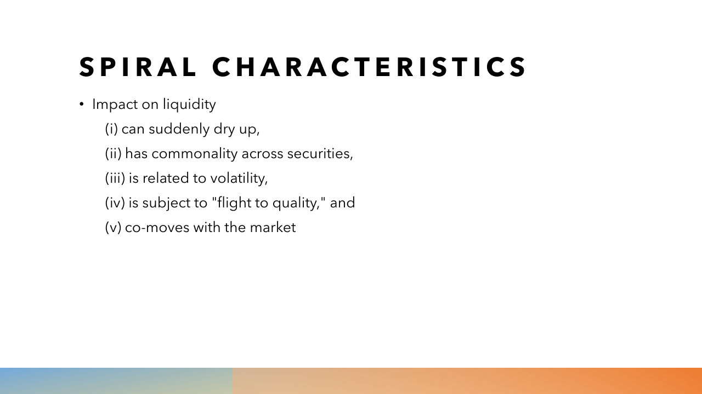

## 4. Extreme market events (slide 6)

Section 2 claimed that lenders raise margins when markets are in trouble. This section checks that claim against real data.

The chart shows margins on S&P 500 futures from 1982 to 2008. A futures contract is an agreement to buy or sell something at a fixed price on a future date. Here the "something" is the S&P 500, an index of 500 large US stocks. The margins are for exchange members. They are a percent of contract value. So a margin of 4 percent means a member must put up 4 out of every 100 of the contract's value. Initial margin equals maintenance margin for members. The initial margin is the amount needed to open a position. The maintenance margin is the least amount the trader must keep while the position stays open. For members, the two are the same, so the chart shows a single line. Each dot is a change in the dollar margin. The levels below are read from the chart, so they are approximate.

The table lists the main events marked on the chart. Each row gives an event, its date and the margin level near that date. Compare each crisis row with the calm row just before it.

| Event | Year | Margin |
|---|---|---|
| Before the crash | 1982 to 1987 | About 4 percent |
| Black Monday | 19 October 1987 | Above 12 percent |
| Calm period | 1989 | About 3 percent |
| Mini-crash | 1989 | It rises again |
| US and Iraq war | 1990 to 1991 | About 6.4 percent |
| Calm period | 1997 | About 2 percent |
| Asian crisis | 1997 | About 3.8 percent |
| LTCM collapse | 1998 | About 5.5 percent |
| Subprime crisis | 2007 to 2008 | It rises from about 4 to about 5 percent |

The pattern is the same each time. Before Black Monday the margin was about 4 percent. At Black Monday it jumped to above 12 percent, about three times as high. In the calm of 1989 it fell back to about 3 percent. Then each new crisis pushed it up again. The 1997 calm level of about 2 percent rose to about 3.8 percent in the Asian crisis. It rose to about 5.5 percent when LTCM collapsed in 1998. LTCM was a large hedge fund. It rose again in the subprime crisis.

Margins rise when markets are in trouble. So traders lose funding exactly when the market needs them. Recall from section 2.2 that the largest position is $W/m$. A higher margin $m$ means a smaller position. So in each crisis, speculators were forced to hold less, at the very moment when sellers most needed buyers. This is the destabilizing margin of section 2.1, seen in real data.

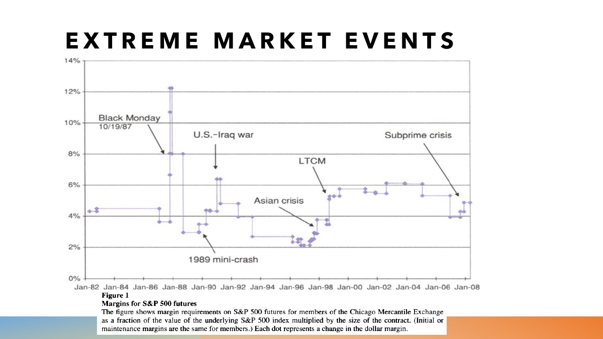

## 5. ⭐ The liquidity spiral (slide 7)

This section puts the pieces together into one loop. It answers the question: once something goes wrong, why does it keep getting worse? The diagram below copies slide 7. Each box causes the box its arrow points to. The two arrows that go back to "Funding problems" are what make it a loop.

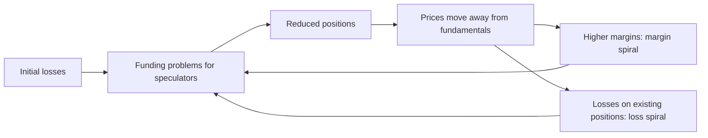

### 5.1 Triggers

A spiral needs a first push. This is called a trigger. The list below gives four ways the loop can start. Each one hits the speculator's capital $W$ or the margin $m$, and so cuts the largest position $W/m$.

1. **A first loss:** Speculators lose capital. This lowers $W$.
2. **A funding shock:** Lenders cut credit or capital is withdrawn. Either way, the speculator has less money to trade with.
3. **A volatility shock:** Financiers cannot tell news from illiquidity. They raise margins. When a price falls, the lender does not know the reason. The fall may come from real bad news about the asset. Or it may come only from forced selling in an illiquid market. Because the lender cannot tell which, the lender treats the asset as riskier and raises $m$.
4. **A forced sale:** A large trader must unwind. Others may predate, as Topic 4 explains. "Unwind" means to sell off a position. "Predate" means that other traders take advantage of the forced seller, which makes the price fall further.

### 5.2 The loop step by step

Now follow the loop one step at a time. Each step says why it causes the next one.

1. Speculators suffer an initial loss. One of the triggers in section 5.1 has happened. So the speculator's capital $W$ is now smaller.
2. They face funding problems. The largest position is $W/m$ (section 2.2). Capital $W$ has fallen, so the largest allowed position has fallen too. The speculator now holds more than the financier allows.
3. They reduce their positions. To get back within the limit, the speculator must sell. Selling is the only way to bring the position down to the new, smaller $W/m$.
4. Their selling moves prices away from fundamentals. Many speculators sell at the same time. The usual buyers are the speculators themselves, and they are now selling. So there are few buyers, and prices fall below the true value.
5. The price fall creates losses on the positions that remain. This is the **loss spiral**. The speculator still holds part of the position. That part is now worth less. So capital $W$ falls again.
6. The price movement also makes lenders raise margins. This is the **margin spiral**. The lender sees a large price move and cannot tell whether it is news or illiquidity (trigger 3 in section 5.1). So the lender raises $m$.
7. Both send the trader back to step 2. The loop repeats and becomes stronger. A lower $W$ and a higher $m$ both make $W/m$ smaller. So the speculator again holds more than allowed. The speculator must sell again, which pushes prices down again. Each pass around the loop causes the next pass.

The table compares the two spirals. The first row is the most important. It says which part of the limit $W/m$ each spiral changes. The loss spiral works on the top of the fraction. The margin spiral works on the bottom.

| Point | Loss spiral | Margin spiral |
|---|---|---|
| What changes | Capital $W$ falls | Margin $m$ rises |
| Cause | Price fall on existing positions | Financier fears volatility and illiquidity |
| Is leverage changed? | The trader sells to keep leverage constant | The trader must cut leverage |
| Needs a higher margin? | No | Yes |

The third row needs a word of explanation. Leverage is position divided by capital (section 0). At the largest allowed position, $X=W/m$. Divide both sides by $W$. This gives $X/W=1/m$. So at the limit, leverage equals one over the margin. In the loss spiral, $m$ does not change. So the leverage at the limit does not change either. The trader sells only enough to bring leverage back to the same level, because capital is smaller. In the margin spiral, $m$ rises. So $1/m$ falls, and the trader must cut leverage itself. The last row follows from this. The loss spiral runs even when the margin stays the same. The margin spiral needs the margin to rise.

### 5.3 Worked example

This example puts numbers into $X\le W/m$. It shows how a small price fall forces a large sale.

A speculator has capital of 10. The margin is 10 percent. So $W=10$ and $m=0.10$.

**Step 1: Find the first position.** It is $10/0.10=100$. The loan is 90. The speculator holds the largest position allowed. This is capital divided by margin.

$$X=\frac{W}{m}=\frac{10}{0.10}=100$$

The speculator pays 10 of this with their own capital. The financier lends the rest, which is $100-10=90$. The leverage is $100/10=10$, which is the same as $1/0.10$.

**Step 2: Apply a price fall of 3 percent.** The position is now 97. The loan is still 90. So capital is $97-90=7$. A fall of 3 percent on a position of 100 is a loss of $100\times0.03=3$. So the position is worth $100-3=97$. The loan does not change when the price falls, because the speculator still owes the same amount. Capital is what is left after repaying the loan.

$$W=97-90=7$$

So a price fall of only 3 percent has cut the speculator's capital from 10 to 7. The whole loss of 3 comes out of the speculator's own money.

**Step 3: Find the loss spiral sale.** The allowed position is $7/0.10=70$. The speculator must sell $97-70=27$. The margin is still 10 percent. Only the capital has changed. So we put the new capital into the same formula.

$$X=\frac{7}{0.10}=70$$

The speculator holds 97 but is allowed only 70. So the speculator must sell the difference, which is 27. The sale money repays part of the loan, so the loan falls to $70-7=63$. Leverage is now $70/7=10$, the same as before. This is the loss spiral of section 5.2: the trader sells to keep leverage constant.

**Step 4: Find the margin spiral sale.** The margin rises to 14 percent. The allowed position is $7/0.14=50$. The speculator must sell 20 more. The lender has seen the price fall and raises the margin (step 6 of section 5.2). Capital is still 7. So we put the new margin into the formula.

$$X=\frac{7}{0.14}=50$$

The speculator now holds 70 but is allowed only 50. So the speculator must sell $70-50=20$ more. The loan falls to $50-7=43$. Leverage falls from 10 to $50/7$, which is about 7.14. This is the margin spiral: the trader must cut leverage.

**Conclusion:** A price fall of 3 percent forced the sale of 47 out of 97. The total sale is the loss spiral sale plus the margin spiral sale, $27+20=47$. That is almost half of the position. This selling pushes the price down again. That new price fall starts the loop again at step 2, so the next round of forced selling follows.

## 6. Empirical measure: Jain, Mishra and McInish (2013) (slide 8)

The theory of section 5 says spirals happen. This section answers a practical question. How can we spot a spiral in real stock data, day by day?

Pankaj K. Jain, Ajay K. Mishra and Thomas H. McInish wrote "Identification and valuation implications of financial market spirals". It is in the book Rethinking Valuation and Pricing Models, from page 471.

> **Exam:** This is the professor's own paper. Learn its two definitions and the sign of its results. "The two definitions" are the illiquidity spiral measure (section 6.1) and the loss spiral measure (section 6.2). "The sign of its results" means whether each spiral raises or lowers firm value (section 9).

The paper builds two measures for the equity market. The equity market is the stock market. Each measure matches one side of the spiral.

1. The illiquidity spiral uses the spread. A widening spread means the stock is getting harder to trade. So the spread tracks market liquidity.
2. The loss spiral uses the price. A falling price means holders are losing money. So the price tracks the losses of the loss spiral.

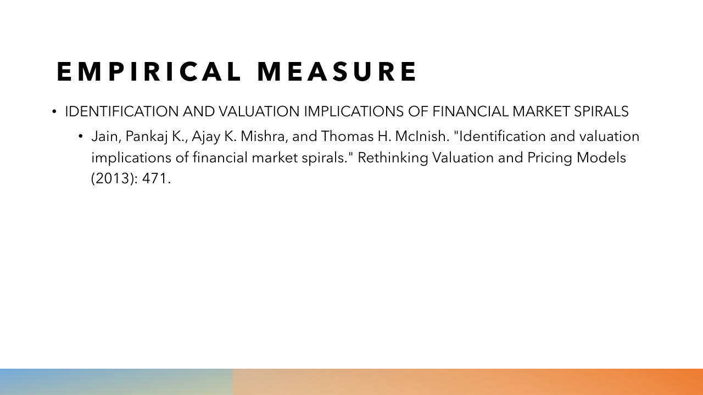

### 6.1 ⭐ Illiquidity spiral (slide 9)

The idea is to mark each day as a bad day, a good day or a normal day for the spread. A spiral is a run of many bad days. So the measure counts bad days over a 10-day window.

Let $s_{t}$ be today's spread, $\bar{s}$ be the average spread of the previous year and $\sigma_s$ be its standard deviation in that year.

The symbols need some words. The subscript $t$ means "today". So $s_{t-1}$ is yesterday's spread. The bar over $\bar{s}$ means an average. The standard deviation $\sigma_s$ measures how far the spread usually moves away from its average. A large $\sigma_s$ means the spread moves around a lot. On the slide, $\bar{s}$ is written "Av. Sprd" for the year before, and $\sigma_s$ is written with "av(yr-1)" for the same year.

**Step 1: Give each day a score.**

| Condition 1 | Condition 2 | Score $S_t$ | Equation |
|---|---|---|---|
| $s_t\lt s_{t-1}$ | $s_t\lt\bar{s}-0.5\sigma_s$ | -1 | 29.1 |
| $s_t\gt s_{t-1}$ | $s_t\gt\bar{s}+0.5\sigma_s$ | +1 | 29.2 |
| Any other case | | 0 | 29.3 |

Read each row as a rule. The first row says this. If today's spread is below yesterday's, and also below the average minus half a standard deviation, then today scores -1. A lower spread means easier trading, so -1 is a good day.

The second row says this. If today's spread is above yesterday's, and also above the average plus half a standard deviation, then today scores +1. A higher spread means harder trading, so +1 is a bad day.

The third row covers every other day. Those days score 0.

Both conditions must hold for a score of +1 or -1. Condition 1 asks about direction: did the spread move up or down since yesterday? Condition 2 asks about level: is the spread far from its normal level? The band runs from $\bar{s}-0.5\sigma_s$ to $\bar{s}+0.5\sigma_s$. A day counts only if the spread is moving the wrong way and is already outside this normal band. A small rise inside the normal band scores 0.

**Step 2: Add the last 10 days.** This is equation 29.4.

The sum adds today's score and the scores of the 9 days before it. That is 10 scores in all. Written out in full, the sum is:

$$S_{spiral,10}=S_t+S_{t-1}+S_{t-2}+\dots+S_{t-9}$$

The letter $k$ counts how many days back each score is. When $k=0$ we have today. When $k=9$ we have 9 days ago. The sign $\sum$ means "add up". So the same sum, written short, is:

$$S_{spiral,10}=\sum_{k=0}^{9}S_{t-k}$$

The slide writes the limits as running from $t=0$ to $-9$. That means the same thing: start today and go back 9 days.

Each score is between -1 and +1, and there are 10 of them. So the sum is between -10 and +10. A large positive sum means that the stock is in an illiquidity spiral. It means bad spread days have far outnumbered good ones in the last 10 days. That is, the stock has kept getting harder to trade.

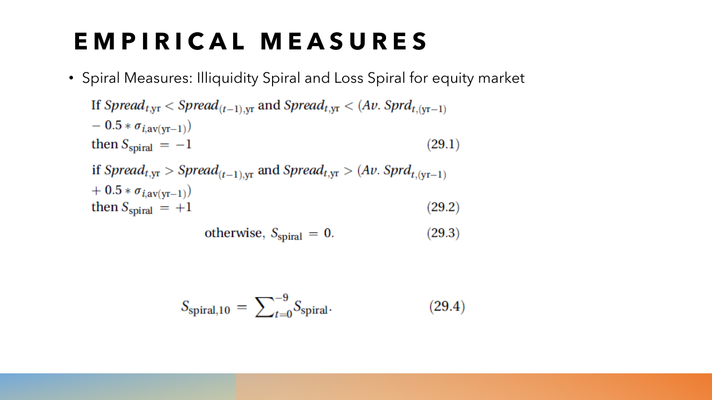

### 6.2 ⭐ Loss spiral (slide 10)

The loss spiral measure uses the same method as section 6.1, but applies it to the price instead of the spread.

Let $P_t$ be today's price, $\bar{M}$ be the midpoint of the previous year and $\sigma_P$ be the standard deviation in that year. As before, $P_{t-1}$ is yesterday's price. The midpoint $\bar{M}$ plays the role that the average spread played in section 6.1. It is the central price level of the year before. The standard deviation $\sigma_P$ measures how far the price usually moves away from that level.

**Step 1: Give each day a score.**

| Condition 1 | Condition 2 | Score $L_t$ | Equation |
|---|---|---|---|
| $P_t\lt P_{t-1}$ | $P_t\lt\bar{M}-0.5\sigma_P$ | +1 | 29.5 |
| $P_t\gt P_{t-1}$ | $P_t\gt\bar{M}+0.5\sigma_P$ | -1 | 29.6 |
| Any other case | | 0 | 29.7 |

Read the rows the same way as before. The first row says this. If today's price is below yesterday's, and also below the midpoint minus half a standard deviation, then today scores +1. A falling price means losses for holders, so +1 is a bad day.

The second row says this. If today's price is above yesterday's, and also above the midpoint plus half a standard deviation, then today scores -1. A rising price means gains, so -1 is a good day.

Every other day scores 0. Again, both conditions must hold for a score of +1 or -1.

The slide uses the letter P for this score. These notes use $L_t$ so that it is not mixed with the price.

**Step 2: Add the last 10 days.** This is equation 29.8.

As in section 6.1, we add today's score and the 9 scores before it. Written out in full:

$$P_{spiral,10}=L_t+L_{t-1}+L_{t-2}+\dots+L_{t-9}$$

Written short with the sum sign:

$$P_{spiral,10}=\sum_{k=0}^{9}L_{t-k}$$

The sum lies between -10 and +10. A large positive sum means many bad price days in the last 10 days. So the stock is in a loss spiral.

> **Exam:** A score of +1 always means bad. For spreads, bad means higher. For prices, bad means lower. So the inequality signs are opposite in the two measures. In the spread measure, +1 goes with "greater than" signs. In the price measure, +1 goes with "less than" signs. If you remember that +1 is bad, you can rebuild both tables.

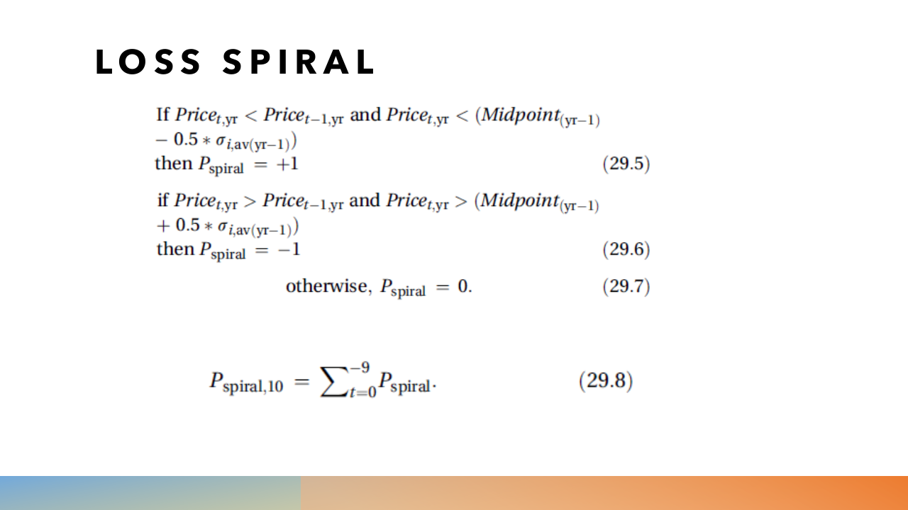

### 6.3 Worked example

This example scores one day with each measure. Then it adds 10 scores to get a spiral value.

Today's spread is 0.95. Yesterday's was 0.90. The previous year has an average of 0.80 and a standard deviation of 0.20. So $s_t=0.95$, $s_{t-1}=0.90$, $\bar{s}=0.80$ and $\sigma_s=0.20$.

1. Today's spread is higher than yesterday's. Since 0.95 is more than 0.90, condition 1 of the +1 row holds.
2. The upper limit is $0.80+0.5(0.20)=0.90$. This is the top edge of the normal band. Half of 0.20 is 0.10. Add that to the average.

$$\bar{s}+0.5\sigma_s=0.80+0.5\times0.20=0.80+0.10=0.90$$

3. Today's spread is above the limit. So the score is +1. Since 0.95 is more than 0.90, condition 2 also holds. Both conditions hold, so today is a bad spread day.

Today's price is 95. Yesterday's was 97. The previous year has a midpoint of 100 and a standard deviation of 8. So $P_t=95$, $P_{t-1}=97$, $\bar{M}=100$ and $\sigma_P=8$.

1. Today's price is lower than yesterday's. Since 95 is less than 97, condition 1 of the +1 row holds.
2. The lower limit is $100-0.5(8)=96$. This is the bottom edge of the normal band. Half of 8 is 4. Take that away from the midpoint.

$$\bar{M}-0.5\sigma_P=100-0.5\times8=100-4=96$$

3. Today's price is below the limit. So the score is +1. Since 95 is less than 96, condition 2 also holds. Both conditions hold, so today is a bad price day.

Now suppose we have the scores for 10 days in a row. If the last 10 scores are 1, 1, 0, 1, 1, -1, 1, 0, 1, 1, then the spiral value is 6. To see this, add the scores one by one.

$$1+1+0+1+1+(-1)+1+0+1+1=6$$

Another way to see it: there are seven scores of +1, one score of -1 and two scores of 0. So the sum is $7-1=6$. A value of 6 out of a possible 10 means bad days far outnumber good days. So the stock looks like it is in a spiral.

## 7. Data (slide 11)

This section says what data the paper used to compute the measures of section 6 and to test their effect on value in section 9. Each item below names a source or a choice.

- **CRSP:** It gives daily closing bid, ask, volume, ticker, close price, market capitalization and PERMCO. CRSP is a database of US stock prices. The bid and ask are the prices at which one can sell and buy, so they give the spread. The close price gives the price for the loss spiral measure. Volume is the number of shares traded. The ticker is the stock's short trading symbol. Market capitalization is the share price times the number of shares, so it is the market value of the firm. PERMCO is a number that CRSP uses to identify each company.
- **Firms:** They are S&P 500 firms in the US.
- **Period:** It is November 1982 to December 2010.
- **Datastream International:** It gives price to book value, dividend per share, total assets and return on equity. It also gives the market value and the P/E of the S&P 500. Datastream is a second database. These items are used in the valuation tests of section 9, where each is explained.
- **Final sample:** It has 476 firms. These are the firms left after the data from both sources were put together.

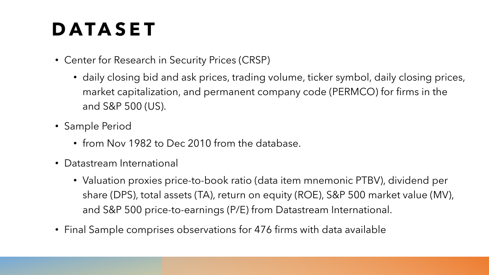

## 8. Spiral and alternative measures (slide 12)

This section shows how often each spiral value occurs in the data. A histogram is a bar chart of counts. Each bar sits over one possible value. The height of the bar says how many times that value occurred. Here, each count is the number of times a stock had that 10-day value on some day in the sample.

The slide has four histograms of the 10-day counts. The counts run from -10 to 10. The heights below are approximate.

Two of the histograms use the measures of section 6, which the slide calls "sigma" measures because they use the standard deviation $\sigma$. The other two use an "alternative" version of each measure. The slide does not define the alternative versions.

The table gives each histogram's shape and its tallest bars. A "peak" or "hump" is a value with a tall bar. Read "0 with about 295,000" as "the value 0 occurred about 295,000 times".

| Histogram | Shape | Peaks |
|---|---|---|
| Sigma-based illiquidity | Two peaks | 0 with about 295,000 and -4 with about 225,000 |
| Alternative illiquidity | One peak and a right tail | -4 with about 300,000 |
| Sigma-based loss | Two humps and a small bump at 0 | -5 with about 240,000 and +5 with about 180,000 |
| Alternative loss | Two humps and a valley at 0 | -5 with about 265,000 and +5 with about 205,000 |

For the illiquidity measures, most values sit at or below 0. A "right tail" means a thin spread of bars stretching out toward the large positive values. Those large positive values are the illiquidity spirals. They are rare, but they occur.

For the loss measures, the shape is different. There are two humps, one near -5 and one near +5. Few values sit near 0. That means a stock usually has either several good price days or several bad price days in its 10-day window, and rarely a mix.

Losses and gains come in runs. This is why the loss measures have humps away from zero. If price falls came at random, good and bad days would tend to cancel, and most sums would be near 0. Instead, a bad price day tends to be followed by more bad days. So the sums pile up away from zero.

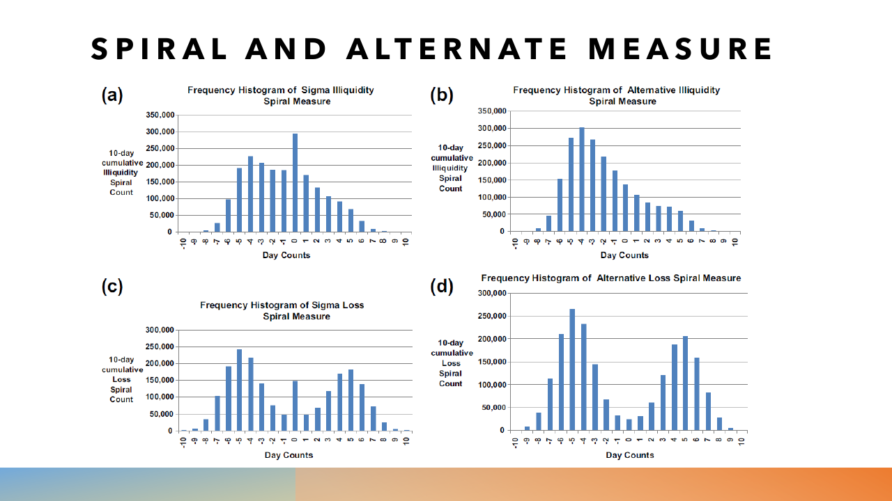

## 9. Effect on valuation (slide 13)

This section answers the last question of the topic. Do spirals change how the market values a firm? The paper tests this with regressions.

A regression is a method that estimates how much one variable changes when another variable changes, holding the other listed variables fixed. The variable being explained is called the dependent variable. The variables doing the explaining are called independent variables. Each number the regression produces is called a coefficient. A coefficient says how much the dependent variable changes when that independent variable rises by 1.

The regressions explain price to book value (PTBV) and price to earnings (P/E). The t values are in brackets.

Both PTBV and P/E measure how highly the market values a firm. PTBV is the share price divided by the book value per share. Book value is the value of the firm in its accounts. P/E is the share price divided by earnings per share. A higher PTBV or P/E means the market pays more for the same book value or the same earnings.

The t value tells us how sure we can be that a coefficient is not zero. It is the coefficient divided by its standard error. The standard error measures how uncertain the estimate is. A t value far from zero, either positive or negative, means the effect is unlikely to be due to chance. The stars mark coefficients that are statistically significant. That means they are unlikely to be zero. Two stars mark a stronger result than one star. The slide does not state the exact levels.

The table has six models. Models 5.1 to 5.3 explain PTBV. Models 6.1 to 6.3 explain P/E. Within each group, the models add more independent variables, called controls, from left to right. A control is a variable included so that its effect is not mistaken for the effect of the spirals. Each cell shows a coefficient, its stars, and its t value in brackets. An empty cell means that variable is not in that model.

| Variable | PTBV 5.1 | PTBV 5.2 | PTBV 5.3 | P/E 6.1 | P/E 6.2 | P/E 6.3 |
|---|---|---|---|---|---|---|
| Intercept | 3.72** (303.19) | 2.79** (70.93) | 3.18** (89.21) | 25.62** (1202.3) | 25.55 (763.56) | 35.41 (743) |
| Loss spiral | -0.034** (-13.22) | -0.030** (-11.67) | -0.032** (-15.30) | -0.33** (-73.41) | -0.33** (-73.18) | -0.36** (-80.04) |
| Illiquidity spiral | -0.003 (-0.77) | -0.008* (-2.00) | -0.049** (-15.56) | -0.37** (-54.64) | -0.37** (-54.16) | -0.33** (-48.88) |
| Index PTBV or P/E | | 0.001** (24.53) | 0.002** (66.66) | | 0.002** (2.53) | 0.015** (16.68) |
| Excess return | | 0.041** (4.43) | 0.021** (2.86) | | 0.13** (7.83) | 0.11** (7.17) |
| Total assets | | | -0.58** (-95.87) | | | -1.36** (-106.78) |
| Return on equity | | | 0.004** (98.12) | | | -0.004** (-29.37) |
| Dividend dummy | | | -0.63** (-27.35) | | | -10.13** (-205.36) |
| Observations | 848,064 | 848,064 | 834,231 | 1,550,914 | 1,550,914 | 1,525,707 |
| R-squared | 0.0002 | 0.001 | 0.0306 | 0.008 | 0.008 | 0.06 |

Here is what each row means.

- **Intercept:** It is the predicted PTBV or P/E when every independent variable is zero. It is a starting level, not a result about spirals. On the slide, the intercepts of models 6.2 and 6.3 carry no stars.
- **Loss spiral:** It is the 10-day loss spiral value $P_{spiral,10}$ from section 6.2.
- **Illiquidity spiral:** It is the 10-day illiquidity spiral value $S_{spiral,10}$ from section 6.1.
- **Index PTBV or P/E:** It is the PTBV or the P/E of the whole S&P 500. It controls for the level of the whole market.
- **Excess return:** It is the stock's return above a benchmark return. The slide does not say which benchmark.
- **Total assets:** It is the total size of the firm's balance sheet (TA on the slide). It controls for firm size.
- **Return on equity:** It is the firm's profit divided by its book value (ROE on the slide). It controls for how profitable the firm is.
- **Dividend dummy:** A dummy variable takes only the values 0 and 1. This one is based on the firm's dividend per share (DPS on the slide). It controls for whether a firm pays dividends.
- **Observations:** It is the number of data points used in that model. Each data point is one firm on one day.
- **R-squared:** It is the share of the variation in the dependent variable that the model explains. It runs from 0 to 1. For example, 0.0306 means the model explains 3.06 percent of the variation.

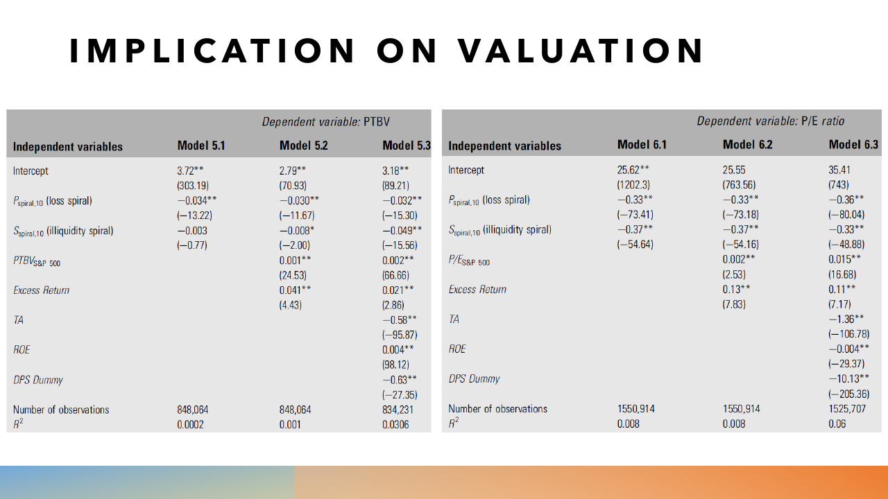

### 9.1 ⭐ How to read it

With the rows defined, we can now read off the results. The key thing to look at is the sign of each spiral coefficient. A negative sign means a larger spiral value goes with a lower valuation.

- **Loss spiral:** It lowers both PTBV and P/E in all six models. Every coefficient in the loss spiral row is negative and has two stars. So a stock in a loss spiral is valued lower, whichever model we use.
- **Illiquidity spiral:** It lowers P/E in all three models. It lowers PTBV significantly after controls are added. In model 5.1 the coefficient is -0.003 with a t value of only -0.77, and it has no stars. So in that model the effect cannot be told apart from zero. In model 5.2 it becomes -0.008 with one star. In model 5.3, with all the controls, it becomes -0.049 with two stars. For P/E, all three coefficients are negative with two stars.
- **Size of the effect:** A loss spiral of 10 lowers PTBV by $10(0.034)=0.34$ in model 5.1. The coefficient says that each extra point of loss spiral lowers PTBV by 0.034. A loss spiral of 10 is 10 such points. So multiply the coefficient by 10.

$$10\times0.034=0.34$$

So, in model 5.1, a stock with the worst possible loss spiral value has a PTBV about 0.34 lower than a stock with a value of 0.

- **Caution:** R-squared is small. The effects are significant, but they explain little of the variation. In model 5.1 the R-squared is 0.0002. That is 0.02 percent of the variation. Even the largest R-squared, 0.06 in model 6.3, is only 6 percent. So the spirals have a real effect on value, but most of the differences in value between firms come from other things.
- **Conclusion:** Financial market spirals have valuation implications. Firms caught in a loss spiral or an illiquidity spiral are valued lower by the market. This links the whole topic together. Funding problems create spirals (section 5), the spirals can be measured (section 6), and the spirals lower firm value (this section).
