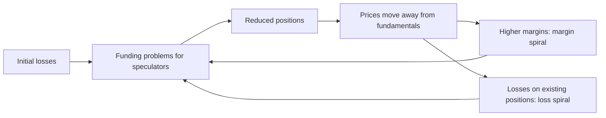
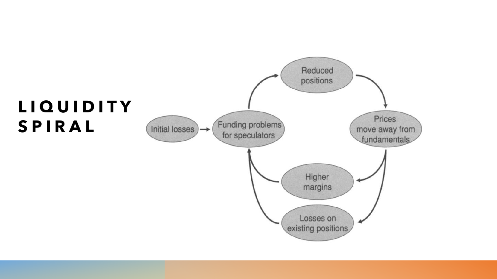

# Topic 3: Triggers of Extreme Illiquidity

These notes follow the deck "4. Extreme illiquidity in Market", slides 1 to 13.

Everything in this file is exam material. A ⭐ marks what to know without notes. Worked examples use made-up numbers to practise the slide formulas.

| Part | Source | Main point |
|---|---|---|
| Theory | Brunnermeier and Pedersen (2009) | Market liquidity and funding liquidity feed each other |
| Evidence | Margin history of S&P 500 futures | Margins jump in a crisis |
| Measure | Jain, Mishra and McInish (2013) | Count bad spread days and bad price days over 10 days |
| Effect | The same paper | Spirals lower firm valuation |

## 0. Words to know first

| Term | Meaning |
|---|---|
| Market liquidity | How easily an asset can be traded |
| Funding liquidity | How easily a trader can obtain money to trade |
| Speculator | A trader who supplies liquidity by buying cheap and selling dear. Dealers and hedge funds are examples |
| Financier | The bank or broker who lends to the speculator |
| Margin | The part of a position that the trader must pay with their own capital. A haircut means the same thing for a collateral loan |
| Deleveraging | Selling positions to reduce borrowing |
| Spiral | A loop in which a bad event causes more of itself |
| Fundamental volatility | The variation of the true value |
| Flight to quality | Capital moves out of risky assets and into safe assets |

## 1. Why extreme cases are critical (slide 2)

| No. | Principle | What it says |
|---|---|---|
| 1 | Liquidity is key | A market cannot work well without it |
| 2 | Trading should govern change | Changes should come from the trading of participants |
| 3 | Outside factors should not rule | External factors should not influence the liquidity of an asset or of the market |

In an extreme case, funding can decide liquidity. This breaks principle 3. This is why these cases need study.

## 2. Brunnermeier and Pedersen (2009): "Market liquidity and funding liquidity" (slides 3 and 4)

The paper is in the Review of Financial Studies, volume 22, issue 6, pages 2201 to 2238.

### 2.1 ⭐ The main idea

| Point | What it says |
|---|---|
| The link | The model links market liquidity and funding liquidity |
| First direction | Traders provide market liquidity. They can do this only when they have funding |
| Second direction | Funding means capital and margin. Both depend on how liquid the assets are |
| The danger | Under some conditions margins are destabilizing. The two kinds of liquidity then reinforce each other |
| The result | This gives liquidity spirals |

| Point | Market liquidity | Funding liquidity |
|---|---|---|
| Belongs to | An asset or a market | A trader |
| Question | Can I sell easily near the true value? | Can I get money to hold this position? |
| Measured by | Spread, depth and price impact | Margin, haircut and cost of borrowing |
| Fails when | Buyers disappear | Lenders demand more capital |

### 2.2 Why capital limits liquidity supply

| Symbol | Meaning |
|---|---|
| $W$ | Capital of the speculator |
| $m$ | Margin rate, a share between 0 and 1 |
| $X$ | Position in money |

| Line | Expression | Why |
|---|---|---|
| 1 | Capital needed $=mX$ | The trader pays the share $m$ of the position from own capital |
| 2 | $mX\le W$ | The trader cannot use more capital than $W$ |
| 3 | $X\le W/m$ | Divide both sides by $m$, which is positive |

$$X\le\frac{W}{m}$$

| Change | Effect on the largest position $W/m$ | Spiral |
|---|---|---|
| Capital $W$ falls | Numerator falls, so the limit falls | Loss spiral |
| Margin $m$ rises | Denominator rises, so the limit falls | Margin spiral |

## 3. ⭐ Five features of liquidity (slide 5)

| Feature | What happens | Why, in the model |
|---|---|---|
| It can suddenly dry up | Liquidity vanishes quickly | Financiers are imperfectly informed and raise margins when volatility changes |
| It has commonality | Many securities become illiquid together | The same speculators supply liquidity in all of them |
| It is related to volatility | Volatile assets are less liquid | Volatile assets need higher margins |
| It shows flight to quality | Risky assets lose more liquidity than safe ones | Scarce capital moves to assets with low margins |
| It moves with the market | Liquidity falls when the market falls | Funding conditions move with the market |

> **Exam:** These five features are an easy question. Write each feature with its reason.

## 4. Extreme market events (slide 6)

The chart shows margins on S&P 500 futures from 1982 to 2008. The margins are for exchange members. They are a percent of contract value. Initial margin equals maintenance margin for members. Each dot is a change in the dollar margin. The levels below are read from the chart, so they are approximate.

| Event | Year | Margin |
|---|---|---|
| Before the crash | 1982 to 1987 | About 4 percent |
| Black Monday | 19 October 1987 | Above 12 percent |
| Calm period | 1989 | About 3 percent |
| Mini-crash | 1989 | It rises again |
| US and Iraq war | 1990 to 1991 | About 6.4 percent |
| Calm period | 1997 | About 2 percent |
| Asian crisis | 1997 | About 3.8 percent |
| LTCM collapse | 1998 | About 5.5 percent |
| Subprime crisis | 2007 to 2008 | It rises from about 4 to about 5 percent |

Margins rise when markets are in trouble. So traders lose funding exactly when the market needs them.

## 5. ⭐ The liquidity spiral (slide 7)

### 5.1 Triggers

| No. | Trigger | What happens |
|---|---|---|
| 1 | A first loss | Speculators lose capital |
| 2 | A funding shock | Lenders cut credit or capital is withdrawn |
| 3 | A volatility shock | Financiers cannot tell news from illiquidity. They raise margins |
| 4 | A forced sale | A large trader must unwind. Others may predate, as Topic 4 explains |

### 5.2 The loop step by step

| Step | What happens | Name |
|---|---|---|
| 1 | Speculators suffer an initial loss | Trigger |
| 2 | They face funding problems | Funding liquidity falls |
| 3 | They reduce their positions | Deleveraging |
| 4 | Their selling moves prices away from fundamentals | Market liquidity falls |
| 5 | The price fall creates losses on the positions that remain | **Loss spiral** |
| 6 | The price movement also makes lenders raise margins | **Margin spiral** |
| 7 | Steps 5 and 6 send the trader back to step 2. The loop repeats and becomes stronger | Spiral |

| Point | Loss spiral | Margin spiral |
|---|---|---|
| What changes | Capital $W$ falls | Margin $m$ rises |
| Cause | Price fall on existing positions | Financier fears volatility and illiquidity |
| Is leverage changed? | The trader sells to keep leverage constant | The trader must cut leverage |
| Needs a higher margin? | No | Yes |

### 5.3 Worked example

A speculator has capital of 10. The margin is 10 percent. The speculator holds the largest position allowed.

| Step | What we find | Working | Result |
|---|---|---|---|
| 1 | First position | $W/m=10/0.10$ | 100 |
| 2 | Loan | $100-10$ | 90 |
| 3 | Position after a 3 percent price fall | $100(1-0.03)$ | 97 |
| 4 | Capital after the fall | Position minus loan: $97-90$ | 7 |
| 5 | Allowed position at the old margin | $7/0.10$ | 70 |
| 6 | Loss spiral sale | $97-70$ | 27 |
| 7 | Allowed position at the new margin of 14 percent | $7/0.14$ | 50 |
| 8 | Margin spiral sale | $70-50$ | 20 more |
| 9 | Total sale | $27+20$ | 47 out of 97 |

**Conclusion:** A price fall of 3 percent forced the sale of 47 out of 97. This selling pushes the price down again.

## 6. Empirical measure: Jain, Mishra and McInish (2013) (slide 8)

Pankaj K. Jain, Ajay K. Mishra and Thomas H. McInish wrote "Identification and valuation implications of financial market spirals". It is in the book Rethinking Valuation and Pricing Models, from page 471.

> **Exam:** This is the professor's own paper. Learn its two definitions and the sign of its results.

The paper builds two measures for the equity market.

| No. | Measure | Based on | Bad direction |
|---|---|---|---|
| 1 | Illiquidity spiral | The spread | The spread rises |
| 2 | Loss spiral | The price | The price falls |

### 6.1 ⭐ Illiquidity spiral (slide 9)

| Symbol | Meaning |
|---|---|
| $s_t$ | Today's spread |
| $s_{t-1}$ | Yesterday's spread |
| $\bar{s}$ | Average spread of the previous year |
| $\sigma_s$ | Standard deviation of the spread in that year |

**Step 1: Give each day a score.**

| Condition 1 | Condition 2 | Score $S_t$ | Equation |
|---|---|---|---|
| $s_t\lt s_{t-1}$ | $s_t\lt\bar{s}-0.5\sigma_s$ | -1 | 29.1 |
| $s_t\gt s_{t-1}$ | $s_t\gt\bar{s}+0.5\sigma_s$ | +1 | 29.2 |
| Any other case | | 0 | 29.3 |

Both conditions must hold for a score of +1 or -1.

**Step 2: Add the last 10 days.** This is equation 29.4.

$$S_{spiral,10}=\sum_{k=0}^{9}S_{t-k}$$

A large positive sum means that the stock is in an illiquidity spiral.

### 6.2 ⭐ Loss spiral (slide 10)

| Symbol | Meaning |
|---|---|
| $P_t$ | Today's price |
| $P_{t-1}$ | Yesterday's price |
| $\bar{M}$ | Midpoint of the previous year |
| $\sigma_P$ | Standard deviation of the price in that year |

**Step 1: Give each day a score.**

| Condition 1 | Condition 2 | Score $L_t$ | Equation |
|---|---|---|---|
| $P_t\lt P_{t-1}$ | $P_t\lt\bar{M}-0.5\sigma_P$ | +1 | 29.5 |
| $P_t\gt P_{t-1}$ | $P_t\gt\bar{M}+0.5\sigma_P$ | -1 | 29.6 |
| Any other case | | 0 | 29.7 |

The slide uses the letter P for this score. These notes use $L_t$ so that it is not mixed with the price.

**Step 2: Add the last 10 days.** This is equation 29.8.

$$P_{spiral,10}=\sum_{k=0}^{9}L_{t-k}$$

> **Exam:** A score of +1 always means bad. For spreads, bad means higher. For prices, bad means lower. So the inequality signs are opposite in the two measures.

### 6.3 Worked example

**Spread score:** Today's spread is 0.95. Yesterday's was 0.90. The previous year has an average of 0.80 and a standard deviation of 0.20.

| Step | Check | Working | Result |
|---|---|---|---|
| 1 | Condition 1: higher than yesterday? | $0.95\gt 0.90$ | Yes |
| 2 | Upper limit | $0.80+0.5(0.20)=0.80+0.10$ | 0.90 |
| 3 | Condition 2: above the limit? | $0.95\gt 0.90$ | Yes |
| 4 | Score | Both conditions hold, equation 29.2 | +1 |

**Price score:** Today's price is 95. Yesterday's was 97. The previous year has a midpoint of 100 and a standard deviation of 8.

| Step | Check | Working | Result |
|---|---|---|---|
| 1 | Condition 1: lower than yesterday? | $95\lt 97$ | Yes |
| 2 | Lower limit | $100-0.5(8)=100-4$ | 96 |
| 3 | Condition 2: below the limit? | $95\lt 96$ | Yes |
| 4 | Score | Both conditions hold, equation 29.5 | +1 |

**10-day sum:** Take the last 10 scores.

| Day $k$ | 0 | 1 | 2 | 3 | 4 | 5 | 6 | 7 | 8 | 9 |
|---|---|---|---|---|---|---|---|---|---|---|
| Score | 1 | 1 | 0 | 1 | 1 | -1 | 1 | 0 | 1 | 1 |

| Step | Working | Result |
|---|---|---|
| 1 | Count the +1 scores | 7 |
| 2 | Count the -1 scores | 1 |
| 3 | Sum: $7(1)+1(-1)+2(0)$ | 6 |

## 7. Data (slide 11)

| Item | Detail |
|---|---|
| CRSP | Daily closing bid, ask, volume, ticker, close price, market capitalization and PERMCO |
| Firms | S&P 500 firms in the US |
| Period | November 1982 to December 2010 |
| Datastream International | Price to book value, dividend per share, total assets and return on equity. Also the market value and the P/E of the S&P 500 |
| Final sample | 476 firms |

## 8. Spiral and alternative measures (slide 12)

The slide has four histograms of the 10-day counts. The counts run from -10 to 10. The heights below are approximate.

| Histogram | Shape | Peaks |
|---|---|---|
| Sigma-based illiquidity | Two peaks | 0 with about 295,000 and -4 with about 225,000 |
| Alternative illiquidity | One peak and a right tail | -4 with about 300,000 |
| Sigma-based loss | Two humps and a small bump at 0 | -5 with about 240,000 and +5 with about 180,000 |
| Alternative loss | Two humps and a valley at 0 | -5 with about 265,000 and +5 with about 205,000 |

Losses and gains come in runs. This is why the loss measures have humps away from zero.

## 9. Effect on valuation (slide 13)

The regressions explain price to book value (PTBV) and price to earnings (P/E). The t values are in brackets.

| Variable | PTBV 5.1 | PTBV 5.2 | PTBV 5.3 | P/E 6.1 | P/E 6.2 | P/E 6.3 |
|---|---|---|---|---|---|---|
| Intercept | 3.72** (303.19) | 2.79** (70.93) | 3.18** (89.21) | 25.62** (1202.3) | 25.55 (763.56) | 35.41 (743) |
| Loss spiral | -0.034** (-13.22) | -0.030** (-11.67) | -0.032** (-15.30) | -0.33** (-73.41) | -0.33** (-73.18) | -0.36** (-80.04) |
| Illiquidity spiral | -0.003 (-0.77) | -0.008* (-2.00) | -0.049** (-15.56) | -0.37** (-54.64) | -0.37** (-54.16) | -0.33** (-48.88) |
| Index PTBV or P/E | | 0.001** (24.53) | 0.002** (66.66) | | 0.002** (2.53) | 0.015** (16.68) |
| Excess return | | 0.041** (4.43) | 0.021** (2.86) | | 0.13** (7.83) | 0.11** (7.17) |
| Total assets | | | -0.58** (-95.87) | | | -1.36** (-106.78) |
| Return on equity | | | 0.004** (98.12) | | | -0.004** (-29.37) |
| Dividend dummy | | | -0.63** (-27.35) | | | -10.13** (-205.36) |
| Observations | 848,064 | 848,064 | 834,231 | 1,550,914 | 1,550,914 | 1,525,707 |
| R-squared | 0.0002 | 0.001 | 0.0306 | 0.008 | 0.008 | 0.06 |

### 9.1 ⭐ How to read it

| Point | What it says |
|---|---|
| Loss spiral | It lowers both PTBV and P/E in all six models |
| Illiquidity spiral | It lowers P/E in all three models. It lowers PTBV significantly after controls are added |
| Size of the effect | A loss spiral of 10 lowers PTBV by $10(0.034)=0.34$ in model 5.1 |
| Caution | R-squared is small. The effects are significant, but they explain little of the variation |
| Conclusion | Financial market spirals have valuation implications |
