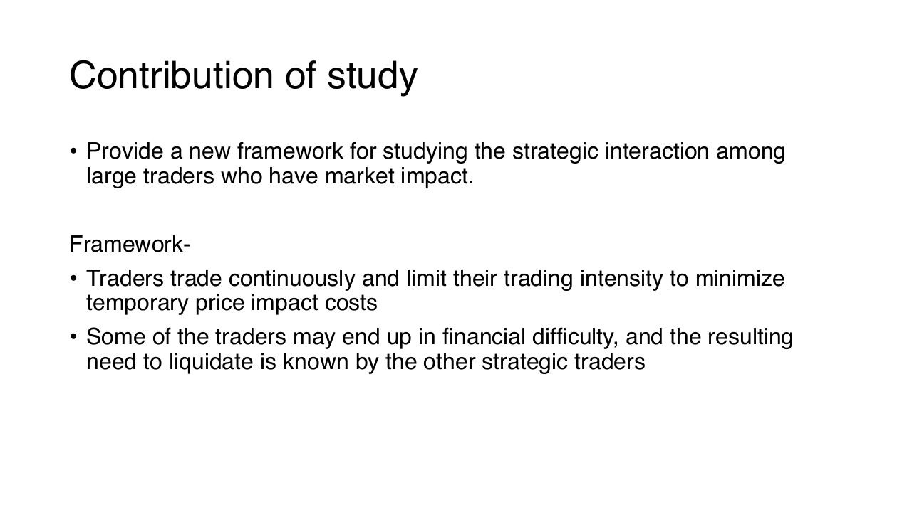
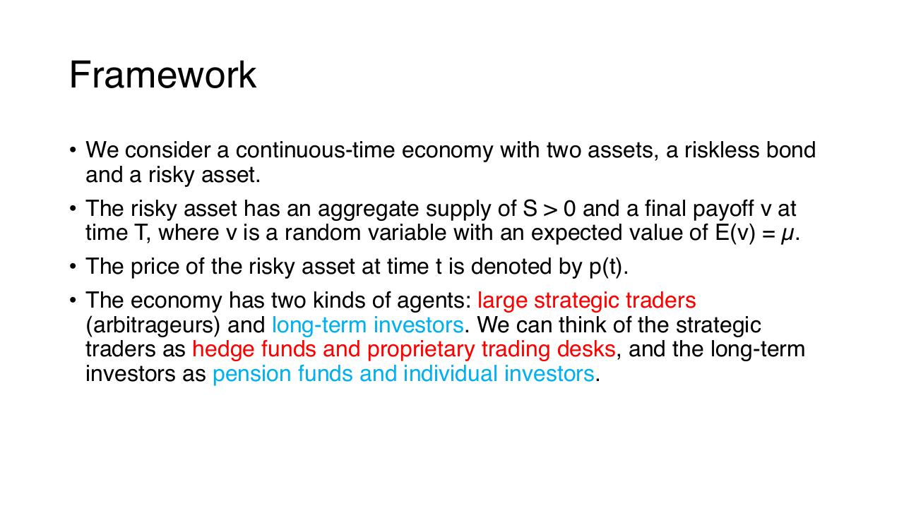
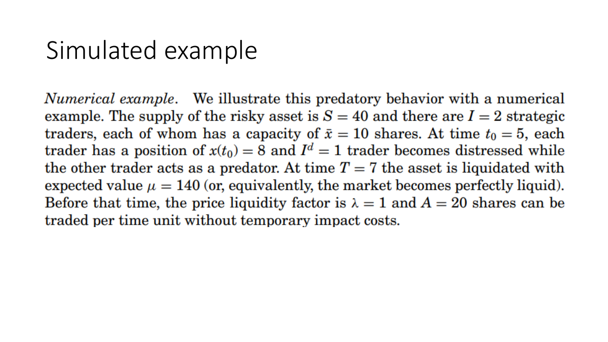
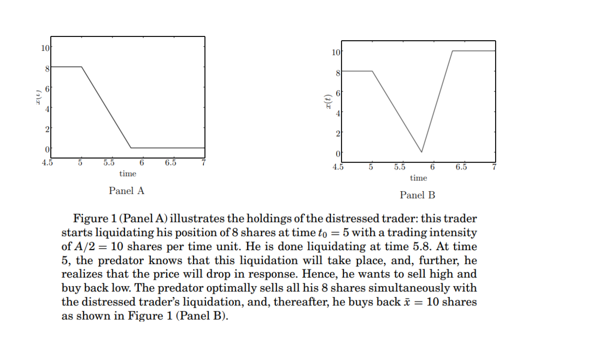
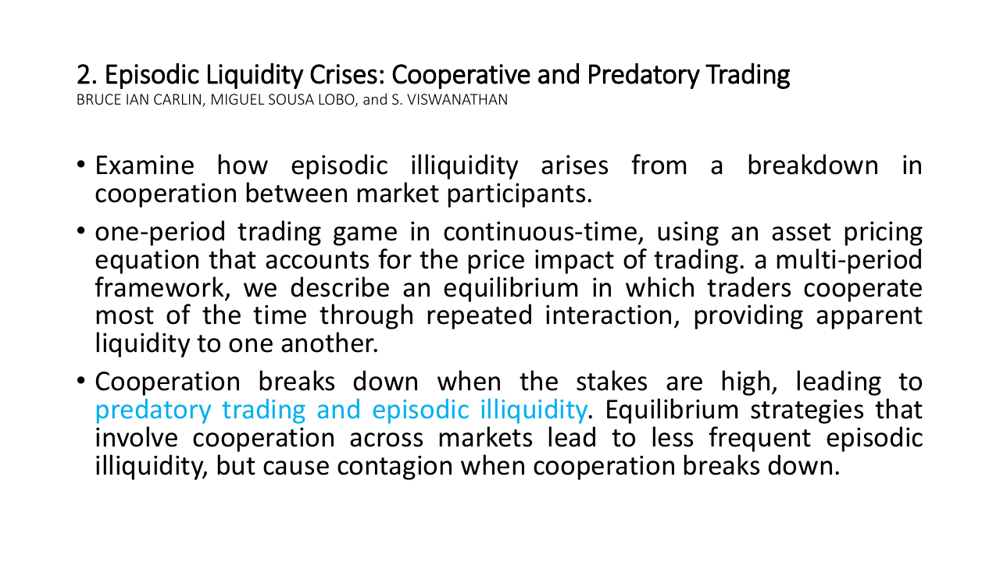
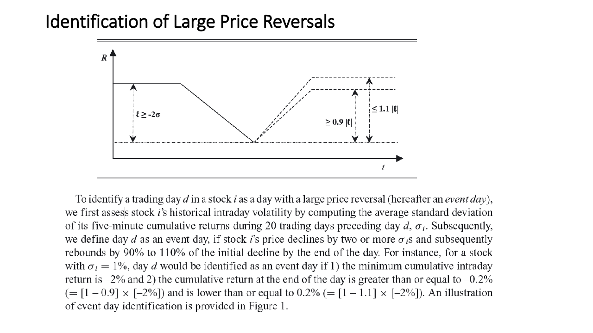
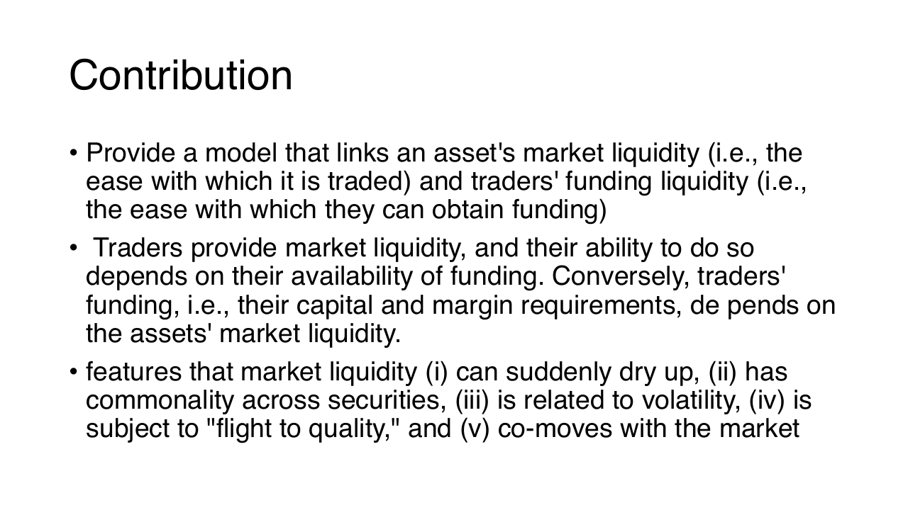
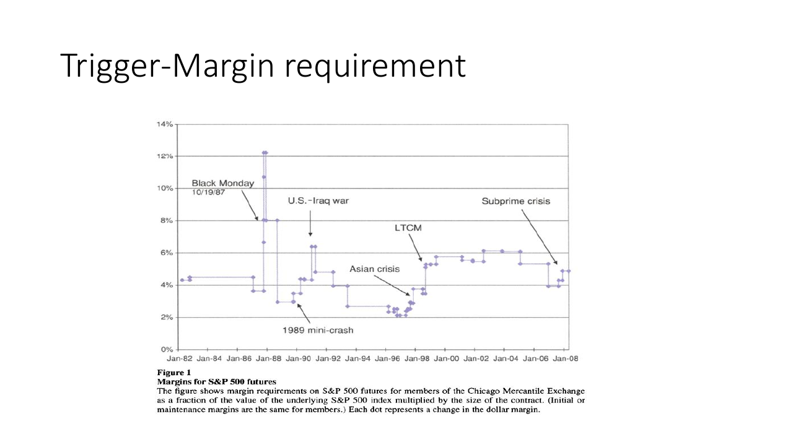
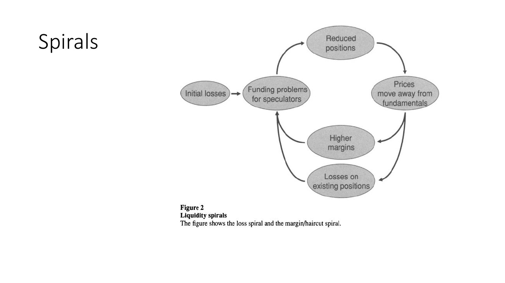
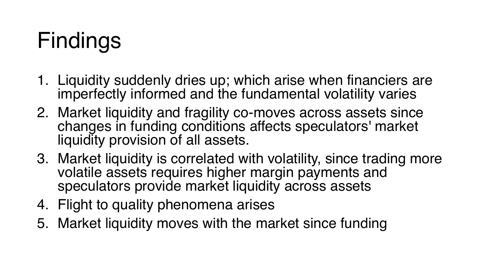

# Topic 4: Market-Wide Liquidity Phenomena

These notes follow the deck "5. Market Wide impacts", slides 1 to 20.

Everything in this file is exam material. A ⭐ marks what to know without notes. Worked examples use made-up numbers to practise the slide formulas.

| Part | Paper | Why liquidity disappears |
|---|---|---|
| Predatory trading | Brunnermeier and Pedersen (2005) | Others trade against a distressed trader |
| Episodic crises | Carlin, Lobo and Viswanathan (2007) | Cooperation between traders breaks down |
| Price pressure | Shkilko, Van Ness and Van Ness (2012) | Sellers demand liquidity together |
| Spirals | Brunnermeier and Pedersen (2009) | Funding and market liquidity feed each other |

## 0. Words to know first

| Term | Meaning |
|---|---|
| Distressed trader | A trader who is forced to sell |
| Predator | A trader who uses the forced sale to make a profit |
| Liquidation value | The money received from selling a position |
| Price overshooting | The price moves beyond its new long-run level and then comes back |
| Front running | Trading ahead of a known order |
| Short sale | Selling a borrowed share |
| Contagion | A crisis spreads from one trader or market to another |

## 1. Predatory trading: Brunnermeier and Pedersen (2005) (slides 2 to 12)

### 1.1 ⭐ Definition (slide 2)

| Point | What it says |
|---|---|
| Slide definition | Predatory trading exploits an information advantage to profit at the expense of others. It may use non-public information or market dynamics. It benefits the predator unfairly and harms other investors or the market |
| The basic pattern | One trader must sell. Other traders also sell. They buy back later |

The pattern has five results.

| No. | Result |
|---|---|
| 1 | The price overshoots |
| 2 | The distressed trader gets a lower liquidation value |
| 3 | The market is illiquid exactly when liquidity is most needed |
| 4 | A trader can profit by triggering the crisis of another trader |
| 5 | The crisis spills over across traders and markets |


### 1.2 Contribution (slide 3)

| Point | What it says |
|---|---|
| New framework | It studies strategic interaction among large traders who have market impact |
| Slow trading | Traders trade continuously. They limit their speed to keep temporary impact cost low |
| Known distress | Some traders become distressed. The other traders know that they need to sell |



### 1.3 Specific contributions (slide 4)

| Part | Contribution | Detail |
|---|---|---|
| a | It introduces predatory trading | It is strategic behaviour that exploits the information disadvantage of others. It causes inefficiency and harms market quality |
| b | It has several types | A trader may front run. A trader may anticipate orders. A trader may trade strategically ahead of a large order |
| c | It is hard to identify | A regulator must separate a legitimate strategy from manipulation |
| d | It hurts market quality | It affects liquidity, price efficiency, stability and investor confidence |


### 1.4 ⭐ Findings (slide 5)

| Step | Finding |
|---|---|
| 1 | A distressed large investor must unwind a position |
| 2 | Other strategic traders first trade in the same direction |
| 3 | They withdraw liquidity instead of providing it |
| 4 | The liquidation becomes costly and the price overshoots |
| 5 | Predation is profitable under the two conditions in the next table |

| Condition | What it says |
|---|---|
| 1 | The market is illiquid |
| 2 | The distressed position is large relative to the buying capacity of the others |

> **Exam:** The normal view says that others buy when someone sells cheaply. Predation says that they sell first and buy later. Write this contrast.


### 1.5 Examples (slide 6)

| Example | What happened |
|---|---|
| Enron and UBS Warburg (2002) | A plan to take Enron's traders without its trading book was opposed for "predatory trading risk". The traders knew the book. |
| Disclosure (IAFE, 2001) | Detailed disclosure of positions can be ruinous for large portfolios. |
| LTCM as a victim (Business Week, 2001) | Lenders sell the same asset before the borrower can. Goldman and other counterparties did this to LTCM in 1998. |
| LTCM (Meriwether) | Meriwether quoted a colleague. Selling hurricane insurance does not cause a hurricane. In markets, people who know that you sold insurance can make the loss happen. |
| Systemic risk (Greenspan, 1 October 1998) | A forced sale by LTCM would distort prices. It could hurt creditors, counterparties and people who were not involved. |
| Hedge funds as predators (Cramer, 2002) | "When you smell blood in the water, you become a shark." |
| Credit General (June 1995) | It bought a billion pounds sterling from a client and tried to sell for marks. The market evaporated. Price and liquidity fell quickly. |


### 1.6 Framework and assumptions (slides 7 and 8)

| No. | Assumption |
|---|---|
| A1 | Time is continuous |
| A2 | There is a riskless bond and a risky asset |
| A3 | The risky asset has supply $S\gt 0$. It pays $v$ at time $T$, with $E(v)=\mu$ |
| A4 | The price at time $t$ is $p(t)$ |
| A5 | There are $I$ large strategic traders. Hedge funds and proprietary desks are examples |
| A6 | There are long-term investors. Pension funds and individuals are examples |
| A7 | Strategic traders are risk neutral. They maximize expected profit |
| A8 | They are large, so they count their own price impact |

| Symbol | Meaning |
|---|---|
| $x^i(t)$ | Position of trader $i$ at time $t$ |
| $a^i(t)$ | Trading speed of trader $i$: shares bought per unit of time. It is negative for selling |
| $\bar{x}$ | Position limit |

**Equation 1: The position adds up the trades.** The position at $t$ is the starting position plus all trades from 0 to $t$.

$$x^i(t)=x^i(0)+\int_0^t a^i(\tau) d\tau$$

**Equation 2: The position has a limit.** The limit comes from risk or from capital.

$$-\bar{x}\le x^i(t)\le\bar{x}$$




### 1.7 ⭐ Simulated example (slides 9 to 11)

| Input | Value |
|---|---|
| Supply $S$ | 40 |
| Strategic traders $I$ | 2 |
| Distressed traders | 1 |
| Position limit $\bar{x}$ | 10 |
| Each starting holding | 8 |
| Time of distress | 5 |
| Final time $T$ | 7 |
| Expected value $\mu$ | 140 |
| Price impact $\lambda$ | 1 |
| Trading speed without temporary cost $A$ | 20 shares per time unit |

At time 7, the asset pays off or the market becomes perfectly liquid.

| Step | What we find | Working | Result |
|---|---|---|---|
| 1 | Starting price | Read from the slide figure | 116 |
| 2 | Speed of each seller | Two traders share the speed $A$: $A/2=20/2$ | 10 per time unit |
| 3 | Time the distressed trader needs | $8/10$ | 0.8 time units |
| 4 | When the selling ends | $5+0.8$ | Time 5.8 |
| 5 | Predator's action | It sells all its 8 shares at the same time | Holding 0 |
| 6 | Total shares sold | $8+8$ | 16 |
| 7 | Price fall | $16\times\lambda=16\times 1$ | 16 points |
| 8 | Lowest price | $116-16$ | 100 |
| 9 | Predator's buy-back | From 0 up to its limit of 10, alone at speed 20: $10/20$ | 0.5 time units |
| 10 | When the buy-back ends | $5.8+0.5$ | Time 6.3 |
| 11 | New price | Read from the slide | 110 |
| 12 | Overshoot | $110-100$ | 10 |

```text
price
116  ----o
          \
110        \      o-------
            \    /
             \  /
100           o
time     5   5.8  6.3    7
```

The slide also marks the marginal selling price and the marginal buying price. The predator sells at higher prices and buys back at lower prices.






### 1.8 Multiple predators (slide 12)

The total starting holding stays the same. It is $2\times 8=16$.

| Traders | Predators | Distressed | Start per trader | Lowest price, approximate | Final price, approximate |
|---|---|---|---|---|---|
| 3 | 2 | 1 | $16/3=5.3$ | 110 | 113.3 |
| 9 | 6 | 3 | $16/9=1.8$ | 112.5 | 113.3 |
| 27 | 18 | 9 | $16/27=0.6$ | 113.1 | 113.3 |

| Point | What it says |
|---|---|
| Earlier buy-back | More predators start buying back earlier |
| Smaller overshoot | The overshoot falls as predators increase. Final minus lowest is about 3.3, then 0.8, then 0.2 |
| Reason | Competition among predators removes part of the predation |


## 2. Carlin, Lobo and Viswanathan (2007): "Episodic liquidity crises: cooperative and predatory trading" (slide 13)



### 2.1 The main idea

Episodic illiquidity comes from a breakdown of cooperation.

### 2.2 ⭐ The model step by step

| Step | What happens |
|---|---|
| 1 | The stage game is a trading game in continuous time over one period. A pricing equation gives price impact |
| 2 | In one period, a trader gains by predating |
| 3 | In many periods, the traders meet again and again |
| 4 | They cooperate most of the time. They give apparent liquidity to each other |
| 5 | A trader who predates today loses cooperation in the future |
| 6 | Cooperation breaks when the stakes are high. The gain today is then larger than the future loss |
| 7 | Predatory trading starts. It causes episodic illiquidity |

| Compare | Value | When it wins |
|---|---|---|
| Predate today | Gain today | Stakes are high |
| Cooperate | Value of future cooperation | Stakes are small |

### 2.3 Cooperation across markets

| Point | What it says |
|---|---|
| Benefit | Cooperation across markets makes crises less frequent |
| Cost | A breakdown then hits all those markets. This is contagion |

| Point | Cooperation | Predation |
|---|---|---|
| When | Most of the time, with small stakes | Sometimes, with high stakes |
| Action | Traders supply liquidity to the one in need | Traders sell with the one in need |
| Market | It looks liquid | It suddenly becomes illiquid |

> **Exam:** The key words are repeated game, high stakes, episodic and contagion.

## 3. Empirical setup: Shkilko, Van Ness and Van Ness (2012) (slides 14 and 15)

The paper is "Short selling and intraday price pressures". It is in Financial Management, volume 41, issue 2, pages 345 to 370.


### 3.1 What it finds

| Point | What it says |
|---|---|
| Subject | It studies intraday downward price pressure in single stocks |
| Main driver | Non-short volume that demands liquidity drives most declines. This is selling by long sellers |
| Short sellers | They are also active. They make declines somewhat worse |
| Large reversals | Short selling becomes more intense in the decline stage |
| Change of role | Short sellers usually provide liquidity. They switch to demanding it |
| Conclusion | Their effect is second to that of long sellers. This contradicts the view that short sellers destabilize markets on their own |

### 3.2 ⭐ How a large price reversal is identified (slide 15)

| Symbol | Meaning |
|---|---|
| $\sigma_i$ | Average standard deviation of five-minute cumulative returns of stock $i$ over the previous 20 trading days |
| $\ell$ | Lowest cumulative return of the day |
| $R_{close}$ | Cumulative return at the close |

| Step | Check |
|---|---|
| 1 | Find the normal movement $\sigma_i$ |
| 2 | Check the decline |
| 3 | Check the rebound |

**Step 1: Find the normal movement.** Compute $\sigma_i$ from the previous 20 trading days.

**Step 2: Check the decline.** The lowest point must be at least two standard deviations below zero.

$$\ell\le-2\sigma_i$$

**Step 3: Check the rebound.** By the end of the day, the price must recover 90 to 110 percent of the decline.

$$0.9\lvert\ell\rvert\le R_{close}-\ell\le 1.1\lvert\ell\rvert$$

| Line | Expression | Why |
|---|---|---|
| 1 | $R_{close}-\ell$ | The rise from the low to the close is the rebound |
| 2 | $\lvert\ell\rvert$ | The size of the decline from zero to the low |
| 3 | Rebound between 90 and 110 percent of the decline | The slide's recovery rule |

**Worked example:** Take $\sigma_i$ as 1 percent.

| Step | What we find | Working | Result |
|---|---|---|---|
| 1 | Decline limit | $-2\sigma_i=-2(1)$ | The low must be -2 percent or lower |
| 2 | Choose a low | Suppose that it reaches exactly -2 percent | $\ell=-2$, $\lvert\ell\rvert=2$ |
| 3 | Smallest rebound | $0.9(2)$ | 1.8 |
| 4 | Close after the smallest rebound | $-2+1.8$ | -0.2 percent |
| 5 | Largest rebound | $1.1(2)$ | 2.2 |
| 6 | Close after the largest rebound | $-2+2.2$ | 0.2 percent |
| 7 | Rule | Steps 4 and 6 | The day must end between -0.2 and 0.2 percent |

> **Slide error:** The figure prints the decline condition with the sign reversed. It shows $\ell\ge-2\sigma$. The text needs $\ell\le-2\sigma$.



## 4. Spirals (slides 16 to 20)

### 4.1 Contribution (slides 16 and 17)

| Point | What it says |
|---|---|
| The link | Brunnermeier and Pedersen (2009) link market liquidity with funding liquidity |
| Funding affects the market | Traders provide market liquidity according to their funding |
| The market affects funding | Capital and margins depend on the market liquidity of assets |
| The loop | Margins can destabilize. The two kinds of liquidity then reinforce each other |




### 4.2 Trigger and spirals (slides 18 and 19)

| Part | What it says |
|---|---|
| Trigger | Margin requirements rise in crises. The S&P 500 futures chart shows this for 1987, 1998 and 2007 |
| Loss spiral | Losses reduce capital and force sales |
| Margin and haircut spiral | Higher margins reduce allowed leverage and force sales |

```text
initial loss --> funding problem --> sell positions --> price leaves fundamentals
                      ^                                          |
                      |                                          |
                      +---- losses and higher margins <----------+
```

Topic 3 explains this loop with a numerical example.





### 4.3 ⭐ Findings (slide 20)

| No. | Finding | What it says |
|---|---|---|
| 1 | Sudden dry-up | It happens when financiers are imperfectly informed and fundamental volatility varies over time |
| 2 | Commonality | Liquidity and fragility move together across assets. A change in funding affects liquidity supply in all assets |
| 3 | Volatility | Liquidity is correlated with volatility. Volatile assets need higher margins, and speculators supply liquidity across assets |
| 4 | Flight to quality | It arises from the model |
| 5 | Moves with the market | Liquidity moves with the market because funding conditions do |

The slide cuts off the last sentence. The words "funding conditions do" complete it.



## 5. Join the whole topic

### 5.1 Market-wide phenomena

| Phenomenon | Meaning | Explanation |
|---|---|---|
| Commonality | Stocks gain and lose liquidity together | Chordia and others, and funding limits |
| Dry-up | Liquidity vanishes suddenly | Margin spiral |
| Flight to quality | Capital moves to safe assets | Scarce funding |
| Overshooting | Price falls too far and returns | Predatory trading |
| Episodic illiquidity | Calm periods end in short crises | Breakdown of cooperation |
| Contagion | A crisis spreads | Common traders and broken cooperation |
| Large reversal | A sharp fall reverses in a day | Temporary selling pressure |

### 5.2 Compare the mechanisms

| Point | Predation | Broken cooperation | Spiral |
|---|---|---|---|
| Trigger | Another trader must sell | Stakes become high | Loss or margin increase |
| Is the seller forced? | The victim is forced, and the predator chooses | The predators choose | All are forced by funding |
| Is strategy needed? | Yes | Yes | No |
| Key limit | Position limit of buyers | Value of future cooperation | Capital and margin |

> **Exam:** A question on market-wide liquidity needs three layers. First define commonality. Then give the mechanism. Then give the evidence.
