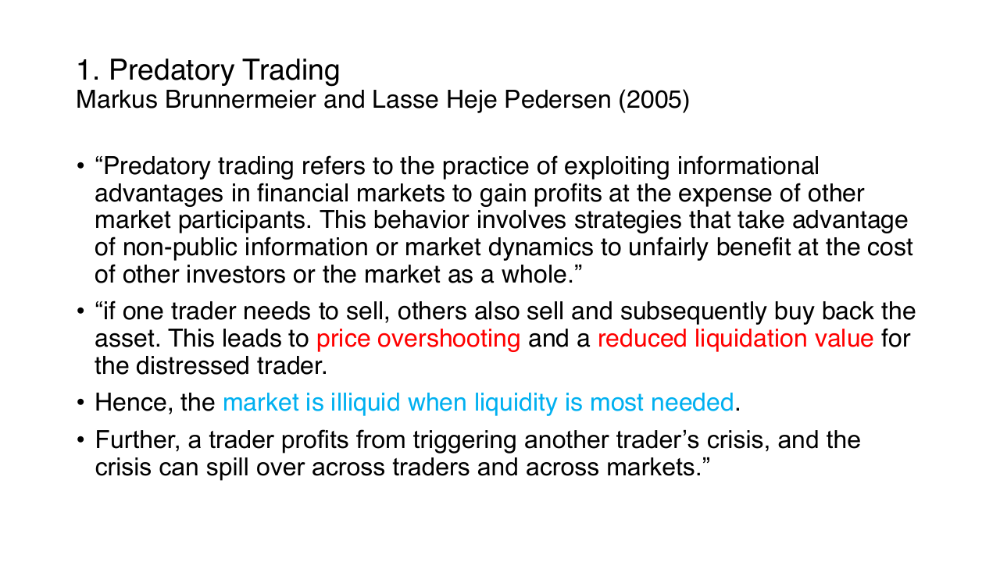
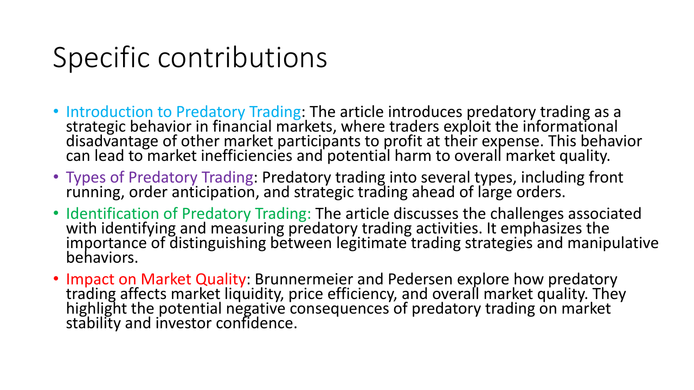
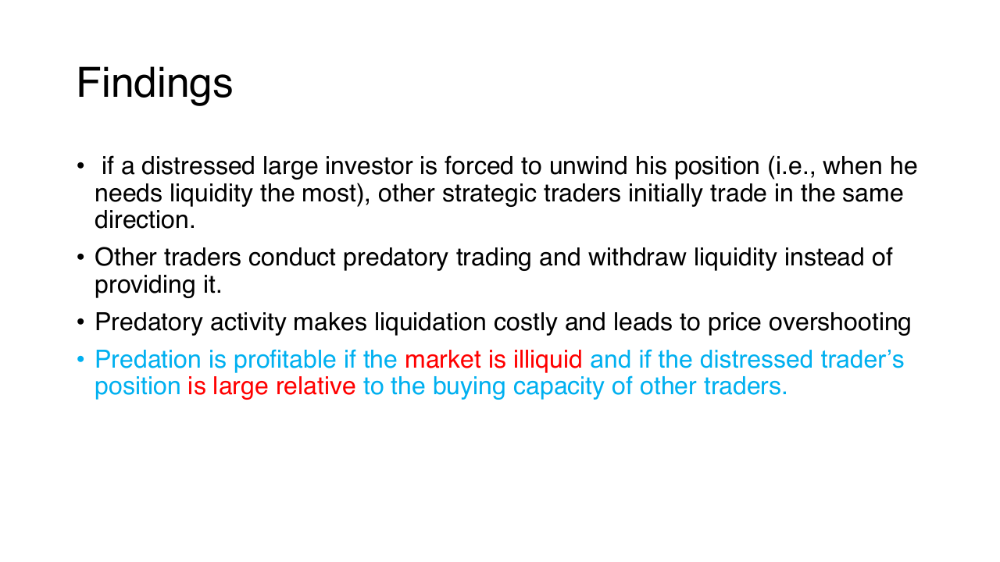
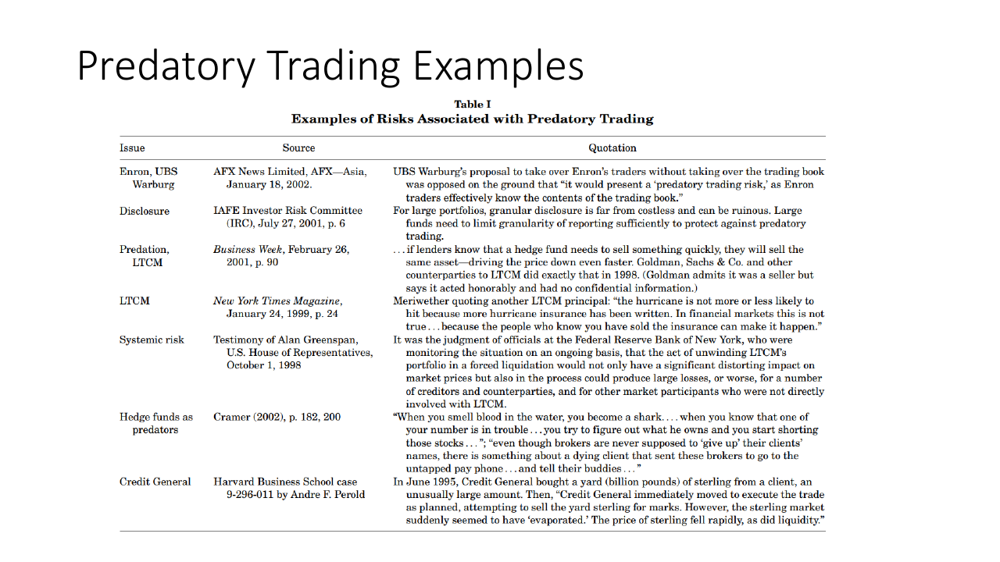
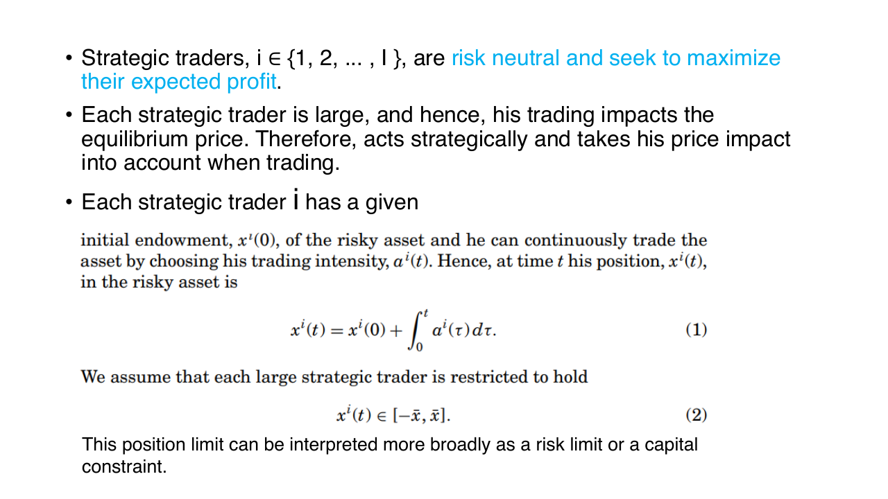
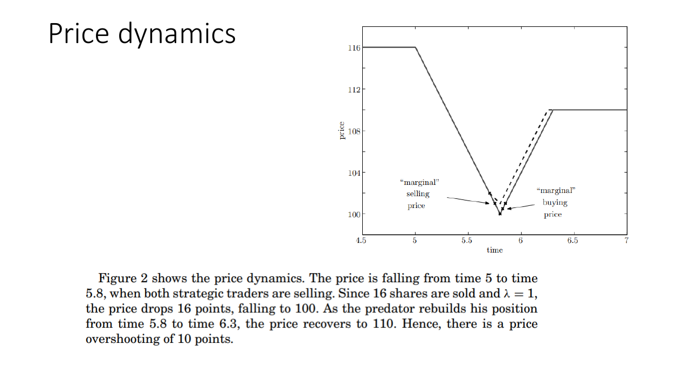
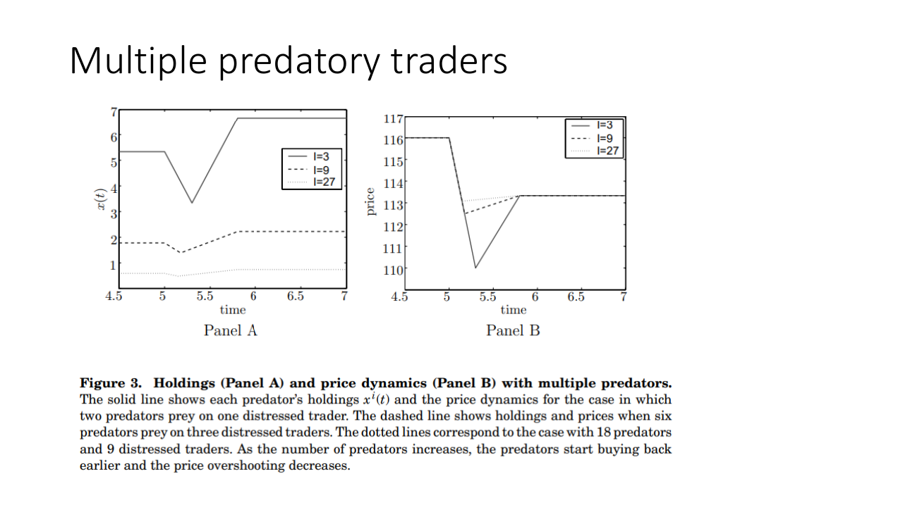
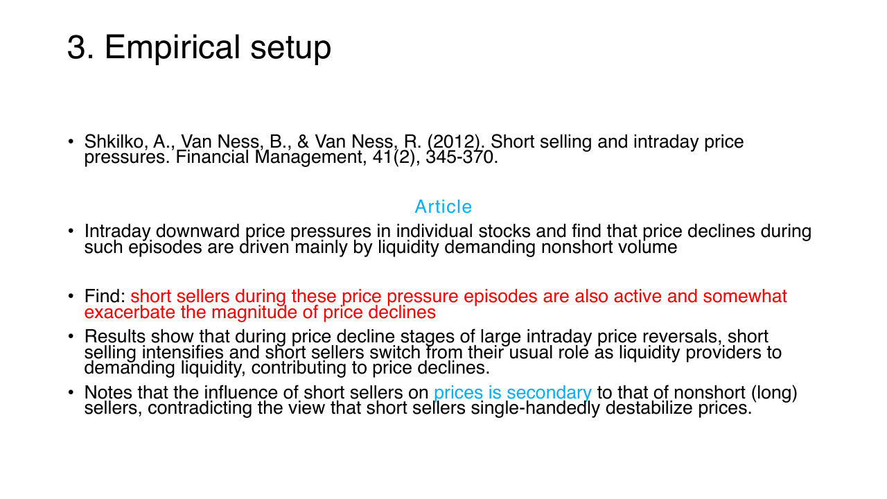
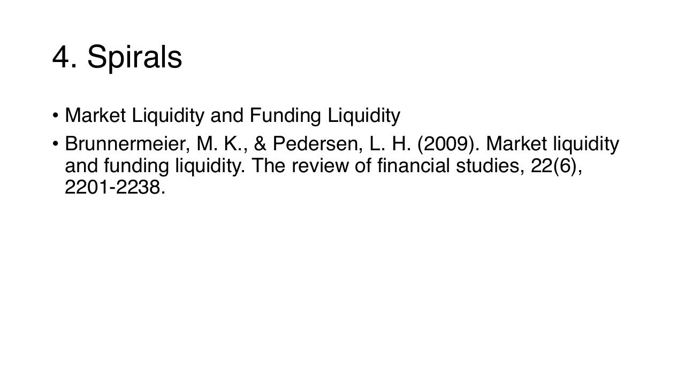

# Topic 4: Market-Wide Liquidity Phenomena

These notes follow the deck "5. Market Wide impacts", slides 1 to 20.

Everything in this file is exam material. A ⭐ marks what to know without notes. Worked examples use made-up numbers to practise the slide formulas.

This topic asks one question. Why does liquidity sometimes disappear from a whole market at once, instead of from one stock at a time? Liquidity means that you can buy or sell quickly, in large amounts, without moving the price much. The deck gives four answers. Each answer comes from one paper. The table below lists them. Read each row as "in this paper, liquidity disappears because of this".

| Part | Paper | Why liquidity disappears |
|---|---|---|
| Predatory trading | Brunnermeier and Pedersen (2005) | Others trade against a distressed trader |
| Episodic crises | Carlin, Lobo and Viswanathan (2007) | Cooperation between traders breaks down |
| Price pressure | Shkilko, Van Ness and Van Ness (2012) | Sellers demand liquidity together |
| Spirals | Brunnermeier and Pedersen (2009) | Funding and market liquidity feed each other |

The first row says that a trader in trouble is attacked by other traders. The second row says that traders usually help each other, but they sometimes stop. The third row is a study of real data. It says that sharp intraday falls come from many sellers who all want to sell at once. The fourth row says that a shortage of money and a shortage of market liquidity make each other worse. The sections below take these four parts in order.

## 0. Words to know first

The later sections use the words below. Each word is defined here once. Later sections refer back to these definitions.

- **Position:** A position is the number of shares a trader holds. A long position means the trader owns shares. A short position means the trader owes shares.
- **Unwind:** To unwind a position means to trade until the position is gone. For a long position, this means selling the shares.
- **Distressed trader:** This trader is forced to sell. The trader does not choose to sell. Something outside the trader's control, such as a loss or a demand for money, makes the sale necessary.
- **Predator:** This trader uses the forced sale to make a profit. The predator knows that the distressed trader must sell. It trades in a way that earns money from that knowledge.
- **Liquidation value:** It is the money received from selling a position. If the price falls while you sell, each share brings in less money. So your liquidation value falls.
- **Price impact:** Price impact is the change in price that your own trade causes. A sale pushes the price down. A purchase pushes the price up. A large trader has a large price impact.
- **Liquidity provider:** A liquidity provider is a trader who stands ready to take the other side of someone else's trade. If you want to sell, the liquidity provider buys from you.
- **Liquidity demander:** A liquidity demander is a trader who wants a trade done now. This trader takes the price that is available.
- **Price overshooting:** The price moves beyond its new long-run level and then comes back. For example, the price falls to 100, but the level where it finally settles is 110. The price went 10 points too far down. Then it came back up.
- **Front running:** It means trading ahead of a known order. Suppose you know that a large sell order is coming. You sell first, before that order pushes the price down.
- **Short sale:** It means selling a borrowed share. The short seller borrows a share, sells it now, and buys it back later to return it. The short seller gains if the price falls in between.
- **Contagion:** A crisis spreads from one trader or market to another. A problem that starts in one place causes a problem somewhere else.

## 1. Predatory trading: Brunnermeier and Pedersen (2005) (slides 2 to 12)

This part answers one question. What happens to prices when one large trader must sell, and other large traders know it? The answer is that the others do not help. They sell too, and they buy back later at a lower price.

### 1.1 ⭐ Definition (slide 2)

The slide first gives a general definition of predatory trading. Then it gives the basic pattern that the paper studies.

- **Slide definition:** Predatory trading exploits an information advantage to profit at the expense of others. It may use non-public information or market dynamics. It benefits the predator unfairly and harms other investors or the market. An information advantage means that the predator knows something that others do not know, or knows it earlier. Market dynamics means the way prices move when large trades arrive. So the predator does not need secret news. It is enough to know that a large sale is coming and that this sale will push the price down.
- **The basic pattern:** One trader must sell. Other traders also sell. They buy back later. The other traders sell first because they know the forced sale will push the price down. Selling before the fall means they sell at a high price. After the price has fallen, they buy the shares back at a low price. The difference is their profit.

This pattern has consequences for the price, for the distressed trader and for the market. The slide lists five results. Each one follows from the pattern above.

1. The price overshoots. Two groups sell at the same time, not one. So the price falls further than the forced sale alone would push it. After the predators buy back, the price comes back up part of the way.
2. The distressed trader gets a lower liquidation value. The distressed trader sells while the predators also sell. So the price is lower at each moment of the forced sale. Each share brings in less money.
3. The market is illiquid exactly when liquidity is most needed. The distressed trader needs buyers. But the traders who could buy are selling instead. So buyers are missing at the very moment they are needed.
4. A trader can profit by triggering the crisis of another trader. If the predators push the price down far enough, another trader may suffer losses and become distressed too. That trader must then sell, and the predators can profit again.
5. The crisis spills over across traders and markets. A crisis in one trader can cause a crisis in another trader, as in result 4. This is contagion, defined in section 0.



### 1.2 Contribution (slide 3)

This slide says what is new in the paper's model. It has three parts.

- **New framework:** It studies strategic interaction among large traders who have market impact. "Strategic" means that each trader thinks about what the other traders will do before choosing its own trades. "Market impact" means price impact, defined in section 0. So each trader knows that its own trades move the price.
- **Slow trading:** Traders trade continuously. They limit their speed to keep temporary impact cost low. Trading continuously means that a trader can buy or sell a little at every moment, instead of all at once. A temporary impact cost is an extra cost that comes from trading too fast. So a trader who wants to sell a lot spreads the sale over time.
- **Known distress:** Some traders become distressed. The other traders know that they need to sell. This knowledge is the information advantage from section 1.1. It is what makes predation possible.


### 1.3 Specific contributions (slide 4)

This slide lists four specific points that the paper makes about predatory trading.

a. **It introduces predatory trading.**
   - It is strategic behaviour that exploits the information disadvantage of others. The distressed trader is at a disadvantage because its need to sell is known to others. The predator uses that disadvantage.
   - It causes inefficiency and harms market quality. Prices move away from the level that the asset is worth, because of the predator's trades. So prices become less accurate.

b. **It has several types.** All three types below have the same core. The predator learns about a large order and trades before it.
   - A trader may front run. This means trading ahead of a known order, as defined in section 0.
   - A trader may anticipate orders. This means guessing that a large order will come and trading before it arrives.
   - A trader may trade strategically ahead of a large order. This means planning trades so that they gain from the price move that the large order will cause.

c. **It is hard to identify.** A regulator must separate a legitimate strategy from manipulation. A regulator is the authority that sets and enforces market rules. From the outside, a predator's sale can look like an ordinary sale. So the regulator must decide whether a sale was a normal trading decision or an attempt to profit from someone else's distress.

d. **It hurts market quality.** It affects liquidity, price efficiency, stability and investor confidence. Liquidity falls because traders sell instead of buying. Price efficiency falls because prices move away from value. Stability falls because prices overshoot. Investor confidence falls because investors fear that others will trade against them.



### 1.4 ⭐ Findings (slide 5)

This slide states what the paper finds. The findings form a sequence of events. Each step leads to the next one.

1. A distressed large investor must unwind a position. Unwinding was defined in section 0. Here it means selling a large block of shares.
2. Other strategic traders first trade in the same direction. So they also sell. They do this because they know the forced sale will push the price down. Selling first lets them sell before the fall.
3. They withdraw liquidity instead of providing it. A liquidity provider would buy from the distressed investor. These traders do the opposite. They sell alongside it. So the buyers the distressed investor needs are missing.
4. The liquidation becomes costly and the price overshoots. Because more shares are sold at the same time, the price falls further. So the distressed investor receives less money for each share. The price falls below the level where it finally settles, and then it comes back. This is overshooting, defined in section 0.
5. Predation is profitable under two conditions.
   - The market is illiquid. In an illiquid market, each sale moves the price a lot. So the predator's selling and buying back create large price moves, and the predator can profit from them.
   - The distressed position is large relative to the buying capacity of the others. Buying capacity is how many shares the other traders are able to buy. If the forced sale is larger than what others can absorb, the price must fall far. A large fall gives the predator a large profit.

> **Exam:** The normal view says that others buy when someone sells cheaply. In that view, other traders act as liquidity providers. They see a low price and buy, and their buying supports the price. Predation says that they sell first and buy later. In this view, the other traders act as liquidity demanders while the forced sale is going on. They make the fall deeper, and only then do they buy. Write this contrast in the answer.



### 1.5 Examples (slide 6)

The slide gives real cases in which people worried about predatory trading or suffered from it. The table keeps the slide's wording. The paragraphs after the table explain what each row shows.

| Example | What happened |
|---|---|
| Enron and UBS Warburg (2002) | A plan to take Enron's traders without its trading book was opposed for "predatory trading risk". The traders knew the book. |
| Disclosure (IAFE, 2001) | Detailed disclosure of positions can be ruinous for large portfolios. |
| LTCM as a victim (Business Week, 2001) | Lenders sell the same asset before the borrower can. Goldman and other counterparties did this to LTCM in 1998. |
| LTCM (Meriwether) | Meriwether quoted a colleague. Selling hurricane insurance does not cause a hurricane. In markets, people who know that you sold insurance can make the loss happen. |
| Systemic risk (Greenspan, 1 October 1998) | A forced sale by LTCM would distort prices. It could hurt creditors, counterparties and people who were not involved. |
| Hedge funds as predators (Cramer, 2002) | "When you smell blood in the water, you become a shark." |
| Credit General (June 1995) | It bought a billion pounds sterling from a client and tried to sell for marks. The market evaporated. Price and liquidity fell quickly. |

**Enron and UBS Warburg.** A trading book is the list of positions a firm holds. UBS Warburg planned to take Enron's traders but not Enron's book. The traders knew which positions the book held. So they could trade against those positions when the book was sold. This is why the plan was opposed for "predatory trading risk".

**Disclosure.** If a large portfolio reveals its positions in detail, others learn what it may have to sell. They can then trade ahead of it. So detailed disclosure can ruin the portfolio.

**LTCM as a victim.** LTCM was a large hedge fund. Its lenders knew its positions. They sold the same assets before LTCM could sell them. So the price was already low when LTCM had to sell. This is the basic pattern of section 1.1.

**Meriwether's quote.** A hurricane does not happen because someone sold hurricane insurance. In markets it is different. If others know that you will lose money when prices fall, they can push prices down. So they can cause the very loss you insured against.

**Greenspan on systemic risk.** Systemic risk is the risk that a problem in one firm spreads to the whole financial system. A forced sale by LTCM would push prices away from their proper level. That would hurt firms that lent to LTCM, firms that traded with LTCM, and even firms that had nothing to do with LTCM. This is contagion.

**Cramer on hedge funds.** "Blood in the water" means a trader in trouble. The quote says that hedge funds attack such a trader, the way a shark attacks when it smells blood. This is the predator's behaviour.

**Credit General.** It bought a billion pounds from a client and then tried to sell them for German marks. The market "evaporated", which means that buyers disappeared. So the price fell and liquidity fell together.



### 1.6 Framework and assumptions (slides 7 and 8)

Before the paper can show predation with numbers, it must set up a model. This section lists the model's assumptions. Each assumption is numbered A1, A2 and so on, so that later steps can refer to it.

- **A1:** Time is continuous. So trading can happen at every moment, not only at fixed dates.
- **A2:** There is a riskless bond and a risky asset. The bond always pays a known amount. The risky asset is the one that the traders buy and sell in this model.
- **A3:** The risky asset has supply $S\gt 0$. It pays $v$ at time $T$, with $E(v)=\mu$. The supply $S$ is the total number of shares that exist. At the final time $T$, each share pays an amount $v$. Nobody knows $v$ in advance. The symbol $E(v)$ means the average value of $v$ that people expect. This expected value is called $\mu$.
- **A4:** The price at time $t$ is $p(t)$. So $p(t)$ is the price of one share of the risky asset at moment $t$.
- **A5:** There are $I$ large strategic traders. Hedge funds and proprietary desks are examples. A proprietary desk is a team inside a bank that trades the bank's own money. "Strategic" was defined in section 1.2.
- **A6:** There are long-term investors. Pension funds and individuals are examples. These investors are not strategic. They are the ones who buy when the strategic traders sell, and sell when the strategic traders buy.
- **A7:** Strategic traders are risk neutral. They maximize expected profit. Risk neutral means that the trader cares only about the average profit. It does not dislike uncertainty.
- **A8:** They are large, so they count their own price impact. Each strategic trader knows that its own purchases push the price up and its own sales push the price down. It takes this into account when it plans its trades.

Now the model needs a way to track each trader's holdings over time. The position of trader $i$ changes with the trading speed $a^i$. The trading speed is the number of shares the trader buys per unit of time. A positive speed means buying. A negative speed means selling. This is equation 1.

$$x^i(t)=x^i(0)+\int_0^t a^i(\tau) d\tau$$

Here $x^i(t)$ is the position of trader $i$ at time $t$. The term $x^i(0)$ is the position at the start, at time 0. The symbol $\tau$ stands for any moment between time 0 and time $t$. The integral adds up all the small purchases and sales made between time 0 and time $t$. So the equation says: the position now equals the starting position plus everything bought, minus everything sold, since the start.

To see what the integral does, take the case where the speed is the same number $a$ at every moment. Then the integral is that speed times the length of time.

$$x^i(t)=x^i(0)+a t$$

The simulated example in section 1.7 uses this. There, a trader starts with 8 shares and sells at 10 shares per time unit, so its speed is $-10$. After 0.8 time units it holds $8+(-10)(0.8)=0$ shares.

The model also needs a limit on how much each trader can hold. Otherwise a trader could buy or sell without end. The position has a limit. It comes from risk or from capital. A risk limit is a cap that the firm puts on how much risk a trader may take. A capital limit means the trader does not have enough money to hold more. This is equation 2.

$$-\bar{x}\le x^i(t)\le\bar{x}$$

The symbol $\bar{x}$ is the largest position allowed. So the trader can hold at most $\bar{x}$ shares long. It can also be at most $\bar{x}$ shares short, which is why the lower bound is $-\bar{x}$. This limit matters for predation. It caps how many shares the other traders can buy. That is the "buying capacity" in section 1.4.




### 1.7 ⭐ Simulated example (slides 9 to 11)

This example puts numbers into the model of section 1.6. It shows predation step by step. It answers one question: when one trader must sell and one other trader preys on it, how far does the price fall, and where does it end up?

The table lists the inputs. Every value comes from slide 9.

| Input | Value |
|---|---|
| Supply $S$ | 40 |
| Strategic traders $I$ | 2 |
| Distressed traders | 1 |
| Position limit $\bar{x}$ | 10 |
| Each starting holding | 8 |
| Time of distress | 5 |
| Final time $T$ | 7 |
| Expected value $\mu$ | 140 |
| Price impact $\lambda$ | 1 |
| Trading speed without temporary cost $A$ | 20 shares per time unit |

Here is what each row means. There are 40 shares in total. There are 2 strategic traders. One of them becomes distressed. The other one acts as the predator. Each trader may hold at most 10 shares. At time 5, each trader holds 8 shares, and at that moment one of them becomes distressed. The price impact $\lambda$ is 1. The slide calls it the "price liquidity factor". It means that each share sold pushes the price down by 1 point, and each share bought pushes it up by 1 point. Finally, the traders together can trade up to 20 shares per time unit without paying any temporary impact cost. Temporary impact cost was defined in section 1.2.

At time 7, the asset pays off or the market becomes perfectly liquid. The asset's expected payoff is 140. "Perfectly liquid" means that after time 7, trading no longer moves the price. So all the action happens between time 5 and time 7.

**Step 1: Read the starting price.** The slide figure starts at 116. The slides do not derive this number. Read it from the price chart on slide 11. The price stays at 116 until time 5, because nobody trades before the distress.

**Step 2: Let both sell.** At time 5 the distressed trader must start selling. The distressed trader sells 8 shares at speed $A/2=10$. Here $A/2$ means half of 20, which is 10 shares per time unit. It needs $8/10=0.8$ time units, so it finishes at time 5.8. That is, 5 plus 0.8 gives 5.8. Panel A of slide 10 shows this. The distressed trader's holding falls in a straight line from 8 at time 5 to 0 at time 5.8.

The predator knows at time 5 that this sale will happen. It also knows that the sale will push the price down. So it wants to sell while the price is still high and buy back after the price has fallen. The predator sells all its 8 shares at the same time. It sells them over the same window, from time 5 to time 5.8. So it also sells at 10 shares per time unit. Panel B of slide 10 shows the predator's holding falling from 8 to 0 over this window.

Together the two traders sell 10 plus 10, which is 20 shares per time unit. That equals $A$. So together they trade exactly as fast as possible without paying any temporary impact cost.

**Step 3: Find the lowest price.** Together they sell 16 shares. That is 8 from the distressed trader plus 8 from the predator. Each share moves the price by $\lambda=1$. So the price drops 16 points, from 116 to 100. The fall is spread over 0.8 time units, so the price falls at 16 divided by 0.8, which is 20 points per time unit. Slide 11 shows this straight-line fall from 116 at time 5 to 100 at time 5.8.

Compare this with a sale by the distressed trader alone. Each share moves the price by 1 point. So its 8 shares alone would move the price by 8 points, not 16. Because the predator sells at the same time, the distressed trader sells into a price that falls twice as far. So each of the distressed trader's shares brings in less money. This is the lower liquidation value of section 1.1.

**Step 4: Let the predator buy back.** At time 5.8 the distressed trader has finished. It now holds nothing and does not trade again. So the predator trades alone. It now trades alone at speed 20. This is the full speed $A$, so it pays no temporary impact cost. The predator holds 0 shares at this point. It buys up to its limit of 10, so it buys 10 shares. At 20 shares per time unit, 10 shares take $10/20=0.5$ time units. It buys up to its limit of 10 in 0.5 time units. It finishes at time 6.3. That is, 5.8 plus 0.5 gives 6.3. Panel B of slide 10 shows the predator's holding rising from 0 at time 5.8 to 10 at time 6.3, and then staying at 10.

Note that the predator ends with 10 shares, but it started with 8. So it buys back more than it sold. It sold 8 and bought 10.

**Step 5: Find the new price.** The slide says that the price recovers to 110. This follows from the price impact rule. The predator buys 10 shares. Each share moves the price up by 1 point. So the price rises 10 points, from 100 to 110. After time 6.3 nobody trades, so the price stays at 110 until time 7.

There is a second way to check the number 110. Look at the whole period from time 5 to time 6.3. The distressed trader went from 8 shares to 0, so it sold 8. The predator went from 8 shares to 10, so on net it bought 2. So on net the two strategic traders sold 8 minus 2, which is 6 shares. Each share moves the price by 1 point. So the price ends 6 points below where it started. That is 116 minus 6, which is 110. Both ways give the same answer.

**Step 6: Find the overshoot.** The price fell to 100. Then it settled at 110. So the lowest price was 10 points below the level where the price finally rested. That gap is the overshoot.

$$\text{overshoot}=110-100=10$$

It is $110-100=10$. The price went 10 points further down than its final level, and then came back.

The text chart below draws the price path. The price is flat at 116 until time 5. It falls in a straight line to 100 at time 5.8. It rises in a straight line to 110 at time 6.3. It stays flat at 110 until time 7.

```text
price
116  ----o
          \
110        \      o-------
            \    /
             \  /
100           o
time     5   5.8  6.3    7
```

The slide also marks the marginal selling price and the marginal buying price. The marginal selling price is the price of the predator's last sale, just before the bottom. The marginal buying price is the price of the predator's first purchase, just after the bottom. On slide 11, two arrows point to these prices near 100. The predator sells at higher prices and buys back at lower prices. It sold its shares while the price fell from 116 toward 100. It starts buying back at the bottom, at 100, and the price rises only as it buys. So the predator gains from the gap between its selling prices and its buying prices.

So the example shows each trader's outcome. The distressed trader loses, because it sells into a price pushed down by 16 points instead of 8. The predator gains, because it sells high, buys back low and ends at its limit of 10 shares. The market shows an overshoot of 10 points.




### 1.8 Multiple predators (slide 12)

Section 1.7 had one predator. This slide asks what happens when there are more predators. The answer is that the overshoot gets smaller.

The slide compares three cases. From case to case, the number of traders grows. The total starting holding stays the same. In section 1.7 the two traders held 8 plus 8, which is 16 shares in total. Here, the 16 shares are split equally among more traders. So each trader holds less. With 3 traders, each holds 16 divided by 3, about 5.3. With 9 traders, each holds 16 divided by 9, about 1.8. With 27 traders, each holds 16 divided by 27, about 0.6. In every case, one trader in three is distressed, and two in three are predators.

| Traders | Predators | Distressed | Start per trader | Lowest price, approximate | Final price, approximate |
|---|---|---|---|---|---|
| 3 | 2 | 1 | 5.3 | 110 | 113.3 |
| 9 | 6 | 3 | 1.8 | 112.5 | 113.3 |
| 27 | 18 | 9 | 0.6 | 113.1 | 113.3 |

Read the table one row at a time. The overshoot is the final price minus the lowest price, as in step 6 of section 1.7. With 3 traders, the overshoot is $113.3-110=3.3$. With 9 traders, it is $113.3-112.5=0.8$. With 27 traders, it is $113.3-113.1=0.2$. The final price is about 113.3 in all three rows. So only the lowest price changes. As the number of predators grows, the lowest price rises toward the final price, and the overshoot shrinks.

The slide draws three conclusions from this.

- **Earlier buy-back:** More predators start buying back earlier. On slide 12, the price for 3 traders reaches its bottom and starts rising before time 5.5. In section 1.7, with one predator, the bottom came at time 5.8.
- **Smaller overshoot:** The overshoot falls as predators increase. The table shows this, as computed above.
- **Reason:** Competition among predators removes part of the predation. Each predator wants to buy back at the low price before the other predators do. So each one starts buying back sooner. Their early buying stops the fall sooner. So the price does not fall as far.



## 2. Carlin, Lobo and Viswanathan (2007): "Episodic liquidity crises: cooperative and predatory trading" (slide 13)

Section 1 showed predation when one trader is in trouble. This paper asks a different question. If predation is profitable, why is the market liquid most of the time, and illiquid only now and then? "Episodic" means happening in separate episodes, now and then, not all the time.


### 2.1 The main idea

Episodic illiquidity comes from a breakdown of cooperation. Cooperation here means that traders help each other. When one trader needs to sell, the others provide liquidity instead of preying on it. While traders cooperate, the market is liquid. When cooperation breaks down, the traders turn into predators, and the market becomes illiquid. So the crises come and go as cooperation breaks and returns.

### 2.2 ⭐ The model step by step

The model is built in two layers. First a single round of trading. Then that round repeated many times. Each step below leads to the next.

1. The stage game is a trading game in continuous time over one period. A pricing equation gives price impact. A "stage game" is one round of the game. In this round, traders trade continuously, as in section 1.6. The pricing equation is a rule that says how much the price moves when traders buy or sell. So it gives price impact, defined in section 0.
2. In one period, a trader gains by predating. If the game is played only once, there is no future to worry about. So a trader who sees another trader in trouble gains by preying on it, as in section 1.
3. In many periods, the traders meet again and again. This is called a repeated game. The same traders trade with each other in round after round.
4. They cooperate most of the time. They give apparent liquidity to each other. Because they meet again, each trader has a reason to help the others. "Apparent liquidity" means the market looks liquid. It looks liquid because the traders agree, in effect, to provide liquidity to each other.
5. A trader who predates today loses cooperation in the future. If one trader preys on another, the others stop helping that trader in later rounds. So predation has a future cost.
6. Cooperation breaks when the stakes are high. The gain today is then larger than the future loss. A trader compares two things. One is the gain from predating today. The other is the loss of cooperation in all future rounds. When the stakes are small, the future loss is larger, so the trader cooperates. When the stakes are high, the gain today is larger, so the trader predates.
7. Predatory trading starts. It causes episodic illiquidity. Once the traders predate, they sell instead of providing liquidity, as in section 1. So the market suddenly becomes illiquid. Because high stakes happen only sometimes, this illiquidity happens only in episodes.

### 2.3 Cooperation across markets

The same traders may trade in several markets. They can then cooperate across all those markets together. This has a benefit and a cost.

- **Benefit:** Cooperation across markets makes crises less frequent. A trader who predates in one market loses cooperation in all the markets. So the future loss from predating is larger. A larger future loss means that the stakes must be even higher before cooperation breaks. So breakdowns happen less often.
- **Cost:** A breakdown then hits all those markets. This is contagion. When cooperation does break, it breaks in every market that was linked by it. So a crisis in one market becomes a crisis in all of them. Contagion was defined in section 0.

The table below puts the two regimes side by side. Read each row across. It compares cooperation and predation on one point.

| Point | Cooperation | Predation |
|---|---|---|
| When | Most of the time, with small stakes | Sometimes, with high stakes |
| Action | Traders supply liquidity to the one in need | Traders sell with the one in need |
| Market | It looks liquid | It suddenly becomes illiquid |

The "When" row repeats step 6 of section 2.2. Small stakes keep cooperation going, and high stakes break it. The "Action" row says what traders do. Under cooperation they buy from the trader who must sell. Under predation they sell alongside that trader. The "Market" row gives the result. Under cooperation the market looks liquid. Under predation it suddenly becomes illiquid.

> **Exam:** The key words are repeated game, high stakes, episodic and contagion. Repeated game explains why traders cooperate most of the time. High stakes explain when cooperation breaks. Episodic describes the pattern of crises that comes and goes. Contagion describes what happens when cooperation across markets breaks. Use all four words in an answer about this paper.

## 3. Empirical setup: Shkilko, Van Ness and Van Ness (2012) (slides 14 and 15)

Sections 1 and 2 were theory. This paper looks at real data. It asks who causes sharp price falls within a single trading day. Short sellers are often blamed. The paper checks whether they really are the cause.

The paper is "Short selling and intraday price pressures". It is in Financial Management, volume 41, issue 2, pages 345 to 370.



### 3.1 What it finds

"Intraday" means within one trading day. "Downward price pressure" means a period when selling pushes the price down. The findings below go from the main cause to the role of short sellers.

- **Subject:** It studies intraday downward price pressure in single stocks. So it looks at one stock at a time, and at falls that happen within one day.
- **Main driver:** Non-short volume that demands liquidity drives most declines. This is selling by long sellers. Non-short volume is selling that is not short selling. Long sellers are traders who sell shares they already own. "Demands liquidity" means they want the sale done now, at the price available. Liquidity demander was defined in section 0. So most of the fall comes from owners who sell in a hurry.
- **Short sellers:** They are also active. They make declines somewhat worse. Short sale was defined in section 0. Short sellers add to the selling. So the fall is a bit deeper than it would be without them.
- **Large reversals:** Short selling becomes more intense in the decline stage. A large reversal is a day when the price falls sharply and then comes back. Section 3.2 defines it exactly. During the falling part of such a day, short sellers sell more than usual.
- **Change of role:** Short sellers usually provide liquidity. They switch to demanding it. On normal days, short sellers take the other side of other traders' trades. During the decline, they instead push their own sales through at the available price. So they add to the price fall.
- **Conclusion:** Their effect is second to that of long sellers. This contradicts the view that short sellers destabilize markets on their own. Short sellers do add to the fall. But the long sellers cause most of it. So the idea that short sellers alone drive prices down is not supported.

### 3.2 ⭐ How a large price reversal is identified (slide 15)

To study large reversals, the paper needs a precise rule that says which days count. This rule has three steps. First measure how much the stock normally moves. Then check that the fall was large compared with that. Then check that the price came back by the end of the day.

**Step 1: Find the normal movement.** Let $\sigma_i$ be the average standard deviation of five-minute cumulative returns over the previous 20 trading days. A return is the percentage change in price. A cumulative return is the total return from the start of the day up to a given moment. The paper measures it every five minutes. The standard deviation measures how widely these returns spread around their average. So $\sigma_i$ tells you how much stock $i$ normally moves within a day. It is averaged over the 20 trading days just before the day being tested.

**Step 2: Check the decline.** Let $\ell$ be the lowest cumulative return of the day. It must be at least two standard deviations below zero. So the stock must fall by at least twice its normal movement. This rules out ordinary small falls.

$$\ell\le-2\sigma_i$$

Here $\ell$ is a negative number, because it is a fall. The condition says that $\ell$ is at or below $-2\sigma_i$. For example, if $\sigma_i$ is 1 percent, then $\ell$ must be $-2$ percent or lower.

**Step 3: Check the rebound.** By the end of the day, the price must recover 90 to 110 percent of the decline. So the price must come back almost exactly to where it started. It may come back a little less, down to 90 percent of the fall. It may come back a little more, up to 110 percent of the fall.

To write this as a formula, we need the size of the rebound. Let $R_{close}$ be the cumulative return at the end of the day. The rebound is the distance from the lowest point up to the close. That distance is $R_{close}-\ell$. The size of the fall is $\lvert\ell\rvert$, the value of $\ell$ without its minus sign. So the condition says that the rebound lies between 0.9 times the fall and 1.1 times the fall.

$$0.9\lvert\ell\rvert\le R_{close}-\ell\le 1.1\lvert\ell\rvert$$

A day that passes both checks is a large price reversal. The paper calls it an event day.

**Worked example:** Take $\sigma_i$ as 1 percent. This is the same example that slide 15 prints. The steps below apply the two checks to it.

1. The decline must reach -2 percent or lower. This is the condition of step 2. Two standard deviations of 1 percent each make 2 percent, and the return must be at or below minus that.
2. Suppose that it reaches exactly -2 percent. So $\ell=-2$ percent, and the size of the fall is $\lvert\ell\rvert=2$ percent.
3. A rebound of 90 percent ends at $(1-0.9)(-2)=-0.2$ percent. Here is why. A 90 percent rebound means the price climbs back 0.9 times 2, which is 1.8 percent. Starting from $-2$ and climbing 1.8 gives $-2+1.8=-0.2$ percent. The formula $(1-0.9)(-2)$ gives the same number in one line: the price is still missing 10 percent of the fall.
4. A rebound of 110 percent ends at $(1-1.1)(-2)=0.2$ percent. In the same way, a 110 percent rebound means the price climbs back 1.1 times 2, which is 2.2 percent. Starting from $-2$ and climbing 2.2 gives $-2+2.2=0.2$ percent. The price ends 10 percent of the fall above where the day started.
5. So the day must end between -0.2 and 0.2 percent. If the close is in this range, the day is an event day. If the close is below $-0.2$ percent, the price did not come back enough. If it is above $0.2$ percent, it came back too much.

> **Slide error:** The figure prints the decline condition with the sign reversed. It shows $\ell\ge-2\sigma$. That would mean the fall is at most two standard deviations, which allows tiny falls. The text needs $\ell\le-2\sigma$. The slide's own text says the price must decline "by two or more" standard deviations. So the fall must be at least two standard deviations, and the correct sign is "less than or equal".


## 4. Spirals (slides 16 to 20)

The earlier sections were about how traders behave toward each other. This section asks how money shortages affect market liquidity. It uses Brunnermeier and Pedersen (2009). Two kinds of liquidity matter here. Market liquidity is the ease of trading an asset without moving its price, as defined at the top of this file. Funding liquidity is the ease with which a trader can get money, for example by borrowing.

### 4.1 Contribution (slides 16 and 17)

The paper's contribution is to link the two kinds of liquidity. The points below build the link one direction at a time, and then close the loop.

- **The link:** Brunnermeier and Pedersen (2009) link market liquidity with funding liquidity. So the paper shows that each kind of liquidity affects the other.
- **Funding affects the market:** Traders provide market liquidity according to their funding. A trader who has plenty of money can buy when others sell. A trader who is short of money cannot. So when funding is scarce, fewer traders provide liquidity, and market liquidity falls.
- **The market affects funding:** Capital and margins depend on the market liquidity of assets. Capital is the trader's own money. A margin is the part of a position that the trader must pay with its own money. The lender pays the rest. If an asset is hard to sell, lenders ask for higher margins on it. So poor market liquidity makes funding harder to get.
- **The loop:** Margins can destabilize. The two kinds of liquidity then reinforce each other. Put the two directions together. Scarce funding lowers market liquidity. Low market liquidity raises margins, and higher margins make funding scarcer. So each one makes the other worse.




### 4.2 Trigger and spirals (slides 18 and 19)

Section 4.1 said that the two kinds of liquidity can feed each other. This section says what starts the process and how it repeats.

- **Trigger:** Margin requirements rise in crises. The S&P 500 futures chart shows this for 1987, 1998 and 2007. A margin requirement is the minimum margin a lender or exchange demands. The S&P 500 is an index of large US stocks. A futures contract on it is a contract to buy or sell the index at a later date. The chart on the slide shows that margins on these contracts jumped in the crisis years 1987, 1998 and 2007. So in a crisis, traders suddenly need more of their own money to keep the same positions.
- **Loss spiral:** Losses reduce capital and force sales. A trader who loses money has less capital. With less capital, it cannot keep its full position. So it must sell. Its selling pushes prices down, which causes more losses. Then the loop starts again.
- **Margin and haircut spiral:** Higher margins reduce allowed leverage and force sales. A haircut is the same idea as a margin. It is the part of the asset's value that a lender will not lend against. Leverage is the size of the position compared with the trader's own capital. When margins rise, the same capital supports a smaller position. So the trader must sell. Its selling pushes prices down, and margins rise further. Then the loop starts again.

The diagram below draws both spirals as one loop. Read it from left to right along the top. An initial loss creates a funding problem. The funding problem forces the trader to sell positions. The selling pushes the price away from fundamentals. Fundamentals means the value the asset is really worth. Then follow the arrow back along the bottom. The price move causes more losses and higher margins. Those make the funding problem worse. So the loop goes round again.

```text
initial loss --> funding problem --> sell positions --> price leaves fundamentals
                      ^                                          |
                      |                                          |
                      +---- losses and higher margins <----------+
```

The bottom arrow carries both spirals. "Losses" is the loss spiral. "Higher margins" is the margin and haircut spiral. Slide 19 draws them as two separate arrows that both return to "funding problems for speculators". A speculator is a trader who takes positions to profit from price moves. Topic 3 explains this loop with a numerical example.


### 4.3 ⭐ Findings (slide 20)

The spirals of section 4.2 explain several patterns seen in real markets. The slide lists five of them. Each finding below says what the pattern is and how the funding link explains it.

1. **Sudden dry-up:** It happens when financiers are imperfectly informed and fundamental volatility varies over time. A dry-up is a sudden disappearance of market liquidity. Financiers are the lenders who fund the traders. "Imperfectly informed" means they cannot tell exactly why prices moved. Fundamental volatility is how much the asset's true value moves around. "Varies over time" means it is sometimes high and sometimes low. The slide does not spell out the steps in between. The link to section 4.2 is the margin: when margins rise, traders are forced to sell, and the spiral can make liquidity vanish suddenly.
2. **Commonality:** Liquidity and fragility move together across assets. A change in funding affects liquidity supply in all assets. Commonality means that many assets gain or lose liquidity at the same time. Fragility means the risk of a sudden dry-up. The same traders provide liquidity in many assets, and they all rely on the same funding. So when funding tightens, liquidity falls in all those assets together.
3. **Volatility:** Liquidity is correlated with volatility. Volatile assets need higher margins, and speculators supply liquidity across assets. Volatility is how much the price moves around. "Correlated" means the two move together. A volatile asset is riskier for a lender, so the lender asks for a higher margin. A higher margin uses up more of the speculator's capital. So the speculator supplies less liquidity in that asset. This is why volatile assets tend to be less liquid.
4. **Flight to quality:** It arises from the model. Flight to quality means that in a crisis, money moves out of risky assets into safe ones. The slide says only that this pattern comes out of the model. Section 5.1 links it to scarce funding.
5. **Moves with the market:** Liquidity moves with the market because funding conditions do. When the market falls, traders lose money and lenders tighten funding. Tighter funding means less liquidity. So liquidity falls when the market falls.

The slide cuts off the last sentence. The words "funding conditions do" complete it.


## 5. Join the whole topic

The four parts of this topic explain different market-wide events. This section puts them together. It answers two questions. Which mechanism explains which event? How do the mechanisms differ?

### 5.1 Market-wide phenomena

The table lists seven market-wide events. For each one it gives the meaning and the mechanism that explains it. Read each row across: the event, what it looks like, and why it happens.

| Phenomenon | Meaning | Explanation |
|---|---|---|
| Commonality | Stocks gain and lose liquidity together | Chordia and others, and funding limits |
| Dry-up | Liquidity vanishes suddenly | Margin spiral |
| Flight to quality | Capital moves to safe assets | Scarce funding |
| Overshooting | Price falls too far and returns | Predatory trading |
| Episodic illiquidity | Calm periods end in short crises | Breakdown of cooperation |
| Contagion | A crisis spreads | Common traders and broken cooperation |
| Large reversal | A sharp fall reverses in a day | Temporary selling pressure |

Each row links back to an earlier section. Commonality was finding 2 in section 4.3. "Chordia and others" refers to the measurement of commonality in an earlier topic, and "funding limits" is the explanation from section 4.3. Dry-up was finding 1 in section 4.3, and the margin spiral is from section 4.2. Flight to quality was finding 4 in section 4.3. Overshooting is the result of predatory trading in section 1, with the 10-point overshoot of section 1.7. Episodic illiquidity is the breakdown of cooperation in section 2. Contagion has two sources. One is common traders: the same traders hold positions in many markets, as in sections 1.1 and 4.3. The other is broken cooperation across markets, as in section 2.3. Large reversal is the event that section 3.2 defines, and section 3.1 says that it is driven by selling pressure that does not last.

### 5.2 Compare the mechanisms

The three theory mechanisms are predation, broken cooperation and the spiral. The table compares them on four points. Read each row across to see how the three differ on that point.

| Point | Predation | Broken cooperation | Spiral |
|---|---|---|---|
| Trigger | Another trader must sell | Stakes become high | Loss or margin increase |
| Is the seller forced? | The victim is forced, and the predator chooses | The predators choose | All are forced by funding |
| Is strategy needed? | Yes | Yes | No |
| Key limit | Position limit of buyers | Value of future cooperation | Capital and margin |

The "Trigger" row says what starts each mechanism. Predation starts when a trader becomes distressed, as in section 1. Broken cooperation starts when the stakes are high, as in step 6 of section 2.2. The spiral starts with a loss or a rise in margins, as in section 4.2.

The "Is the seller forced?" row says who must sell and who chooses to sell. In predation, the distressed trader must sell, but the predator chooses to sell. In broken cooperation, the predators choose to stop cooperating. In the spiral, every trader sells because its funding forces it to.

The "Is strategy needed?" row asks whether traders must think about each other's actions. Predation and broken cooperation both need it, because each trader plans around what the others will do. The spiral does not need it, because traders sell only because their funding forces them to.

The "Key limit" row names the limit that makes each mechanism bite. In predation, it is the position limit $\bar{x}$ from equation 2. That limit caps how many shares the other traders can buy. In broken cooperation, it is the value of future cooperation. If that value is small compared with today's gain, cooperation breaks. In the spiral, it is capital and margin. These cap how large a position a trader can keep.

> **Exam:** A question on market-wide liquidity needs three layers. First define commonality. That is, say that many assets gain or lose liquidity at the same time. Then give the mechanism. That is, explain why it happens, using predation, broken cooperation or the spiral from the table above. Then give the evidence. That is, cite what the papers find, such as the findings in sections 1.4, 3.1 and 4.3.
