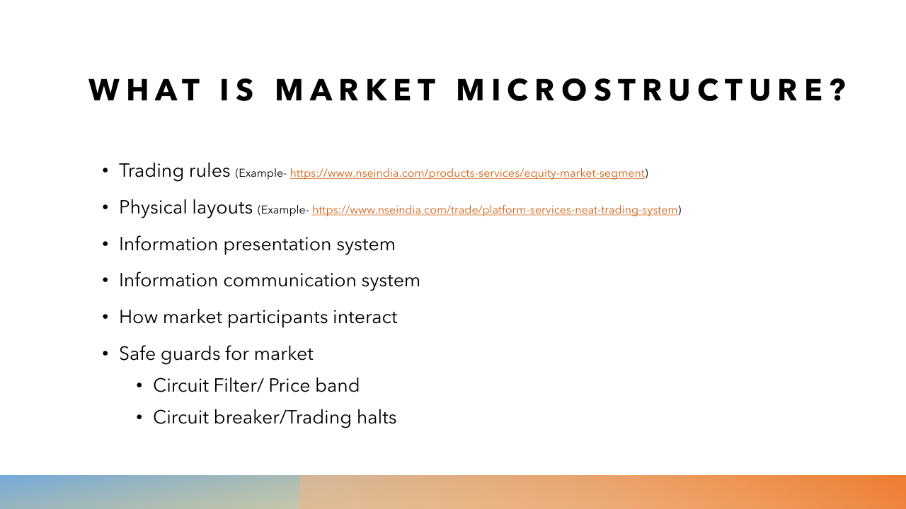
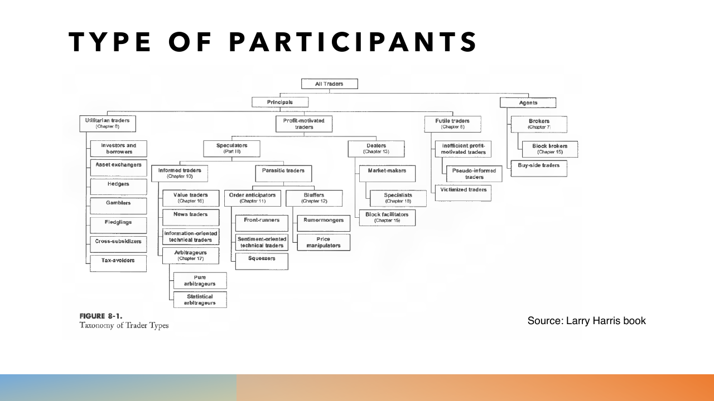
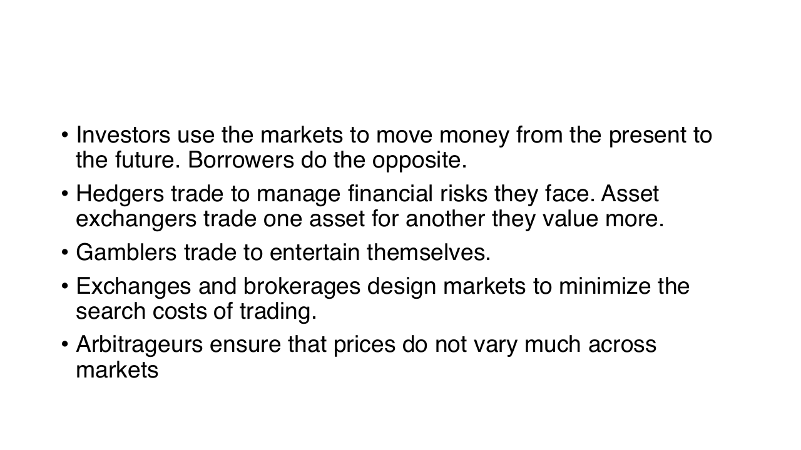
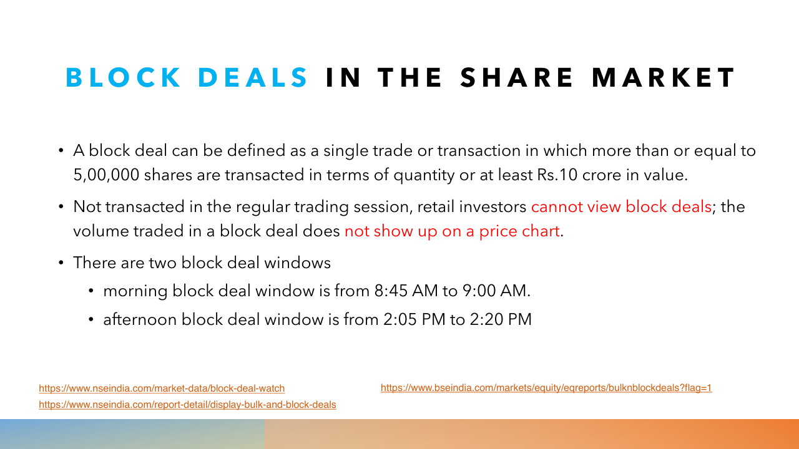
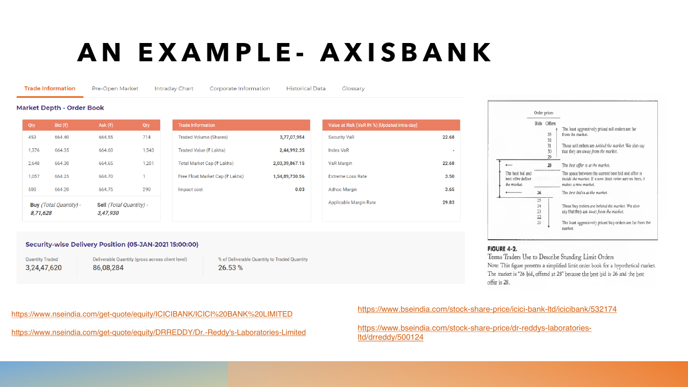
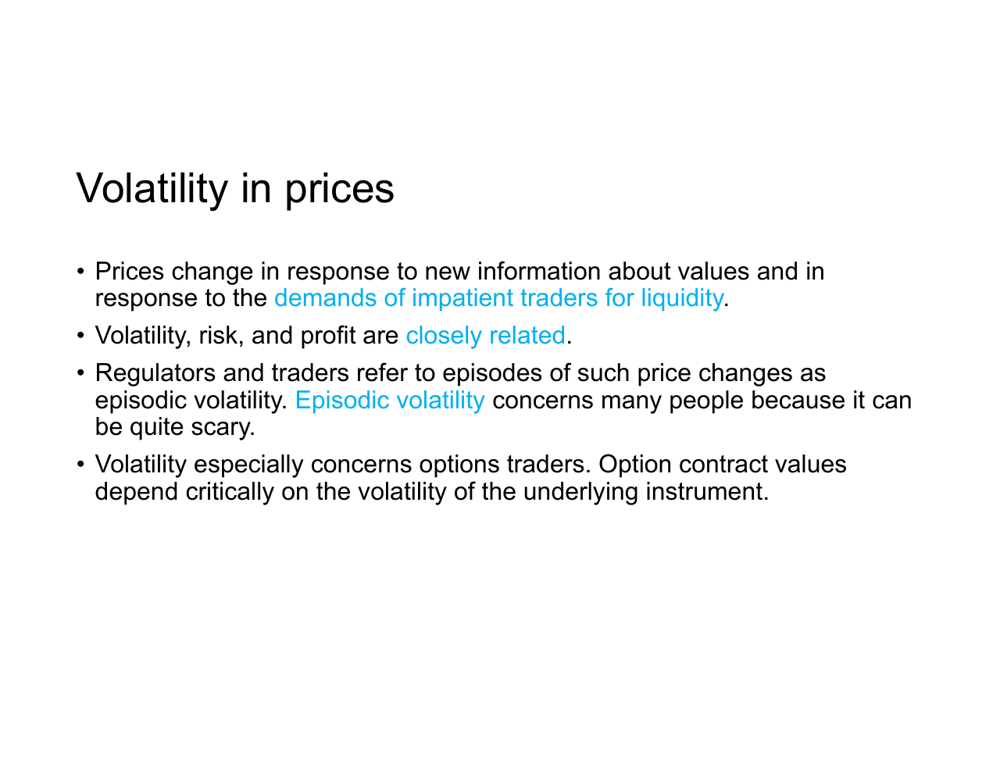
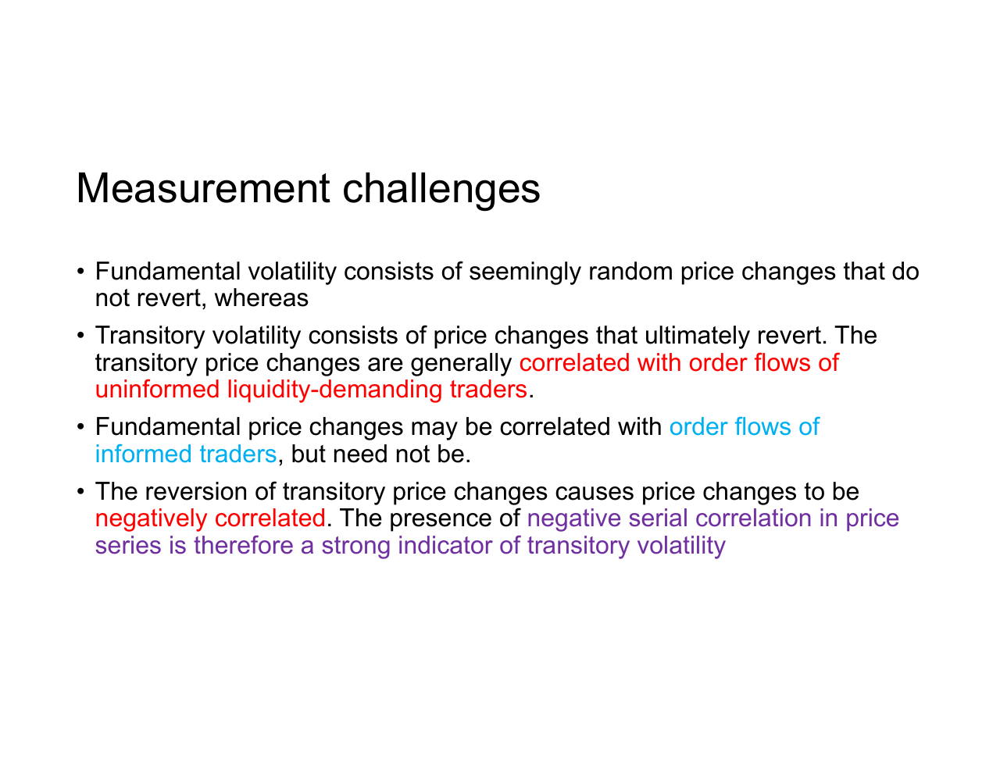
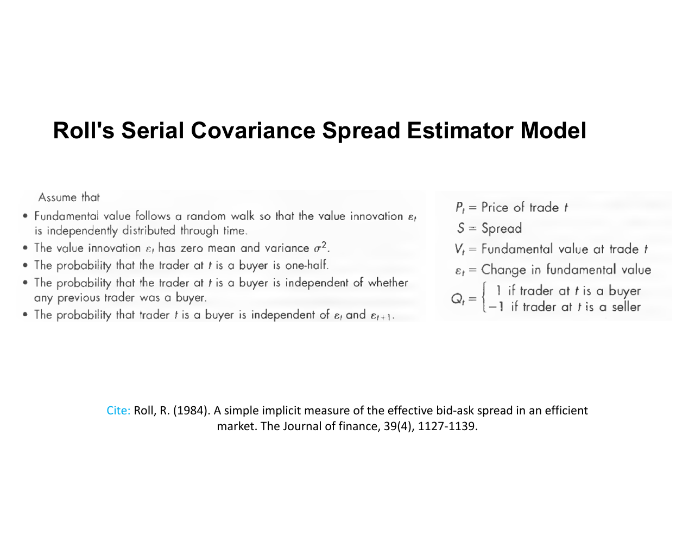

# Topic 5: Basic Concepts Discussed in Class

These notes follow the midsem decks: "1. Introduction of Market Microstructure", "1.1 Exchanges", "1.1 Orders and Trades" and "2.1 Sources of Volatility".

This is the least important topic. Read it once after Topics 1 to 4. A ⭐ marks what to know without notes.

## 1. What market microstructure is

The introduction slides list what microstructure covers.

1. Trading rules.
2. Physical layouts, such as the NSE NEAT trading system.
3. The systems that present and communicate information.
4. How market participants interact.
5. Safeguards for the market. Examples are price bands, circuit breakers and trading halts.

**Textbook definition (Kissell, 2014):** Market microstructure studies financial markets and how they operate. It focuses on five things.

1. The structure of exchanges and trading venues, both displayed and dark.
2. The price discovery process.
3. The determinants of spreads and quotes.
4. Intraday trading behaviour.
5. Transaction costs.

**Why we trade:** The slides give three reasons. They are profit, information and price discovery.

## 2. Dimensions of a market

1. **Trading platform:** It can be manual or fully automated. Speed, market integration and stabilizing mechanisms matter.
2. **Information flow mechanism:** It decides how information reaches traders.
3. **Traders' interaction:** It decides how traders meet and trade.
4. **Regulatory mechanism:** It sets the rules.
5. **Imperfections:** Transaction cost and information asymmetry are the two imperfections.

## 3. ⭐ Traders and participants

**Types of traders:** The slides list proprietary traders, brokers or agency traders, dealers, hedgers, arbitrageurs, value investors and front runners.

The exchanges deck adds these facts from Harris.

- **Zero-sum game:** Trading is zero-sum when gains and losses are measured relative to the market average.
- **Brokers:** They are agents who arrange trades for their clients.
- **Patient traders:** They get better prices than impatient traders, because they search longer for good terms.
- **Speculators:** They trade to profit from information about future prices.
- **Dealers:** They lose to well-informed speculators, because they end up on the wrong side of the trade.
- **Bluffers:** They sometimes fool uninformed traders into trading unwisely.
- **Investors and borrowers:** Investors move money from the present to the future. Borrowers do the opposite.
- **Hedgers:** They trade to manage financial risks.
- **Asset exchangers:** They trade one asset for another that they value more.
- **Gamblers:** They trade to entertain themselves.
- **Arbitrageurs:** They make sure that prices do not differ much across markets.
- **Sell side:** Dealers and brokers provide exchange services to the buy side.

## 4. ⭐ Basic terms

- **Bid and ask:** The bid is the best price to sell at. The ask is the best price to buy at.
- **Mid quote:** It is the average of the best bid and the best ask.
- **Spread:** It is the best ask minus the best bid.
- **BBO and NBBO:** BBO is the best bid and offer. NBBO is the national best bid and offer.
- **Price impact:** It is how much an order moves the price.
- **Tick:** An uptick is a price above the last price. A downtick is a price below it. A zero tick is the same price.
- **Block deal:** It is one trade of at least 5,00,000 shares or at least Rs 10 crore. It happens in a separate window, from 8:45 to 9:00 AM or from 2:05 to 2:20 PM. Retail investors cannot see it.
- **Bulk deal:** It involves at least 0.5 percent of a company's listed shares. It happens in normal hours, and everyone can see it.

**Worked example (the Axis Bank slide):** The bid is 664.40 for 453 shares. The ask is 664.55 for 714 shares.

1. The spread is $664.55-664.40=0.15$.
2. The mid price is 664.475.
3. The proportional spread is $0.15/664.475=0.0226$ percent.
4. The depth is $(714+453)/2=583.5$ shares.

## 5. ⭐ Liquidity dimensions

The 2025 midsem asked for the four dimensions of liquidity, so they were taught in class.

| Dimension | Question |
|---|---|
| Immediacy | How fast can I trade? |
| Width | How much does a small trade cost? This is the spread. |
| Depth | How much can I trade at a given price? |
| Resiliency | How fast does the price recover after a large trade? |

## 6. Orders

| Order | Instruction | Role |
|---|---|---|
| Market | Trade now at the best price available | It takes liquidity and pays the spread |
| Limit | Trade only at the limit price or better | It provides liquidity |
| Stop | Activate the order when the price reaches the stop price | A sell stop is a safety net for a long position |

- **Market order risk:** It fills quickly, but sometimes at a poor price. Its price impact depends on available liquidity.
- **Limit order risk 1:** It faces execution uncertainty. The price can move away, so the trader fails to trade.
- **Limit order risk 2:** It faces adverse selection. The order fills when informed traders know that it is mispriced. This causes ex post regret.

## 7. Market design

- **Continuous market:** Trades happen at any time during the session.
- **Call market:** Orders are collected and executed together at one time. NSE uses a call auction in its pre-open session.
- **Quote-driven market:** Dealers quote prices, and traders trade with dealers.
- **Order-driven market:** Rules match buy and sell orders directly.
- **Circuit breaker:** It halts trading after a large market move.

**Market quality** has five measures. They are liquidity, transaction cost, informative prices, volatility and trading profits.

## 8. ⭐ Volatility

Prices change for two reasons. New information arrives about values. Impatient traders also demand liquidity.

| Point | Fundamental volatility | Transitory volatility |
|---|---|---|
| Cause | Unanticipated changes in values | Trading by impatient uninformed traders |
| Life | Permanent | Temporary, because prices revert to value |
| Example | Earnings news | Bid-ask bounce and large uninformed orders |
| Who causes it | Informed traders move the price to the new value | Uninformed orders push the price away from value |
| Who ends it | Not applicable | Value traders and arbitrageurs push the price back |

- **Total volatility:** It is fundamental volatility plus transitory volatility.
- **Dealers:** They infer information from order flow. This creates the adverse selection part of the spread. Price changes from this part add to fundamental volatility.
- **Bid-ask bounce:** Market buyers trade at the ask and market sellers trade at the bid. So the price jumps without any news.

## 9. ⭐ Inventory models and information models

| Point | Inventory models | Information models |
|---|---|---|
| Problem of the dealer | Unbalanced inventory | Better-informed customers |
| Source of the spread | Cost and risk of inventory | Expected loss to informed traders |
| Effect of a trade on price | Temporary | Permanent |
| Main papers | Garman, Amihud-Mendelson, Stoll, Ho-Stoll, O'Hara-Oldfield | Bagehot, Copeland-Galai, Glosten-Milgrom, Kyle, Easley-O'Hara |

## 10. ⭐ Roll (1984): the spread from prices

**Assumptions:**

- **A1:** The value follows a random walk: $V_t=V_{t-1}+\varepsilon_t$.
- **A2:** The spread $S$ is constant.
- **A3:** The trade sign $Q_t$ is +1 for a buy and -1 for a sale, each with probability one half.
- **A4:** Trade signs are independent over time and independent of news.

**Step 1: Write the trade price.**

$$P_t=V_t+\frac{S}{2}Q_t$$

**Step 2: Take the price change.**

$$\Delta P_t=\varepsilon_t+\frac{S}{2}(Q_t-Q_{t-1})$$

**Step 3: Find the variance.** The sign change has $E[(\Delta Q_t)^2]=2$.

$$\mathrm{Var}(\Delta P_t)=\sigma^2+\frac{S^2}{2}$$

**Step 4: Find the covariance.** Only the shared term $-Q_{t-1}^2$ survives, so $E[\Delta Q_t\Delta Q_{t-1}]=-1$.

$$\mathrm{Cov}(\Delta P_t,\Delta P_{t-1})=-\frac{S^2}{4}$$

**Step 5: Solve for the spread.**

$$S=2\sqrt{-\mathrm{Cov}(\Delta P_t,\Delta P_{t-1})}$$

**Example:** A covariance of -0.0625 gives $S=2(0.25)=0.5$.

**Limits:** The formula fails when the sample covariance is positive. It assumes that trades carry no information. It assumes a constant spread.

