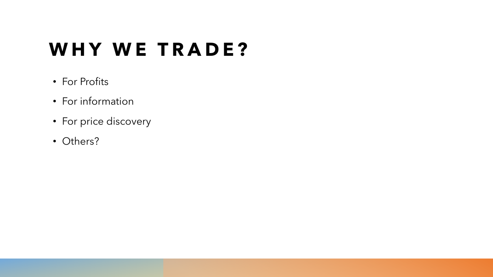
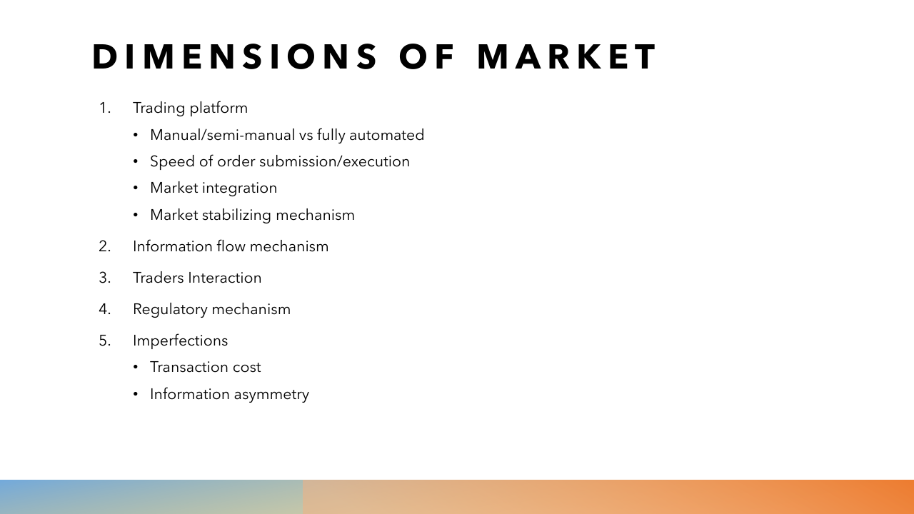
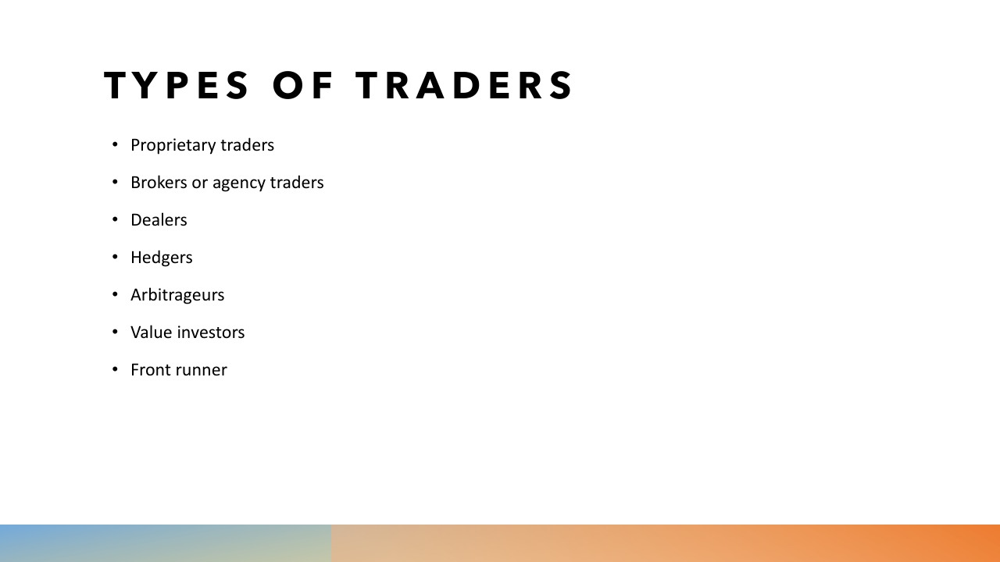
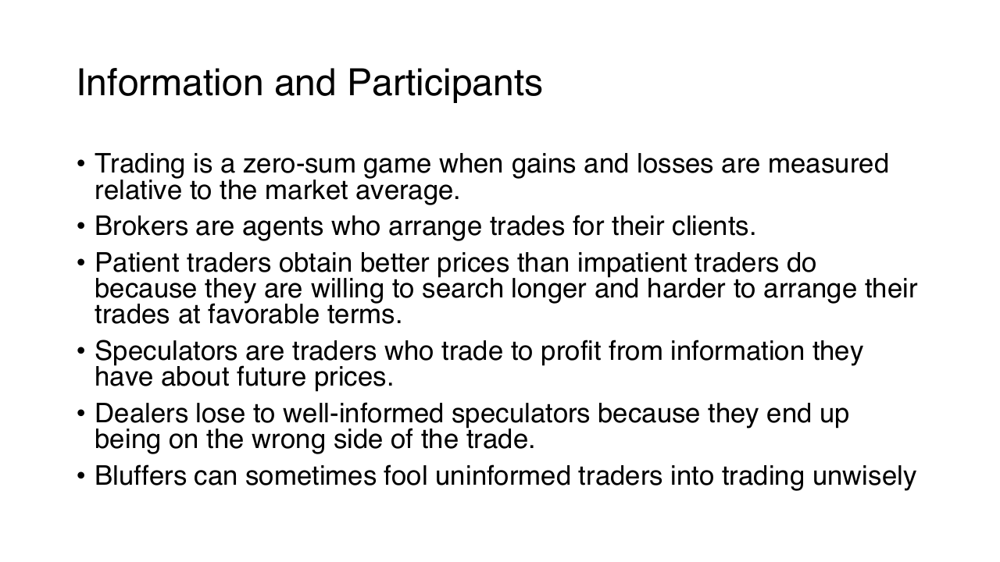
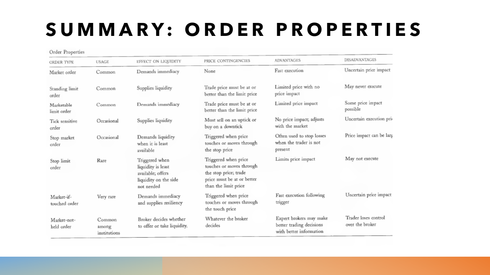
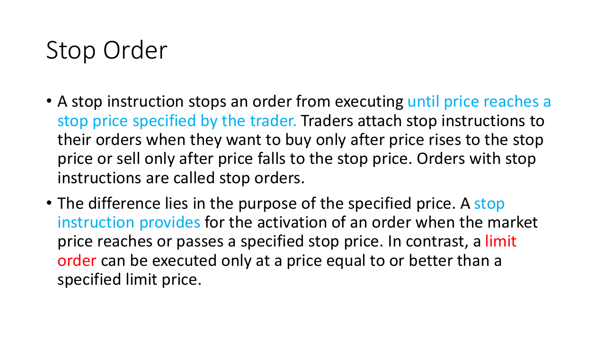
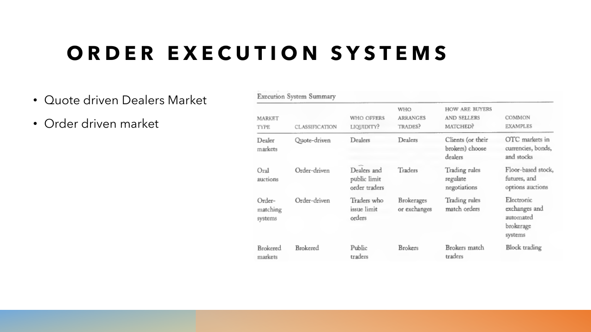
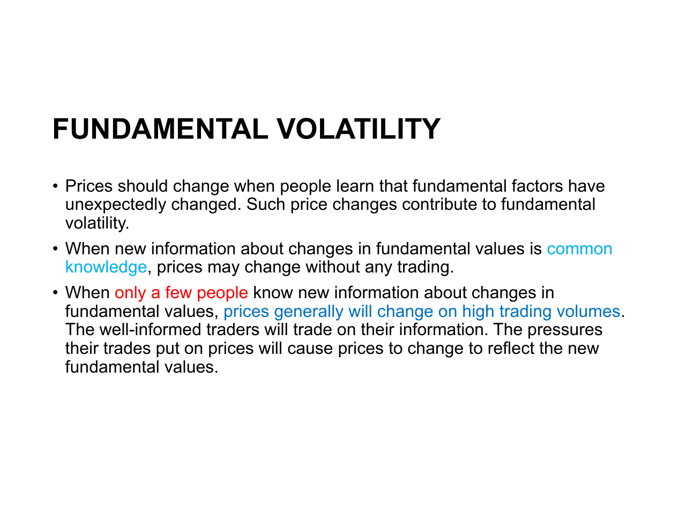
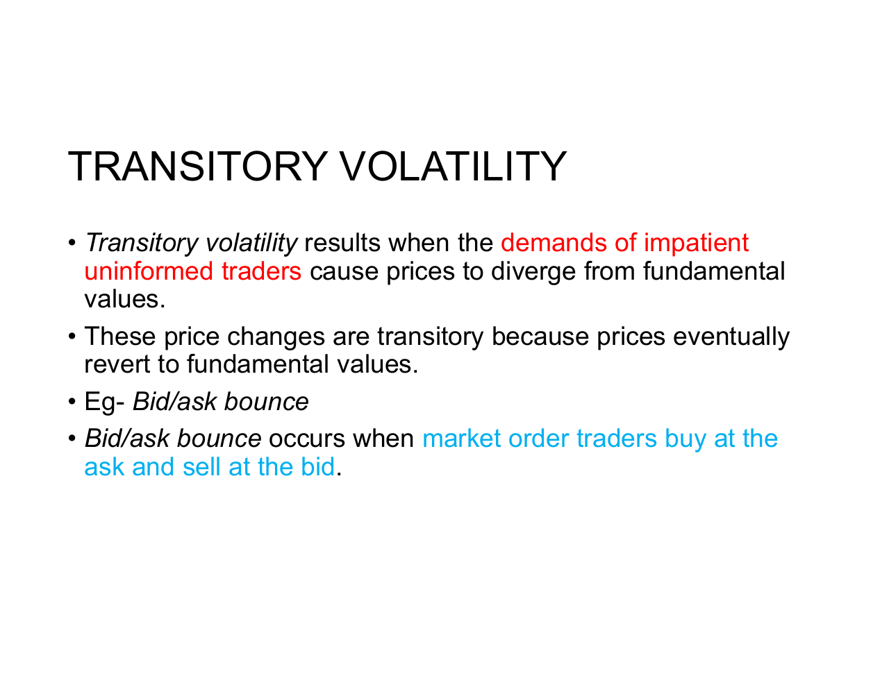

# Topic 5: Basic Concepts Discussed in Class

These notes follow the midsem decks: "1. Introduction of Market Microstructure", "1.1 Exchanges", "1.1 Orders and Trades" and "2.1 Sources of Volatility".

This is the least important topic. Read it once after Topics 1 to 4. A ⭐ marks what to know without notes.

The notes build the topic in order. First they say what market microstructure studies. Then they describe the market, the people who trade in it, and the words used for prices and orders. After that they cover how a market is designed and why prices move. They end with two families of dealer models and with Roll (1984), which turns price changes into an estimate of the spread.

## 1. What market microstructure is

This section answers one question: what does the field of market microstructure study?

A market is a place, physical or electronic, where buyers and sellers meet and trade an asset such as a share. Market microstructure looks at the fine detail of how that meeting happens. The introduction slides list what it covers.

1. Trading rules.
2. Physical layouts, such as the NSE NEAT trading system.
3. The systems that present and communicate information.
4. How market participants interact.
5. Safeguards for the market. Examples are price bands, circuit breakers and trading halts.

Each item on this list is a part of how trading works. Trading rules say who may trade, when, and how orders are matched. The physical layout is the setup through which trades happen. NSE is the National Stock Exchange of India, and NEAT is the name of its electronic trading system. The information systems decide how prices and orders are shown to traders and sent between them. Participant interaction is about how buyers and sellers actually meet. The safeguards stop the market from moving in a harmful way. A price band is a limit on how far a price may move in a day. A circuit breaker stops trading after a large move. A trading halt is a pause in trading.

The slides also give a textbook definition. It says the same thing in a more formal way.

**Textbook definition (Kissell, 2014):** Market microstructure studies financial markets and how they operate. It focuses on five things.

1. The structure of exchanges and trading venues, both displayed and dark.
2. The price discovery process.
3. The determinants of spreads and quotes.
4. Intraday trading behaviour.
5. Transaction costs.

Here is what each item means. A trading venue is any place where trades happen, and an exchange is one kind of venue. A displayed venue shows its orders to everyone. A dark venue does not show its orders before they trade. Price discovery is the process by which trading moves the price toward the true value of the asset. A quote is a price at which someone offers to buy or sell. The spread is the gap between the price to buy and the price to sell (section 4 defines it exactly). "Determinants" means the things that decide how large spreads are and where quotes sit. Intraday trading behaviour is how trading changes within a single day. Transaction costs are the costs a trader pays to trade.

The slides then ask why people trade at all.

**Why we trade:** The slides give three reasons. They are profit, information and price discovery.

A trader may trade to earn a profit. A trader may trade because the trader has information about the value of the asset. And trading as a whole helps the market find the right price, which is price discovery.

## 2. Dimensions of a market

Section 1 said what the field studies. This section answers a narrower question: in which ways can two markets differ from each other? The slides call these ways the "dimensions" of a market. There are five.

1. **Trading platform:** It can be manual or fully automated. Speed, market integration and stabilizing mechanisms matter.
2. **Information flow mechanism:** It decides how information reaches traders.
3. **Traders' interaction:** It decides how traders meet and trade.
4. **Regulatory mechanism:** It sets the rules.
5. **Imperfections:** Transaction cost and information asymmetry are the two imperfections.

The first dimension is the trading platform. This is the system on which orders are placed and carried out. On a manual platform, people handle the orders. On a fully automated platform, computers handle them. The slide lists three more features of a platform. Speed is how fast orders are submitted and executed. Market integration is how well this market is linked to other markets. A stabilizing mechanism is a tool that keeps the market from moving wildly, such as the circuit breaker from section 1.

The second dimension is the information flow mechanism. It decides what traders can see, such as prices and orders, and when they see it.

The third dimension is how traders interact. It decides whether traders meet each other directly or through someone else, such as a dealer.

The fourth dimension is the regulatory mechanism. A regulator is the authority that makes and enforces the rules of the market.

The fifth dimension is the imperfections. An imperfection is something that stops the market from working perfectly. The slide names two. A transaction cost is any cost of trading, so it makes every trade a little more expensive. Information asymmetry means that some traders know more than others about the value of the asset. So the less informed trader can lose to the better informed trader.

## 3. ⭐ Traders and participants

Section 2 described the market itself. This section answers the next question: who trades in the market, and why does each type trade?

**Types of traders:** The slides list proprietary traders, brokers or agency traders, dealers, hedgers, arbitrageurs, value investors and front runners.

Most of these names are explained in the list below. Two of them are not, so they are defined here. A proprietary trader trades with the firm's own money, not with a client's money. An agency trader is another name for a broker, because a broker acts as the agent of a client. A value investor buys an asset when its price is below its value. A front runner trades ahead of a large order that the front runner knows is coming, to profit from the price move that order will cause.

The exchanges deck adds these facts from Harris. Harris is the author of the textbook that this deck draws on. Each fact below describes one type of trader, or one feature of trading.

- **Zero-sum game:** Trading is zero-sum when gains and losses are measured relative to the market average. A zero-sum game is one where the total gain of the winners equals the total loss of the losers. So if one trader beats the market average, another trader must fall behind it by the same amount.
- **Brokers:** They are agents who arrange trades for their clients. An agent acts on behalf of someone else. So a broker does not trade for itself. It finds a counterparty for its client.
- **Patient traders:** They get better prices than impatient traders, because they search longer for good terms. A patient trader is willing to wait. An impatient trader wants to trade now and so accepts whatever price is available.
- **Speculators:** They trade to profit from information about future prices. If a speculator expects the price to rise, it buys now and sells later.
- **Dealers:** They lose to well-informed speculators, because they end up on the wrong side of the trade. A dealer is a trader who stands ready to buy from or sell to anyone at posted prices. When an informed speculator buys, it is because the value is high. The dealer has sold to it at a price that is too low, so the dealer loses.
- **Bluffers:** They sometimes fool uninformed traders into trading unwisely. A bluffer trades to make others believe the price will move in some direction. An uninformed trader who believes the bluff then trades at a bad price.
- **Investors and borrowers:** Investors move money from the present to the future. Borrowers do the opposite. An investor gives up money today to have more money later. A borrower gets money today and pays it back later.
- **Hedgers:** They trade to manage financial risks. A hedger takes a trade that gains when another position the hedger holds loses. So the two risks partly cancel.
- **Asset exchangers:** They trade one asset for another that they value more.
- **Gamblers:** They trade to entertain themselves. They do not need information or a hedge. They trade for the fun of it.
- **Arbitrageurs:** They make sure that prices do not differ much across markets. If the same asset is cheaper in one market, an arbitrageur buys it there and sells it in the dearer market. Its buying pushes the low price up and its selling pushes the high price down. So the two prices come close together.
- **Sell side:** Dealers and brokers provide exchange services to the buy side. The buy side is the traders who use those services, such as investors, hedgers and speculators. The sell side is the firms that sell trading services to them.

## 4. ⭐ Basic terms

Section 3 said who trades. This section gives the words used to describe the prices and trades they make. The rest of these notes use these words, so learn them first.

- **Bid and ask:** The bid is the best price to sell at. The ask is the best price to buy at. A bid is an offer to buy, and the best bid is the highest price anyone is willing to pay. So a trader who wants to sell now gets the best bid. An ask is an offer to sell, and the best ask is the lowest price anyone is willing to accept. So a trader who wants to buy now pays the best ask. The ask is also called the offer.
- **Mid quote:** It is the average of the best bid and the best ask. So it is the point halfway between the two prices.
- **Spread:** It is the best ask minus the best bid. The ask is above the bid, so the spread is positive. A trader who buys at the ask and then sells at the bid loses the spread.
- **BBO and NBBO:** BBO is the best bid and offer. NBBO is the national best bid and offer. The BBO is the best bid and the best ask in one market. The NBBO is the best bid and the best ask across all the markets in a country.
- **Price impact:** It is how much an order moves the price. A large order uses up the orders waiting at the best price. It then trades at worse prices, so the price moves against the trader.
- **Tick:** An uptick is a price above the last price. A downtick is a price below it. A zero tick is the same price. So each new trade price is compared with the trade price just before it.
- **Block deal:** It is one trade of at least 5,00,000 shares or at least Rs 10 crore. It happens in a separate window, from 8:45 to 9:00 AM or from 2:05 to 2:20 PM. Retail investors cannot see it. A retail investor is an individual who trades small amounts with personal money. So a block deal is a single very large trade done away from the normal market.
- **Bulk deal:** It involves at least 0.5 percent of a company's listed shares. It happens in normal hours, and everyone can see it. So the difference from a block deal is that a bulk deal trades in the normal market and is visible.

The slides apply these terms to a real order book. An order book is the list of all buy orders and sell orders waiting to trade, with their prices and quantities. The slide shows the order book of Axis Bank on NSE. The top row of the book holds the best bid and the best ask, so the example uses only that row.

**Worked example (the Axis Bank slide):** The bid is 664.40 for 453 shares. The ask is 664.55 for 714 shares.

This means buyers are waiting to buy 453 shares at Rs 664.40, and no one offers to pay more. Sellers are waiting to sell 714 shares at Rs 664.55, and no one offers to sell for less. Now each term from the list above can be computed.

1. The spread is $664.55-664.40=0.15$.
2. The mid price is 664.475.
3. The proportional spread is $0.15/664.475=0.0226$ percent.
4. The depth is $(714+453)/2=583.5$ shares.

Here is each line in words.

Line 1 uses the definition of the spread. The best ask is 664.55 and the best bid is 664.40. Their difference is 0.15. So a trader who buys and then sells at once loses Rs 0.15 per share.

Line 2 uses the definition of the mid quote, the average of the best bid and the best ask. Add the two prices and divide by two.

$$\frac{664.55+664.40}{2}=\frac{1328.95}{2}=664.475$$

Line 3 computes the proportional spread. This is the spread divided by the mid price. It expresses the spread as a share of the price, so stocks with different prices can be compared. The division gives 0.000226. Multiply by 100 to turn it into a percent, which gives 0.0226 percent. So a round trip costs about two hundredths of one percent of the price.

Line 4 computes the depth. Depth here is the average number of shares waiting at the best bid and the best ask. There are 714 shares at the ask and 453 shares at the bid. Their sum is 1167. Half of that is 583.5 shares. So about 583.5 shares can trade at the best prices before the price must move.

## 5. ⭐ Liquidity dimensions

The Axis Bank example measured the spread and the depth. Both are measures of liquidity. Liquidity is how easily a trader can buy or sell an asset quickly, at a low cost, without moving its price much. This section answers the question: in which ways can liquidity be measured?

The 2025 midsem asked for the four dimensions of liquidity, so they were taught in class.

| Dimension | Question |
|---|---|
| Immediacy | How fast can I trade? |
| Width | How much does a small trade cost? This is the spread. |
| Depth | How much can I trade at a given price? |
| Resiliency | How fast does the price recover after a large trade? |

The table gives one question for each dimension. Read it row by row.

Immediacy is about time. A liquid market lets a trader trade at once.

Width is about cost. A small trade does not move the price, so its only cost is the spread. A narrow spread means a liquid market. In the Axis Bank example the width was 0.15.

Depth is about size. It asks how many shares can trade at the current best price. A deep market can absorb a large order without the price moving. In the Axis Bank example the depth was 583.5 shares.

Resiliency is about recovery. A large trade pushes the price away from its value. In a resilient market, new orders arrive fast and the price returns to its value fast.

## 6. Orders

Section 5 measured how easy it is to trade. This section answers the next question: what kinds of instructions can a trader send to trade? Such an instruction is called an order. The table lists the three basic orders.

| Order | Instruction | Role |
|---|---|---|
| Market | Trade now at the best price available | It takes liquidity and pays the spread |
| Limit | Trade only at the limit price or better | It provides liquidity |
| Stop | Activate the order when the price reaches the stop price | A sell stop is a safety net for a long position |

Read the table row by row.

A market order says "trade now at the best price available". A market buy order trades with the best ask. A market sell order trades with the best bid. So it uses up orders that were waiting in the book. That is why the table says it "takes liquidity". It buys at the ask or sells at the bid, so it pays the spread.

A limit order sets a limit price. A buy limit order may trade only at the limit price or lower. A sell limit order may trade only at the limit price or higher. If it cannot trade at once, it waits in the order book. While it waits, other traders can trade against it. That is why the table says it "provides liquidity".

A stop order waits until the price reaches a chosen level, called the stop price. Then it becomes active and trades. A long position means the trader owns the asset. A sell stop is placed below the current price. If the price falls to the stop price, the order sells the asset. So it limits the trader's loss if the price keeps falling. That is why it is a "safety net".

Each order type carries a risk. The notes list one risk for market orders and two for limit orders.

- **Market order risk:** It fills quickly, but sometimes at a poor price. Its price impact depends on available liquidity. "Fills" means the order trades. A market order is sure to trade, but the trader does not choose the price. If few shares wait at the best price, the order trades at worse prices too. So a thin market gives a large price impact.
- **Limit order risk 1:** It faces execution uncertainty. The price can move away, so the trader fails to trade. Execution uncertainty means the trader does not know if the order will trade. Suppose a trader posts a buy limit order below the current price and the price then rises. The order is never reached, so the trader does not get to buy.
- **Limit order risk 2:** It faces adverse selection. The order fills when informed traders know that it is mispriced. This causes ex post regret. Adverse selection means the trades that happen are the ones that are bad for the order owner. A limit order sits in the book at a fixed price. If news makes that price wrong, an informed trader trades against it at once. "Ex post" means after the event. So after the trade, the limit order owner wishes the order had not filled.

## 7. Market design

Section 6 described the orders a trader sends. This section answers the question: how does a market turn those orders into trades? The answer depends on how the market is designed. The notes describe designs by timing (when trades happen) and by who sets the prices.

- **Continuous market:** Trades happen at any time during the session. A session is the period in a day when the market is open. As soon as a buy order and a sell order match, they trade.
- **Call market:** Orders are collected and executed together at one time. NSE uses a call auction in its pre-open session. A call auction gathers all orders for a while and then trades them all at one price. The pre-open session is the short period before the normal market opens.
- **Quote-driven market:** Dealers quote prices, and traders trade with dealers. So the dealers supply the liquidity. The slide calls this a dealers market.
- **Order-driven market:** Rules match buy and sell orders directly. Here traders who post limit orders supply the liquidity, and no dealer is needed in the middle.
- **Circuit breaker:** It halts trading after a large market move.

A designer needs a way to judge whether a design works well. The notes give the yardstick, called market quality.

**Market quality** has five measures. They are liquidity, transaction cost, informative prices, volatility and trading profits.

Liquidity was defined in section 5. Transaction cost is what a trader pays to trade. Informative prices are prices that reflect the true value of the asset. Volatility is how much the price moves around (section 8 explains it). Trading profits are the gains that traders make from trading.

## 8. ⭐ Volatility

Section 7 listed volatility as one measure of market quality. This section answers the question: why do prices move, and which moves are permanent? Volatility means how much a price moves up and down over time.

Prices change for two reasons. New information arrives about values. Impatient traders also demand liquidity.

The first reason changes the value of the asset itself. The value is what the asset is truly worth. The second reason moves the price without changing the value. An impatient trader wants to trade now, so it accepts a worse price and pushes the price away from value. These two reasons give two kinds of volatility. The table compares them.

| Point | Fundamental volatility | Transitory volatility |
|---|---|---|
| Cause | Unanticipated changes in values | Trading by impatient uninformed traders |
| Life | Permanent | Temporary, because prices revert to value |
| Example | Earnings news | Bid-ask bounce and large uninformed orders |
| Who causes it | Informed traders move the price to the new value | Uninformed orders push the price away from value |
| Who ends it | Not applicable | Value traders and arbitrageurs push the price back |

Read the table row by row.

The cause. Fundamental volatility comes from changes in value that no one expected. Transitory volatility comes from trades by impatient traders who have no information.

The life. A fundamental move is permanent, because the value really changed. A transitory move is temporary, because the value did not change. So the price later reverts, which means it goes back to the value.

The example. Earnings news is a company's report of its profits. It changes the value, so it causes fundamental volatility. The bid-ask bounce (defined below) and large orders from uninformed traders cause transitory volatility.

Who causes it. Informed traders learn the new value first. Their trades move the price to that new value. Uninformed orders push the price away from the value instead.

Who ends it. A fundamental move does not end, because the new price is the right price. So the row says "Not applicable". A transitory move ends when value traders and arbitrageurs trade against it. They buy when the price is below value and sell when it is above. So they push the price back.

The notes add three more points.

- **Total volatility:** It is fundamental volatility plus transitory volatility. So the price moves we see in data mix both kinds. Roll (1984) in section 10 shows how to separate them.
- **Dealers:** They infer information from order flow. This creates the adverse selection part of the spread. Price changes from this part add to fundamental volatility. Order flow is the stream of buy and sell orders reaching the market. Many buys hint that the value is high. So the dealer raises its prices after buys, and lowers them after sales. The dealer also widens its spread to cover its expected loss to informed traders. That part of the spread is the adverse selection part. These price changes follow real information, so they add to fundamental volatility, not transitory volatility.
- **Bid-ask bounce:** Market buyers trade at the ask and market sellers trade at the bid. So the price jumps without any news. Suppose the value does not change. If a buy is followed by a sale, the trade price falls from the ask to the bid. If a sale is followed by a buy, it rises from the bid to the ask. So the trade price bounces between the two quotes. Slide 12 notes the result: a rise tends to be followed by a fall. In other words, price changes are negatively correlated from one trade to the next. Section 10 uses exactly this fact.

## 9. ⭐ Inventory models and information models

Section 8 showed that a dealer's prices react to trades. This section answers the question: why does a dealer charge a spread at all? The course gives two families of answers. Inventory models are the first family. Information models are the second. The table compares them.

| Point | Inventory models | Information models |
|---|---|---|
| Problem of the dealer | Unbalanced inventory | Better-informed customers |
| Source of the spread | Cost and risk of inventory | Expected loss to informed traders |
| Effect of a trade on price | Temporary | Permanent |
| Main papers | Garman, Amihud-Mendelson, Stoll, Ho-Stoll, O'Hara-Oldfield | Bagehot, Copeland-Galai, Glosten-Milgrom, Kyle, Easley-O'Hara |

Read the table row by row.

The problem of the dealer. A dealer's inventory is the stock of the asset that the dealer holds. Each time the dealer buys, its inventory grows. Each time it sells, its inventory shrinks. In inventory models, the dealer's problem is that inventory can become unbalanced, too large or too small. In information models, the dealer's problem is that some customers know more about the value than the dealer.

The source of the spread. In inventory models, holding an unbalanced inventory costs money and carries risk, because the price may move. The spread pays for that cost and risk. In information models, the dealer expects to lose money to informed traders. The spread pays for that expected loss, using what the dealer earns from uninformed traders.

The effect of a trade on price. In inventory models, a trade moves the dealer's prices only to fix its inventory. Once the inventory is back in balance, the prices return. So the effect is temporary. In information models, a trade tells the dealer something about the value. The dealer's belief about the value changes for good. So the effect is permanent. This matches section 8: the inventory effect is transitory volatility, and the information effect is fundamental volatility.

The main papers. The last row lists the papers in each family.

## 10. ⭐ Roll (1984): the spread from prices

Section 8 said that the bid-ask bounce makes trade prices bounce up and down. Roll (1984) turns that idea into a formula. The question it answers is this: if we see only a list of trade prices, with no quotes, can we estimate the spread? Roll's answer is yes. The size of the bounce reveals the size of the spread.

The model rests on four assumptions. Here are the symbols first, as slide 13 defines them. $P_t$ is the price of trade number $t$. $V_t$ is the fundamental value of the asset at trade $t$. $S$ is the spread. $\varepsilon_t$ is the change in fundamental value at trade $t$, which is the news. $Q_t$ is the sign of trade $t$: it says whether the trader was a buyer or a seller.

**Assumptions:**

- **A1:** The value follows a random walk: $V_t=V_{t-1}+\varepsilon_t$.
- **A2:** The spread $S$ is constant.
- **A3:** The trade sign $Q_t$ is +1 for a buy and -1 for a sale, each with probability one half.
- **A4:** Trade signs are independent over time and independent of news.

Here is what each assumption says in words.

A1 says the new value equals the old value plus some news. A random walk is a series where each step adds a random amount. Slide 13 adds that the news $\varepsilon_t$ has an average of zero and a variance of $\sigma^2$. Variance measures how spread out a random amount is around its average. Slide 13 also says the news at different times is independent. Two random amounts are independent if knowing one tells you nothing about the other.

A2 says the gap between ask and bid never changes.

A3 says a buy and a sale are equally likely.

A4 says that whether this trade is a buy tells you nothing about whether the last trade was a buy. It also says the trade sign tells you nothing about the news. So in this model, trades carry no information about value.

Two facts follow from A3 and A4, and the steps below use them. The symbol $E[\cdot]$ means the expected value, or average, over all possible outcomes.

Fact 1. $Q_t$ is either +1 or -1. Either way, $Q_t^2=1$. So its average is also 1.

$$E[Q_t^2]=1$$

Fact 2. By A3, the average of $Q_t$ is zero, because +1 and -1 are equally likely. By A4, $Q_t$ and $Q_{t-1}$ are independent. The average of a product of two independent amounts equals the product of their averages.

$$E[Q_tQ_{t-1}]=E[Q_t]E[Q_{t-1}]=0\times 0=0$$

The same reasoning gives $E[Q_tQ_{t-2}]=0$ and $E[Q_{t-1}Q_{t-2}]=0$, because all trade signs are independent of each other. By A4, the average of a trade sign times any news term is also zero. That is because the trade sign has average zero and is independent of the news.

Now the derivation runs in five steps.

**Step 1: Write the trade price.**

A buyer trades at the ask and a seller trades at the bid. Slide 14 sets the ask half a spread above the value, and the bid half a spread below it. So a buy has price $V_t+S/2$, and a sale has price $V_t-S/2$. The sign $Q_t$ picks between them. When $Q_t=+1$ we add $S/2$. When $Q_t=-1$ we subtract $S/2$. So one formula covers both cases.

$$P_t=V_t+\frac{S}{2}Q_t$$

**Step 2: Take the price change.**

The price change $\Delta P_t$ is this trade price minus the last trade price. Write Step 1 at time $t$ and at time $t-1$, and subtract.

$$\Delta P_t=P_t-P_{t-1}=\left(V_t+\frac{S}{2}Q_t\right)-\left(V_{t-1}+\frac{S}{2}Q_{t-1}\right)$$

Group the value terms together and the sign terms together. The spread $S$ is the same at both times by A2, so $S/2$ comes out as a common factor.

$$\Delta P_t=(V_t-V_{t-1})+\frac{S}{2}(Q_t-Q_{t-1})$$

By A1, $V_t-V_{t-1}$ is the news $\varepsilon_t$. Substitute it.

$$\Delta P_t=\varepsilon_t+\frac{S}{2}(Q_t-Q_{t-1})$$

So every price change has two parts. The first part is news. The second part is the bounce between bid and ask. Write $\Delta Q_t=Q_t-Q_{t-1}$ for the change in sign, so the bounce part is $\frac{S}{2}\Delta Q_t$.

Before Step 3, note that the average price change is zero. The news has average zero by A1. Each trade sign has average zero by A3, so $\Delta Q_t$ has average zero too. This matters because, for amounts with average zero, the variance is the average of the square, and the covariance is the average of the product. Steps 3 and 4 use this.

**Step 3: Find the variance.** The sign change has $E[(\Delta Q_t)^2]=2$.

The variance of the price change tells us how much prices move in total. Its average is zero, so the variance is the average of its square. Square the price change from Step 2.

$$\mathrm{Var}(\Delta P_t)=E\left[\left(\varepsilon_t+\frac{S}{2}\Delta Q_t\right)^2\right]$$

Expand the square with $(x+y)^2=x^2+2xy+y^2$, and take the average of each term.

$$\mathrm{Var}(\Delta P_t)=E[\varepsilon_t^2]+2\cdot\frac{S}{2}E[\varepsilon_t\Delta Q_t]+\frac{S^2}{4}E[(\Delta Q_t)^2]$$

Now find each average in turn.

The first term. The news has average zero and variance $\sigma^2$ by A1. So the average of its square is $\sigma^2$.

The middle term. It is the average of news times a trade sign. By A4 the trade signs are independent of the news, so this average is zero.

The last term needs $E[(\Delta Q_t)^2]$. That is where the line "The sign change has $E[(\Delta Q_t)^2]=2$" comes from. Expand the square of the sign change.

$$(\Delta Q_t)^2=(Q_t-Q_{t-1})^2=Q_t^2-2Q_tQ_{t-1}+Q_{t-1}^2$$

Take the average of each term. By Fact 1, the first and last terms each have average 1. By Fact 2, the middle term has average 0.

$$E[(\Delta Q_t)^2]=1-2\times 0+1=2$$

Now put the three terms back together. The first term is $\sigma^2$. The middle term is 0. The last term is $\frac{S^2}{4}\times 2=\frac{S^2}{2}$.

$$\mathrm{Var}(\Delta P_t)=\sigma^2+\frac{S^2}{2}$$

This result has a meaning. Slide 14 calls the two terms the fundamental and transitory volatility components. The first term, $\sigma^2$, comes from news, so it is the fundamental part. The second term, $S^2/2$, comes from the bid-ask bounce, so it is the transitory part. This is the "total volatility" split from section 8. But the variance alone cannot give $S$, because $\sigma^2$ is unknown. So Roll needs a second equation.

**Step 4: Find the covariance.** Only the shared term $-Q_{t-1}^2$ survives, so $E[\Delta Q_t\Delta Q_{t-1}]=-1$.

The second equation comes from the covariance between this price change and the last one. Covariance measures whether two amounts tend to move together. A negative covariance means a rise tends to be followed by a fall. Both price changes have average zero, so the covariance is the average of their product. Write both price changes using Step 2.

$$\mathrm{Cov}(\Delta P_t,\Delta P_{t-1})=E\left[\left(\varepsilon_t+\frac{S}{2}\Delta Q_t\right)\left(\varepsilon_{t-1}+\frac{S}{2}\Delta Q_{t-1}\right)\right]$$

Multiply out the brackets. Each of the two terms in the first bracket multiplies each of the two terms in the second bracket. That gives four terms. Take the average of each.

$$\mathrm{Cov}(\Delta P_t,\Delta P_{t-1})=E[\varepsilon_t\varepsilon_{t-1}]+\frac{S}{2}E[\varepsilon_t\Delta Q_{t-1}]+\frac{S}{2}E[\varepsilon_{t-1}\Delta Q_t]+\frac{S^2}{4}E[\Delta Q_t\Delta Q_{t-1}]$$

Now show why the three news terms drop out.

The first term is news at time $t$ times news at time $t-1$. By A1, news at different times is independent and has average zero. So the average of the product is $0\times 0=0$.

The second and third terms are news times a change in trade sign. By A4, trade signs are independent of news. A change in trade sign has average zero. So both averages are zero.

Only the last term remains. It needs $E[\Delta Q_t\Delta Q_{t-1}]$. Write out both sign changes. Note that the earlier one, $\Delta Q_{t-1}$, is $Q_{t-1}-Q_{t-2}$.

$$\Delta Q_t\Delta Q_{t-1}=(Q_t-Q_{t-1})(Q_{t-1}-Q_{t-2})$$

Multiply out the brackets term by term.

$$\Delta Q_t\Delta Q_{t-1}=Q_tQ_{t-1}-Q_tQ_{t-2}-Q_{t-1}^2+Q_{t-1}Q_{t-2}$$

Take the average of each term. Three terms are products of two different trade signs, so by Fact 2 each has average 0. The term $-Q_{t-1}^2$ is the one shared by both sign changes, because $Q_{t-1}$ appears in both. By Fact 1 its average is $-1$.

$$E[\Delta Q_t\Delta Q_{t-1}]=0-0-1+0=-1$$

That is the line "Only the shared term $-Q_{t-1}^2$ survives". Put it back into the covariance. The three news terms are zero, and the last term is $\frac{S^2}{4}\times(-1)$.

$$\mathrm{Cov}(\Delta P_t,\Delta P_{t-1})=-\frac{S^2}{4}$$

This result has a meaning. The covariance is negative, so a price rise tends to be followed by a fall. This is the bid-ask bounce from section 8. The news $\sigma^2$ does not appear at all. So the covariance depends only on the spread. That is why Roll can use it to find $S$.

**Step 5: Solve for the spread.**

Start from Step 4 and solve for $S$. Multiply both sides by $-4$.

$$S^2=-4\mathrm{Cov}(\Delta P_t,\Delta P_{t-1})$$

Take the square root of both sides. The spread is positive, so we keep the positive root. The square root of 4 is 2, so the 4 comes out as a 2.

$$S=2\sqrt{-\mathrm{Cov}(\Delta P_t,\Delta P_{t-1})}$$

So to estimate the spread, compute the covariance of each price change with the one before it, from trade price data. Put that covariance into this formula.

**Example:** A covariance of -0.0625 gives $S=2(0.25)=0.5$.

Here is the example line by line. The covariance is $-0.0625$. Its negative is $0.0625$. The square root of $0.0625$ is $0.25$, because $0.25\times 0.25=0.0625$. Multiply by 2 to get the spread, which is 0.5. Check this with Step 4: a spread of 0.5 gives a covariance of minus $0.5^2/4=0.25/4=0.0625$, so the covariance is $-0.0625$, as given.

**Limits:** The formula fails when the sample covariance is positive. It assumes that trades carry no information. It assumes a constant spread.

Here is why each limit holds. First, the formula takes the square root of minus the covariance. If the covariance measured from data is positive, minus the covariance is negative. A negative number has no real square root, so the formula gives no answer. Second, A4 says trade signs are independent of news. So the model has no room for informed traders, whose trades carry news. Third, A2 says the spread never changes. So the formula cannot handle a spread that changes.

