**How to use this PDF.** The text is the five topic notes, word for word. Three kinds of box are added to them.

- A blue **Hook** box gives a trick to remember a list, a number or an equation.
- A green **Proof map** box comes just before a long proof. It gives the whole proof as a few moves, with no intermediate steps. Read the map first. Then read the full proof under it.
- An orange **Formula** box holds the formulas that you need for numericals.

The last page collects every formula box on one sheet.

**Read first:** Topic 1, Section 7 (Easley and O'Hara), and all of Topic 2. You have not read these yet.

::: {.hook title="The whole course in five sentences"}
1. Informed traders make the dealer charge a spread, and their trades move the price. This is Topic 1.
2. Liquidity measures tell us how large these trading costs are. This is Topic 2.
3. Limits on funding can turn a small loss into extreme illiquidity. This is Topic 3.
4. Common funding and strategic selling spread illiquidity across the whole market. This is Topic 4.
5. Illiquidity lowers prices and raises the return that investors demand. This is in Topics 2 and 3.

Remember the chain: **Inform, Measure, Fund, Spread across, Price.**
:::


\newpage

# Topic 1: Information-Based Models

These notes follow the deck "3. Information based Models", slides 1 to 47, in the slide order.

Everything in this file is exam material. A $\star$ marks what to know without notes. Worked examples use made-up numbers to practise the slide formulas.

| Model | What it adds | What the dealer does | Main result |
|---|---|---|---|
| Bagehot (1971) | Some traders know more | Recovers losses from the uninformed | The spread exists because of information |
| Copeland and Galai (1983) | A profit function for the dealer | Balances expected gains and losses | The spread is the price of a free option |
| Glosten and Milgrom (1985) | Learning from each trade | Quotes the expected value given the trade | The spread exists with zero cost and zero profit |
| Kyle (1985) | A strategic insider who chooses size | Prices the total order flow | Price impact is $\lambda = \sigma_0 / 2\sigma_y$ |
| Easley and O'Hara (1987) | Trade size and event uncertainty | Quotes a price for each size | Size and sequence of trades move prices |

## 0. Words to know first

| Term | Meaning |
|---|---|
| Fundamental value | What the asset is truly worth. It is written $V$, $v$ or $P$ |
| Bid and ask | The dealer buys at the bid. The dealer sells at the ask |
| Spread | The ask minus the bid |
| Informed trader | Knows something about the value that the price does not show yet |
| Uninformed trader | Trades for cash needs or portfolio needs. Also called a liquidity trader or noise trader |
| Adverse selection | The dealer loses because the better informed trader picks the profitable side |
| Risk neutral | Cares only about expected profit. Risk does not matter |
| Prior | The belief before seeing a trade |
| Posterior | The belief after seeing a trade |

## 1. Role of information (slide 2)

| No. | Point | What it means |
|---|---|---|
| 1 | Transaction cost is not enough | The market price of an asset did not always depend on transaction cost |
| 2 | Information flow matters | New information also moves prices |
| 3 | Some traders are superior | Market participants do not have equal information |
| 4 | The dealer faces a new risk | Adverse selection is a risk to the wealth of the market maker |

| Point | Inventory models | Information models |
|---|---|---|
| Dealer's problem | The dealer holds an unwanted position | The trader may know more |
| Reason for the spread | Holding cost, order cost and ruin risk | Adverse selection |
| What a trade changes | The inventory | The belief about value |
| Price effect | Mostly temporary | Permanent, as far as the trade has information |

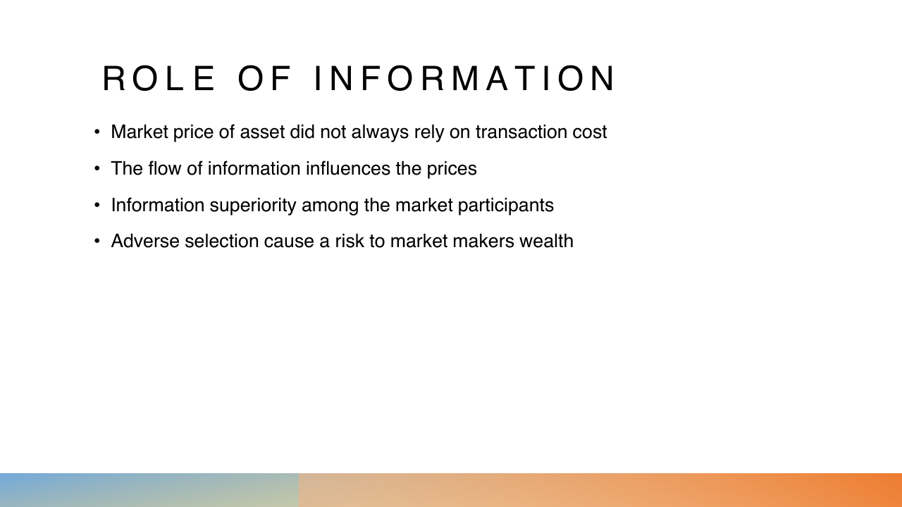{width=75%}
## 2. The five theories (slide 3)

::: {.hook title="The five theories: the dealer WOBLS"}
Each model adds one new thing. The first letters spell **WOBLS**, so remember that "the dealer wobbles".

- **W**ords: Bagehot (1971) gives the idea in words only, with no equation.
- **O**ption: Copeland and Galai (1983) treat the quotes as free options.
- **B**ayes: Glosten and Milgrom (1985) let the dealer learn from each trade by Bayes rule.
- **L**ambda: Kyle (1985) lets a strategic insider choose the order size, and the price impact is $\lambda$.
- **S**ize: Easley and O'Hara (1987) let traders choose between two sizes.

The years climb through odd numbers: 71, 83, 85, 85, 87. The two 1985 papers are twins. Glosten and Milgrom is sequential with one unit per trade. Kyle is a batch auction with a chosen size.
:::


Each theory fixes a weakness of the theory before it.

| No. | Theory | Weakness of the earlier theory that it fixes |
|---|---|---|
| 1 | Bagehot (1971) | First theory. It gives the idea in words |
| 2 | Copeland and Galai (1983) | Bagehot gave only words. This one writes a profit function |
| 3 | Glosten and Milgrom (1985) | Copeland and Galai have one period and the dealer does not learn |
| 4 | Kyle (1985) | The Glosten and Milgrom insider trades one unit and ignores price impact |
| 5 | Easley and O'Hara (1987) | Earlier sequential models use one fixed size and assume that information exists |

{width=75%}
## 3. Bagehot (1971): "The only game in town" (slide 4)

::: {.hook title="Bagehot: 2-2-1"}
Remember **2-2-1**.

- There are **two gains**. The market gain can be earned by everyone. The trading gain cannot be earned by everyone.
- There are **two traders**. The dealer loses to the informed trader. The dealer recovers that loss from the uninformed trader.
- There is **one balance**. The spread balances the loss and the gain.
:::


**There are two gains.**

| Gain | Where it comes from | Can everyone earn it? |
|---|---|---|
| Market gain | The whole market rises | Yes |
| Trading gain | Trading better than others | No |

**The average investor loses over time.** The cost of information causes this loss.

**The market maker stands in the middle.**

| Counterparty | What happens to the market maker |
|---|---|
| Everyone | The market maker supplies liquidity to them |
| Informed traders | The market maker loses to them |
| Uninformed traders | The market maker must recover that loss from them |

**The spread balances the two.**

| A wider spread | Effect |
|---|---|
| Against informed traders | Reduces the loss |
| Against uninformed traders | Raises the gain |

```text
Informed traders  <--- dealer loses ---  DEALER  <--- dealer gains ---  Uninformed traders
```

> **Exam:** Bagehot has no equations. Write three things: the two gains, the two kinds of traders, and the spread as the balance.

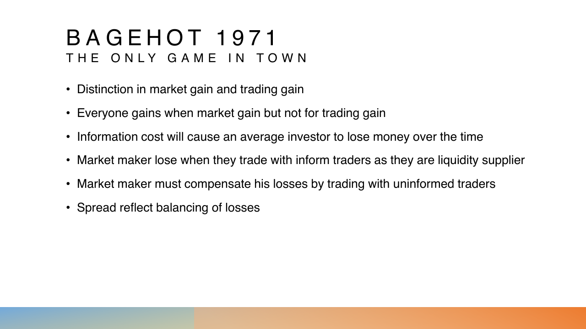{width=75%}
## 4. Copeland and Galai (1983): "Information effects on the bid-ask spread" (slides 5 to 11)

**Why this model is needed:** Bagehot gave only words. Copeland and Galai turn the idea into a profit function.

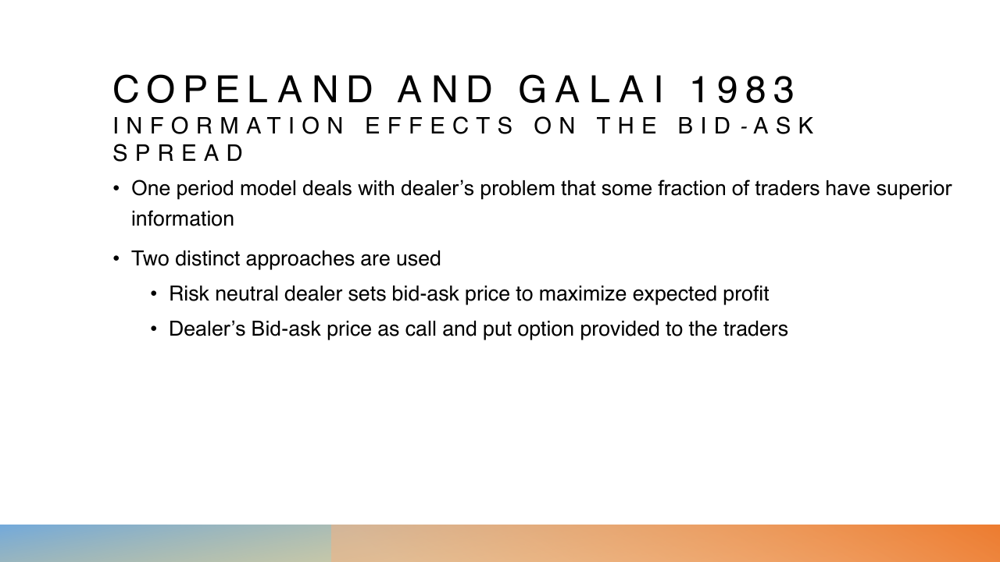{width=75%}
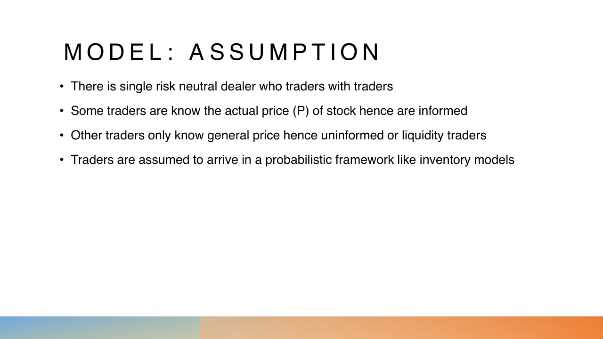{width=75%}
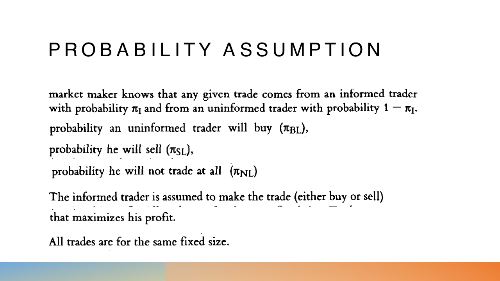{width=75%}
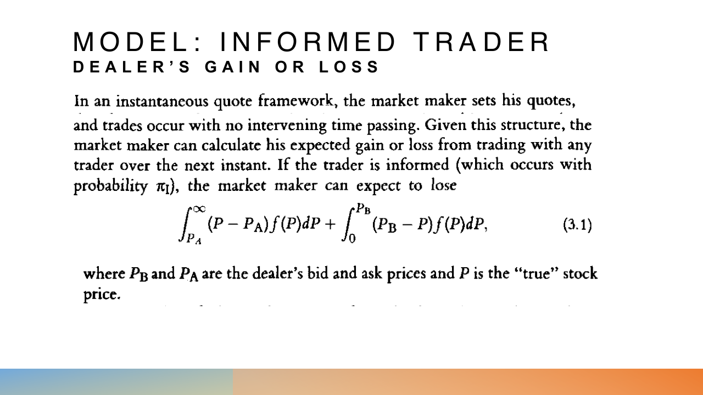{width=75%}
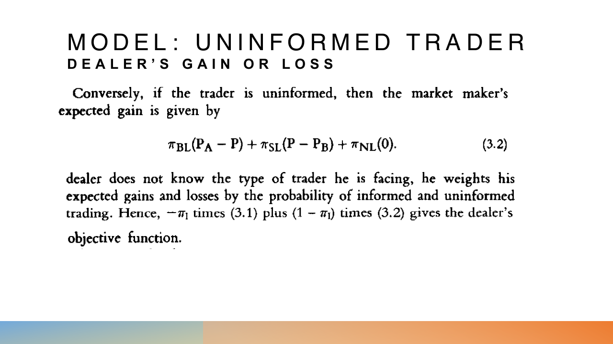{width=75%}
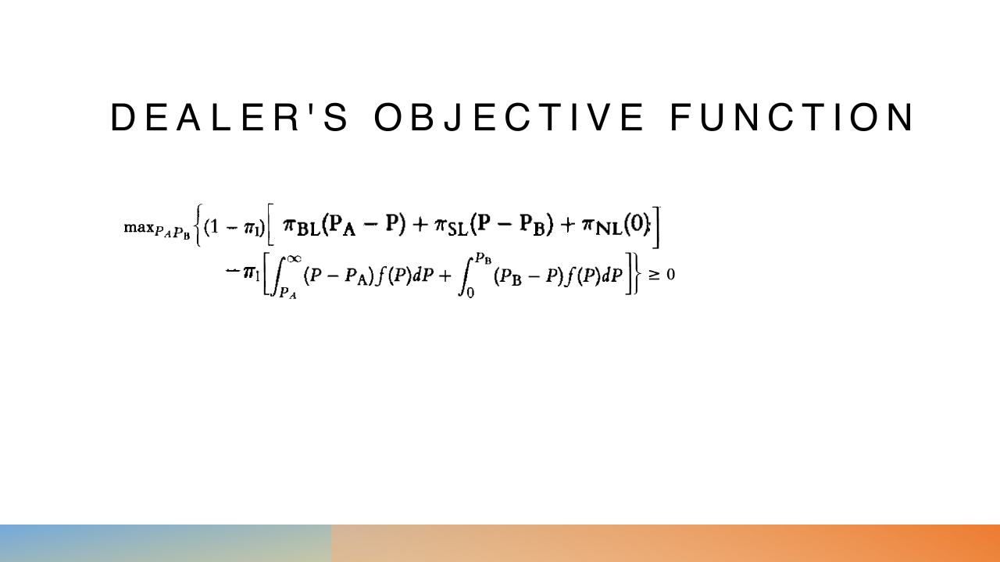{width=75%}
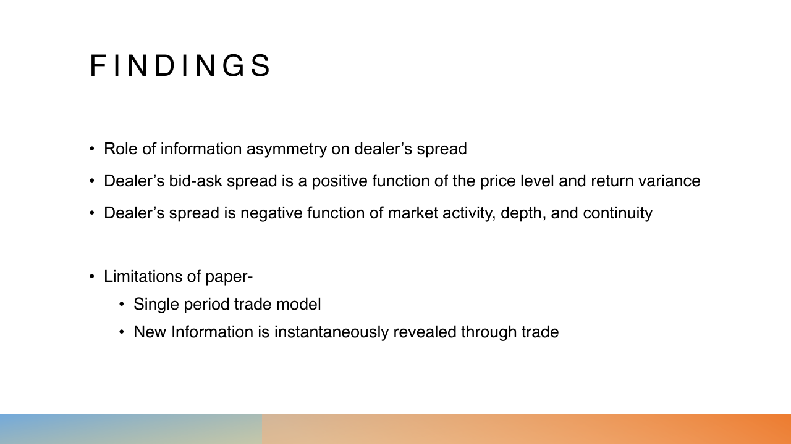{width=75%}
### 4.1 The idea

::: {.hook title="Copeland and Galai: Ask is a Call, Bid is a Put"}
The ask is a free call option with strike $P_A$. The informed trader exercises it, by buying, when the true price $P$ is above $P_A$.

The bid is a free put option with strike $P_B$. The informed trader exercises it, by selling, when $P$ is below $P_B$.

The objective is **"Gain from the Uninformed, Lose to the Informed"**: $(1-\pi_I)G_U-\pi_I L_I$. Each term is weighted by the probability of its own trader type.
:::


| Point | What the model says |
|---|---|
| Periods | One period |
| Traders | Some fraction of the traders has superior information |
| Profit view | A risk-neutral dealer sets the bid and ask to maximize expected profit |
| Option view | The dealer gives traders two free options: the ask and the bid |

| Quote | Option it is | A trader uses it when |
|---|---|---|
| Ask $P_A$ | Free call with strike $P_A$ | The true value is above $P_A$ |
| Bid $P_B$ | Free put with strike $P_B$ | The true value is below $P_B$ |

### 4.2 Assumptions

| No. | Assumption |
|---|---|
| A1 | There is a single risk-neutral dealer |
| A2 | Informed traders know the actual price $P$ |
| A3 | Uninformed traders know only the general price. Call it $P_0$ |
| A4 | Traders arrive with given probabilities, as in inventory models |
| A5 | All trades have the same fixed size |
| A6 | Quotes are instantaneous. No time passes between setting the quote and trading |

### 4.3 Notation

| Symbol | Meaning |
|---|---|
| $\pi_I$ | Probability that the trader is informed |
| $1-\pi_I$ | Probability that the trader is uninformed |
| $\pi_{BL}$ | Probability that an uninformed trader buys |
| $\pi_{SL}$ | Probability that an uninformed trader sells |
| $\pi_{NL}$ | Probability that an uninformed trader does not trade |
| $f(P)$ | Density of the true price |
| $P_A$ and $P_B$ | Ask and bid |

### 4.4 $\star$ Solution step by step

::: map
1. The informed trader uses the free options. So the expected loss $L_I$ is the expected payoff of the call at $P_A$ plus the expected payoff of the put at $P_B$.
2. The uninformed trader pays half the spread on each trade. So the gain is $G_U=\pi_{BL}(P_A-P_0)+\pi_{SL}(P_0-P_B)$.
3. The dealer weights each part by the chance of that trader type. Then the dealer chooses $P_A$ and $P_B$ to maximize $(1-\pi_I)G_U-\pi_I L_I$.
4. A wider spread lowers the option loss and raises the gain per uninformed trade. But a wider spread also drives uninformed traders away. This stops the spread from growing without limit.
5. Competition pushes the profit to zero. In the symmetric example, this gives the half-spread $h=\pi_I\Delta$.
:::


**What each trade does to the dealer:**

| Trader | Action | When it happens | Dealer's result |
|---|---|---|---|
| Informed | Buys | Only if $P > P_A$ | Loses $P-P_A$ |
| Informed | Sells | Only if $P < P_B$ | Loses $P_B-P$ |
| Uninformed | Buys | With probability $\pi_{BL}$ | Gains $P_A-P_0$ |
| Uninformed | Sells | With probability $\pi_{SL}$ | Gains $P_0-P_B$ |
| Uninformed | No trade | With probability $\pi_{NL}$ | Zero |

**Step 1: Loss to an informed trader (equation 3.1).** Average the two informed losses over all possible prices.

$$L_I=\int_{P_A}^{\infty}(P-P_A)f(P) dP+\int_{0}^{P_B}(P_B-P)f(P) dP$$

**Step 2: Gain from an uninformed trader (equation 3.2).** Add the three uninformed rows. The slide writes $P$ in place of $P_0$.

$$G_U=\pi_{BL}(P_A-P_0)+\pi_{SL}(P_0-P_B)+\pi_{NL}(0)$$

**Step 3: Weight the gain and the loss.** The gain comes with probability $1-\pi_I$. The loss comes with probability $\pi_I$.

$$\max_{P_A, P_B}\left[(1-\pi_I)G_U-\pi_I L_I\right]$$

**Step 4: Participation condition.** The dealer stays only if expected profit is not negative. With competition, expected profit becomes zero.

$$(1-\pi_I)G_U-\pi_I L_I\ge 0$$

**Step 5: The trade-off.**

| A wider spread | Effect on the dealer |
|---|---|
| Makes $L_I$ smaller | Good |
| Earns more per uninformed trade | Good |
| Drives uninformed traders away | Bad. This stops the spread from growing without limit |

### 4.5 Worked example

**Data:** The true price is 110 or 90 with equal chance. So $P_0=100$. Also $\pi_I=0.2$ and $\pi_{BL}=\pi_{SL}=0.5$. The quotes are $100+h$ and $100-h$. Competition makes profit zero.

| Step | Working | Result |
|---|---|---|
| 1. Gain | $G_U=0.5h+0.5h$ | $G_U=h$ |
| 2. Loss | $L_I=0.5(10-h)+0.5(10-h)$ | $L_I=10-h$ |
| 3. Zero profit | $0.8h=0.2(10-h)$ | One equation in $h$ |
| 4. Expand the right side | $0.8h=2-0.2h$ | |
| 5. Add $0.2h$ to both sides | $h=2$ | Ask 102, bid 98, spread 4 |

### 4.6 $\star$ Findings and limitations

::: {.hook title="Findings: PV up, ADC down"}
The spread rises with the **P**rice level and the **V**ariance of the return. The spread falls with market **A**ctivity, **D**epth and **C**ontinuity.

There are two limitations. The model has only one period. The information is revealed at once by the trade.
:::


| Type | Point |
|---|---|
| Finding | Information asymmetry explains the dealer's spread |
| Finding | The spread rises with the price level and with the variance of return |
| Finding | The spread falls with market activity, depth and continuity |
| Limitation | The model has only one period |
| Limitation | New information is revealed instantly through the trade |

> **Exam:** Do not stop at the objective function. Explain the sign of each term and the option view.


::: {.box title="Formulas: Copeland and Galai"}
Use this for the symmetric example. The value is $P_0\pm\Delta$ with equal chance. The quotes are $P_0\pm h$. Every uninformed trader trades, so $\pi_{BL}=\pi_{SL}=0.5$.

1. The gain from an uninformed trader is $G_U=h$.
2. The loss to an informed trader is $L_I=\Delta-h$.
3. Zero profit means $(1-\pi_I)h=\pi_I(\Delta-h)$. This gives $h=\pi_I\Delta$.

The example has $\Delta=10$ and $\pi_I=0.2$. So $h=2$, the ask is 102, the bid is 98, and the spread is 4.
:::


## 5. Glosten and Milgrom (1985): "Bid, ask and transaction prices in a specialist market with heterogeneously informed traders" (slides 12 to 24)

**Why this model is needed:** Copeland and Galai have one period. Their dealer does not learn. Here the dealer learns from every trade.

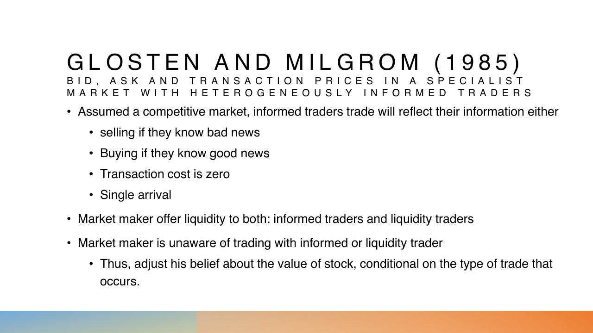{width=75%}
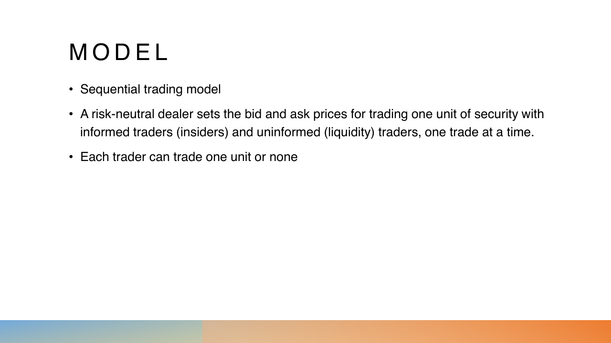{width=75%}
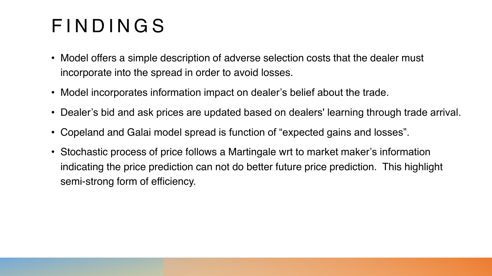{width=75%}
### 5.1 The idea

::: {.hook title="Glosten and Milgrom: quote what you would believe after the trade"}
The ask is $E[V\mid\text{buy}]$. The bid is $E[V\mid\text{sale}]$. The dealer quotes what they would believe after the trade, so they never regret the quote. This is why the quotes are called regret free.

Remember **"tilt, then normalise"**. Start from the prior. A buy multiplies the good state by $(1+\mu)$ and the bad state by $(1-\mu)$. A sale swaps the two. Then divide by the sum.

Remember **"$\theta$ for trouble"**: $\theta=\Pr(V_L)$. Write this in the first line of your answer, because the slides switch its meaning.
:::


| Point | What the model says |
|---|---|
| Competitive market | The dealer earns zero expected profit |
| Trades carry information | Informed traders sell on bad news. They buy on good news |
| Types are hidden | The dealer serves informed traders and liquidity traders. The dealer cannot tell who is who |
| The trade is a signal | The dealer updates the belief about value using the type of trade, which is a buy or a sale |

### 5.2 Assumptions

| No. | Assumption |
|---|---|
| A1 | The value is $V_L$ with probability $\theta$. It is $V_H$ with probability $1-\theta$ |
| A2 | A fraction $\mu$ of traders are insiders. The rest, $1-\mu$, are liquidity traders |
| A3 | Insiders buy on good news and sell on bad news |
| A4 | A liquidity trader buys or sells with probability 0.5 each |
| A5 | Trading is sequential. One trader arrives at a time and trades one unit or none |
| A6 | The dealer is risk neutral and competitive |
| A7 | Transaction cost is zero |

The profit of insiders equals the loss of liquidity traders.

> **Slide error:** The slides change the meaning of $\theta$. Slides 14, 16 and 17 use it for good news. Slides 18 and 20 and equation 4.27 use it for bad news. These notes always use $\theta=\Pr(V_L)$, because the final formulas need it. Define $\theta$ in your first line in the exam.

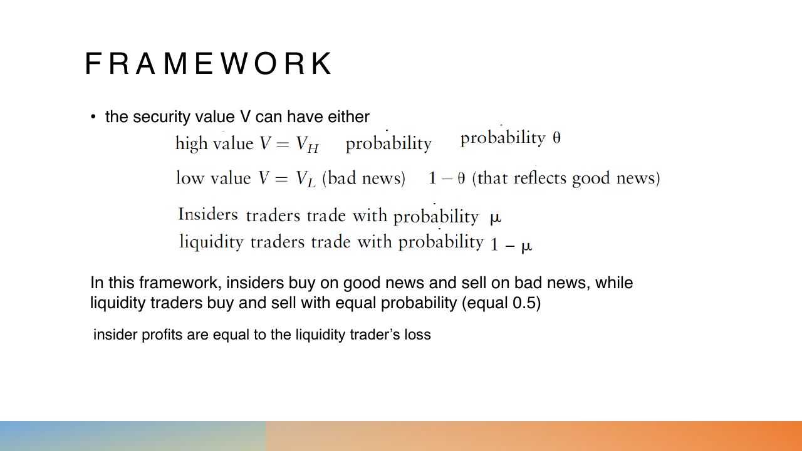{width=75%}
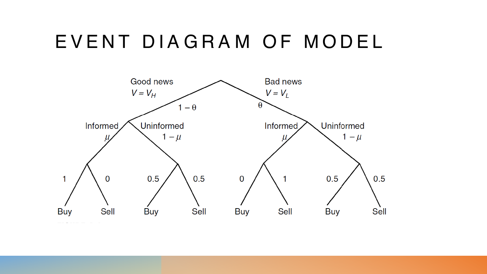{width=75%}
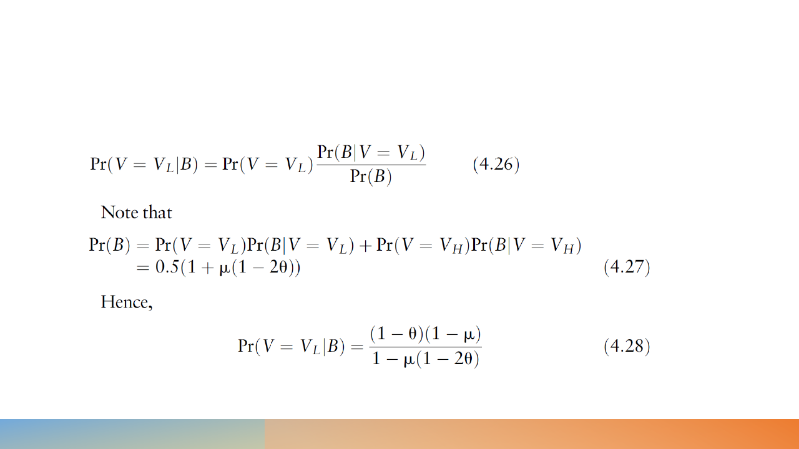{width=75%}
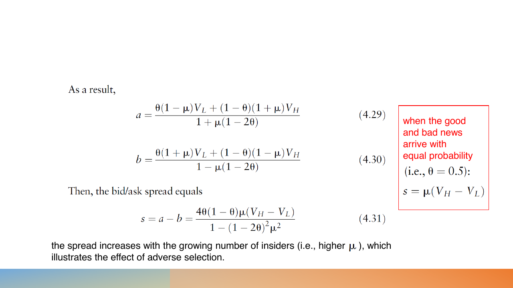{width=75%}
### 5.3 The event tree (slides 16 to 18)

| Stage | What happens | Probabilities |
|---|---|---|
| 1 | Nature chooses the news | Bad news $\theta$, good news $1-\theta$ |
| 2 | The trader learns the news or does not | Informed $\mu$, uninformed $1-\mu$ |
| 3 | The trader buys or sells | See the table below |

```text
                                           buy        sell
                     informed   (mu)        1          0
good news (1-theta)
                     uninformed (1-mu)     0.5        0.5

                     informed   (mu)        0          1
bad news  (theta)
                     uninformed (1-mu)     0.5        0.5
```

Multiply along each branch to get the joint probability.

| Branch | Probability with a buy | Probability with a sale |
|---|---|---|
| Good news, informed | $(1-\theta)\mu$ | 0 |
| Good news, uninformed | $0.5(1-\theta)(1-\mu)$ | $0.5(1-\theta)(1-\mu)$ |
| Bad news, informed | 0 | $\theta\mu$ |
| Bad news, uninformed | $0.5\theta(1-\mu)$ | $0.5\theta(1-\mu)$ |

A sale at time 1 can come from three branches. An informed sale on good news is impossible.

Slide 16 is more general. It lets uninformed traders buy with probability $\gamma^B$ and sell with probability $\gamma^S$. In our notation it gives these totals.

$$\Pr(B)=(1-\mu)\gamma^B+(1-\theta)\mu$$

$$\Pr(S)=(1-\mu)\gamma^S+\theta\mu$$

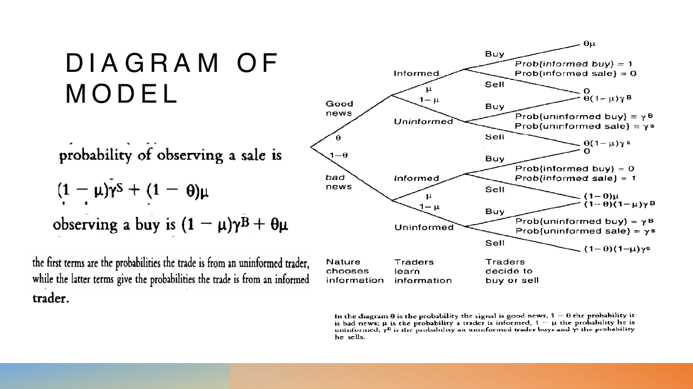{width=75%}
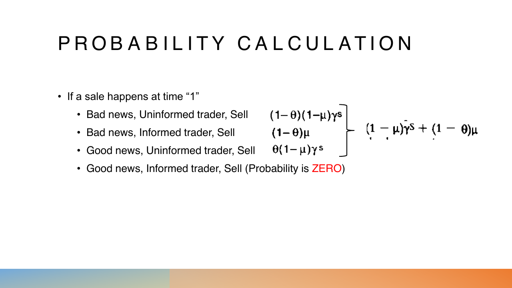{width=75%}
### 5.4 Bayes rule (slides 21 to 23)

| Step | What we do | Equation |
|---|---|---|
| 1 | The data $D$ can happen with the event $E$ or without it ($E^c$) | 3.10 |
| 2 | Write the joint probability in two ways | 3.11 |
| 3 | Divide by $\Pr(D)$ | 3.12 |
| 4 | Put step 1 into the denominator | 3.13 |
| 5 | Read it: posterior equals prior times likelihood, divided by the marginal likelihood | 3.14 |

**Step 1 (3.10):**

$$\Pr(D)=\Pr(D\mid E)\Pr(E)+\Pr(D\mid E^c)\Pr(E^c)$$

**Step 2 (3.11):**

$$\Pr(D,E)=\Pr(E\mid D)\Pr(D)=\Pr(D\mid E)\Pr(E)$$

**Step 3 (3.12):**

$$\Pr(E\mid D)=\frac{\Pr(D\mid E)\Pr(E)}{\Pr(D)}$$

**Step 4 (3.13):**

$$\Pr(E\mid D)=\frac{\Pr(D\mid E)\Pr(E)}{\Pr(D\mid E)\Pr(E)+\Pr(D\mid E^c)\Pr(E^c)}$$

| Part of step 4 | Name |
|---|---|
| $\Pr(E)$ | Prior |
| $\Pr(D\mid E)$ | Likelihood |
| Denominator, $\Pr(D)$ | Marginal likelihood |
| $\Pr(E\mid D)$ | Posterior |

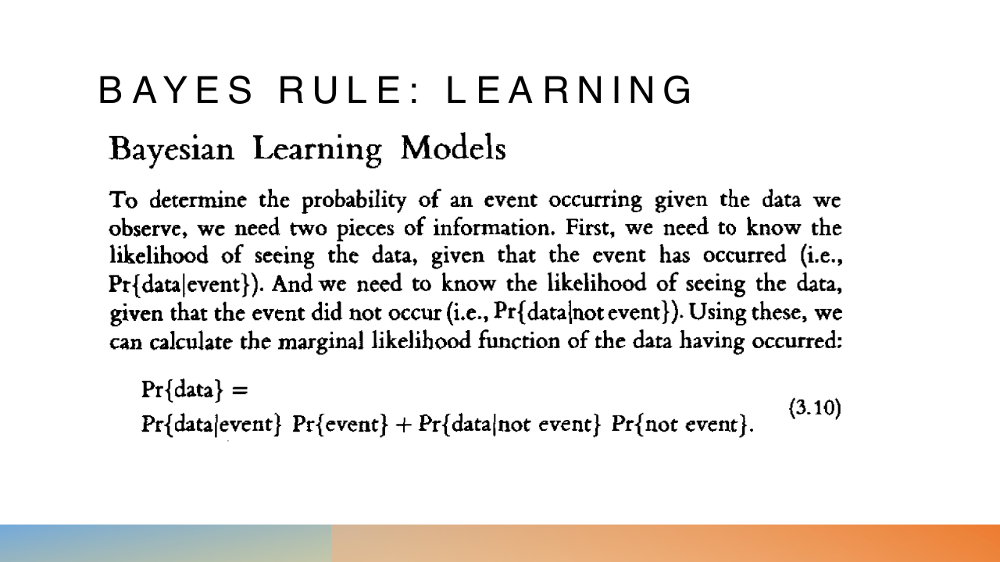{width=75%}
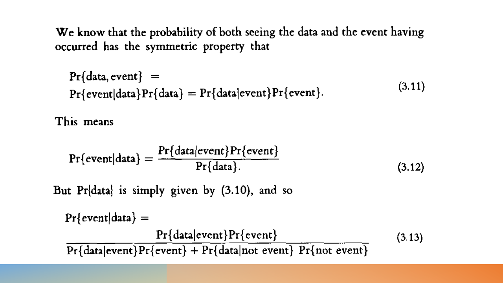{width=75%}
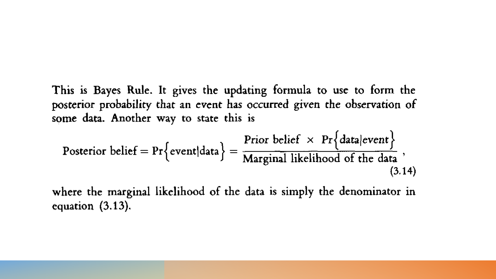{width=75%}
### 5.5 Regret-free quotes (slide 15)

A quote is regret free if it is still fair after the trade happens.

| Quote | Equals | Equation |
|---|---|---|
| Ask | The expected value given a buy | 4.23 |
| Bid | The expected value given a sale | 4.24 |

$$a=E[V\mid B]=V_L\Pr(V_L\mid B)+V_H\Pr(V_H\mid B)$$

$$b=E[V\mid S]=V_L\Pr(V_L\mid S)+V_H\Pr(V_H\mid S)$$

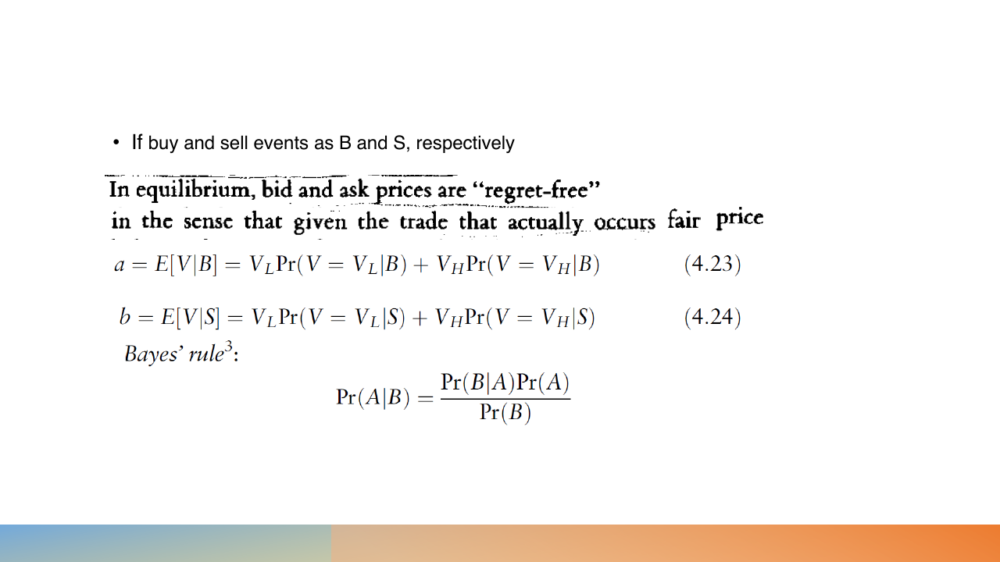{width=75%}
### 5.6 $\star$ Solution step by step

::: map
1. In the good state, all insiders buy and half of the uninformed buy. So a buy has probability $\tfrac12(1+\mu)$. In the bad state, only half of the uninformed buy. So a buy has probability $\tfrac12(1-\mu)$.
2. Bayes rule multiplies the prior by these likelihoods. The $\tfrac12$ cancels. After a buy, the weights are $\theta(1-\mu)$ on $V_L$ and $(1-\theta)(1+\mu)$ on $V_H$. After a sale, the weights are $\theta(1+\mu)$ and $(1-\theta)(1-\mu)$.
3. Each quote is the weighted average of the two values. The buy weights add to $1+\mu(1-2\theta)$, and the sale weights add to $1-\mu(1-2\theta)$:
$$a=\frac{\theta(1-\mu)V_L+(1-\theta)(1+\mu)V_H}{1+\mu(1-2\theta)},\qquad b=\frac{\theta(1+\mu)V_L+(1-\theta)(1-\mu)V_H}{1-\mu(1-2\theta)}$$
4. The ask minus the bid gives the spread:
$$s=\frac{4\theta(1-\theta)\mu(V_H-V_L)}{1-(1-2\theta)^2\mu^2}$$
When $\theta=0.5$, the spread is $s=\mu(V_H-V_L)$.
5. The spread is positive with zero cost and zero profit. So the whole spread is adverse selection.
:::
::: {.hook title="The spread formula in words"}
The spread is **4 times the coin, times the insider share, times the range, divided by the product of the two denominators**.

The coin is $\theta(1-\theta)$. The product of the two denominators is $1-(1-2\theta)^2\mu^2$.

With a fair coin, $\theta=0.5$, the spread is simply the insider share times the range.
:::


| Step | What we find | How |
|---|---|---|
| 1 | $\Pr(B)$ | Add the buy column of the branch table |
| 2 | $\Pr(S)$ | Subtract $\Pr(B)$ from 1 |
| 3 | Posteriors after a buy | Bayes rule on the buy column |
| 4 | Posteriors after a sale | Bayes rule on the sale column |
| 5 | Ask $a$ | Put step 3 into 4.23 |
| 6 | Bid $b$ | Put step 4 into 4.24 |
| 7 | Both quotes from $V_L$ | Use that the two posteriors add to 1 |
| 8 | Spread $s=a-b$ | Subtract and simplify |
| 9 | Special case | Put $\theta=0.5$ |

**Step 1: Find the probability of a buy.** Add the buy column of the table.

$$\Pr(B)=0.5\theta(1-\mu)+(1-\theta)\mu+0.5(1-\theta)(1-\mu)$$

| Line | Expression | Why |
|---|---|---|
| a | $0.5\theta(1-\mu)+0.5(1-\theta)(1-\mu)=0.5(1-\mu)$ | Join the two uninformed terms. $\theta+(1-\theta)=1$ |
| b | $\Pr(B)=0.5(1-\mu)+\mu-\theta\mu$ | Put line a back in. Open $(1-\theta)\mu$ |
| c | $\Pr(B)=0.5+0.5\mu-\theta\mu$ | Open $0.5(1-\mu)$ and add $\mu$ |
| d | $\Pr(B)=0.5(1+\mu-2\theta\mu)$ | Take 0.5 outside |

This is equation 4.27.

$$\Pr(B)=0.5[1+\mu(1-2\theta)]$$

**Step 2: Find the probability of a sale.** Every trade is a buy or a sale, so subtract from 1.

$$\Pr(S)=1-\Pr(B)=0.5[1-\mu(1-2\theta)]$$

**Step 3: Update after a buy.** Use Bayes rule, which is equation 4.26. Divide the joint probability by $\Pr(B)$.

| Value | Joint probability with a buy | Why |
|---|---|---|
| $V_L$ | $0.5\theta(1-\mu)$ | Only an uninformed trader buys on bad news |
| $V_H$ | $(1-\theta)\mu+0.5(1-\theta)(1-\mu)=0.5(1-\theta)(1+\mu)$ | Take $(1-\theta)$ outside. $\mu+0.5-0.5\mu=0.5(1+\mu)$ |

Divide each by $\Pr(B)=0.5[1+\mu(1-2\theta)]$. The 0.5 cancels.

$$\Pr(V_L\mid B)=\frac{0.5\theta(1-\mu)}{\Pr(B)}=\frac{\theta(1-\mu)}{1+\mu(1-2\theta)}$$

$$\Pr(V_H\mid B)=\frac{(1-\theta)(1+\mu)}{1+\mu(1-2\theta)}$$

**Step 4: Update after a sale.** Use the sale column and Bayes rule.

| Value | Joint probability with a sale | Why |
|---|---|---|
| $V_L$ | $\theta\mu+0.5\theta(1-\mu)=0.5\theta(1+\mu)$ | Informed and uninformed both sell on bad news |
| $V_H$ | $0.5(1-\theta)(1-\mu)$ | Only an uninformed trader sells on good news |

Divide each by $\Pr(S)=0.5[1-\mu(1-2\theta)]$. The 0.5 cancels.

$$\Pr(V_L\mid S)=\frac{\theta(1+\mu)}{1-\mu(1-2\theta)}$$

$$\Pr(V_H\mid S)=\frac{(1-\theta)(1-\mu)}{1-\mu(1-2\theta)}$$

> **Slide error:** Equation 4.28 prints $\Pr(V_L\mid B)$ as $(1-\theta)(1-\mu)/[1-\mu(1-2\theta)]$. That is true only when $\theta$ means good news. It does not agree with equations 4.27 and 4.29. Use Step 3.

**Step 5: Write the ask.** Put Step 3 into equation 4.23. This is equation 4.29.

$$a=\frac{\theta(1-\mu)V_L+(1-\theta)(1+\mu)V_H}{1+\mu(1-2\theta)}$$

**Step 6: Write the bid.** Put Step 4 into equation 4.24. This is equation 4.30.

$$b=\frac{\theta(1+\mu)V_L+(1-\theta)(1-\mu)V_H}{1-\mu(1-2\theta)}$$

**Step 7: Write both quotes as a distance from the low value.** Let $k=1-2\theta$.

| Line | Expression | Why |
|---|---|---|
| a | $\Pr(V_L\mid B)=1-\Pr(V_H\mid B)$ | The two posteriors add to 1 |
| b | $a=V_L[1-\Pr(V_H\mid B)]+V_H\Pr(V_H\mid B)$ | Put line a into 4.23 |
| c | $a=V_L+(V_H-V_L)\Pr(V_H\mid B)$ | Collect the $\Pr(V_H\mid B)$ terms |
| d | $b=V_L+(V_H-V_L)\Pr(V_H\mid S)$ | Same lines for the bid |

$$a=V_L+(V_H-V_L)\frac{(1-\theta)(1+\mu)}{1+\mu k}$$

$$b=V_L+(V_H-V_L)\frac{(1-\theta)(1-\mu)}{1-\mu k}$$

**Step 8: Subtract.** The two $V_L$ terms cancel. Use the common denominator $(1+\mu k)(1-\mu k)=1-\mu^2k^2$.

$$s=(V_H-V_L)(1-\theta)\frac{(1+\mu)(1-\mu k)-(1-\mu)(1+\mu k)}{1-\mu^2k^2}$$

| Line | Expression | Why |
|---|---|---|
| a | $(1+\mu)(1-\mu k)=1-\mu k+\mu-\mu^2k$ | Open the first product |
| b | $(1-\mu)(1+\mu k)=1+\mu k-\mu-\mu^2k$ | Open the second product |
| c | Line a minus line b $=1-\mu k+\mu-\mu^2k-1-\mu k+\mu+\mu^2k$ | Change every sign of line b |
| d | $=2\mu-2\mu k=2\mu(1-k)$ | The $1$ and $\mu^2k$ terms cancel |
| e | $=2\mu(2\theta)=4\theta\mu$ | $1-k=1-(1-2\theta)=2\theta$ |

Put line e into the numerator. Put $k=1-2\theta$ back. This gives equation 4.31.

$$s=a-b=\frac{4\theta(1-\theta)\mu(V_H-V_L)}{1-(1-2\theta)^2\mu^2}$$

**Step 9: Take the special case.** Put $\theta=0.5$. Then $1-2\theta=0$, so the denominator is 1. The numerator is $4(0.5)(0.5)\mu(V_H-V_L)$.

$$s=\mu(V_H-V_L)$$

**Conclusion:**

| Result | Meaning |
|---|---|
| $s> 0$ with zero cost and zero profit | This spread is pure adverse selection |
| $s$ rises with $\mu$ | More insiders mean a wider spread |

### 5.7 $\star$ Worked example

**Data:** $V_H=110$, $V_L=90$, $\theta=0.3$ and $\mu=0.4$.

| Step | Working | Result |
|---|---|---|
| 1. Prior value | $0.3(90)+0.7(110)$ | 104 |
| 2. The term $\mu(1-2\theta)$ | $0.4(0.4)$ | 0.16 |
| 3. Buy and sale probabilities | $\Pr(B)=0.5(1.16)$, $\Pr(S)=1-0.58$ | 0.58 and 0.42 |
| 4. Ask weights | $\theta(1-\mu)=0.3(0.6)=0.18$, $(1-\theta)(1+\mu)=0.7(1.4)=0.98$ | 0.18 and 0.98 |
| 5. Ask | $[0.18(90)+0.98(110)]/1.16=124/1.16$ | 106.897 |
| 6. Bid weights | $\theta(1+\mu)=0.3(1.4)=0.42$, $(1-\theta)(1-\mu)=0.7(0.6)=0.42$ | 0.42 and 0.42 |
| 7. Bid | $[0.42(90)+0.42(110)]/0.84=84/0.84$ | 100 |
| 8. Spread | $106.897-100$ | 6.897 |
| 9. Average transaction price | $0.58(106.897)+0.42(100)$ | 104. It equals the prior value |

Now suppose a buy happens. The dealer learns from it.

| Step | Working | Result |
|---|---|---|
| 1. New $\theta$ | $\Pr(V_L\mid B)=0.18/1.16$ | 0.1552 |
| 2. New quotes | Repeat the table above with $\theta=0.1552$ | Ask 108.541, bid 104 |
| 3. Meaning | Compare with 106.897 and 100 | Both quotes move up after a buy |


::: {.box title="Formulas: Glosten and Milgrom"}
1. After a **buy**, the weights are $w_L=\theta(1-\mu)$ and $w_H=(1-\theta)(1+\mu)$. The ask is $(w_LV_L+w_HV_H)/(w_L+w_H)$.
2. After a **sale**, the weights are $w_L=\theta(1+\mu)$ and $w_H=(1-\theta)(1-\mu)$. The bid is the same weighted average.
3. The probability of a buy is $\Pr(B)=0.5[1+\mu(1-2\theta)]$, and $\Pr(S)=1-\Pr(B)$.
4. After a buy, the new $\theta$ is $w_L/(w_L+w_H)$. Use it to find the next quotes.
5. Check your answer: $\Pr(B)\,a+\Pr(S)\,b$ must equal the prior mean. This is the martingale property.
:::


### 5.8 $\star$ Findings

::: {.hook title="Findings: ZLMS"}
- **Z**ero profit: the dealer puts the adverse-selection cost into the spread.
- **L**earning: beliefs and quotes update with each trade.
- **M**artingale: the best forecast of the next price is the present price.
- **S**emi-strong efficiency: public information cannot predict the future price better.

Compare with Copeland and Galai. Their spread comes from expected gains and losses. The Glosten and Milgrom spread comes from beliefs given each trade.
:::


| Finding | What it says |
|---|---|
| Simple description | The model explains the adverse selection cost. The dealer puts it in the spread to avoid losses |
| Beliefs change | Information affects the beliefs of the dealer |
| Quotes change | The dealer updates quotes by learning from the arrival of trades |
| Difference from Copeland and Galai | Their spread is a function of expected gains and losses. This spread comes from beliefs given each trade |
| Martingale | The price is a martingale with respect to the dealer's information. The best forecast of the next price is the present price |
| Efficiency | The market is semi-strong efficient. Public information cannot predict the future price better |

> **Exam:** This is the most likely numerical. Draw the tree first. Then write the buy probability, the posterior, the ask, the bid and the spread. Finish with one line of meaning.

## 6. Kyle (1985): "Continuous auctions and insider trading" (slides 25 to 32)

**Why this model is needed:** The insider in Glosten and Milgrom trades one unit and does not think about price impact. Kyle's insider chooses the size strategically.

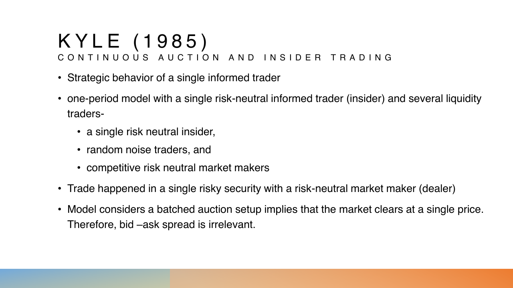{width=75%}
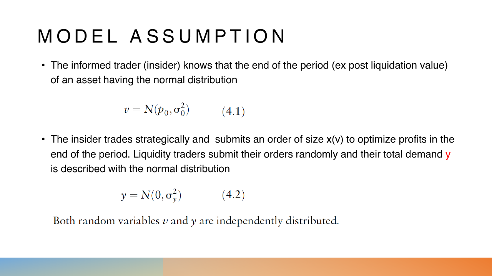{width=75%}
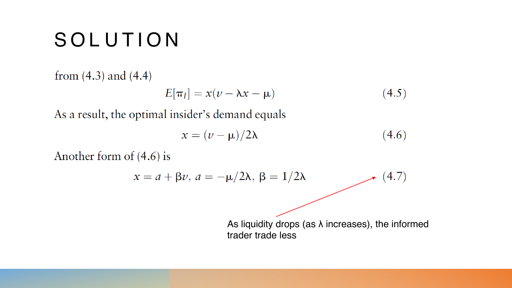{width=75%}
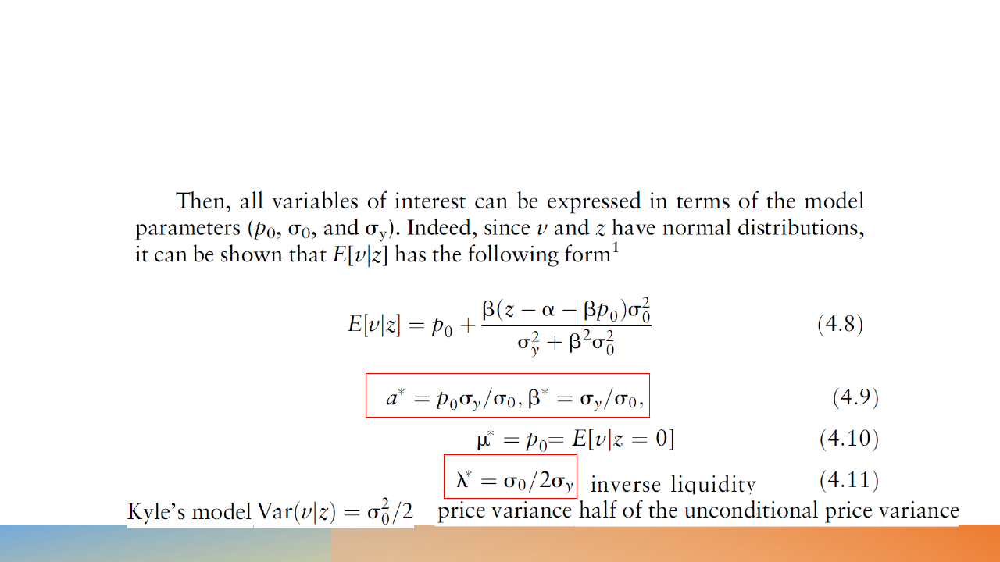{width=75%}
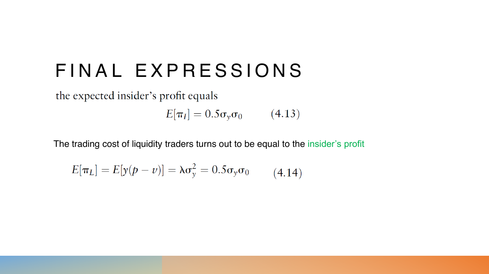{width=75%}
### 6.1 The idea and the players

::: {.hook title="Kyle: the insider hides perfectly, and everything is a half"}
At the equilibrium, the insider's order has the **same variance as the noise**: $\beta^2\sigma_0^2=\sigma_y^2$. So half of the order flow is information, and half of the information enters the price.

- $\lambda=\dfrac{\sigma_0}{2\sigma_y}$. Remember **"information over twice the noise"**.
- $\beta=\dfrac{\sigma_y}{\sigma_0}$. Remember **"flip $\lambda$ and drop the 2"**.
- $E[\pi_I]=\dfrac{\sigma_0\sigma_y}{2}$. Remember **"multiply the two, then halve"**.
:::


| Player or feature | What it is |
|---|---|
| Strategic insider | One risk-neutral informed trader. They know how their order moves the price |
| Noise traders | They trade a random amount |
| Market makers | They are competitive and risk neutral |
| Batch auction | All orders clear at one price. So the bid-ask spread is not relevant |
| Simple setting | There is one period and one risky security |

### 6.2 Questions the model answers (slide 26)

| No. | Question | Answer from the model |
|---|---|---|
| 1 | How quickly does private information enter the price? | Half of it in one period (Step 9) |
| 2 | How valuable is private information to an insider? | $E[\pi_I]=\sigma_y\sigma_0/2$ (Step 10) |
| 3 | How does noise trading affect price volatility? | More noise lowers price impact $\lambda$ (section 6.5) |
| 4 | What decides the liquidity of a market? | $\lambda=\sigma_0/2\sigma_y$: private information against noise (Step 6) |

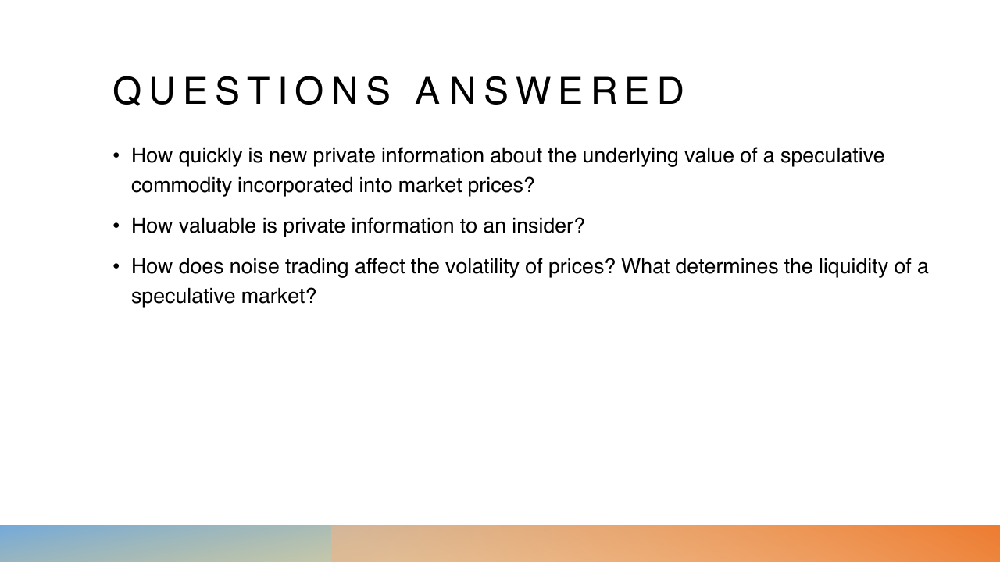{width=75%}
### 6.3 Assumptions

| No. | Assumption |
|---|---|
| A1 | The final value is $v\sim N(p_0,\sigma_0^2)$. Only the insider knows it |
| A2 | Noise demand is $y\sim N(0,\sigma_y^2)$. It is independent of $v$ |
| A3 | The insider knows $v$ but not $y$. The insider submits $x(v)$ |
| A4 | The dealer sees only the total $z=x+y$. The dealer sets $p(z)$ |
| A5 | Competition gives zero expected profit. So $p=E[v\mid z]$ |
| A6 | The price rule is linear. It is $p(z)=\lambda z+\mu$, as in equation 4.4 |

| Symbol | Meaning |
|---|---|
| $\lambda$ | Inverse liquidity. A lower $\lambda$ means lower price impact |
| $\mu$ | An intercept here. It is not the share of insiders |

> **Slide gap:** Slide 28 says that the dealer sets the price to optimize profit. In Kyle, competition forces zero expected profit. Use A5.

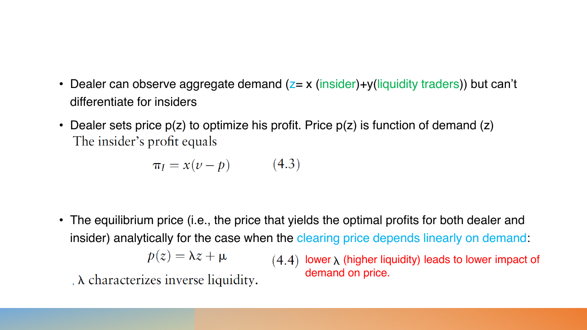{width=75%}
### 6.4 $\star$ Solution step by step

::: map
1. **The insider responds.** The expected profit is $x(v-\mu-\lambda x)$. Setting the derivative to zero gives $x=(v-\mu)/2\lambda$. So the insider's slope is $\beta=1/2\lambda$.
2. **The dealer responds.** The price is the regression of $v$ on the order flow $z$. So $\lambda=\mathrm{Cov}(v,z)/\mathrm{Var}(z)=\beta\sigma_0^2/(\beta^2\sigma_0^2+\sigma_y^2)$.
3. **The two responses meet.** Putting $\beta=1/2\lambda$ into the dealer's rule gives $\lambda^2\sigma_y^2=\sigma_0^2/4$. So $\lambda=\sigma_0/2\sigma_y$, $\beta=\sigma_y/\sigma_0$ and $\mu=p_0$.
4. **The insider hides.** With these values, $\beta^2\sigma_0^2=\sigma_y^2$. So the order flow has variance $2\sigma_y^2$, and the variance left after trading is $\sigma_0^2/2$.
5. **The noise traders pay.** The insider earns $\sigma_0\sigma_y/2$ on average. The noise traders lose $\lambda\sigma_y^2=\sigma_0\sigma_y/2$. The dealer earns zero.
:::


| Step | Who | What we find |
|---|---|---|
| 1 to 4 | Insider | The best order $x$ for a given price rule |
| 5 to 7 | Dealer | The price rule $\lambda$, $\mu$ for a given order rule |
| 8 | Both | The insider's rule at the equilibrium |
| 9 to 11 | Results | Information revealed, insider profit, noise-trader loss |

**Step 1: Write the insider's profit.** This is equation 4.3.

$$\pi_I=x(v-p)$$

**Step 2: Take the expectation.** Put in $p=\lambda(x+y)+\mu$. The insider does not know $y$, and $E[y]=0$. This is equation 4.5.

$$E[\pi_I]=x(v-\lambda x-\mu)$$

**Step 3: Maximize.**

| Line | Expression | Why |
|---|---|---|
| a | $E[\pi_I]=xv-\lambda x^2-\mu x$ | Open the bracket |
| b | $v-2\lambda x-\mu=0$ | Set the derivative in $x$ to zero |
| c | Second derivative $=-2\lambda< 0$ | So line b gives a maximum |
| d | $x=(v-\mu)/2\lambda$ | Solve line b for $x$ |

$$x=\frac{v-\mu}{2\lambda}$$

This is equation 4.6. The insider trades less when $\lambda$ is higher.

**Step 4: Write the order as a line.** Split the fraction in Step 3. This is equation 4.7.

$$x=a+\beta v$$

$$a=-\frac{\mu}{2\lambda},\qquad \beta=\frac{1}{2\lambda}$$

**Step 5: Let the dealer learn.** The order flow is $z=a+\beta v+y$.

| Quantity | Value | Why |
|---|---|---|
| Mean of $z$ | $a+\beta p_0$ | $E[v]=p_0$ and $E[y]=0$ |
| Variance of $z$ | $\beta^2\sigma_0^2+\sigma_y^2$ | $v$ and $y$ are independent |
| Covariance of $z$ with $v$ | $\beta\sigma_0^2$ | Only the $\beta v$ part moves with $v$ |
| Rule for normal variables | $E[v\mid z]=E[v]+\frac{\mathrm{Cov}}{\mathrm{Var}}(z-E[z])$ | Standard result for two normal variables |

Put the rows in. This is equation 4.8.

$$E[v\mid z]=p_0+\frac{\beta\sigma_0^2}{\sigma_y^2+\beta^2\sigma_0^2}(z-a-\beta p_0)$$

**Step 6: Match the slope.** A5 says this must equal $\lambda z+\mu$. So the coefficient of $z$ must equal $\lambda$.

$$\lambda=\frac{\beta\sigma_0^2}{\sigma_y^2+\beta^2\sigma_0^2}$$

| Line | Expression | Why |
|---|---|---|
| a | $\lambda\sigma_y^2+\lambda\beta^2\sigma_0^2=\beta\sigma_0^2$ | Multiply by the denominator |
| b | $\lambda\sigma_y^2+\frac{\sigma_0^2}{4\lambda}=\frac{\sigma_0^2}{2\lambda}$ | Put $\beta=1/2\lambda$, so $\lambda\beta^2=1/4\lambda$ |
| c | $\lambda\sigma_y^2=\frac{\sigma_0^2}{4\lambda}$ | Subtract the second term from both sides |
| d | $\lambda^2\sigma_y^2=\frac{\sigma_0^2}{4}$ | Multiply by $\lambda$ |
| e | $\lambda=\frac{\sigma_0}{2\sigma_y}$ | Take the positive root |

$$\lambda\sigma_y^2+\frac{\sigma_0^2}{4\lambda}=\frac{\sigma_0^2}{2\lambda}$$

$$\lambda^2\sigma_y^2=\frac{\sigma_0^2}{4}$$

This is equation 4.11.

$$\lambda^{\ast}=\frac{\sigma_0}{2\sigma_y}$$

**Step 7: Match the intercept.** The constant part of Step 5 must equal $\mu$. So $\mu=p_0-\lambda(a+\beta p_0)$.

| Line | Expression | Why |
|---|---|---|
| a | $\lambda a=-\mu/2$ | $a=-\mu/2\lambda$ |
| b | $\lambda\beta p_0=p_0/2$ | $\beta=1/2\lambda$ |
| c | $\mu=p_0+\mu/2-p_0/2$ | Put lines a and b in |
| d | $\mu/2=p_0/2$ | Subtract $\mu/2$ from both sides |
| e | $\mu=p_0$ | Multiply by 2 |

$$\mu=p_0+\frac{\mu}{2}-\frac{p_0}{2}$$

This is equation 4.10.

$$\mu^{\ast}=p_0$$

**Step 8: Find the insider's rule.** Put $\lambda^{\ast}$ and $\mu^{\ast}$ into Step 4.

| Quantity | Working | Result |
|---|---|---|
| $\beta^{\ast}$ | $1/2\lambda^{\ast}=1/(\sigma_0/\sigma_y)$ | $\sigma_y/\sigma_0$ |
| $a^{\ast}$ | $-\mu^{\ast}/2\lambda^{\ast}=-p_0\beta^{\ast}$ | $-p_0\sigma_y/\sigma_0$ |

$$\beta^{\ast}=\frac{\sigma_y}{\sigma_0},\qquad a^{\ast}=-\frac{p_0\sigma_y}{\sigma_0}$$

$$x=\frac{\sigma_y}{\sigma_0}(v-p_0)$$

> **Slide error:** Equation 4.9 has no minus sign on $a^{\ast}$. The minus sign is needed, because $a=-\mu/2\lambda$.

**Step 9: Find how much is revealed.**

| Line | Expression | Why |
|---|---|---|
| a | $\mathrm{Var}(v\mid z)=\sigma_0^2-\mathrm{Cov}^2/\mathrm{Var}(z)$ | Rule for normal variables |
| b | $\mathrm{Cov}^2=\beta^2\sigma_0^4$ | Square the covariance from Step 5 |
| c | $\beta^2\sigma_0^2=\sigma_y^2$ | $\beta=\sigma_y/\sigma_0$ from Step 8 |
| d | $\mathrm{Var}(z)=2\sigma_y^2$ | Put line c into the variance of $z$ |
| e | $\beta^2\sigma_0^4/2\sigma_y^2=\sigma_0^2/2$ | $\beta^2\sigma_0^4=\sigma_y^2\sigma_0^2$ by line c |

$$\mathrm{Var}(v\mid z)=\sigma_0^2-\frac{\beta^2\sigma_0^4}{2\sigma_y^2}=\frac{\sigma_0^2}{2}$$

Half of the private information enters the price in one period.

**Step 10: Find the insider's expected profit.**

| Line | Expression | Why |
|---|---|---|
| a | $v-\lambda x-\mu=(v-\mu)/2$ | $\lambda x=(v-\mu)/2$ by Step 3 |
| b | $E[\pi_I]=x(v-\mu)/2=(v-\mu)^2/4\lambda$ | Multiply line a by $x$ |
| c | $(v-p_0)^2/4\lambda$ | $\mu=p_0$ |
| d | Average of $(v-p_0)^2$ is $\sigma_0^2$ | Definition of the variance of $v$ |
| e | $\sigma_0^2/4\lambda=\sigma_0^2(2\sigma_y)/4\sigma_0$ | Put $\lambda=\sigma_0/2\sigma_y$ |

This is equation 4.13.

$$E[\pi_I]=\frac{\sigma_0^2}{4\lambda}=\frac{\sigma_y\sigma_0}{2}$$

**Step 11: Find the loss of noise traders.** The price is $p=\lambda x+\lambda y+\mu$. Only the $\lambda y$ part of the price is related to $y$. So $E[y(p-v)]=\lambda E[y^2]=\lambda\sigma_y^2$. This is equation 4.14.

$$E[\pi_L]=E[y(p-v)]=\lambda\sigma_y^2=\frac{\sigma_y\sigma_0}{2}$$

**Conclusion:**

| Player | Expected result |
|---|---|
| Insider | Gains $\sigma_y\sigma_0/2$ |
| Noise traders | Lose $\sigma_y\sigma_0/2$ |
| Dealer | Net profit zero |

The trading cost of noise traders equals the insider's profit. The dealer's expected net profit is zero.

### 6.5 $\star$ What changes what

::: {.hook title="What changes what: profit likes both, lambda likes only information"}
- When $\sigma_0$ rises, $\lambda$ rises and the insider's profit rises. There is more private information, so the market is less liquid.
- When $\sigma_y$ rises, $\lambda$ falls and the insider's profit rises. More noise hides the insider, so the market is deeper.
:::


| Change | Price impact | Insider's profit | Meaning |
|---|---|---|---|
| Higher $\sigma_0$ | Rises | Rises | More private information makes the market less liquid |
| Higher $\sigma_y$ | Falls | Rises | More noise hides the insider and makes the market deeper |

### 6.6 Worked example

**Data:** $p_0=100$, $\sigma_0=10$, $\sigma_y=1000$, $v=110$ and $y=-400$.

| Step | Working | Result |
|---|---|---|
| 1. Price impact | $\lambda=10/2000$ | 0.005 |
| 2. Slope | $\beta=1000/10$ | 100 |
| 3. Insider's order | $x=100(110-100)$ | 1000 |
| 4. Order flow seen | $z=1000-400$ | 600 |
| 5. Price | $p=100+0.005(600)$ | 103 |
| 6. Realized insider profit | $1000(110-103)$ | 7000 |
| 7. Expected profit before $v$ is known | $0.5(1000)(10)$ | 5000 |
| 8. Remaining variance | $100/2$ | 50 |


::: {.box title="Formulas: Kyle"}
1. $\lambda=\sigma_0/(2\sigma_y)$ and $\beta=\sigma_y/\sigma_0$.
2. The insider's order is $x=\beta(v-p_0)$.
3. The order flow is $z=x+y$, and the price is $p=p_0+\lambda z$.
4. The realized profit is $x(v-p)$. The expected profit, before $v$ is known, is $\sigma_0\sigma_y/2$.
5. The variance left after trading is $\sigma_0^2/2$.
:::


### 6.7 $\star$ Findings (slide 32)

| Finding | What it says |
|---|---|
| Noise distorts information | Order flow from liquidity traders hides the insider's information. A large random buy makes the dealer raise the price |
| Who pays | Liquidity traders fund the insider's profit. The dealer's net loss is zero |
| Many periods | The insider splits the order into small pieces. The size of the pieces changes over time |

> **Slide gap:** Slide 32 says that noise distorts the information "available to informed traders". The insider already knows $v$. The noise hides the information from the dealer.

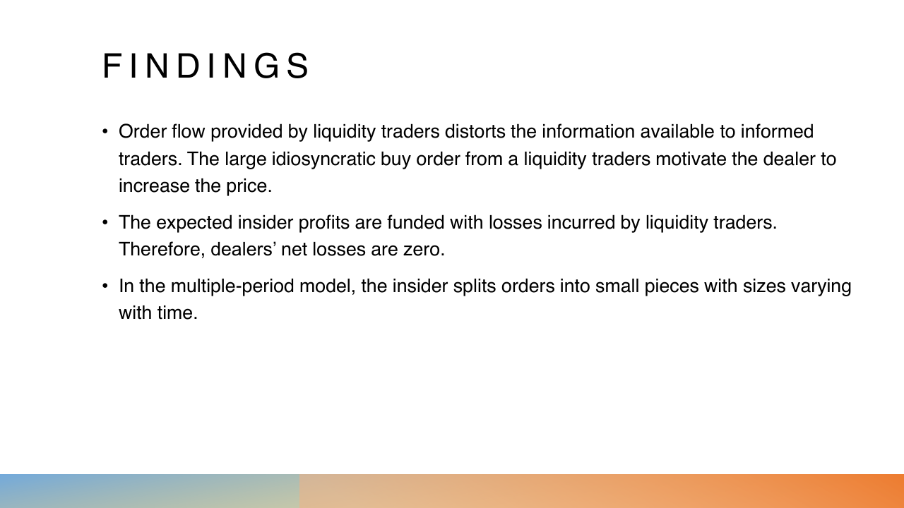{width=75%}
## 7. Easley and O'Hara (1987): "Price, trade size, and information in securities markets" (slides 33 to 47)

**Why this model is needed:** Earlier sequential models used one fixed trade size. They also assumed that information exists.

### 7.1 What is new and what is examined (slides 33 and 34)

| Point | What it says |
|---|---|
| Extension | The model extends the sequential trade model of Glosten and Milgrom |
| Same dealers | Market makers are competitive and risk neutral. Their quotes change with trades |
| Different sizes | Traders can trade different quantities |
| Dual uncertainty | The dealer does not know whether information exists. The dealer also does not know its direction |
| Object of study | Price movements, trade size and the spread of information |
| Main message | The size and the sequence of trades both move prices and pass information |

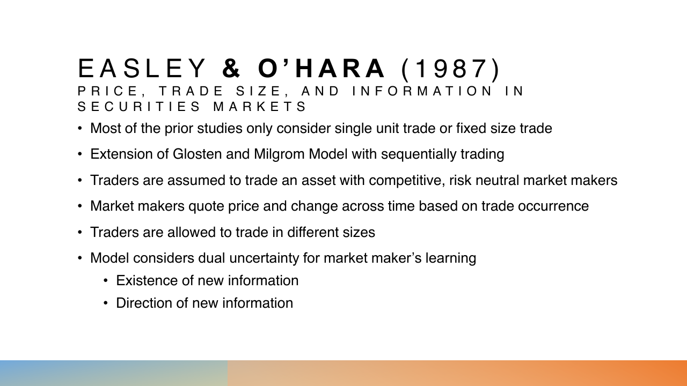{width=75%}
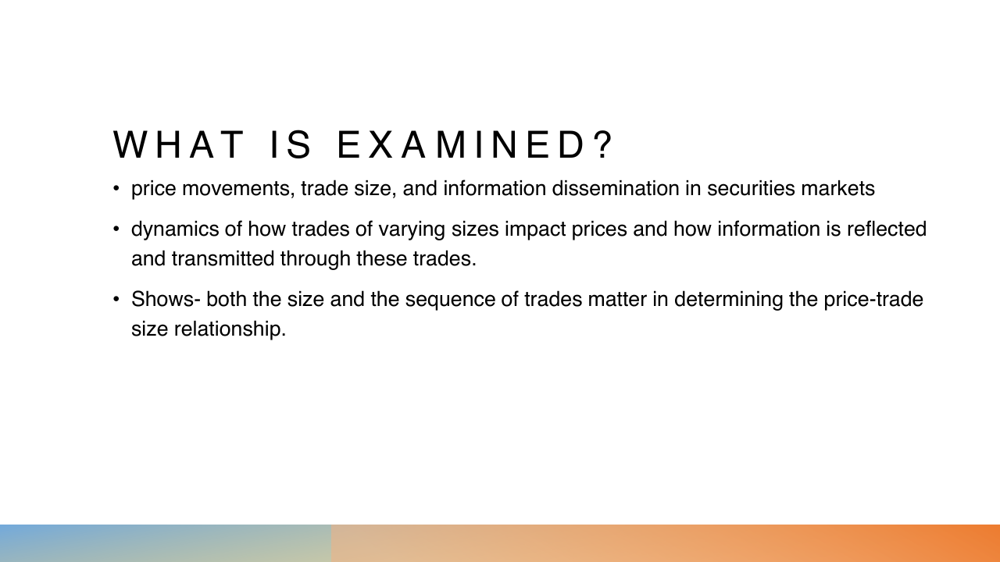{width=75%}
### 7.2 Assumptions (slides 35 to 37)

::: {.hook title="Three Greek letters: Alpha Arrives, Delta Decides, Mu Many"}
- $\alpha$ is the chance that an information event **arrives** before the day.
- $\delta$ is the chance that the signal is **low**, which is bad news.
- $\mu$ is the share of traders who are informed **after an event**.

The key product is $\alpha\mu$. It is the chance that a random trader is informed. So $1-\alpha\mu$ is the chance that a random trader is uninformed.
:::


| No. | Assumption |
|---|---|
| A1 | The value $V$ is random. An information event is a signal $s$. It is low or high |
| A2 | The signal is low with probability $\delta$ and high with probability $1-\delta$. Here $0<\delta< 1$ |
| A3 | Write $\underline{V}=E[V\mid s=L]$ and $\bar{V}=E[V\mid s=H]$. Here $\bar{V}>\underline{V}$ |
| A4 | An event happens before the trading day with probability $\alpha$. Here $0<\alpha\le 1$. An event will happen at some time. It happens only between trading days |
| A5 | After an event, some traders see the signal. The expected share of trades by them is $\mu$ |
| A6 | Informed traders are risk neutral. They are many, so they act competitively |
| A7 | The dealer and the uninformed know neither the event nor the signal |
| A8 | There is no transaction cost and no risk aversion. Costs are ignored because the period is short |
| A9 | Uninformed demand is given from outside. It comes from the timing of income and consumption, or from portfolio needs. These needs differ across people |

The value without news is the prior mean.

$$V^{\ast}=\delta\underline{V}+(1-\delta)\bar{V}$$

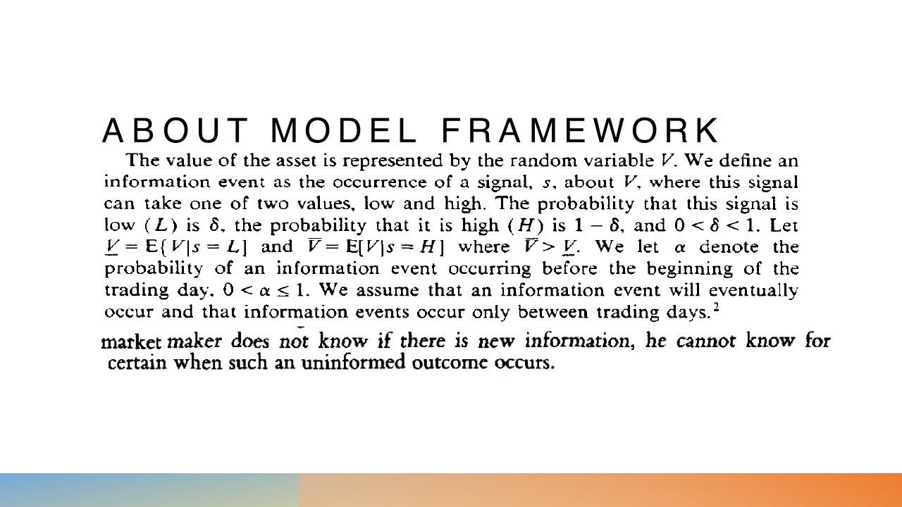{width=75%}
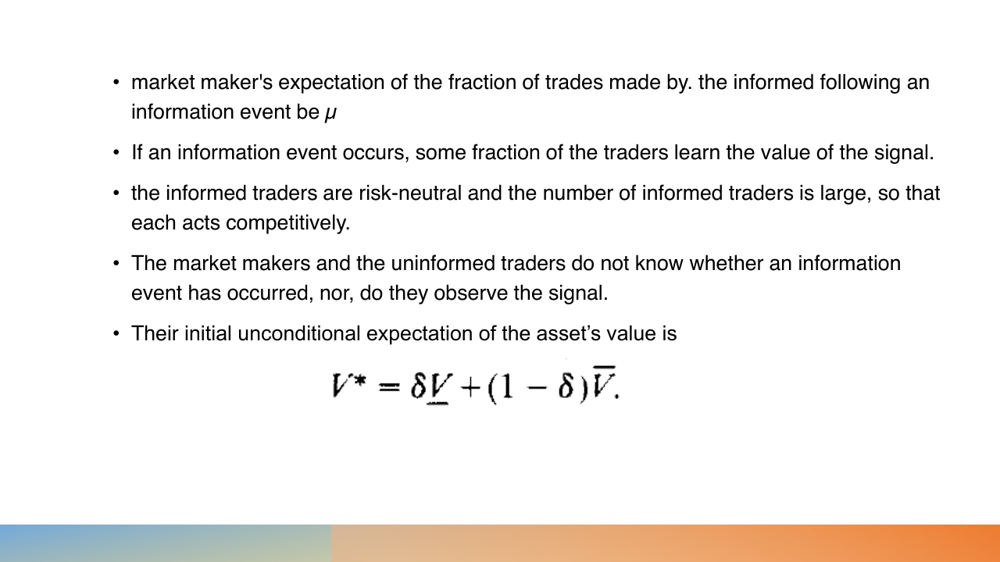{width=75%}
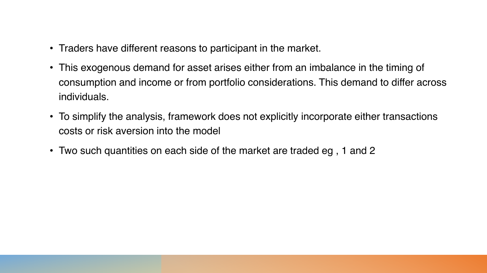{width=75%}
### 7.3 Market structure (slides 37 to 40)

**There are two sizes on each side.**

| Side | Small size | Large size | Rule |
|---|---|---|---|
| Buyers want | $B^1$ | $B^2$ | $0< B^1< B^2$ |
| Sellers offer | $S^1$ | $S^2$ | $0< S^1< S^2$ |
| Share of uninformed who want each size | $X_B^1$, $X_S^1$ | $X_B^2$, $X_S^2$ | All positive |

**Trading is sequential.**

| Step | What happens |
|---|---|
| 1 | A trader arrives according to these probabilities |
| 2 | The trader asks competing dealers for prices at each quantity |
| 3 | The trader may choose not to trade |
| 4 | An uninformed trader takes the best quote for the desired quantity |
| 5 | An informed trader takes the quote with the highest profit |
| 6 | A trader who is indifferent picks a dealer at random |

**Dealers set schedules.**

| Point | What it says |
|---|---|
| Choice | Each dealer picks a profit-maximizing schedule, given the schedules of the others |
| Timing | At the start of the day, the dealer sets a price for each quantity |
| Profit | Each trade has zero expected profit |
| Scope | Prices are needed only for the four quantities |


**The tree of events (from the slide diagram):**

1. Before trading, an information event happens with probability $\alpha$. No event happens with probability $1-\alpha$.
2. After an event, the signal is low with probability $\delta$. It is high with probability $1-\delta$.
3. After a low signal, the informed share $\mu$ of traders sells.
4. After a high signal, the informed share $\mu$ of traders buys.
5. With no event, all traders are uninformed.


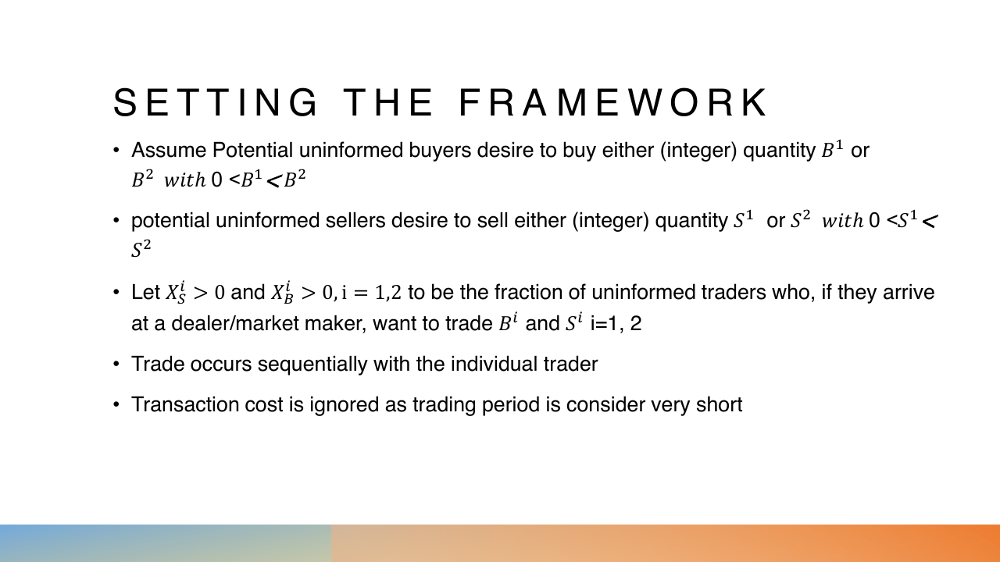{width=75%}
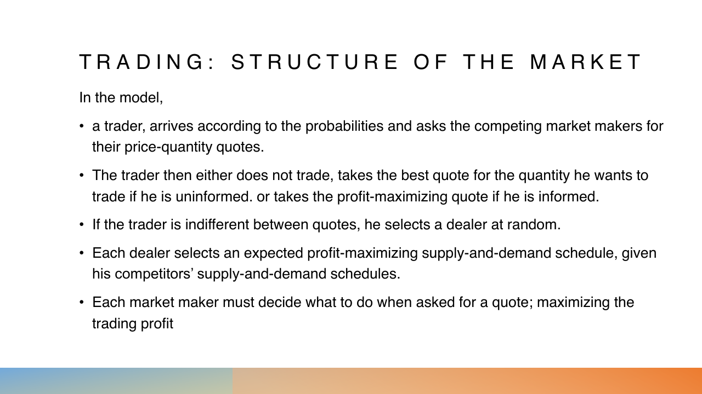{width=75%}
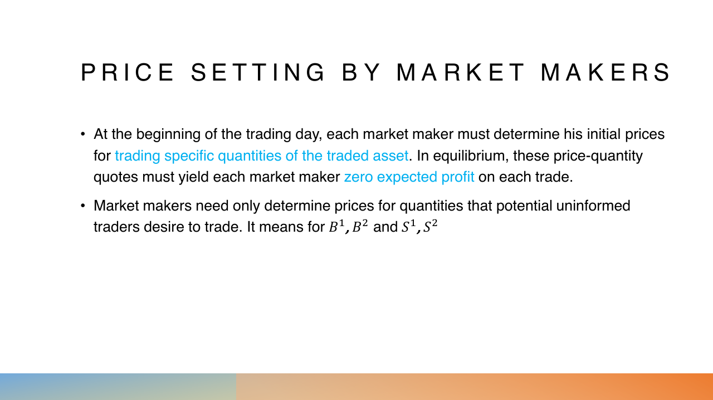{width=75%}
### 7.4 $\star$ Two equilibria (slides 41 and 43)

::: {.hook title="Two equilibria: few informed means Fork, many informed means Mix"}
**Separating (few informed, a fork).** The informed trade only the large size. So small trades are safe, and $a_1=b_1=V^{\ast}$. Only large trades carry a spread.

**Pooling (many informed, a mix).** The informed trade both sizes. The dealer cannot tell the types apart. So both sizes carry a spread.
:::


| Point | Separating equilibrium | Pooling equilibrium |
|---|---|---|
| Size chosen by the informed | Mainly large | Both small and large |
| Number of informed traders | Relatively few | Many |
| Can the dealer separate types? | Yes, partly by size | No, the types are hard to tell apart |
| Where is the spread? | Only on large trades | On both sizes |
| Effect on price | Large trades get worse prices | Prices are averaged and may hide the true price |

In pooling, both types choose the same action at the same price with positive probability.

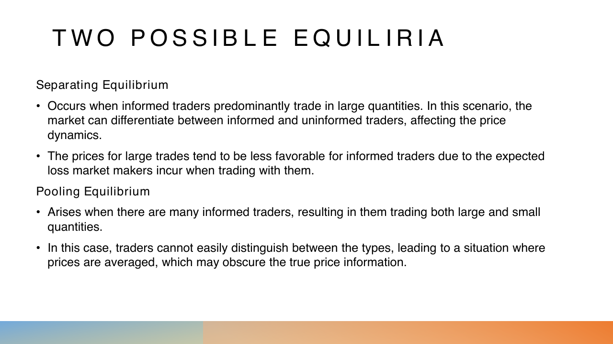{width=75%}
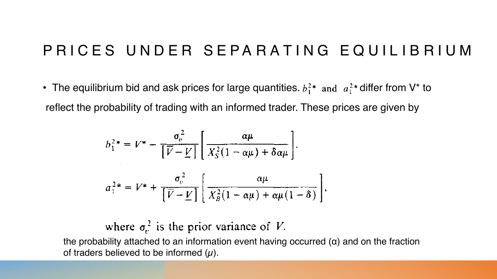{width=75%}
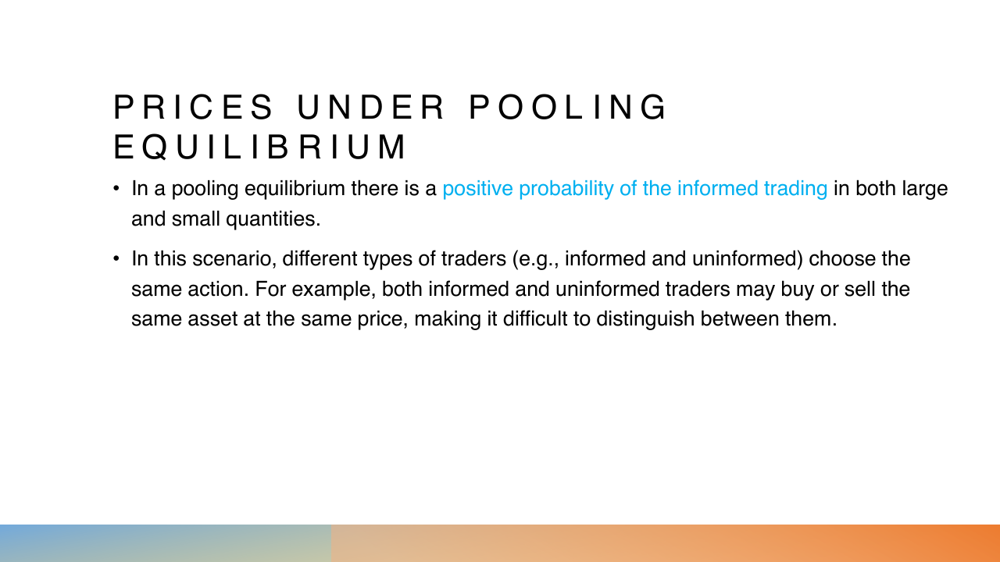{width=75%}
### 7.5 $\star$ Separating prices step by step (slide 42)

::: map
1. Two groups sell large. The uninformed sellers have weight $X_S^2(1-\alpha\mu)$, and they are worth $V^{\ast}$ on average. The informed sellers, after an event and a low signal, have weight $\alpha\delta\mu$, and they are worth $\underline{V}$.
2. The large bid is the weighted average of these two values. This is the Glosten and Milgrom rule again:
$$b_2=\frac{X_S^2(1-\alpha\mu)\,V^{\ast}+\alpha\delta\mu\,\underline{V}}{X_S^2(1-\alpha\mu)+\alpha\delta\mu}$$
3. Writing $V^{\ast}-\underline{V}$ with the variance $\sigma_v^2$ turns this into the slide's form:
$$b_2^{\ast}=V^{\ast}-\frac{\sigma_v^2}{\bar{V}-\underline{V}}\cdot\frac{\alpha\mu}{X_S^2(1-\alpha\mu)+\delta\alpha\mu}$$
The large ask is the same, with buyers, $X_B^2$ and $(1-\delta)$ in place of $\delta$.
4. Separation holds only if the informed buyer prefers the large size: $B^2(\bar{V}-a_2)\ge B^1(\bar{V}-V^{\ast})$. This gives
$$\frac{B^2}{B^1}\ge 1+\frac{\alpha\mu(1-\delta)}{X_B^2(1-\alpha\mu)}$$
If this fails, the informed also trade small, and the result is pooling.
:::
::: {.hook title="The large bid in words"}
The large bid is **$V^{\ast}$ minus (the variance over the range) times (the informed over all large sellers, without the $\delta$ on top)**.

In a numerical, skip the formula. Take the weighted average from move 2 of the proof map.
:::


**Step 1: List the ways a large sale can happen.**

| State | Who sells large | Joint probability with a large sale |
|---|---|---|
| Event and low signal | All informed, and uninformed who want $S^2$ | $\alpha\delta[\mu+(1-\mu)X_S^2]$ |
| Event and high signal | Only uninformed who want $S^2$ | $\alpha(1-\delta)(1-\mu)X_S^2$ |
| No event | Only uninformed who want $S^2$ | $(1-\alpha)X_S^2$ |

**Step 2: Add them.**

| Line | Expression | Why |
|---|---|---|
| a | $\alpha\delta\mu+X_S^2[\alpha\delta(1-\mu)+\alpha(1-\delta)(1-\mu)+(1-\alpha)]$ | Collect the $X_S^2$ terms |
| b | $\alpha\delta(1-\mu)+\alpha(1-\delta)(1-\mu)=\alpha(1-\mu)$ | $\delta+(1-\delta)=1$ |
| c | $\alpha(1-\mu)+1-\alpha=1-\alpha\mu$ | Open and cancel $\alpha$ |

$$\Pr(S^2)=X_S^2(1-\alpha\mu)+\alpha\delta\mu$$

**Step 3: Find the expected value.** Uninformed sales are worth $V^{\ast}$ on average. Informed sales are worth $\underline{V}$. Weight each by its share of $\Pr(S^2)$.

$$b_2=\frac{X_S^2(1-\alpha\mu)V^{\ast}+\alpha\delta\mu\underline{V}}{X_S^2(1-\alpha\mu)+\alpha\delta\mu}$$

**Step 4: Take $V^{\ast}$ outside.**

| Line | Expression | Why |
|---|---|---|
| a | Numerator $=[X_S^2(1-\alpha\mu)+\alpha\delta\mu]V^{\ast}-\alpha\delta\mu(V^{\ast}-\underline{V})$ | Add and subtract $\alpha\delta\mu V^{\ast}$ |
| b | First part divided by the denominator is $V^{\ast}$ | The bracket equals the denominator |

$$b_2=V^{\ast}-\frac{\alpha\mu\delta(V^{\ast}-\underline{V})}{X_S^2(1-\alpha\mu)+\alpha\delta\mu}$$

**Step 5: Use the variance.**

| Line | Expression | Why |
|---|---|---|
| a | $V^{\ast}-\underline{V}=(1-\delta)(\bar{V}-\underline{V})$ | Put in $V^{\ast}=\delta\underline{V}+(1-\delta)\bar{V}$ |
| b | $\sigma_v^2=\delta(1-\delta)(\bar{V}-\underline{V})^2$ | Variance of a two-point value |
| c | $\delta(V^{\ast}-\underline{V})=\sigma_v^2/(\bar{V}-\underline{V})$ | Multiply line a by $\delta$ and use line b |

$$b_2^{\ast}=V^{\ast}-\frac{\sigma_v^2}{\bar{V}-\underline{V}}\cdot\frac{\alpha\mu}{X_S^2(1-\alpha\mu)+\delta\alpha\mu}$$

**Step 6: Repeat the steps for a large buy.** The informed buy with a high signal, so $1-\delta$ replaces $\delta$ in the denominator.

$$a_2^{\ast}=V^{\ast}+\frac{\sigma_v^2}{\bar{V}-\underline{V}}\cdot\frac{\alpha\mu}{X_B^2(1-\alpha\mu)+(1-\delta)\alpha\mu}$$

**Step 7: Price small trades.** The informed never trade small here. So a first small trade has no adverse selection.

$$a_1=b_1=V^{\ast}$$

**Step 8: Check that the informed prefer the large size.** A buyer needs $B^2(\bar{V}-a_2)\ge B^1(\bar{V}-V^{\ast})$.

| Line | Expression | Why |
|---|---|---|
| a | $\bar{V}-V^{\ast}=\delta(\bar{V}-\underline{V})$ | Definition of $V^{\ast}$ |
| b | $\bar{V}-a_2=\delta(\bar{V}-\underline{V})\cdot\frac{X_B^2(1-\alpha\mu)}{X_B^2(1-\alpha\mu)+(1-\delta)\alpha\mu}$ | Put in $a_2$ from Step 6 and line a |
| c | $\frac{B^2}{B^1}\ge\frac{\bar{V}-V^{\ast}}{\bar{V}-a_2}$ | Divide the condition by $B^1(\bar{V}-a_2)$ |
| d | $\frac{\bar{V}-V^{\ast}}{\bar{V}-a_2}=\frac{X_B^2(1-\alpha\mu)+(1-\delta)\alpha\mu}{X_B^2(1-\alpha\mu)}$ | Divide line a by line b |

$$\frac{B^2}{B^1}\ge 1+\frac{\alpha\mu(1-\delta)}{X_B^2(1-\alpha\mu)}$$

| Case | Result |
|---|---|
| The large size is large enough, or $\alpha\mu$ is small enough | Separation holds |
| Otherwise | The informed also trade small, and pooling results |

**Conclusion:** The large-trade discount rises with $\alpha$, $\mu$ and the variance of value.

### 7.6 Pooling prices (slide 43)

Let a share $\phi_i$ of informed sellers choose size $i$. Use the same steps.

$$b_i=V^{\ast}-\frac{\sigma_v^2}{\bar{V}-\underline{V}}\cdot\frac{\alpha\mu\phi_i}{X_S^i(1-\alpha\mu)+\delta\alpha\mu\phi_i}$$

| Point | Result |
|---|---|
| Both bids | Below $V^{\ast}$, so both sizes carry a spread |
| Informed sellers | Must earn the same profit at both sizes |

### 7.7 Spread calculation (slide 44)

The slide writes $H$ for an informed trader, $L$ for an uninformed trader and $C$ for costs and risk premium. It prints $B=E[V\mid H]-C$, $A=E[V\mid L]+C$ and $S=E[V\mid L]-E[V\mid H]+2C$.

> **Slide error:** The dealer cannot see the type of trader, so a quote cannot depend on it. The dealer sees only the side and the size. These are the correct forms for size $i$.

$$A_i=E[V\mid B^i]+C$$

$$B_i=E[V\mid S^i]-C$$

$$S_i=E[V\mid B^i]-E[V\mid S^i]+2C$$

The model itself assumes $C=0$.

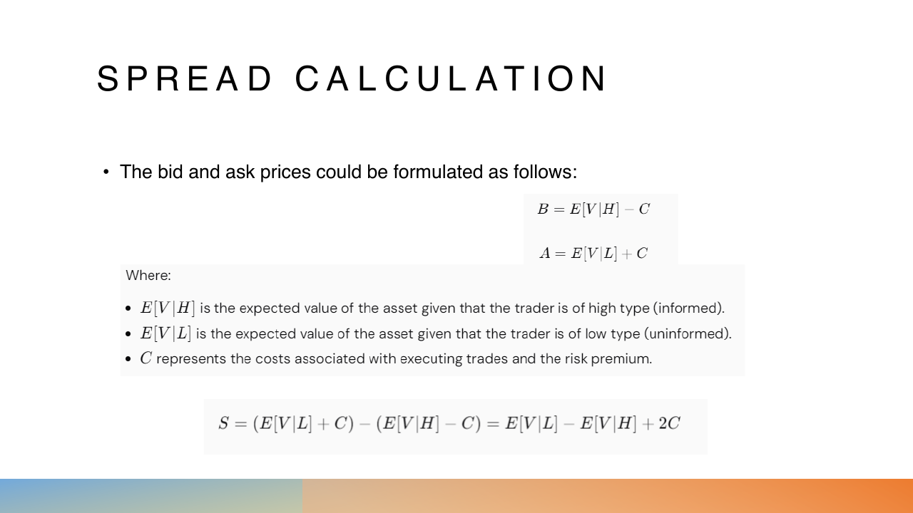{width=75%}
### 7.8 $\star$ Price path after a block sale (slides 45 and 46)

::: {.hook title="Price path: known event means stuck, unsure event means bounce part way"}
At time $t$, a small trade happens at $V^{\ast}$. At $t+1$, a block sale pushes the price down to $b_2$.

- If the event is **known** (Figure 1), a small trade at $t+2$ says nothing new. So the price **stays** at $b_2$.
- If the event is **uncertain** (Figure 2), only the uninformed trade small. So a small trade makes "no event" more likely. The price **recovers part way**, but it stays below $V^{\ast}$.
:::


```text
Figure 1: only the trader type is uncertain (an event is known)

V*    o
       \
b2      o---------o
        t+1      t+2

Figure 2: the trader type and the event are both uncertain

V*    o
       \
        \         o     partial recovery, still below V*
         \       /
b2        o-----
        t+1      t+2
```

| Time | Figure 1: event known | Figure 2: event uncertain |
|---|---|---|
| t | A small trade happens at $V^{\ast}$ | A small trade happens at $V^{\ast}$ |
| t+1 | A block sale pushes the price down to $b_2$ | A block sale pushes the price down to $b_2$ |
| t+2 | A small trade says nothing new. The price stays at the low level | A small trade comes only from an uninformed trader. It makes "no event" more likely. The price recovers partly |

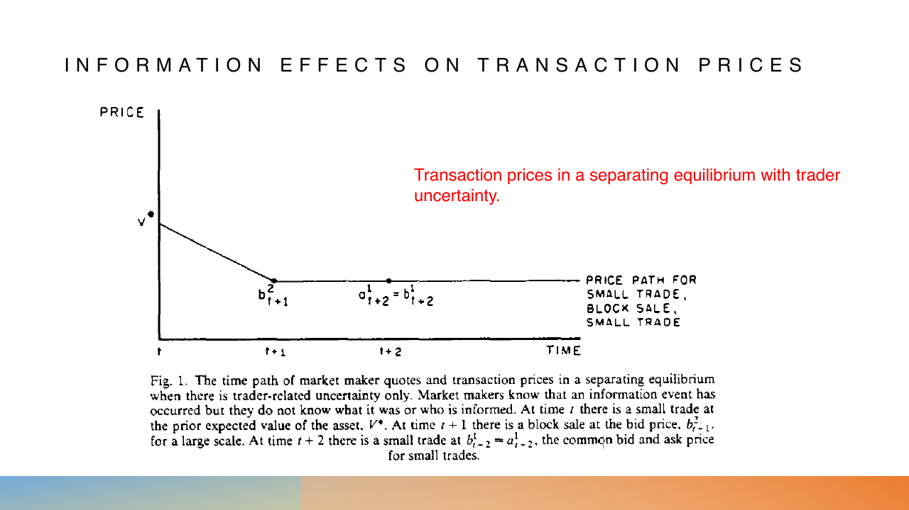{width=75%}
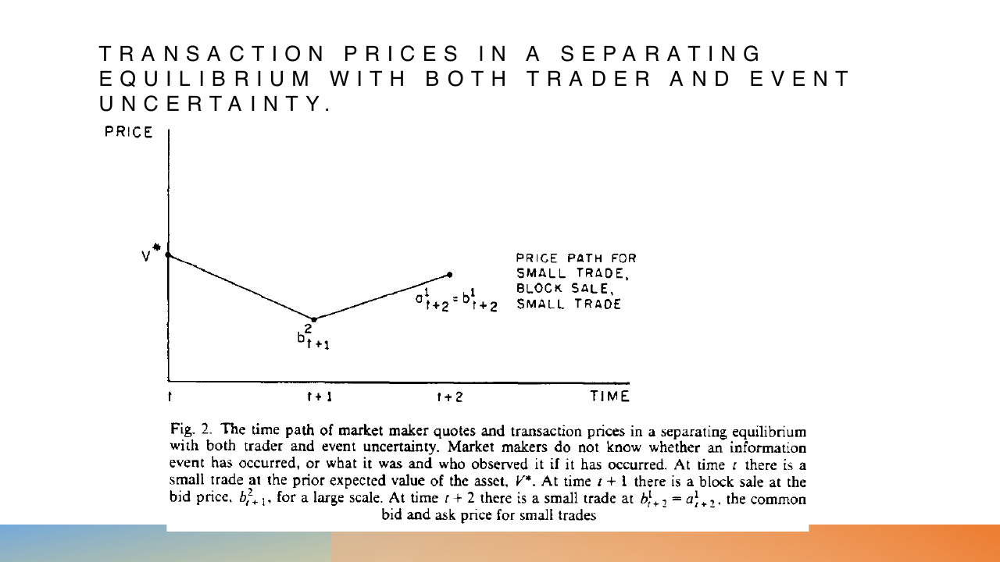{width=75%}
### 7.9 Worked example

**Data:** $\bar{V}=110$, $\underline{V}=90$, $\delta=0.5$, $\alpha=0.5$, $\mu=0.4$ and $X_S^2=X_B^2=0.25$.

| Step | Working | Result |
|---|---|---|
| 1. Prior value | $V^{\ast}=0.5(90)+0.5(110)$ | 100 |
| 2. Variance | $\sigma_v^2=0.5(0.5)(20)^2$ | 100 |
| 3. Product $\alpha\mu$ | $0.5(0.4)$ | 0.2 |
| 4. Denominator | $0.25(0.8)+0.5(0.2)$ | 0.3 |
| 5. Adjustment | $(100/20)(0.2/0.3)$ | 3.333 |
| 6. Large quotes | $100-3.333$ and $100+3.333$ | Large bid 96.667, large ask 103.333 |
| 7. Small quotes | $a_1=b_1=V^{\ast}$ | Both small prices are 100 |
| 8. Separation condition | $1+0.2(0.5)/[0.25(0.8)]=1+0.1/0.2$ | Needs $B^2/B^1\ge 1.5$ |

**After the block sale, a small trade arrives.** Only uninformed traders trade small. They are a share $1-\mu=0.6$ of traders after an event, and all traders with no event.

| State | Weight after the block sale (Step 1 of 7.5) | Times the chance of an uninformed trader | New weight | Value |
|---|---|---|---|---|
| Event, low signal | $0.25(0.4+0.6(0.25))=0.1375$ | 0.6 | 0.0825 | 90 |
| Event, high signal | $0.25(0.6)(0.25)=0.0375$ | 0.6 | 0.0225 | 110 |
| No event | $0.5(0.25)=0.125$ | 1 | 0.125 | 100 |
| Total | 0.3 | | 0.23 | |

| Step | Working | Result |
|---|---|---|
| 9. Price of the small trade | $[0.0825(90)+0.0225(110)+0.125(100)]/0.23=22.4/0.23$ | 97.391 |
| 10. Meaning | 97.391 lies between 96.667 and 100 | This shows the partial recovery |


::: {.box title="Formulas: Easley and O'Hara"}
1. $V^{\ast}=\delta\underline{V}+(1-\delta)\bar{V}$, and $\sigma_v^2=\delta(1-\delta)(\bar{V}-\underline{V})^2$.
2. The large bid is the average of $V^{\ast}$, with weight $X_S^2(1-\alpha\mu)$, and $\underline{V}$, with weight $\alpha\delta\mu$.
3. The large ask is the average of $V^{\ast}$, with weight $X_B^2(1-\alpha\mu)$, and $\bar{V}$, with weight $\alpha(1-\delta)\mu$.
4. In the separating equilibrium, the small quotes are $a_1=b_1=V^{\ast}$.
5. Separation needs $B^2/B^1\ge 1+\alpha\mu(1-\delta)/[X_B^2(1-\alpha\mu)]$.
6. For a small trade after a block, take the three state weights after the block sale. Multiply each weight by the chance that the trader is uninformed: $1-\mu$ after an event, and 1 with no event. Then average the values with these weights.
:::


### 7.10 $\star$ Findings (slide 47)

::: {.hook title="Findings: BQIO"}
- **B**lock trades move prices, because of informed trading.
- **Q**uantity is correlated with private information.
- **I**nformed traders prefer larger amounts at any given price.
- **O**ptimal pricing depends on quantity. Prices of large trades show a higher probability of informed trading.
:::


| Finding | What it says |
|---|---|
| Block trades | Their price effects come from informed trading |
| Quantity matters | Trade size is correlated with private information |
| Informed preference | At any given price, informed traders prefer larger amounts |
| Optimal pricing | The price depends on quantity. Large-trade prices show a higher probability of informed trading |

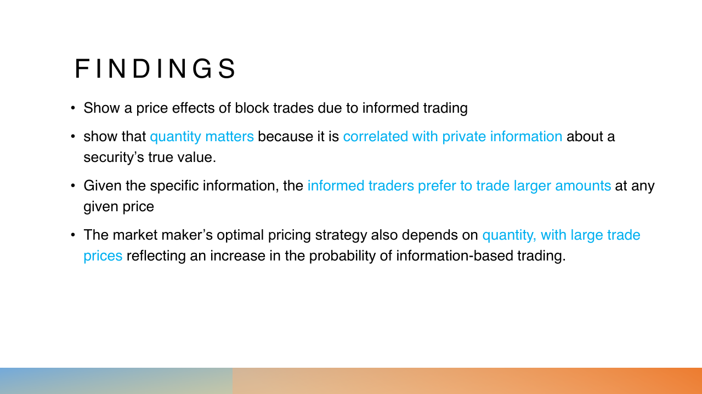{width=75%}
## 8. $\star$ Compare the five theories

::: {.hook title="Recognize the model from one word"}
- The word "option" points to Copeland and Galai.
- The words "regret free", "Bayes" or "sequential" point to Glosten and Milgrom.
- The words "batch", "strategic" or "order flow" point to Kyle.
- The words "size", "block" or "event uncertainty" point to Easley and O'Hara.
:::


| Point | Bagehot | Copeland and Galai | Glosten and Milgrom | Kyle | Easley and O'Hara |
|---|---|---|---|---|---|
| Time | No formal model | One period | Sequential | One batch, later many | Sequential |
| Dealer | Loses and recovers | Maximizes profit | Earns zero profit | Earns zero profit | Earns zero profit |
| Informed trader | Not modelled | Takes a free option | Trades one unit | Chooses size strategically | Chooses one of two sizes |
| Does the dealer learn? | No | No | From direction | From net order flow | From direction, size and sequence |
| Liquidity measure | Spread | Spread | Spread | $1/\lambda$ | Spread at each size |
| Is the event certain? | Not modelled | Yes | Yes | Yes | No |

> **Exam:** The word "option" points to Copeland and Galai. "Regret free", "Bayes" and "sequential" point to Glosten and Milgrom. "Batch", "strategic" and "order flow" point to Kyle. "Size", "block" and "event uncertainty" point to Easley and O'Hara.


\newpage

# Topic 2: Liquidity Measures and Applications

These notes follow the deck "1.5 Empirical Liquidity and it characteristics", slides 1 to 34. Section 5 covers Lesmond (2005), which is not in the slides.

Everything in this file is exam material. A $\star$ marks what to know without notes. Worked examples use made-up numbers to practise the slide formulas.

| Paper | Question | Measure | Answer |
|---|---|---|---|
| Chordia, Roll and Subrahmanyam (2000) | Does liquidity move together across stocks? | Spreads and depth | Yes, there is commonality |
| Amihud (2002) | Does illiquidity affect returns? | Absolute return per dollar traded | Less liquid stocks must pay higher returns |
| Lesmond (2005) | Which measure works in emerging markets? | LOT, Roll, Amihud and others | LOT and Roll work best across countries |
| Ince (2022) | Which part of illiquidity is priced? | Three parts of illiquidity | The idiosyncratic part predicts returns |
| Stoll (2000) | What causes friction? | Seven friction measures | Friction has real and informational parts |

## 0. Words to know first

| Term | Meaning |
|---|---|
| Liquidity | The ability to trade a large size, quickly, at low cost, when you want to |
| Immediacy | Trading now without waiting |
| Mid price | $P_M=(P_A+P_B)/2$ |
| Price impact | How much a trade moves the price |
| Commonality | The liquidity of many stocks moves together |
| Premium | The extra return that investors demand |
| Coefficient | The size and direction of an effect |
| t value | Tells whether the coefficient differs from zero. An absolute value above about 2 is significant |


::: {.hook title="Five papers: CALIS"}
Each paper answers one question. The first letters spell **CALIS**.

- **C**hordia (2000) asks whether liquidity moves together. The answer is yes, which is commonality.
- **A**mihud (2002) asks whether illiquidity is priced. The answer is yes: illiquid stocks pay higher returns.
- **L**esmond (2005) asks which measure works in emerging markets. LOT and Roll work best across countries.
- **I**nce (2022) asks which part of illiquidity is priced. The idiosyncratic part predicts returns.
- **S**toll (2000) asks what causes friction. Friction has a real part and an informational part.
:::


## 1. Background (slides 2 and 3)

The deck has three main papers. They are Chordia and others (2000), Amihud (2002) and Ince (2022).

| No. | Paper | Contribution |
|---|---|---|
| 1 | Amihud and Mendelson (1986) | Introduced the spread as a proxy for illiquidity |
| 2 | Chordia and others (2000) | Documented commonality in liquidity |
| 3 | Chordia and others (2001) | Studied the cross-sectional relation with the level of illiquidity |
| 4 | Huberman and Halka (2001) | Found a systematic part of liquidity that changes over time |

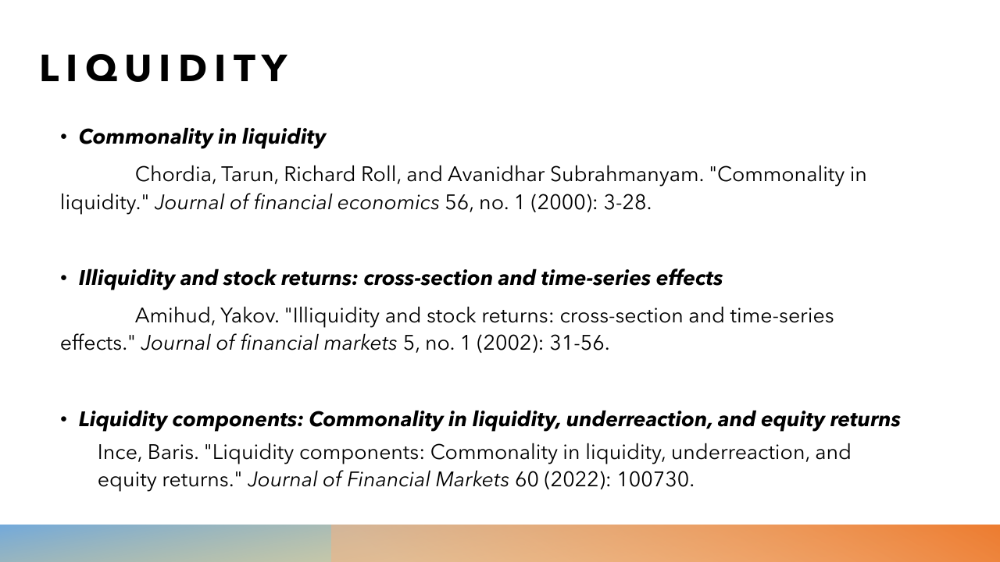{width=75%}
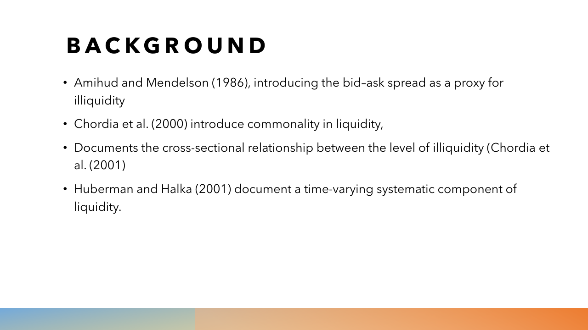{width=75%}
## 2. Chordia, Roll and Subrahmanyam (2000): "Commonality in liquidity" (slides 4 to 18)

### 2.1 The gap (slide 4)

| Point | What it says |
|---|---|
| Earlier studies looked at one stock at a time | They gave little attention to common causes of liquidity |
| Liquidity moves together | Changes in liquidity are correlated across stocks |
| Two causes of change | Inventory risk and asymmetric information both change liquidity over time |
| Common causes | Trading cost and other microstructure effects have common determinants |

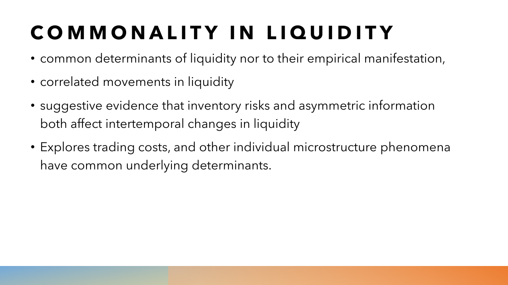{width=75%}
### 2.2 $\star$ Seven reasons for commonality (slide 5)

::: {.hook title="Seven reasons: PVIVP, plus F, plus I"}
The first five letters read the same both ways, like a palindrome. All five are **inventory** reasons.

- **P**rice swings make market-wide trading respond.
- **V**olume drives dealer inventories together.
- **I**nterest rates set the cost of carrying inventory.
- **V**olatility gives inventory risk a market part.
- **P**rogram trading puts common pressure on many inventories.

Then come two more. **F**unds: institutional funds with similar styles trade alike. **I**nformation: a few large traders may know about many stocks.
:::


| No. | Reason | How it makes liquidity move together | Type |
|---|---|---|---|
| 1 | Price swings | Trading activity across the market responds to market-wide price swings | Inventory |
| 2 | Volume | Volume drives dealer inventory. So the desired inventory levels of dealers move together | Inventory |
| 3 | Interest rates | The cost of carrying inventory depends on market interest rates | Inventory |
| 4 | Volatility | Inventory risk depends on volatility. Volatility has a market component | Inventory |
| 5 | Program trading | It puts common pressure on many inventories at once | Inventory |
| 6 | Institutional funds | Funds with similar styles trade in a similar way | Correlated trading |
| 7 | Asymmetric information | A small group of large traders may know more about many stocks | Information |

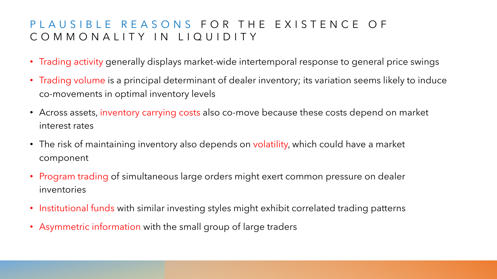{width=75%}
### 2.3 Implications (slide 6)

| Implication | What it says |
|---|---|
| Covariation | Liquidity moves together |
| Trading cost | The costs of trading also move together |
| Crises | Liquidity crises can be episodic. They can also be global |
| A liquidity factor | Trading cost has a common factor. See Amihud and Mendelson (1986) and Brennan and Subrahmanyam (1996) |
| Asset prices | Liquidity affects prices through two channels, in the next table |

| Channel | What matters | Effect |
|---|---|---|
| Static | The average cost of trading | A costly stock must pay a higher return |
| Dynamic | The risk that liquidity changes | Traders avoid trading, so a risky-liquidity stock must pay more |

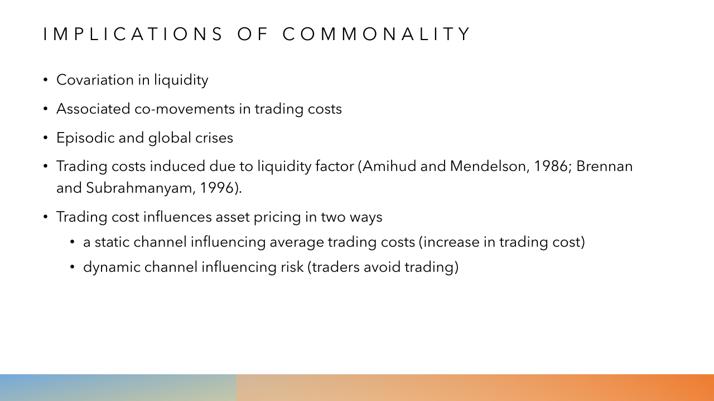{width=75%}
### 2.4 Data (slides 7 and 8)

::: {.hook title="Data: 92, 1169, 254, two dollars"}
Remember four numbers in order. The data is NYSE (ISSM) for the year **1992**. There are **1,169** stocks. There are **254** trading days. Stock-days with a price below **\$2** are deleted.
:::


| Item | Detail |
|---|---|
| Source | NYSE transaction data from the Institute for the Study of Security Markets |
| Period | The year 1992. It has 254 trading days |
| Sample | 1,169 stocks. Each traded at least once on 10 or more days |
| Excluded stocks | Stocks with splits or stock dividends, certificates, ADRs, non-US firms, Americus Trust, closed-end funds and REITs |
| Price filter | A stock-day is deleted if the average price is below 2 dollars |
| Trade filter | The opening batch and special-settlement trades are removed |
| NYSE feature | The specialist announces the spread and depth some seconds before a trade |
| Daily value | Each measure is averaged over all trades of that stock on that day |

{width=75%}
{width=75%}
### 2.5 $\star$ The five measures (slide 9)

::: {.hook title="Five measures: quoted uses the mid, effective uses the trade price and has a 2"}
The quoted spreads use the mid quote. The effective spreads use the trade price, and they carry a factor of 2.

Depth is the **only** measure where a higher value means **more** liquid.
:::


| Symbol | Name | Formula | Unit | Higher value means |
|---|---|---|---|---|
| QSPR | Quoted spread | $P_A-P_B$ | Dollars | Less liquidity |
| PQSPR | Proportional quoted spread | $(P_A-P_B)/P_M$ | Pure number | Less liquidity |
| DEP | Depth | $(Q_A+Q_B)/2$ | Shares | More liquidity |
| ESPR | Effective spread | $2\lvert P_t-P_M\rvert$ | Dollars | Less liquidity |
| PESPR | Proportional effective spread | $2\lvert P_t-P_M\rvert/P_t$ | Pure number | Less liquidity |

| Symbol | Meaning |
|---|---|
| $P_t$ | The trade price |
| $Q_A$ and $Q_B$ | The shares offered at the ask and the bid |

**Worked example:** The bid is 99.80 and the ask is 100.20. A buy happens at 100.10. The depths are 600 at the bid and 400 at the ask.

| Step | Measure | Working | Result |
|---|---|---|---|
| 1 | Quoted spread | $100.20-99.80$ | 0.40 |
| 2 | Mid price | $(100.20+99.80)/2$ | 100 |
| 3 | Proportional quoted spread | $0.40/100$ | 0.004 |
| 4 | Depth | $(600+400)/2$ | 500 shares |
| 5 | Effective spread | $2\lvert 100.10-100\rvert=2(0.10)$ | 0.20 |
| 6 | Proportional effective spread | $0.20/100.10$ | 0.002 |
| 7 | Compare | 0.20 against 0.40 | The effective spread is smaller because the trade is inside the quotes |

> **Exam:** The effective spread has a 2 in it. The proportional quoted spread divides by the mid price. The proportional effective spread divides by the trade price.

{width=75%}
### 2.6 Cross-sectional statistics (slide 10)

| Measure | Mean | Median | Standard deviation |
|---|---|---|---|
| QSPR | 0.3162 | 0.2691 | 1.3570 |
| PQSPR | 0.0160 | 0.0115 | 0.0136 |
| DEP | 3776 | 2661 | 3790 |
| ESPR | 0.2245 | 0.1791 | 1.3051 |
| PESPR | 0.0111 | 0.0077 | 0.0132 |

| Correlation | PQSPR | DEP | ESPR | PESPR |
|---|---|---|---|---|
| QSPR | 0.844 | -0.396 | 0.665 | 0.555 |
| PQSPR | | -0.303 | 0.549 | 0.699 |
| DEP | | | -0.228 | -0.156 |
| ESPR | | | | 0.871 |

| What we see | Why |
|---|---|
| Effective below quoted | Many trades happen inside the quotes |
| Mean above median | A few illiquid stocks pull the mean up |
| Spreads agree | All spread measures have positive correlation with each other |
| Depth is opposite | A wide spread comes with low depth |

{width=75%}
### 2.7 Daily changes (slide 11)

The letter D means the proportional change from the previous day.

$$DL_t=\frac{L_t-L_{t-1}}{L_{t-1}}$$

| Absolute change | Mean | Median | Standard deviation |
|---|---|---|---|
| DQSPR | 0.2396 | 0.2373 | 0.0741 |
| DPQSPR | 0.2408 | 0.2386 | 0.0742 |
| DDEP | 0.7828 | 0.6543 | 0.4533 |
| DESPR | 0.3148 | 0.2976 | 0.1367 |
| DPESPR | 0.3196 | 0.2977 | 0.1811 |

Liquidity changes a lot from day to day. Depth changes the most.

{width=75%}
### 2.8 $\star$ Test 1: market commonality (slides 12 and 13)

::: {.hook title="Test 1: one number, 0.69, and one range, 69 to 85"}
The quoted-spread coefficient on the same day is **0.69**. So a 1 percent change in the market spread goes with a 0.69 percent change in the stock's spread.

Between **69 and 85** percent of stocks have a positive coefficient. The same-day coefficient is much larger than the lag and the lead.
:::


$$DL_{j,t}=\alpha_j+\beta_jDL_{M,t}+\varepsilon_{j,t}$$

| Part | Meaning |
|---|---|
| $DL_{j,t}$ | The change in liquidity of stock $j$ |
| $DL_{M,t}$ | The change in average market liquidity on the same day |
| $\beta_j> 0$ | The stock moves with the market. This is commonality |
| Extra terms | The regression also has a lag and a lead of the market change |
| Table notation | t values are in brackets. "Significant" means positive with t above 1.645 |

| Item | DQSPR | DPQSPR | DDEP | DESPR | DPESPR |
|---|---|---|---|---|---|
| Same day | 0.690 (28.29) | 0.791 (30.09) | 1.373 (15.50) | 0.280 (10.64) | 0.778 (2.06) |
| Percent positive | 84.86 | 84.26 | 81.61 | 68.61 | 71.00 |
| Percent significant | 34.65 | 33.27 | 31.05 | 14.88 | 14.29 |
| Lag | 0.123 (4.72) | 0.169 (6.46) | -0.047 (-0.72) | 0.058 (2.63) | 0.179 (1.80) |
| Percent positive | 58.60 | 59.80 | 47.65 | 53.04 | 55.95 |
| Percent significant | 8.81 | 9.50 | 4.62 | 6.93 | 7.96 |
| Lead | 0.053 (2.33) | 0.050 (1.87) | 0.336 (5.55) | 0.042 (1.99) | -0.156 (-0.65) |
| Percent positive | 55.35 | 56.29 | 56.54 | 53.21 | 55.00 |
| Percent significant | 6.84 | 7.01 | 7.19 | 5.73 | 6.76 |

| Result | What it says |
|---|---|
| Main result | The same-day coefficient is positive for all five measures |
| Breadth | About 69 to 85 percent of stocks have a positive coefficient |
| Timing | The same day matters much more than the lag or the lead |
| Reading a number | A value of 0.69 means that a 1 percent change in the market spread goes with a 0.69 percent change in the stock spread |

{width=75%}
{width=75%}
### 2.9 Test 2: market and industry (slide 14)

$$DL_{j,t}=\alpha_j+\beta_{j,M}DL_{M,t}+\beta_{j,I}DL_{I,t}+\varepsilon_{j,t}$$

Here $DL_{I,t}$ is the change in average industry liquidity.

| Measure | Market, same day | Industry, same day | Market, sum | Industry, sum | Mean R-squared |
|---|---|---|---|---|---|
| DQSPR | 0.264 (9.86) | 0.467 (16.65) | 0.409 | 0.530 | 0.024 |
| DPQSPR | 0.505 (14.06) | 0.287 (11.08) | 0.642 | 0.386 | 0.022 |
| DDEP | 0.721 (6.17) | 0.614 (7.28) | 1.030 | 0.596 | 0.014 |
| DESPR | 0.164 (5.26) | 0.414 (7.51) | 0.260 | 0.429 | 0.020 |
| DPESPR | -0.172 (-0.60) | 0.970 (1.81) | -0.468 | 1.285 | 0.018 |

| Result | What it says |
|---|---|
| Two sources | Both the market and the industry matter |
| Sum | It adds the same day, the lag and the lead |
| Small power | The regression explains only about 2 percent of daily changes. Most changes are specific to the firm |

{width=75%}
### 2.10 Test 3: inventory risk or information (slides 15 and 16)

| Idea used | Source |
|---|---|
| The number of trades indicates asymmetric information | Jones and others, 1994 |
| Stealth trading: informed traders break up orders. They are most active in medium sizes | Barclay and Warner, 1993 |
| The trading frequency of a stock is strongly influenced by the market and the industry | Slide 15 |

$$DL_{j,t}=\alpha_j+\beta_SDS_{j,t}+\beta_TDT_{j,t}+\beta_MDV_{M,t}+\beta_IDV_{I,t}+\varepsilon_{j,t}$$

| Variable | Meaning | What it stands for |
|---|---|---|
| $S$ | Average dollar size of a trade in the stock | Block pressure or information |
| $T$ | Number of trades in the stock | Asymmetric information |
| $V_M$ | Market dollar volume without stock $j$ | Balanced, uninformed trading |
| $V_I$ | Industry dollar volume without stock $j$ | Trading in the industry |

{width=75%}
{width=75%}
### 2.11 Observations (slide 17)

| Variable | Effect | Explanation |
|---|---|---|
| Trading in general | The usual view: more trading should reduce spreads | Inventory view |
| Number of transactions | Spreads rise with it. It has a strong positive effect on spreads | Informed traders |
| Market volume | Negative and marginal effect on the quoted spread | Balanced, uninformed trading |
| Trade size | Strong positive effect on the quoted spread and on depth | Block pressure or information |
| Industry volume | Its effect on depth is negative and not significant | No clear effect |

{width=75%}
### 2.12 $\star$ Conclusion (slide 18)

::: {.hook title="Conclusion: together, own trades widen, market trades tighten"}
1. **Together.** The liquidity of individual stocks moves together.
2. **Own trades widen.** A stock's spread rises with its own number of trades. This is asymmetric information.
3. **Market trades tighten.** The spread falls with market-wide trading. That trading is mostly uninformed and balances inventory.
:::


| No. | Conclusion | Which theory |
|---|---|---|
| 1 | Liquidity measures of individual stocks move together | Commonality |
| 2 | The spread of a stock rises with its own number of transactions | Asymmetric information |
| 3 | The spread falls with market-wide trading, because such trading is mostly uninformed and balances inventory | Inventory risk |

> **Exam:** Write in this order: meaning, reasons, data, five measures, regression, sign and conclusion. One number is enough: the quoted spread coefficient is 0.69.

{width=75%}

::: {.box title="Formulas: Chordia, Roll and Subrahmanyam"}
1. Quoted spread: QSPR $=P_A-P_B$.
2. Proportional quoted spread: PQSPR $=(P_A-P_B)/P_M$.
3. Depth: DEP $=(Q_A+Q_B)/2$.
4. Effective spread: ESPR $=2\lvert P_t-P_M\rvert$.
5. Proportional effective spread: PESPR $=2\lvert P_t-P_M\rvert/P_t$.
6. Daily change: $DL_t=(L_t-L_{t-1})/L_{t-1}$.
7. Test 1: $DL_{j,t}=\alpha_j+\beta_jDL_{M,t}+\varepsilon_{j,t}$.

Example: the bid is 99.80, the ask is 100.20, a buy happens at 100.10, and the depth is 600 at the bid and 400 at the ask. Then QSPR $=0.40$, $P_M=100$, PQSPR $=0.004$, DEP $=500$, ESPR $=0.20$ and PESPR $=0.002$.
:::


## 3. Amihud (2002): "Illiquidity and stock returns: cross-section and time-series effects" (slides 19 to 25)

{width=75%}
{width=75%}
### 3.1 The idea

| Point | What it says |
|---|---|
| Illiquidity | A stock is illiquid if a small traded value moves the price a lot |
| Advantage | The measure needs only daily returns and daily volume. It needs no quote data |
| Claim | Investors demand a higher expected return for an illiquid stock |

### 3.2 $\star$ The measure (slide 21)

::: {.hook title="ILLIQ: absolute return per dollar, ratio first, then average"}
For each day, divide the absolute return by the dollar volume. Then take the average of these daily ratios over the year. Do not divide the average return by the average volume.

A higher ILLIQ means **less** liquid. Amivest is the upside-down cousin: total volume over total absolute return. A higher Amivest means **more** liquid.
:::


$$ILLIQ_{iy}=\frac{1}{D_{iy}}\sum_{d=1}^{D_{iy}}\frac{\lvert R_{iyd}\rvert}{VOLD_{iyd}}$$

| Symbol | Meaning |
|---|---|
| $R_{iyd}$ | Return of stock $i$ on day $d$ of year $y$ |
| $VOLD_{iyd}$ | Dollar volume on that day |
| $D_{iy}$ | Number of days with data in that year |

| Point | What it says |
|---|---|
| Meaning | The average absolute return per dollar traded. It is a price impact measure |
| Direction | A higher value means less liquidity |
| Related measure | The Amivest ratio is total volume divided by total absolute return. See Cooper and others (1985) and Khan and Baker (1993). A higher Amivest ratio means more liquidity |

**Worked example:**

| Day | Return | Volume in million dollars | Absolute return per million dollars |
|---|---|---|---|
| 1 | 0.02 | 10 | 0.002 |
| 2 | -0.01 | 5 | 0.002 |
| 3 | 0.03 | 10 | 0.003 |

| Step | Working | Result |
|---|---|---|
| 1. Ratio for each day | $0.02/10$, $0.01/5$, $0.03/10$ | 0.002, 0.002, 0.003 |
| 2. Add the last column | $0.002+0.002+0.003$ | 0.007 |
| 3. Divide by three days | $0.007/3$ | ILLIQ is 0.002333 per million dollars |
| 4. Total volume | $10+5+10$ | 25 |
| 5. Total absolute return | $0.02+0.01+0.03$ | 0.06 |
| 6. Amivest ratio | $25/0.06=416.67$ | 416.67 million dollars per unit return |

> **Exam:** Take the ratio for each day first. Then take the average. Do not divide the average return by the average volume. Always state the unit.

{width=75%}
### 3.3 Is it a good measure? (slide 22)

The test compares it with two measures from detailed trade data.

$$ILLIQ_i=-292+247.9\lambda_i+49.2\psi_i$$

| Term | Meaning | t value |
|---|---|---|
| Intercept | $-292$ | 12.25 |
| $\lambda_i$ | Kyle's price impact | 13.78 |
| $\psi_i$ | The fixed-cost part of the spread | 17.33 |
| R-squared | 0.30 | |

Both slopes are positive. So the simple measure agrees with the detailed measures.

{width=75%}
### 3.4 $\star$ Effect on returns: data and method (slides 23 and 24)

::: {.hook title="Data: NYSE 63 to 97, 408 months, Fama-MacBeth"}
The data is NYSE stocks from 1963 to 1997, from CRSP. Returns are adjusted for delisting (Shumway 1997). The characteristics come from year $y-1$.

Fama-MacBeth has three steps. Run one cross-section regression each month. Save the coefficients. Average them over the 408 months, and test the average against zero.
:::


| Item | Detail |
|---|---|
| Market | NYSE stocks from 1963 to 1997 |
| Source | CRSP daily and monthly |
| Method | Fama and MacBeth (1973) |
| Tests | One cross-section in each month from 1964 to 1997. That is 408 months |
| Delisting | Returns are adjusted for delisting (Shumway, 1997). This avoids survivorship bias |
| Timing | Each stock characteristic comes from year $y-1$. So it is known at the start of year $y$ |

$$R_{imy}=k_{0my}+\sum_{j=1}^{J}k_{jmy}X_{ji,y-1}+U_{imy}$$

| Symbol | Meaning |
|---|---|
| $R_{imy}$ | Return of stock $i$ in month $m$ of year $y$ |
| $X_{ji,y-1}$ | Characteristic $j$ from the previous year, such as illiquidity |
| $k_{jmy}$ | Price of that characteristic in that month |
| $U_{imy}$ | Error term |

The method has three steps.

| Step | What we do |
|---|---|
| 1 | Run one regression across stocks in each month |
| 2 | Save the coefficients of each month |
| 3 | Average them over 408 months and test whether the average is zero |

{width=75%}
{width=75%}
### 3.5 Findings

::: {.hook title="Findings: Expected means Extra return later, Unexpected means Ugly return now"}
- **Expected** market illiquidity raises the expected excess return later.
- **Unexpected** illiquidity raises the required return at once. So the price $D/r$ falls, and the return now is negative.
- Both effects are stronger for **small** firms. This is the flight to liquidity.
:::


The findings slide (slide 25) is blank in our deck. The [midsem liquidity notes](../pre-midsem/2_liquidity/liquidity_measures.html), section 3, list them.

{width=75%}

::: {.box title="Formulas: Amihud"}
1. ILLIQ is the yearly average of the daily ratio $\lvert R_d\rvert/VOLD_d$. Always state the unit.
2. Amivest $=\sum VOLD_d/\sum\lvert R_d\rvert$.
3. A surprise in illiquidity: with a dividend $D$ forever, the price is $P=D/r$. A higher $r$ lowers the price now.

Example: returns $0.02,-0.01,0.03$ and volumes 10, 5 and 10 million dollars. The ratios are $0.002,0.002,0.003$. ILLIQ $=0.002333$ per million dollars. Amivest $=25/0.06=416.67$.
Surprise example: $D=5$. At $r=10\%$, $P=50$. At $r=12.5\%$, $P=40$. The return now is $-20\%$.
:::


## 4. Ince (2022): liquidity components (slides 26 to 28 and slide 34)

{width=75%}
{width=75%}
### 4.1 What the paper does

::: {.hook title="Ince: ASI, and only I survives"}
Monthly firm illiquidity has three parts: **A**lpha (a constant for the firm), **S**ystematic (moves with the market) and **I**diosyncratic (specific to the firm).

The systematic premium disappears once very small stocks are removed. The idiosyncratic part predicts returns.
:::


The paper splits the monthly illiquidity of a firm into three parts.

| No. | Part | What it is |
|---|---|---|
| 1 | Alpha | The constant part for that firm |
| 2 | Systematic | It moves with the market |
| 3 | Idiosyncratic | It is specific to the firm |

### 4.2 Findings

| Part | Finding |
|---|---|
| Systematic premium | It disappears when very small stocks are removed |
| Idiosyncratic part | High idiosyncratic liquidity gives positive future risk-adjusted returns. Low idiosyncratic liquidity gives negative ones |

### 4.3 Data (slide 34)

This slide sits after Stoll in the deck, but it belongs to Ince.

| Item | Detail |
|---|---|
| Stocks | Common stocks on NYSE, Amex and Nasdaq |
| Period | January 1964 to December 2018 |
| Source | CRSP |

{width=75%}
### 4.4 Other articles on commonality (slide 28)

| Article | Cause or finding |
|---|---|
| Kamara and others (2008), Koch and others (2009) | Correlated trading by institutions |
| Morck and others (2000) | Weak incentive to trade individual securities |
| Huberman and Halka (2001) | Investor sentiment |
| Coughenour and Saad (2004), Hameed and others (2010) | Funding limits of intermediaries |
| Karolyi and others (2012) | Evidence from 40 markets |

{width=75%}
## 5. Lesmond (2005): "Liquidity of emerging markets"

The paper is in the Journal of Financial Economics, volume 77, pages 411 to 452.

> **Source:** The full paper is behind a paywall, and I did not read it. The main findings below come from parts of the abstract and from summaries, both shown by web search. The LOT model in 5.4 comes from the original 1999 paper. The last column of the table in 5.3 is explanation. It is not a claim of the paper.

### 5.1 The problem

| Point | What it says |
|---|---|
| Data is missing | Many emerging markets lack long records of bids and asks |
| Cost still matters | Trading can be very costly in these markets |
| Solution | Estimate liquidity from daily prices and volume |
| Question | Which low-frequency measure works across countries and within a country? |

### 5.2 Setting

| Item | Detail |
|---|---|
| Markets | Summaries say that it covers 31 emerging markets. One citing paper says 23 |
| Period | A summary of the paper reports 1987 to 2000 |
| Test | It compares five liquidity measures with quoted spreads, where spreads are available |
| Named measures | Search summaries name LOT, Roll, Amihud and turnover. I remember the fifth as Amivest, but I did not verify this |

### 5.3 The measures

| Measure | Formula | Type | Data needed | Main weakness |
|---|---|---|---|---|
| LOT | $\alpha_2-\alpha_1$ | Price based | Daily returns of stock and market | It needs an estimation model |
| Roll | $2\sqrt{-\mathrm{Cov}(\Delta P_t,\Delta P_{t-1})}$ | Price based | Daily prices | It fails when covariance is positive |
| Amihud | Average of absolute return over traded value | Price impact | Returns and volume | It fails with zero volume |
| Turnover | Shares traded over shares outstanding | Volume based | Volume and share count | Volume can rise in a crisis while cost also rises |

### 5.4 $\star$ The LOT model (Lesmond, Ogden and Trzcinka, 1999)

::: {.hook title="LOT: the no-trade band"}
An investor trades only if the value of the news beats the trading cost. Inside the band $[\alpha_1,\alpha_2]$, nobody trades, so the observed return is **zero**.

So **many zero-return days mean a high cost**. The width of the band is the round-trip cost: $LOT=\alpha_2-\alpha_1$.
:::
::: map
1. The true return follows the market model: $R^{\ast}_{jt}=\beta_jR_{mt}+\varepsilon_{jt}$.
2. Below the band, the observed return is $R^{\ast}-\alpha_1$. Inside the band, it is 0. Above the band, it is $R^{\ast}-\alpha_2$.
3. Maximum likelihood over the three kinds of days picks $\alpha_1$, $\alpha_2$, $\beta$ and the error variance.
4. The selling cost $-\alpha_1$ plus the buying cost $\alpha_2$ gives the round-trip cost $LOT=\alpha_2-\alpha_1$.
:::


**Idea:** An investor trades only if the value of information exceeds the cost of trading. Otherwise the price does not move. So many zero-return days indicate high trading cost.

**Assumptions:**

| No. | Assumption |
|---|---|
| A1 | The true return $R^{\ast}$ follows the market model |
| A2 | Selling needs a true return below $\alpha_1$, where $\alpha_1< 0$ |
| A3 | Buying needs a true return above $\alpha_2$, where $\alpha_2> 0$ |
| A4 | The marginal informed investor trades only beyond these limits |
| A5 | The error is normal |

| Step | What we do |
|---|---|
| 1 | Write the true return |
| 2 | Write what we observe in each of the three regions |
| 3 | Estimate by maximum likelihood |
| 4 | Take the difference of the two limits |

**Step 1: Write the true return.**

$$R^{\ast}_{jt}=\beta_jR_{mt}+\varepsilon_{jt}$$

**Step 2: Write what we observe in each of the three regions.**

| True return | Observed return | Meaning |
|---|---|---|
| $R^{\ast}<\alpha_1$ | $R=R^{\ast}-\alpha_1$ | Bad news is larger than the selling cost |
| $\alpha_1\le R^{\ast}\le\alpha_2$ | $R=0$ | News is too small, so the return is zero |
| $R^{\ast}>\alpha_2$ | $R=R^{\ast}-\alpha_2$ | Good news is larger than the buying cost |

**Step 3: Estimate by maximum likelihood.**

| Part of the likelihood | Days it covers |
|---|---|
| Falls | Days with $R< 0$ |
| Zeros | Days with $R=0$ |
| Rises | Days with $R> 0$ |

It chooses $\alpha_1$, $\alpha_2$, $\beta$ and the error variance to make the observed returns most likely.

**Step 4: Take the difference.**

| Cost | Value |
|---|---|
| Selling cost | $-\alpha_1$ |
| Buying cost | $\alpha_2$ |
| Round-trip cost | Their sum |

$$LOT=\alpha_2-\alpha_1$$

**Worked example:** Take $\alpha_1=-0.010$ and $\alpha_2=0.015$.

| Step | Case | Working | Result |
|---|---|---|---|
| 1 | Round-trip cost | $0.015+0.010=0.025$ | 2.5 percent |
| 2 | True return 0.025, above $\alpha_2$ | $0.025-0.015=0.010$ | Observed 0.010 |
| 3 | True return 0.007, between the limits | No trade | Observed zero |
| 4 | True return -0.018, below $\alpha_1$ | $-0.018+0.010=-0.008$ | Observed -0.008 |

The 1999 paper estimated round-trip costs of 1.2 percent for the largest US firms and 10.3 percent for the smallest, for 1963 to 1990.

**Simpler cousin:** The share of zero-return days also measures illiquidity. Bekaert, Harvey and Lundblad report that Lesmond (2005) found it highly correlated with hand-collected spreads in emerging markets.

### 5.5 $\star$ Findings

::: {.hook title="Findings: across countries LOT and Roll, within a country LOT then Amihud"}
1. Across countries, the price-based measures LOT and Roll work best.
2. Within a country, LOT works best, and Amihud works to a lesser extent.
3. Weak political and legal institutions mean a higher liquidity cost.
4. More political risk adds 10 basis points of cost by LOT and 1.9 percent of price impact by Amihud.
5. Politics beats law: political risk looks stronger than the information risk from legal institutions.
:::


| No. | Topic | Finding |
|---|---|---|
| 1 | Across countries | The price-based measures, LOT and Roll, work better than volume-based measures |
| 2 | Within a country | LOT works best. Amihud works to a lesser extent |
| 3 | Institutions | Countries with weak political and legal institutions have significantly higher liquidity cost. The abstract says that this holds "even to the exclusion of legal origin or insider trading enforcement" |
| 4 | Political risk | More political risk goes with 10 basis points higher cost by LOT. It goes with 1.9 percent higher price impact by Amihud |
| 5 | Which risk is stronger | Political risk appears stronger than information risk created by legal institutions |

> **Exam:** Remember the pair. LOT and Roll are for comparisons across countries. LOT and then Amihud are for comparisons within a country. Then add institutions and political risk.


::: {.box title="Formulas: LOT"}
1. $LOT=\alpha_2-\alpha_1$.
2. The observed return is $R^{\ast}-\alpha_2$ above the band, $R^{\ast}-\alpha_1$ below it, and 0 inside it.

Example: $\alpha_1=-0.010$ and $\alpha_2=0.015$. So LOT $=0.025$, or 2.5 percent. A true return of 0.025 is observed as 0.010. A true return of 0.007 is observed as 0. A true return of $-0.018$ is observed as $-0.008$.
:::


## 6. Stoll (2000): "Friction" (slides 29 to 33)

### 6.1 What friction means (slide 30)

::: {.hook title="Two views of friction: time or price, and Stoll pays the price"}
Friction can be seen as time (Lippman and McCall) or as price (Demsetz). Stoll uses the price view. Friction is the price concession paid for immediacy.
:::


| View | Friction is | Source |
|---|---|---|
| Time | The time needed to trade a given amount optimally | Lippman and McCall (1986) |
| Price | The price concession paid for immediacy | Demsetz (1968) |

Stoll uses the price view.

{width=75%}
### 6.2 What the paper does (slide 29)

| Item | Detail |
|---|---|
| Focus | It studies the sources of trading friction |
| Measures | It builds seven robust measures from transaction data |
| Sample | 1,706 NYSE and AMSE stocks and 2,184 Nasdaq stocks |
| Insights | The size of cost, real against informational friction, and the effect of market structure |
| Relations | How the measures relate to each other and to trading characteristics |

{width=75%}
### 6.3 Price of immediacy (slides 31 and 32)

::: {.hook title="Signs: volume and price shrink it, variance grows it, MV and N flip by market"}
- $\log V$ has a negative sign, because inventory is easier to unload.
- $\sigma^2$ has a positive sign, because of inventory risk.
- $\log P$ has a negative sign, because a fixed cost is spread over a higher price.
- $\log MV$ and $\log N$ are positive on NYSE and AMSE, and negative on Nasdaq.

The adjusted $R^2$ is 0.77 for NYSE and AMSE, and 0.65 for Nasdaq.
:::


$$s=a_0+a_1\log V+a_2\sigma^2+a_3\log MV+a_4\log P+a_5\log N+e$$

| Symbol | Meaning |
|---|---|
| $s=(A-B)/2P$ | The proportional quoted half-spread |
| $V$ | Daily dollar volume |
| $\sigma^2$ | Return variance |
| $MV$ | Market value |
| $P$ | Price |
| $N$ | Trades per day |

Results for December 1997 have t values in brackets.

| Variable | NYSE and AMSE | Nasdaq | Why |
|---|---|---|---|
| Intercept | 0.0207 | 0.0384 | It is the base level |
| Log volume | -0.0010 (-9.35) | -0.0012 (-5.95) | Inventory is easier to unload |
| Variance | 1.5467 (16.74) | 0.4908 (7.56) | Inventory risk is higher |
| Log market value | 0.0003 (3.56) | -0.0003 (-2.18) | The sign differs by market |
| Log price | -0.0024 (-21.15) | -0.0020 (-9.51) | Fixed cost is spread over a higher price |
| Log trades | 0.0003 (2.63) | -0.0011 (-5.60) | The sign differs by market |
| Adjusted R-squared | 0.7731 | 0.6467 | The fit is strong |

January and February 1998 give similar results.

| Month | NYSE and AMSE adjusted R-squared | Nasdaq adjusted R-squared |
|---|---|---|
| January 1998 | 0.7763 | 0.6588 |
| February 1998 | 0.7914 | 0.6688 |

{width=75%}
{width=75%}
### 6.4 Real and informational friction (slide 33)

::: {.hook title="Two kinds of friction: real and informational"}
**Real** friction uses up resources: labour, systems, and capital to bear inventory risk. **Informational** friction moves wealth from the less informed to the better informed.
:::
::: {.box title="Formulas: Stoll"}
1. Stoll uses **half**-spreads. The quoted half-spread is $S=(A-B)/2$. The effective half-spread is $ES=\lvert P-M\rvert$.
2. Chordia uses **full** spreads. So Chordia's effective spread is 2 times Stoll's.
:::


| Friction | What it is |
|---|---|
| Real friction | Trading uses real resources, such as labour, systems and capital to bear inventory risk |
| Informational friction | Wealth moves from less informed traders to better informed traders |

| Measure | Formula | What it contains |
|---|---|---|
| Quoted half-spread | $S=(A-B)/2$ | Total friction |
| Effective half-spread | $ES=\lvert P-M\rvert$ | Total friction on actual trades |
| Traded spread | Not given. The slide says "refer to article". | Not given |

> **Exam:** Stoll uses half-spreads. Chordia uses full spreads. So Chordia's effective spread is twice Stoll's.

{width=75%}

\newpage

# Topic 3: Triggers of Extreme Illiquidity

These notes follow the deck "4. Extreme illiquidity in Market", slides 1 to 13.

Everything in this file is exam material. A $\star$ marks what to know without notes. Worked examples use made-up numbers to practise the slide formulas.

| Part | Source | Main point |
|---|---|---|
| Theory | Brunnermeier and Pedersen (2009) | Market liquidity and funding liquidity feed each other |
| Evidence | Margin history of S&P 500 futures | Margins jump in a crisis |
| Measure | Jain, Mishra and McInish (2013) | Count bad spread days and bad price days over 10 days |
| Effect | The same paper | Spirals lower firm valuation |

## 0. Words to know first

| Term | Meaning |
|---|---|
| Market liquidity | How easily an asset can be traded |
| Funding liquidity | How easily a trader can obtain money to trade |
| Speculator | A trader who supplies liquidity by buying cheap and selling dear. Dealers and hedge funds are examples |
| Financier | The bank or broker who lends to the speculator |
| Margin | The part of a position that the trader must pay with their own capital. A haircut means the same thing for a collateral loan |
| Deleveraging | Selling positions to reduce borrowing |
| Spiral | A loop in which a bad event causes more of itself |
| Fundamental volatility | The variation of the true value |
| Flight to quality | Capital moves out of risky assets and into safe assets |

## 1. Why extreme cases are critical (slide 2)

| No. | Principle | What it says |
|---|---|---|
| 1 | Liquidity is key | A market cannot work well without it |
| 2 | Trading should govern change | Changes should come from the trading of participants |
| 3 | Outside factors should not rule | External factors should not influence the liquidity of an asset or of the market |

In an extreme case, funding can decide liquidity. This breaks principle 3. This is why these cases need study.

{width=75%}
## 2. Brunnermeier and Pedersen (2009): "Market liquidity and funding liquidity" (slides 3 and 4)

The paper is in the Review of Financial Studies, volume 22, issue 6, pages 2201 to 2238.

{width=75%}
{width=75%}
### 2.1 $\star$ The main idea

::: {.hook title="Market liquidity belongs to the asset, funding liquidity belongs to the trader"}
Market liquidity asks whether an asset can be sold easily near its true value. Funding liquidity asks whether a trader can get money to hold a position. Each one feeds the other, so they can form a spiral.
:::


| Point | What it says |
|---|---|
| The link | The model links market liquidity and funding liquidity |
| First direction | Traders provide market liquidity. They can do this only when they have funding |
| Second direction | Funding means capital and margin. Both depend on how liquid the assets are |
| The danger | Under some conditions margins are destabilizing. The two kinds of liquidity then reinforce each other |
| The result | This gives liquidity spirals |

| Point | Market liquidity | Funding liquidity |
|---|---|---|
| Belongs to | An asset or a market | A trader |
| Question | Can I sell easily near the true value? | Can I get money to hold this position? |
| Measured by | Spread, depth and price impact | Margin, haircut and cost of borrowing |
| Fails when | Buyers disappear | Lenders demand more capital |

### 2.2 Why capital limits liquidity supply

::: {.hook title="X is at most W over m"}
Own capital must pay the margin share $m$ of the position. So $mX\le W$, which gives $X\le W/m$.

- When $W$ falls, the top of the fraction shrinks. This is the **loss spiral**.
- When $m$ rises, the bottom of the fraction grows. This is the **margin spiral**.
:::


| Symbol | Meaning |
|---|---|
| $W$ | Capital of the speculator |
| $m$ | Margin rate, a share between 0 and 1 |
| $X$ | Position in money |

| Line | Expression | Why |
|---|---|---|
| 1 | Capital needed $=mX$ | The trader pays the share $m$ of the position from own capital |
| 2 | $mX\le W$ | The trader cannot use more capital than $W$ |
| 3 | $X\le W/m$ | Divide both sides by $m$, which is positive |

$$X\le\frac{W}{m}$$

| Change | Effect on the largest position $W/m$ | Spiral |
|---|---|---|
| Capital $W$ falls | Numerator falls, so the limit falls | Loss spiral |
| Margin $m$ rises | Denominator rises, so the limit falls | Margin spiral |

## 3. $\star$ Five features of liquidity (slide 5)

::: {.hook title="Five features: Dry, Common, Volatile, Flees, Follows"}
1. **Dry:** liquidity can suddenly dry up.
2. **Common:** many securities become illiquid together.
3. **Volatile:** volatile assets are less liquid.
4. **Flees:** in a flight to quality, risky assets lose more liquidity.
5. **Follows:** liquidity falls when the market falls.

The same five are the findings of the spiral paper in Topic 4.
:::


| Feature | What happens | Why, in the model |
|---|---|---|
| It can suddenly dry up | Liquidity vanishes quickly | Financiers are imperfectly informed and raise margins when volatility changes |
| It has commonality | Many securities become illiquid together | The same speculators supply liquidity in all of them |
| It is related to volatility | Volatile assets are less liquid | Volatile assets need higher margins |
| It shows flight to quality | Risky assets lose more liquidity than safe ones | Scarce capital moves to assets with low margins |
| It moves with the market | Liquidity falls when the market falls | Funding conditions move with the market |

> **Exam:** These five features are an easy question. Write each feature with its reason.

{width=75%}
## 4. Extreme market events (slide 6)

::: {.hook title="Margins rise exactly when the market needs traders"}
Margins were about 4 percent before 1987. They went above 12 percent on Black Monday. In every later crisis (1989, 1990 to 1991, the Asian crisis, LTCM in 1998, subprime in 2007 to 2008), margins rose again.
:::


The chart shows margins on S&P 500 futures from 1982 to 2008. The margins are for exchange members. They are a percent of contract value. Initial margin equals maintenance margin for members. Each dot is a change in the dollar margin. The levels below are read from the chart, so they are approximate.

| Event | Year | Margin |
|---|---|---|
| Before the crash | 1982 to 1987 | About 4 percent |
| Black Monday | 19 October 1987 | Above 12 percent |
| Calm period | 1989 | About 3 percent |
| Mini-crash | 1989 | It rises again |
| US and Iraq war | 1990 to 1991 | About 6.4 percent |
| Calm period | 1997 | About 2 percent |
| Asian crisis | 1997 | About 3.8 percent |
| LTCM collapse | 1998 | About 5.5 percent |
| Subprime crisis | 2007 to 2008 | It rises from about 4 to about 5 percent |

Margins rise when markets are in trouble. So traders lose funding exactly when the market needs them.

{width=75%}
## 5. $\star$ The liquidity spiral (slide 7)


**The loop (from the slide diagram):**

1. Initial losses cause funding problems for speculators.
2. Funding problems force speculators to reduce their positions.
3. Reduced positions push prices away from fundamentals.
4. Prices away from fundamentals cause higher margins. This is the margin spiral.
5. Prices away from fundamentals also cause losses on existing positions. This is the loss spiral.
6. Both spirals lead back to funding problems, so the loop starts again.


{width=75%}
### 5.1 Triggers

::: {.hook title="Four triggers: LFVF"}
- **L**oss: a first loss.
- **F**unding shock: lenders cut credit.
- **V**olatility shock: financiers cannot tell news from illiquidity, so they raise margins.
- **F**orced sale: a large trader must unwind, and others may predate.
:::


| No. | Trigger | What happens |
|---|---|---|
| 1 | A first loss | Speculators lose capital |
| 2 | A funding shock | Lenders cut credit or capital is withdrawn |
| 3 | A volatility shock | Financiers cannot tell news from illiquidity. They raise margins |
| 4 | A forced sale | A large trader must unwind. Others may predate, as Topic 4 explains |

### 5.2 The loop step by step

::: map
1. A trader suffers a loss.
2. The loss causes a funding problem.
3. The trader must sell, so prices move away from fundamentals.
4. Lower prices cause more losses on the remaining positions. This is the loss spiral.
5. Higher volatility makes financiers raise margins. This is the margin spiral.
6. Both spirals make the funding problem worse, so the loop starts again, stronger each time.
:::


| Step | What happens | Name |
|---|---|---|
| 1 | Speculators suffer an initial loss | Trigger |
| 2 | They face funding problems | Funding liquidity falls |
| 3 | They reduce their positions | Deleveraging |
| 4 | Their selling moves prices away from fundamentals | Market liquidity falls |
| 5 | The price fall creates losses on the positions that remain | **Loss spiral** |
| 6 | The price movement also makes lenders raise margins | **Margin spiral** |
| 7 | Steps 5 and 6 send the trader back to step 2. The loop repeats and becomes stronger | Spiral |

| Point | Loss spiral | Margin spiral |
|---|---|---|
| What changes | Capital $W$ falls | Margin $m$ rises |
| Cause | Price fall on existing positions | Financier fears volatility and illiquidity |
| Is leverage changed? | The trader sells to keep leverage constant | The trader must cut leverage |
| Needs a higher margin? | No | Yes |

### 5.3 Worked example

A speculator has capital of 10. The margin is 10 percent. The speculator holds the largest position allowed.

| Step | What we find | Working | Result |
|---|---|---|---|
| 1 | First position | $W/m=10/0.10$ | 100 |
| 2 | Loan | $100-10$ | 90 |
| 3 | Position after a 3 percent price fall | $100(1-0.03)$ | 97 |
| 4 | Capital after the fall | Position minus loan: $97-90$ | 7 |
| 5 | Allowed position at the old margin | $7/0.10$ | 70 |
| 6 | Loss spiral sale | $97-70$ | 27 |
| 7 | Allowed position at the new margin of 14 percent | $7/0.14$ | 50 |
| 8 | Margin spiral sale | $70-50$ | 20 more |
| 9 | Total sale | $27+20$ | 47 out of 97 |

**Conclusion:** A price fall of 3 percent forced the sale of 47 out of 97. This selling pushes the price down again.


::: {.box title="Formulas: the spiral numbers"}
1. The position is $X=W/m$, and the loan is $X-W$.
2. After a price fall of $f$, the position is worth $X(1-f)$. The new capital is $W'=X(1-f)-\text{loan}$.
3. The loss-spiral sale is $X(1-f)-W'/m$. The margin-spiral sale is $W'/m-W'/m'$.

Example: $W=10$ and $m=10\%$, so $X=100$ and the loan is 90. A 3 percent fall makes the position 97 and $W'=7$. At a 10 percent margin, the trader may hold 70, so they sell 27. At a 14 percent margin, they may hold 50, so they sell 20 more. In total, 47 of 97 are sold after a 3 percent fall.
:::


## 6. Empirical measure: Jain, Mishra and McInish (2013) (slide 8)

::: {.hook title="Spiral scores: +1 is always bad"}
For spreads, bad means **up**. For prices, bad means **down**. So the inequalities point opposite ways in the two measures.

Two tests must both hold. First, the value moves against yesterday. Second, the value is beyond the band, which is last year's mean plus or minus **half** a standard deviation. Otherwise the score is 0.

Add the scores of the last 10 days. A large positive sum means the stock is in a spiral.
:::


Pankaj K. Jain, Ajay K. Mishra and Thomas H. McInish wrote "Identification and valuation implications of financial market spirals". It is in the book Rethinking Valuation and Pricing Models, from page 471.

> **Exam:** This is the professor's own paper. Learn its two definitions and the sign of its results.

The paper builds two measures for the equity market.

| No. | Measure | Based on | Bad direction |
|---|---|---|---|
| 1 | Illiquidity spiral | The spread | The spread rises |
| 2 | Loss spiral | The price | The price falls |

{width=75%}
### 6.1 $\star$ Illiquidity spiral (slide 9)

| Symbol | Meaning |
|---|---|
| $s_t$ | Today's spread |
| $s_{t-1}$ | Yesterday's spread |
| $\bar{s}$ | Average spread of the previous year |
| $\sigma_s$ | Standard deviation of the spread in that year |

**Step 1: Give each day a score.**

| Condition 1 | Condition 2 | Score $S_t$ | Equation |
|---|---|---|---|
| $s_t< s_{t-1}$ | $s_t<\bar{s}-0.5\sigma_s$ | -1 | 29.1 |
| $s_t> s_{t-1}$ | $s_t>\bar{s}+0.5\sigma_s$ | +1 | 29.2 |
| Any other case | | 0 | 29.3 |

Both conditions must hold for a score of +1 or -1.

**Step 2: Add the last 10 days.** This is equation 29.4.

$$S_{spiral,10}=\sum_{k=0}^{9}S_{t-k}$$

A large positive sum means that the stock is in an illiquidity spiral.

{width=75%}
### 6.2 $\star$ Loss spiral (slide 10)

| Symbol | Meaning |
|---|---|
| $P_t$ | Today's price |
| $P_{t-1}$ | Yesterday's price |
| $\bar{M}$ | Midpoint of the previous year |
| $\sigma_P$ | Standard deviation of the price in that year |

**Step 1: Give each day a score.**

| Condition 1 | Condition 2 | Score $L_t$ | Equation |
|---|---|---|---|
| $P_t< P_{t-1}$ | $P_t<\bar{M}-0.5\sigma_P$ | +1 | 29.5 |
| $P_t> P_{t-1}$ | $P_t>\bar{M}+0.5\sigma_P$ | -1 | 29.6 |
| Any other case | | 0 | 29.7 |

The slide uses the letter P for this score. These notes use $L_t$ so that it is not mixed with the price.

**Step 2: Add the last 10 days.** This is equation 29.8.

$$P_{spiral,10}=\sum_{k=0}^{9}L_{t-k}$$

> **Exam:** A score of +1 always means bad. For spreads, bad means higher. For prices, bad means lower. So the inequality signs are opposite in the two measures.

{width=75%}
### 6.3 Worked example

**Spread score:** Today's spread is 0.95. Yesterday's was 0.90. The previous year has an average of 0.80 and a standard deviation of 0.20.

| Step | Check | Working | Result |
|---|---|---|---|
| 1 | Condition 1: higher than yesterday? | $0.95> 0.90$ | Yes |
| 2 | Upper limit | $0.80+0.5(0.20)=0.80+0.10$ | 0.90 |
| 3 | Condition 2: above the limit? | $0.95> 0.90$ | Yes |
| 4 | Score | Both conditions hold, equation 29.2 | +1 |

**Price score:** Today's price is 95. Yesterday's was 97. The previous year has a midpoint of 100 and a standard deviation of 8.

| Step | Check | Working | Result |
|---|---|---|---|
| 1 | Condition 1: lower than yesterday? | $95< 97$ | Yes |
| 2 | Lower limit | $100-0.5(8)=100-4$ | 96 |
| 3 | Condition 2: below the limit? | $95< 96$ | Yes |
| 4 | Score | Both conditions hold, equation 29.5 | +1 |

**10-day sum:** Take the last 10 scores.

| Day $k$ | 0 | 1 | 2 | 3 | 4 | 5 | 6 | 7 | 8 | 9 |
|---|---|---|---|---|---|---|---|---|---|---|
| Score | 1 | 1 | 0 | 1 | 1 | -1 | 1 | 0 | 1 | 1 |

| Step | Working | Result |
|---|---|---|
| 1 | Count the +1 scores | 7 |
| 2 | Count the -1 scores | 1 |
| 3 | Sum: $7(1)+1(-1)+2(0)$ | 6 |


::: {.box title="Formulas: spiral scores"}
1. The spread score is +1 if $s_t>s_{t-1}$ and $s_t>\bar{s}+0.5\sigma_s$. It is $-1$ if $s_t<s_{t-1}$ and $s_t<\bar{s}-0.5\sigma_s$. Otherwise it is 0.
2. The price score is +1 if $P_t<P_{t-1}$ and $P_t<\bar{M}-0.5\sigma_P$. It is $-1$ if $P_t>P_{t-1}$ and $P_t>\bar{M}+0.5\sigma_P$. Otherwise it is 0.
3. The spiral measure is the sum of the scores over the last 10 days.
:::


## 7. Data (slide 11)

| Item | Detail |
|---|---|
| CRSP | Daily closing bid, ask, volume, ticker, close price, market capitalization and PERMCO |
| Firms | S&P 500 firms in the US |
| Period | November 1982 to December 2010 |
| Datastream International | Price to book value, dividend per share, total assets and return on equity. Also the market value and the P/E of the S&P 500 |
| Final sample | 476 firms |

{width=75%}
## 8. Spiral and alternative measures (slide 12)

The slide has four histograms of the 10-day counts. The counts run from -10 to 10. The heights below are approximate.

| Histogram | Shape | Peaks |
|---|---|---|
| Sigma-based illiquidity | Two peaks | 0 with about 295,000 and -4 with about 225,000 |
| Alternative illiquidity | One peak and a right tail | -4 with about 300,000 |
| Sigma-based loss | Two humps and a small bump at 0 | -5 with about 240,000 and +5 with about 180,000 |
| Alternative loss | Two humps and a valley at 0 | -5 with about 265,000 and +5 with about 205,000 |

Losses and gains come in runs. This is why the loss measures have humps away from zero.

{width=75%}
## 9. Effect on valuation (slide 13)

The regressions explain price to book value (PTBV) and price to earnings (P/E). The t values are in brackets.

| Variable | PTBV 5.1 | PTBV 5.2 | PTBV 5.3 | P/E 6.1 | P/E 6.2 | P/E 6.3 |
|---|---|---|---|---|---|---|
| Intercept | 3.72** (303.19) | 2.79** (70.93) | 3.18** (89.21) | 25.62** (1202.3) | 25.55 (763.56) | 35.41 (743) |
| Loss spiral | -0.034** (-13.22) | -0.030** (-11.67) | -0.032** (-15.30) | -0.33** (-73.41) | -0.33** (-73.18) | -0.36** (-80.04) |
| Illiquidity spiral | -0.003 (-0.77) | -0.008* (-2.00) | -0.049** (-15.56) | -0.37** (-54.64) | -0.37** (-54.16) | -0.33** (-48.88) |
| Index PTBV or P/E | | 0.001** (24.53) | 0.002** (66.66) | | 0.002** (2.53) | 0.015** (16.68) |
| Excess return | | 0.041** (4.43) | 0.021** (2.86) | | 0.13** (7.83) | 0.11** (7.17) |
| Total assets | | | -0.58** (-95.87) | | | -1.36** (-106.78) |
| Return on equity | | | 0.004** (98.12) | | | -0.004** (-29.37) |
| Dividend dummy | | | -0.63** (-27.35) | | | -10.13** (-205.36) |
| Observations | 848,064 | 848,064 | 834,231 | 1,550,914 | 1,550,914 | 1,525,707 |
| R-squared | 0.0002 | 0.001 | 0.0306 | 0.008 | 0.008 | 0.06 |

{width=75%}
### 9.1 $\star$ How to read it

::: {.hook title="Valuation: spirals shrink multiples"}
The loss spiral lowers both price to book (PTBV) and P/E in all six models. The illiquidity spiral lowers P/E in all three models, and it lowers PTBV once controls are added.

The effects are significant, but the $R^2$ is tiny, so they explain little.
:::


| Point | What it says |
|---|---|
| Loss spiral | It lowers both PTBV and P/E in all six models |
| Illiquidity spiral | It lowers P/E in all three models. It lowers PTBV significantly after controls are added |
| Size of the effect | A loss spiral of 10 lowers PTBV by $10(0.034)=0.34$ in model 5.1 |
| Caution | R-squared is small. The effects are significant, but they explain little of the variation |
| Conclusion | Financial market spirals have valuation implications |


\newpage

# Topic 4: Market-Wide Liquidity Phenomena

These notes follow the deck "5. Market Wide impacts", slides 1 to 20.

Everything in this file is exam material. A $\star$ marks what to know without notes. Worked examples use made-up numbers to practise the slide formulas.

| Part | Paper | Why liquidity disappears |
|---|---|---|
| Predatory trading | Brunnermeier and Pedersen (2005) | Others trade against a distressed trader |
| Episodic crises | Carlin, Lobo and Viswanathan (2007) | Cooperation between traders breaks down |
| Price pressure | Shkilko, Van Ness and Van Ness (2012) | Sellers demand liquidity together |
| Spirals | Brunnermeier and Pedersen (2009) | Funding and market liquidity feed each other |

## 0. Words to know first

| Term | Meaning |
|---|---|
| Distressed trader | A trader who is forced to sell |
| Predator | A trader who uses the forced sale to make a profit |
| Liquidation value | The money received from selling a position |
| Price overshooting | The price moves beyond its new long-run level and then comes back |
| Front running | Trading ahead of a known order |
| Short sale | Selling a borrowed share |
| Contagion | A crisis spreads from one trader or market to another |


::: {.hook title="Four ways liquidity vanishes: Prey, Betray, Pressure, Spiral"}
- **Prey:** others trade against a distressed trader. This is predatory trading (Brunnermeier and Pedersen 2005).
- **Betray:** cooperation among traders breaks down (Carlin, Lobo and Viswanathan 2007).
- **Pressure:** sellers demand liquidity together (Shkilko, Van Ness and Van Ness 2012).
- **Spiral:** funding liquidity and market liquidity feed each other (Brunnermeier and Pedersen 2009).
:::


## 1. Predatory trading: Brunnermeier and Pedersen (2005) (slides 2 to 12)

### 1.1 $\star$ Definition (slide 2)

| Point | What it says |
|---|---|
| Slide definition | Predatory trading exploits an information advantage to profit at the expense of others. It may use non-public information or market dynamics. It benefits the predator unfairly and harms other investors or the market |
| The basic pattern | One trader must sell. Other traders also sell. They buy back later |

The pattern has five results.

| No. | Result |
|---|---|
| 1 | The price overshoots |
| 2 | The distressed trader gets a lower liquidation value |
| 3 | The market is illiquid exactly when liquidity is most needed |
| 4 | A trader can profit by triggering the crisis of another trader |
| 5 | The crisis spills over across traders and markets |

{width=75%}
### 1.2 Contribution (slide 3)

| Point | What it says |
|---|---|
| New framework | It studies strategic interaction among large traders who have market impact |
| Slow trading | Traders trade continuously. They limit their speed to keep temporary impact cost low |
| Known distress | Some traders become distressed. The other traders know that they need to sell |

{width=75%}
### 1.3 Specific contributions (slide 4)

| Part | Contribution | Detail |
|---|---|---|
| a | It introduces predatory trading | It is strategic behaviour that exploits the information disadvantage of others. It causes inefficiency and harms market quality |
| b | It has several types | A trader may front run. A trader may anticipate orders. A trader may trade strategically ahead of a large order |
| c | It is hard to identify | A regulator must separate a legitimate strategy from manipulation |
| d | It hurts market quality | It affects liquidity, price efficiency, stability and investor confidence |

{width=75%}
### 1.4 $\star$ Findings (slide 5)

::: {.hook title="Five results: OLIPS"}
- The price **O**vershoots.
- The distressed trader gets a **L**ower liquidation value.
- The market is **I**lliquid exactly when liquidity is most needed.
- A trader can **P**rofit by triggering another trader's crisis.
- The crisis **S**pills over across traders and markets.

Remember **"sell with them, then buy from them"**. Predators sell first, in the same direction, and buy back later. Predation pays when the market is **illiquid** and the distressed position is **big** relative to others' buying capacity.
:::


| Step | Finding |
|---|---|
| 1 | A distressed large investor must unwind a position |
| 2 | Other strategic traders first trade in the same direction |
| 3 | They withdraw liquidity instead of providing it |
| 4 | The liquidation becomes costly and the price overshoots |
| 5 | Predation is profitable under the two conditions in the next table |

| Condition | What it says |
|---|---|
| 1 | The market is illiquid |
| 2 | The distressed position is large relative to the buying capacity of the others |

> **Exam:** The normal view says that others buy when someone sells cheaply. Predation says that they sell first and buy later. Write this contrast.

{width=75%}
### 1.5 Examples (slide 6)

| Example | What happened |
|---|---|
| Enron and UBS Warburg (2002) | A plan to take Enron's traders without its trading book was opposed for "predatory trading risk". The traders knew the book. |
| Disclosure (IAFE, 2001) | Detailed disclosure of positions can be ruinous for large portfolios. |
| LTCM as a victim (Business Week, 2001) | Lenders sell the same asset before the borrower can. Goldman and other counterparties did this to LTCM in 1998. |
| LTCM (Meriwether) | Meriwether quoted a colleague. Selling hurricane insurance does not cause a hurricane. In markets, people who know that you sold insurance can make the loss happen. |
| Systemic risk (Greenspan, 1 October 1998) | A forced sale by LTCM would distort prices. It could hurt creditors, counterparties and people who were not involved. |
| Hedge funds as predators (Cramer, 2002) | "When you smell blood in the water, you become a shark." |
| Credit General (June 1995) | It bought a billion pounds sterling from a client and tried to sell for marks. The market evaporated. Price and liquidity fell quickly. |

{width=75%}
### 1.6 Framework and assumptions (slides 7 and 8)

| No. | Assumption |
|---|---|
| A1 | Time is continuous |
| A2 | There is a riskless bond and a risky asset |
| A3 | The risky asset has supply $S> 0$. It pays $v$ at time $T$, with $E(v)=\mu$ |
| A4 | The price at time $t$ is $p(t)$ |
| A5 | There are $I$ large strategic traders. Hedge funds and proprietary desks are examples |
| A6 | There are long-term investors. Pension funds and individuals are examples |
| A7 | Strategic traders are risk neutral. They maximize expected profit |
| A8 | They are large, so they count their own price impact |

| Symbol | Meaning |
|---|---|
| $x^i(t)$ | Position of trader $i$ at time $t$ |
| $a^i(t)$ | Trading speed of trader $i$: shares bought per unit of time. It is negative for selling |
| $\bar{x}$ | Position limit |

**Equation 1: The position adds up the trades.** The position at $t$ is the starting position plus all trades from 0 to $t$.

$$x^i(t)=x^i(0)+\int_0^t a^i(\tau) d\tau$$

**Equation 2: The position has a limit.** The limit comes from risk or from capital.

$$-\bar{x}\le x^i(t)\le\bar{x}$$

{width=75%}
{width=75%}
### 1.7 $\star$ Simulated example (slides 9 to 11)

| Input | Value |
|---|---|
| Supply $S$ | 40 |
| Strategic traders $I$ | 2 |
| Distressed traders | 1 |
| Position limit $\bar{x}$ | 10 |
| Each starting holding | 8 |
| Time of distress | 5 |
| Final time $T$ | 7 |
| Expected value $\mu$ | 140 |
| Price impact $\lambda$ | 1 |
| Trading speed without temporary cost $A$ | 20 shares per time unit |

At time 7, the asset pays off or the market becomes perfectly liquid.

| Step | What we find | Working | Result |
|---|---|---|---|
| 1 | Starting price | Read from the slide figure | 116 |
| 2 | Speed of each seller | Two traders share the speed $A$: $A/2=20/2$ | 10 per time unit |
| 3 | Time the distressed trader needs | $8/10$ | 0.8 time units |
| 4 | When the selling ends | $5+0.8$ | Time 5.8 |
| 5 | Predator's action | It sells all its 8 shares at the same time | Holding 0 |
| 6 | Total shares sold | $8+8$ | 16 |
| 7 | Price fall | $16\times\lambda=16\times 1$ | 16 points |
| 8 | Lowest price | $116-16$ | 100 |
| 9 | Predator's buy-back | From 0 up to its limit of 10, alone at speed 20: $10/20$ | 0.5 time units |
| 10 | When the buy-back ends | $5.8+0.5$ | Time 6.3 |
| 11 | New price | Read from the slide | 110 |
| 12 | Overshoot | $110-100$ | 10 |

```text
price
116  ----o
          \
110        \      o-------
            \    /
             \  /
100           o
time     5   5.8  6.3    7
```

The slide also marks the marginal selling price and the marginal buying price. The predator sells at higher prices and buys back at lower prices.

{width=75%}
{width=75%}
{width=75%}

::: {.box title="Formulas: the predation example"}
1. The price change is $\lambda$ times the number of shares traded.
2. The overshoot is the final price minus the lowest price.

Example: each of the two traders holds 8, and the speed is $A=20$. Both sell at speed 10, so the selling ends at 5.8. Together they sell 16 shares, so the price falls from 116 to 100. The predator buys back 10 shares alone at speed 20, so this ends at 6.3. The final price is 110. So the overshoot is $110-100=10$.
:::


### 1.8 Multiple predators (slide 12)

::: {.hook title="More predators, less overshoot: competition eats predation"}
With 3, 9 and 27 traders, the overshoot shrinks to about 3.3, 0.8 and 0.2. More predators also start buying back earlier.
:::


The total starting holding stays the same. It is $2\times 8=16$.

| Traders | Predators | Distressed | Start per trader | Lowest price, approximate | Final price, approximate |
|---|---|---|---|---|---|
| 3 | 2 | 1 | $16/3=5.3$ | 110 | 113.3 |
| 9 | 6 | 3 | $16/9=1.8$ | 112.5 | 113.3 |
| 27 | 18 | 9 | $16/27=0.6$ | 113.1 | 113.3 |

| Point | What it says |
|---|---|
| Earlier buy-back | More predators start buying back earlier |
| Smaller overshoot | The overshoot falls as predators increase. Final minus lowest is about 3.3, then 0.8, then 0.2 |
| Reason | Competition among predators removes part of the predation |

{width=75%}
## 2. Carlin, Lobo and Viswanathan (2007): "Episodic liquidity crises: cooperative and predatory trading" (slide 13)

{width=75%}
### 2.1 The main idea

Episodic illiquidity comes from a breakdown of cooperation.

### 2.2 $\star$ The model step by step

::: {.hook title="Episodic crises: RHEC"}
- **R**epeated game: traders cooperate, because predating today loses future cooperation.
- **H**igh stakes: when the stakes are high, today's gain beats the future loss, so cooperation breaks.
- **E**pisodic: so illiquidity comes in sudden episodes.
- **C**ontagion: cooperation across markets makes crises rarer, but a breakdown then hits all markets.
:::


| Step | What happens |
|---|---|
| 1 | The stage game is a trading game in continuous time over one period. A pricing equation gives price impact |
| 2 | In one period, a trader gains by predating |
| 3 | In many periods, the traders meet again and again |
| 4 | They cooperate most of the time. They give apparent liquidity to each other |
| 5 | A trader who predates today loses cooperation in the future |
| 6 | Cooperation breaks when the stakes are high. The gain today is then larger than the future loss |
| 7 | Predatory trading starts. It causes episodic illiquidity |

| Compare | Value | When it wins |
|---|---|---|
| Predate today | Gain today | Stakes are high |
| Cooperate | Value of future cooperation | Stakes are small |

### 2.3 Cooperation across markets

| Point | What it says |
|---|---|
| Benefit | Cooperation across markets makes crises less frequent |
| Cost | A breakdown then hits all those markets. This is contagion |

| Point | Cooperation | Predation |
|---|---|---|
| When | Most of the time, with small stakes | Sometimes, with high stakes |
| Action | Traders supply liquidity to the one in need | Traders sell with the one in need |
| Market | It looks liquid | It suddenly becomes illiquid |

> **Exam:** The key words are repeated game, high stakes, episodic and contagion.

## 3. Empirical setup: Shkilko, Van Ness and Van Ness (2012) (slides 14 and 15)

The paper is "Short selling and intraday price pressures". It is in Financial Management, volume 41, issue 2, pages 345 to 370.

{width=75%}
### 3.1 What it finds

::: {.hook title="Shkilko: longs lead, shorts follow"}
Intraday price declines are driven mostly by **long sellers**. Short sellers make declines somewhat worse, and they switch from providing liquidity to demanding it. But their effect is second to that of the long sellers.
:::


| Point | What it says |
|---|---|
| Subject | It studies intraday downward price pressure in single stocks |
| Main driver | Non-short volume that demands liquidity drives most declines. This is selling by long sellers |
| Short sellers | They are also active. They make declines somewhat worse |
| Large reversals | Short selling becomes more intense in the decline stage |
| Change of role | Short sellers usually provide liquidity. They switch to demanding it |
| Conclusion | Their effect is second to that of long sellers. This contradicts the view that short sellers destabilize markets on their own |

### 3.2 $\star$ How a large price reversal is identified (slide 15)

::: {.hook title="Large reversal: two sigma down, 90 to 110 percent back"}
The price first falls by at least two standard deviations: $\ell\le-2\sigma_i$. Then, by the close, it recovers between 90 and 110 percent of the fall: $0.9\lvert\ell\rvert\le R_{close}-\ell\le 1.1\lvert\ell\rvert$.
:::


| Symbol | Meaning |
|---|---|
| $\sigma_i$ | Average standard deviation of five-minute cumulative returns of stock $i$ over the previous 20 trading days |
| $\ell$ | Lowest cumulative return of the day |
| $R_{close}$ | Cumulative return at the close |

| Step | Check |
|---|---|
| 1 | Find the normal movement $\sigma_i$ |
| 2 | Check the decline |
| 3 | Check the rebound |

**Step 1: Find the normal movement.** Compute $\sigma_i$ from the previous 20 trading days.

**Step 2: Check the decline.** The lowest point must be at least two standard deviations below zero.

$$\ell\le-2\sigma_i$$

**Step 3: Check the rebound.** By the end of the day, the price must recover 90 to 110 percent of the decline.

$$0.9\lvert\ell\rvert\le R_{close}-\ell\le 1.1\lvert\ell\rvert$$

| Line | Expression | Why |
|---|---|---|
| 1 | $R_{close}-\ell$ | The rise from the low to the close is the rebound |
| 2 | $\lvert\ell\rvert$ | The size of the decline from zero to the low |
| 3 | Rebound between 90 and 110 percent of the decline | The slide's recovery rule |

**Worked example:** Take $\sigma_i$ as 1 percent.

| Step | What we find | Working | Result |
|---|---|---|---|
| 1 | Decline limit | $-2\sigma_i=-2(1)$ | The low must be -2 percent or lower |
| 2 | Choose a low | Suppose that it reaches exactly -2 percent | $\ell=-2$, $\lvert\ell\rvert=2$ |
| 3 | Smallest rebound | $0.9(2)$ | 1.8 |
| 4 | Close after the smallest rebound | $-2+1.8$ | -0.2 percent |
| 5 | Largest rebound | $1.1(2)$ | 2.2 |
| 6 | Close after the largest rebound | $-2+2.2$ | 0.2 percent |
| 7 | Rule | Steps 4 and 6 | The day must end between -0.2 and 0.2 percent |

> **Slide error:** The figure prints the decline condition with the sign reversed. It shows $\ell\ge-2\sigma$. The text needs $\ell\le-2\sigma$.

{width=75%}

::: {.box title="Formulas: Shkilko reversal"}
1. The decline condition is $\ell\le-2\sigma_i$.
2. The rebound condition is $0.9\lvert\ell\rvert\le R_{close}-\ell\le 1.1\lvert\ell\rvert$.

Example: $\sigma_i=1\%$ and the low is $\ell=-2\%$. The smallest rebound is 1.8, so the close is $-0.2\%$. The largest rebound is 2.2, so the close is $+0.2\%$. The day must end between $-0.2\%$ and $+0.2\%$.
:::


## 4. Spirals (slides 16 to 20)

### 4.1 Contribution (slides 16 and 17)

| Point | What it says |
|---|---|
| The link | Brunnermeier and Pedersen (2009) link market liquidity with funding liquidity |
| Funding affects the market | Traders provide market liquidity according to their funding |
| The market affects funding | Capital and margins depend on the market liquidity of assets |
| The loop | Margins can destabilize. The two kinds of liquidity then reinforce each other |

{width=75%}
{width=75%}
### 4.2 Trigger and spirals (slides 18 and 19)

| Part | What it says |
|---|---|
| Trigger | Margin requirements rise in crises. The S&P 500 futures chart shows this for 1987, 1998 and 2007 |
| Loss spiral | Losses reduce capital and force sales |
| Margin and haircut spiral | Higher margins reduce allowed leverage and force sales |

```text
initial loss --> funding problem --> sell positions --> price leaves fundamentals
                      ^                                          |
                      |                                          |
                      +---- losses and higher margins <----------+
```

Topic 3 explains this loop with a numerical example.

{width=75%}
{width=75%}
### 4.3 $\star$ Findings (slide 20)

::: {.hook title="The spiral findings are the five features again"}
Remember **Dry, Common, Volatile, Flees, Follows** from Topic 3. These are the five findings on slide 20.
:::


| No. | Finding | What it says |
|---|---|---|
| 1 | Sudden dry-up | It happens when financiers are imperfectly informed and fundamental volatility varies over time |
| 2 | Commonality | Liquidity and fragility move together across assets. A change in funding affects liquidity supply in all assets |
| 3 | Volatility | Liquidity is correlated with volatility. Volatile assets need higher margins, and speculators supply liquidity across assets |
| 4 | Flight to quality | It arises from the model |
| 5 | Moves with the market | Liquidity moves with the market because funding conditions do |

The slide cuts off the last sentence. The words "funding conditions do" complete it.

{width=75%}
## 5. Join the whole topic

### 5.1 Market-wide phenomena

| Phenomenon | Meaning | Explanation |
|---|---|---|
| Commonality | Stocks gain and lose liquidity together | Chordia and others, and funding limits |
| Dry-up | Liquidity vanishes suddenly | Margin spiral |
| Flight to quality | Capital moves to safe assets | Scarce funding |
| Overshooting | Price falls too far and returns | Predatory trading |
| Episodic illiquidity | Calm periods end in short crises | Breakdown of cooperation |
| Contagion | A crisis spreads | Common traders and broken cooperation |
| Large reversal | A sharp fall reverses in a day | Temporary selling pressure |

### 5.2 Compare the mechanisms

| Point | Predation | Broken cooperation | Spiral |
|---|---|---|---|
| Trigger | Another trader must sell | Stakes become high | Loss or margin increase |
| Is the seller forced? | The victim is forced, and the predator chooses | The predators choose | All are forced by funding |
| Is strategy needed? | Yes | Yes | No |
| Key limit | Position limit of buyers | Value of future cooperation | Capital and margin |

> **Exam:** A question on market-wide liquidity needs three layers. First define commonality. Then give the mechanism. Then give the evidence.


\newpage

# Topic 5: Basic Concepts Discussed in Class

These notes follow the midsem decks: "1. Introduction of Market Microstructure", "1.1 Exchanges", "1.1 Orders and Trades" and "2.1 Sources of Volatility".

This is the least important topic. Read it once after Topics 1 to 4. A $\star$ marks what to know without notes.

## 1. What market microstructure is

::: {.hook title="Kissell's five foci and the three reasons to trade"}
Kissell's five foci are **Venues, Discovery, Spreads, Intraday, Costs**. Microstructure studies trading venues, price discovery, spreads and quotes, intraday behaviour and transaction costs.

The three reasons to trade spell **PIP**: Profit, Information and Price discovery.
:::


The introduction slides list what microstructure covers.

| No. | Area | Example or detail |
|---|---|---|
| 1 | Trading rules | |
| 2 | Physical layouts | The NSE NEAT trading system |
| 3 | Information systems | The systems that present and communicate information |
| 4 | Interaction | How market participants interact |
| 5 | Safeguards | Price bands, circuit breakers and trading halts |

**Textbook definition (Kissell, 2014):** Market microstructure studies financial markets and how they operate. It focuses on five things.

| No. | Focus |
|---|---|
| 1 | The structure of exchanges and trading venues, both displayed and dark |
| 2 | The price discovery process |
| 3 | The determinants of spreads and quotes |
| 4 | Intraday trading behaviour |
| 5 | Transaction costs |

**Why we trade:** The slides give three reasons.

| No. | Reason |
|---|---|
| 1 | Profit |
| 2 | Information |
| 3 | Price discovery |

{width=75%}
{width=75%}
{width=75%}
## 2. Dimensions of a market

| No. | Dimension | What it means |
|---|---|---|
| 1 | Trading platform | It can be manual or fully automated. Speed, market integration and stabilizing mechanisms matter |
| 2 | Information flow mechanism | It decides how information reaches traders |
| 3 | Traders' interaction | It decides how traders meet and trade |
| 4 | Regulatory mechanism | It sets the rules |
| 5 | Imperfections | Transaction cost and information asymmetry are the two imperfections |

{width=75%}
## 3. $\star$ Traders and participants

::: {.hook title="Seven trader types: Please Bring Dad's Huge Avocado, Very Fresh"}
**P**roprietary traders, **B**rokers, **D**ealers, **H**edgers, **A**rbitrageurs, **V**alue investors and **F**ront runners.
:::


**Types of traders:** The slides list seven types.

| No. | Type |
|---|---|
| 1 | Proprietary traders |
| 2 | Brokers or agency traders |
| 3 | Dealers |
| 4 | Hedgers |
| 5 | Arbitrageurs |
| 6 | Value investors |
| 7 | Front runners |

The exchanges deck adds these facts from Harris.

| Who or what | Fact |
|---|---|
| Zero-sum game | Trading is zero-sum when gains and losses are measured relative to the market average |
| Brokers | They are agents who arrange trades for their clients |
| Patient traders | They get better prices than impatient traders, because they search longer for good terms |
| Speculators | They trade to profit from information about future prices |
| Dealers | They lose to well-informed speculators, because they end up on the wrong side of the trade |
| Bluffers | They sometimes fool uninformed traders into trading unwisely |
| Investors and borrowers | Investors move money from the present to the future. Borrowers do the opposite |
| Hedgers | They trade to manage financial risks |
| Asset exchangers | They trade one asset for another that they value more |
| Gamblers | They trade to entertain themselves |
| Arbitrageurs | They make sure that prices do not differ much across markets |
| Sell side | Dealers and brokers provide exchange services to the buy side |

{width=75%}
{width=75%}
{width=75%}
{width=75%}
{width=75%}
{width=75%}
## 4. $\star$ Basic terms

| Term | Meaning |
|---|---|
| Bid | The best price to sell at |
| Ask | The best price to buy at |
| Mid quote | The average of the best bid and the best ask |
| Spread | The best ask minus the best bid |
| BBO | The best bid and offer |
| NBBO | The national best bid and offer |
| Price impact | How much an order moves the price |
| Uptick | A price above the last price |
| Downtick | A price below the last price |
| Zero tick | The same price as the last price |

| Point | Block deal | Bulk deal |
|---|---|---|
| Size | One trade of at least 5,00,000 shares or at least Rs 10 crore | At least 0.5 percent of a company's listed shares |
| When | A separate window, from 8:45 to 9:00 AM or from 2:05 to 2:20 PM | Normal hours |
| Who can see it | Retail investors cannot see it | Everyone can see it |

**Worked example (the Axis Bank slide):** The bid is 664.40 for 453 shares. The ask is 664.55 for 714 shares.

| Step | Measure | Working | Result |
|---|---|---|---|
| 1 | Spread | $664.55-664.40$ | 0.15 |
| 2 | Mid price | $(664.55+664.40)/2=1328.95/2$ | 664.475 |
| 3 | Proportional spread | $0.15/664.475=0.000226$ | 0.0226 percent |
| 4 | Depth | $(714+453)/2=1167/2$ | 583.5 shares |

{width=75%}
{width=75%}
{width=75%}
{width=75%}
{width=75%}

::: {.box title="Formulas: the Axis Bank example"}
1. The spread is the ask minus the bid: $664.55-664.40=0.15$.
2. The mid price is the average: $664.475$.
3. The proportional spread is $0.15/664.475=0.0226$ percent.
4. The depth is $(714+453)/2=583.5$ shares.
:::


## 5. $\star$ Liquidity dimensions

::: {.hook title="Liquidity dimensions: I Want Deep Rivers"}
**I**mmediacy asks how fast you can trade. **W**idth is the spread, the cost of a small trade. **D**epth asks how much you can trade at a price. **R**esiliency asks how fast the price recovers after a large trade.
:::


The 2025 midsem asked for the four dimensions of liquidity, so they were taught in class.

| Dimension | Question |
|---|---|
| Immediacy | How fast can I trade? |
| Width | How much does a small trade cost? This is the spread. |
| Depth | How much can I trade at a given price? |
| Resiliency | How fast does the price recover after a large trade? |

## 6. Orders

| Order | Instruction | Role |
|---|---|---|
| Market | Trade now at the best price available | It takes liquidity and pays the spread |
| Limit | Trade only at the limit price or better | It provides liquidity |
| Stop | Activate the order when the price reaches the stop price | A sell stop is a safety net for a long position |

| Order | Risk | What it means |
|---|---|---|
| Market | Poor price | It fills quickly, but sometimes at a poor price. Its price impact depends on available liquidity |
| Limit | Execution uncertainty | The price can move away, so the trader fails to trade |
| Limit | Adverse selection | The order fills when informed traders know that it is mispriced. This causes ex post regret |

{width=75%}
{width=75%}
{width=75%}
{width=75%}
{width=75%}
{width=75%}
{width=75%}
{width=75%}
## 7. Market design

::: {.hook title="Market quality: Let Traders Invest Very Profitably"}
The five measures are **L**iquidity, **T**ransaction cost, **I**nformative prices, **V**olatility and trading **P**rofits.
:::


| Design | What it means |
|---|---|
| Continuous market | Trades happen at any time during the session |
| Call market | Orders are collected and executed together at one time. NSE uses a call auction in its pre-open session |
| Quote-driven market | Dealers quote prices, and traders trade with dealers |
| Order-driven market | Rules match buy and sell orders directly |
| Circuit breaker | It halts trading after a large market move |

**Market quality** has five measures.

| No. | Measure |
|---|---|
| 1 | Liquidity |
| 2 | Transaction cost |
| 3 | Informative prices |
| 4 | Volatility |
| 5 | Trading profits |

{width=75%}
{width=75%}
{width=75%}
{width=75%}
## 8. $\star$ Volatility

::: {.hook title="Volatility: fundamental is forever, transitory is temporary"}
Total volatility is fundamental volatility plus transitory volatility. Fundamental volatility comes from news, and it is permanent. Transitory volatility comes from impatient uninformed traders, and value traders push the price back.
:::


Prices change for two reasons. New information arrives about values. Impatient traders also demand liquidity.

| Point | Fundamental volatility | Transitory volatility |
|---|---|---|
| Cause | Unanticipated changes in values | Trading by impatient uninformed traders |
| Life | Permanent | Temporary, because prices revert to value |
| Example | Earnings news | Bid-ask bounce and large uninformed orders |
| Who causes it | Informed traders move the price to the new value | Uninformed orders push the price away from value |
| Who ends it | Not applicable | Value traders and arbitrageurs push the price back |

| Point | What it says |
|---|---|
| Total volatility | Fundamental volatility plus transitory volatility |
| Dealers | They infer information from order flow. This creates the adverse selection part of the spread. Price changes from this part add to fundamental volatility |
| Bid-ask bounce | Market buyers trade at the ask and market sellers trade at the bid. So the price jumps without any news |

{width=75%}
{width=75%}
{width=75%}
{width=75%}
{width=75%}
{width=75%}
{width=75%}
{width=75%}
{width=75%}
## 9. $\star$ Inventory models and information models

| Point | Inventory models | Information models |
|---|---|---|
| Problem of the dealer | Unbalanced inventory | Better-informed customers |
| Source of the spread | Cost and risk of inventory | Expected loss to informed traders |
| Effect of a trade on price | Temporary | Permanent |
| Main papers | Garman, Amihud-Mendelson, Stoll, Ho-Stoll, O'Hara-Oldfield | Bagehot, Copeland-Galai, Glosten-Milgrom, Kyle, Easley-O'Hara |

## 10. $\star$ Roll (1984): the spread from prices

::: {.hook title="Roll: the bounce shares one sign, with a minus"}
Two neighbouring price changes share only $Q_{t-1}$. It enters them with opposite signs. So $\mathrm{Cov}=-(S/2)^2$, and $S=2\sqrt{-\mathrm{Cov}}$.
:::
::: map
1. The trade price is the value plus or minus half the spread: $P_t=V_t+\tfrac{S}{2}Q_t$.
2. The price change is the news plus the change in the bounce: $\Delta P_t=\varepsilon_t+\tfrac{S}{2}(Q_t-Q_{t-1})$.
3. In the covariance of two neighbouring changes, only the shared term $-Q_{t-1}^2$ survives. So $\mathrm{Cov}=-S^2/4$.
4. Solving gives $S=2\sqrt{-\mathrm{Cov}(\Delta P_t,\Delta P_{t-1})}$. The variance is $\sigma^2+S^2/2$.
:::


**Assumptions:**

| No. | Assumption |
|---|---|
| A1 | The value follows a random walk: $V_t=V_{t-1}+\varepsilon_t$. The news $\varepsilon_t$ has mean 0 and variance $\sigma^2$, and is independent over time |
| A2 | The spread $S$ is constant |
| A3 | The trade sign $Q_t$ is +1 for a buy and -1 for a sale, each with probability one half |
| A4 | Trade signs are independent over time and independent of news |

| Fact | Working | Why |
|---|---|---|
| $E[Q_t]=0$ | $\frac{1}{2}(1)+\frac{1}{2}(-1)$ | A3 |
| $E[Q_t^2]=1$ | $Q_t^2=1$ for both signs | A3 |
| $E[Q_tQ_{t-k}]=0$ for $k\ge 1$ | $E[Q_t]E[Q_{t-k}]=0\cdot 0$ | A4 |
| $E[\varepsilon_tQ_s]=0$ | $E[\varepsilon_t]E[Q_s]=0$ | A4 |

| Step | What we do |
|---|---|
| 1 | Write the trade price |
| 2 | Take the price change |
| 3 | Find the variance |
| 4 | Find the covariance |
| 5 | Solve for the spread |

**Step 1: Write the trade price.** A buy pays half a spread above value. A sale gets half a spread below value.

$$P_t=V_t+\frac{S}{2}Q_t$$

**Step 2: Take the price change.**

| Line | Expression | Why |
|---|---|---|
| 1 | $\Delta P_t=P_t-P_{t-1}$ | Definition |
| 2 | $=(V_t-V_{t-1})+\frac{S}{2}(Q_t-Q_{t-1})$ | Step 1 at $t$ and $t-1$ |
| 3 | $=\varepsilon_t+\frac{S}{2}\Delta Q_t$ | A1, and $\Delta Q_t=Q_t-Q_{t-1}$ |

$$\Delta P_t=\varepsilon_t+\frac{S}{2}(Q_t-Q_{t-1})$$

**Step 3: Find the variance.**

| Line | Expression | Why |
|---|---|---|
| 1 | $E[(\Delta Q_t)^2]=E[Q_t^2]-2E[Q_tQ_{t-1}]+E[Q_{t-1}^2]$ | Expand the square |
| 2 | $=1-0+1=2$ | Facts table |
| 3 | $\mathrm{Var}(\Delta P_t)=\mathrm{Var}(\varepsilon_t)+\frac{S^2}{4}E[(\Delta Q_t)^2]$ | The cross term is 0, since news is independent of signs |
| 4 | $=\sigma^2+\frac{S^2}{4}(2)$ | A1 and line 2 |

$$\mathrm{Var}(\Delta P_t)=\sigma^2+\frac{S^2}{2}$$

**Step 4: Find the covariance.**

| Line | Expression | Why |
|---|---|---|
| 1 | $\Delta P_{t-1}=\varepsilon_{t-1}+\frac{S}{2}(Q_{t-1}-Q_{t-2})$ | Step 2 one period earlier |
| 2 | News terms add 0 | $\varepsilon_t$ and $\varepsilon_{t-1}$ are independent of each other and of all signs |
| 3 | $\mathrm{Cov}=\frac{S^2}{4}E[(Q_t-Q_{t-1})(Q_{t-1}-Q_{t-2})]$ | Both means are 0, so the covariance is the mean of the product |
| 4 | $=\frac{S^2}{4}(E[Q_tQ_{t-1}]-E[Q_tQ_{t-2}]-E[Q_{t-1}^2]+E[Q_{t-1}Q_{t-2}])$ | Multiply out the four terms |
| 5 | $=\frac{S^2}{4}(0-0-1+0)$ | Facts table. Only the shared term $-Q_{t-1}^2$ survives |
| 6 | $=-\frac{S^2}{4}$ | Arithmetic |

$$\mathrm{Cov}(\Delta P_t,\Delta P_{t-1})=-\frac{S^2}{4}$$

**Step 5: Solve for the spread.**

| Line | Expression | Why |
|---|---|---|
| 1 | $-\mathrm{Cov}=\frac{S^2}{4}$ | Multiply Step 4 by -1 |
| 2 | $S^2=-4\,\mathrm{Cov}$ | Multiply by 4 |
| 3 | $S=2\sqrt{-\mathrm{Cov}}$ | Take the positive root, since $S> 0$ |

$$S=2\sqrt{-\mathrm{Cov}(\Delta P_t,\Delta P_{t-1})}$$

**Example:** The covariance is -0.0625.

| Step | Working | Result |
|---|---|---|
| 1 | $-\mathrm{Cov}=0.0625$ | 0.0625 |
| 2 | $\sqrt{0.0625}$ | 0.25 |
| 3 | $S=2(0.25)$ | 0.5 |

**Limits:**

| No. | Limit |
|---|---|
| 1 | The formula fails when the sample covariance is positive, since the root of a negative number is not real |
| 2 | It assumes that trades carry no information |
| 3 | It assumes a constant spread |

{width=75%}
{width=75%}
{width=75%}
{width=75%}
{width=75%}

\newpage

# Last look: every formula on one sheet

::: {.box title="All formulas for numericals"}
- **Copeland and Galai:** maximize $(1-\pi_I)G_U-\pi_IL_I$. In the symmetric case, $h=\pi_I\Delta$.
- **Glosten and Milgrom** ($\theta=\Pr(V_L)$): the buy weights are $\theta(1-\mu)$ and $(1-\theta)(1+\mu)$. The sale weights are $\theta(1+\mu)$ and $(1-\theta)(1-\mu)$. The spread is $\dfrac{4\theta(1-\theta)\mu(V_H-V_L)}{1-(1-2\theta)^2\mu^2}$, which is $\mu\Delta V$ when $\theta=\tfrac12$. $\Pr(B)=\tfrac12[1+\mu(1-2\theta)]$.
- **Kyle:** $\lambda=\sigma_0/2\sigma_y$, $\beta=\sigma_y/\sigma_0$, $p=p_0+\lambda z$. The expected profit is $\sigma_0\sigma_y/2$, which equals the noise traders' loss. The variance left is $\sigma_0^2/2$.
- **Easley and O'Hara:** $V^{\ast}=\delta\underline{V}+(1-\delta)\bar{V}$. The large bid is the average of $V^{\ast}$ (weight $X_S^2(1-\alpha\mu)$) and $\underline{V}$ (weight $\alpha\delta\mu$). The small quotes are $V^{\ast}$. Separation needs $B^2/B^1\ge 1+\alpha\mu(1-\delta)/[X_B^2(1-\alpha\mu)]$.
- **Chordia:** QSPR $=A-B$. PQSPR divides it by $P_M$. DEP $=(Q_A+Q_B)/2$. ESPR $=2\lvert P_t-P_M\rvert$. PESPR divides it by $P_t$. Test 1 is $DL_{j,t}=\alpha_j+\beta_jDL_{M,t}+\varepsilon$, with $\beta\approx 0.69$.
- **Amihud:** ILLIQ is the average of $\lvert R_d\rvert/VOLD_d$, ratio first. Amivest $=\sum VOLD/\sum\lvert R\rvert$.
- **Lesmond:** $LOT=\alpha_2-\alpha_1$. **Stoll:** half-spreads $(A-B)/2$ and $\lvert P-M\rvert$.
- **Roll:** $S=2\sqrt{-\mathrm{Cov}(\Delta P_t,\Delta P_{t-1})}$, and $\mathrm{Var}(\Delta P)=\sigma^2+S^2/2$.
- **Funding:** $X\le W/m$. **Spiral scores:** +1, $-1$ or 0 against the band of mean plus or minus half a standard deviation. +1 is bad. Add the last 10 days.
- **Predation:** the price change is $\lambda$ times the shares. The path is 116, then 100, then 110, so the overshoot is 10.
- **Shkilko:** $\ell\le-2\sigma_i$ and $0.9\lvert\ell\rvert\le R_{close}-\ell\le 1.1\lvert\ell\rvert$.
:::
